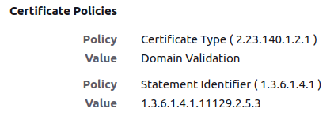
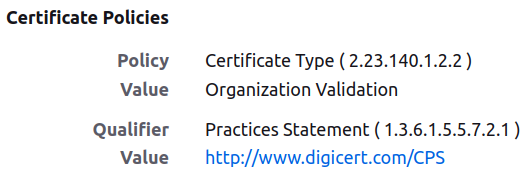
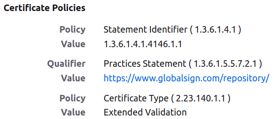
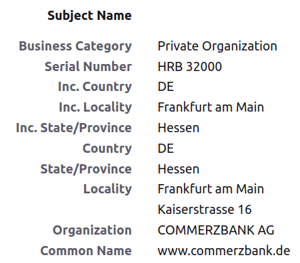
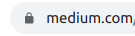
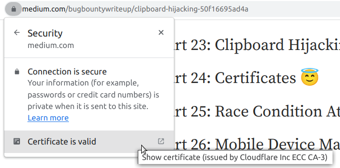
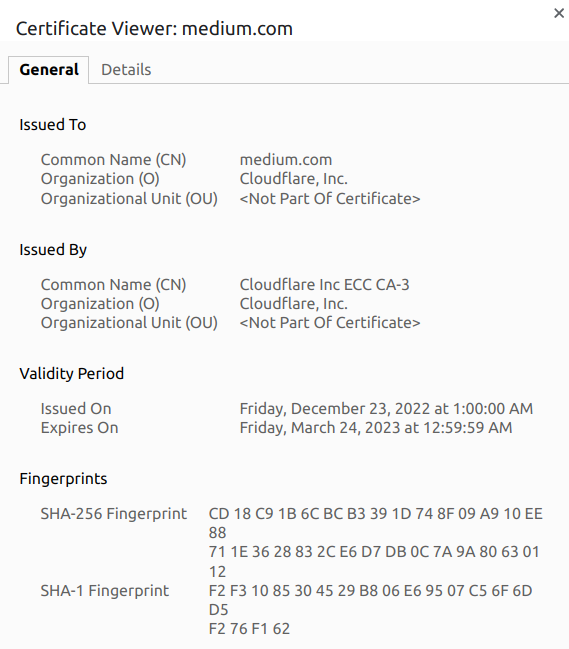
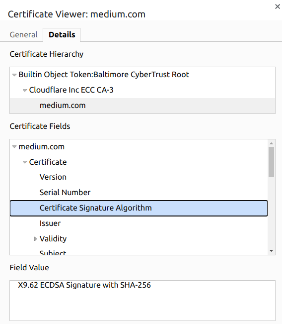

A secure channel over an insecure network can be established via asymmetric cryptography. But we also need to make sure that we are actually talking with the correct person (or rather server). It is of no help if we have a secure channel to an attacker. We need to make sure that we are talking with the correct server when we make the first connection.

**Certificates are used to authenticate the identity** of the parties involved in a communication. A certificate is a digital document that contains information about a website. This information includes the entity’s name, public key, and the digital signature of a trusted third-party called a certificate authority (CA).

When a user accesses a website that uses a certificate, their web browser will check the certificate to make sure it is valid and has not expired. The browser will also check the digital signature to ensure that it was issued by a trusted CA. If the certificate is valid and the digital signature is correct, the browser will establish an encrypted connection with the website, ensuring that the data being transmitted is protected from eavesdropping.

## Certificate Authority (CA)

Certificate Authorities are the trusted parties from which we accept certificates. They may sign certificates.

There are lots of certificate authorities. Well-known ones are Comodo, DigiCert, Verisign, GoDaddy, and SecureTrust. Their certificates are shipped with browsers, e.g. the [Chrome Root Store](https://chromium.googlesource.com/chromium/src/+/main/net/data/ssl/chrome_root_store/faq.md).

## Types of Certificates: The Products of the CA

Certificates come in three flavors:

* **Domain Validated (DV)** certificates only say that the person who has it, owns the domain. The Certificate Authority sends an e-mail to the domain owner listed in the WHOIS database. That is the whole verification process.
* **Organization Validated (OV)** certificates additionally verify that the owner of the certificate actually represents the organization they claim to represent.
* **Extended Validation (EV)** certificates do all of the above and more, including verifying the phone number, length of time in business, registration number, and jurisdiction.

For example, you can see the following via Firefox for google.com:

<figure>
    <a href="../images/2023/03/the-role-of-certificates-in-secure-communication-2.png"></a>
</figure>

Where 2.23.140.1.2.1 refers to [domain validation](https://oidref.com/2.23.140.1.2.1).

For medium.com, you can see:

<figure>
    <a href="../images/2023/03/the-role-of-certificates-in-secure-communication-3.png"></a>
</figure>

For commerzbank.de you can see that it has a certificate signed by GlobalSign:

<figure>
    <a href="../images/2023/03/the-role-of-certificates-in-secure-communication-4.png"></a>
</figure>

I like that [GlobalSign describes its practices](https://www.globalsign.com/en/repository/GlobalSign_CP_v6.11_final.pdf).

For Commerzbank you can also see their details, whereas the others have only limited information within the certificate:

<figure>
    <a href="../images/2023/03/the-role-of-certificates-in-secure-communication-5.png"></a>
</figure>

## Root Certificates and Self-Signed Certificates

A self-signed certificate is one that is issued and signed by the entity itself, rather than a trusted CA. These types of certificates may be used in internal networks or for testing purposes, but they are not typically considered as secure as those issued by a trusted CA.

Root certificates, on the other hand, are the topmost level of trust in a certificate chain. They are issued by a trusted CA and are used to establish trust for all the certificates that are signed by that CA.

[**What is the difference between a certificate and a key with respect to SSL?** *Let me explain with an example. In normal key-pair-based PKI, there are private keys and public keys. In a…*](https://superuser.com/a/1195689/64857)

## Public Key Pinning (PKP)

Public Key Pinning (PKP) is a security technique used to prevent man-in-the-middle (MITM) attacks by binding a host to its expected X.509 certificate or public key. It allows a web host to provide a set of fingerprints for the certificates that it uses and prevents an attacker from replacing the host’s certificate with a different one.

When a client (such as a web browser) connects to a website, it retrieves the website’s certificate and checks its validity. With Public Key Pinning, the client also compares the certificate’s fingerprints (also known as “public key pins”) to a set of fingerprints that the website has previously provided. If the certificate’s fingerprints match the set of fingerprints provided by the website, the client can be sure that the certificate is legitimate and proceed with the connection. If the fingerprints do not match, the client will terminate the connection as a potential MITM attack is detected.

**In practice, PKP has the issue of producing too many false positives**: It detects potential MITM attacks that turn out not to be MITM attacks. Browsers removed HTTP Public Key Pinning (HPKP) around 2018 for this reason.

## Certificate Transparency (CT)

The goal of Certificate Transparency (CT) is to make it easier for domain owners, CAs, and other stakeholders to detect and block the issuance of fraudulent or mis-issued certificates. Those could be issued when hackers get hold of the Certificate authority (CA). The key idea is to have a log.

The CT log is a distributed system where logs from different sources are added and replicated. These logs are used to track the issuance of new certificates so that anyone can see which certificates have been issued for a particular domain. If a certificate is issued that should not have been, it will be visible in the CT log and can be blocked by browsers or other clients that check the log.

The main benefit of the CT system is that it allows for a more transparent and secure PKI by making it possible for domain owners, CAs, and other stakeholders to detect and block the issuance of fraudulent or mis-issued certificates. Additionally, it makes it harder for attackers to obtain fraudulent certificates, and use them in phishing or man-in-the-middle attacks.

The CT initiative is supported by major web browsers such as Google Chrome, Mozilla Firefox, and Apple Safari, and also by other companies such as Microsoft, Cloudflare, and Akamai, among others. Some of them make use of the CT logs to improve the security of their browsers, and to ensure that the certificates they trust are legitimate.

In summary, the Certificate Transparency initiative is a project that aims to improve the security of the public key infrastructure (PKI) by creating a publicly-available, tamper-proof log of all SSL/TLS certificates issued by publicly-trusted certificate authorities (CAs). It makes it easier for domain owners, CAs, and other stakeholders to detect and block the issuance of fraudulent or mis-issued certificates, and it’s supported by major web browsers and other companies.

You can look at the certificate log [here](https://ui.ctsearch.entrust.com/ui/ctsearchui).

## A Developer’s Perspective

```bash
# Generate key
openssl genrsa -des3 -out foo.key.pw 4096

# Make a signing request
openssl req -new -key foo.key.pw -out foo.csr

# Generate a key without a password
openssl rsa -in foo.key.pw -out foo.key

# Now we would send the foo.csr to the CA. The CA would sign it
# But we can also sign ourselves:
openssl x509 -req -in foo.csr -signkey foo.key -out foo.crt

# Now the key / .crt file can be used in nginx
```

Configure nginx:

```nginx
server {
    listen 443 ssl;
    server_name example.com;
    ssl_certificate /path/to/certificate.pem;
    ssl_certificate_key /path/to/private_key.pem;

    # ... other configuration settings ...
}
```

Update the Django settings: Finally, you need to update your Django settings to include the `SECURE_PROXY_SSL_HEADER` setting, which tells Django that it is running behind an SSL-terminating proxy like nginx. Here's an example:

```python
SECURE_PROXY_SSL_HEADER = ("HTTP_X_FORWARDED_PROTO", "https")
```

## A User’s Perspective

A user can see this icon in Chrome:

<figure>
    <a href="../images/2023/03/the-role-of-certificates-in-secure-communication-6.png"></a>
</figure>

Going into the details, they can see:

<figure>
    <a href="../images/2023/03/the-role-of-certificates-in-secure-communication-7.png"></a>
</figure>

The Chrome Certificate Viewer gives:

<figure>
    <a href="../images/2023/03/the-role-of-certificates-in-secure-communication-8.png"></a>
</figure>

And the details show:

<figure>
    <a href="../images/2023/03/the-role-of-certificates-in-secure-communication-9.png"></a>
</figure>

<!-- series: appsec -->
