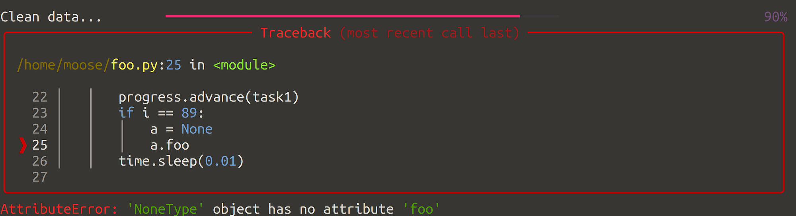

<figure>
    <a href="../images/2023/04/data-science-pattern-1-the-progress-serializer-1.png"></a>
    <figcaption>Forgetting that a value might be None / NULL is one of the most common issues. But also dividing by 0 or expecting a list to be non-empty happens when you clean data. Without a way to resume work, you have to start from the beginning.</figcaption>
</figure>

Data cleaning and preprocessing is a necessary and time-consuming task in data science. I typically do this in iterations with a subset of the original dataset. Once I think I have found all the issues, I run the cleaning code on the complete dataset.

There are several different ways to create the cleaned dataset. Assuming you can clean the data by looking at single elements in isolation, I’ll walk you through different approaches. Let’s go!

## The Straight-forward approach

```python
def clean_data(data):
    cleaned_data = []
    for element in data:
        cleaned = clean(element)
        cleaned_data.append(cleaned)
    return cleaned_data
```

If the `clean` function throws an exception, you lose all the work. You have to fix the issue and run `clean_data` from the start.

If running `clean_data` is quick (e.g. less than 20 minutes), it’s fine. If not, you might want to use the progress serializer pattern.

## The Progress Serializer Pattern

The progress serializer pattern makes sure that no progress is lost, even if the data cleanup didn’t run completely.

To apply this pattern, you need a way to store the progress and to resume later from that state. It could look like this:

```python
def save_data_entry(entry):
    # what you do here depends heavily on your data
    # - You might store every single element to disk
    #   e.g. when you deal with image/video/audio files
    # - You might use a database for pretty much any type of data
    # - You might use a custom format, e.g. a JSON or a pickle file
    ...


def is_processed(entry) -> bool:
    """Indicate if an entry was already processed."""
    # This function needs to be way quicker than clean(element)


def clean_data(data):
    for i, element in enumerate(data):
        if is_processed(element):
            continue
        cleaned = clean(element)
        save_data_entry(cleaned)
```

You could also make sure the `data` is always in the same order and just store the current index `i`.

Keep in mind that saving the cleaned data and checking if something was already processed takes some time.

This pattern is easiest to apply with a database. You can just have one column `cleaned_at` e.g. with an optional datetime. Then you just load the data where `cleaned_at IS NULL or cleaned_at < '2022-01-23'`, where the date is the one of your latest iteration of the cleaning script.

## Summary

You’ve learned about the progress serializer pattern.

**What problem does it solve?** Long-running tasks can be interrupted either by programming mistakes, by the running process being terminated (e.g. because you closed the terminal), or by the operating system deciding that now is the best time to restart.

**How does it work?** You need two ingredients: (1) Store the progress (2) make sure you can resume at that point without the need to do the work again.

## What other patterns are there?

There are a couple of other patterns about which I want to write articles:

* #2: Progress Bars
* #3: Batch Processing
* #4: Sampling
* #5: The Pipeline
* #6: Caching
* #7: Pre-computation
