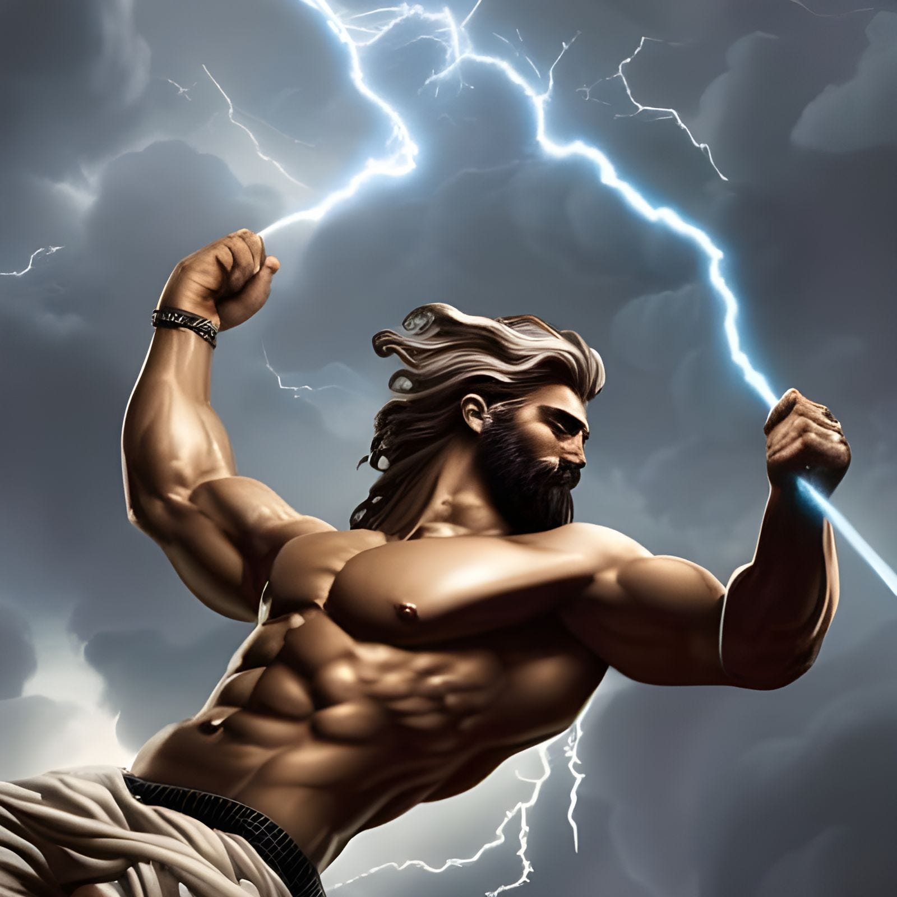

<figure class="ai-generated">
    
</figure>

Writing prompts are sentences that give you ideas for interesting stories. I took the following prompt to generate a story written with ChatGPT (GPT-4):

> You stood there, looking at your friend, facepalming “Let me get this straight, you’re dating a Goddess, an actual ‘divine powers, older than civilization’ Goddess and you ….CHEATED ON HER!?!??” Your friend has a desperate look in their eyes “Can you help me or not?”

For the human-written stories, see [/r/shortstories](https://www.reddit.com/r/shortstories/) or [r/writingprompts](https://www.reddit.com/r/writingprompts/).

For the story I wrote with lots of back-and-forth with Chat GPT (GPT-4), continue :-)

## **Chapter 1: How it all began**

As I stood there in disbelief, I couldn’t help but feel a mix of amusement and concern. My friend, Josh, had managed to get himself into the most absurdly dangerous and comical situation imaginable. He had somehow managed to win the heart of Lilaia, the enchanting Goddess of Balance and Harmony. Her powers were legendary, with the ability to restore equilibrium to any situation, whether it was calming the fiercest storms or soothing the angriest of hearts. Legend had it that she had once single-handedly quelled a war between two ancient civilizations, restoring peace and ushering in a golden age of prosperity. And now, Josh had cheated on her with a mortal woman.

Now he was begging me for help, as if I had any expertise in dealing with the wrath of divine beings.

“Okay, let’s think this through,” I said, trying to suppress a laugh. “First things first, how did you even meet a Goddess?”

Josh hesitated before answering. “You remember that ancient artifact exhibit at the museum? It turns out that one of the relics was actually a gateway to the realm of the Gods. I was admiring it when I accidentally sneezed, and that’s when Lilaia appeared. Apparently, sneezing was the secret activation method. Who would’ve thought?”

I couldn’t help but chuckle at the absurdity of it all. “Well, what do you know about Lilaia? What is she the Goddess of?”

“She’s the Goddess of Balance and Harmony,” Josh replied, his voice shaking. “And now she’s furious. I was so stupid! How could I have been so careless? It’s not every day you date a divine being with such incredible powers!”

I sighed, pondering the severity of the situation. A vengeful Goddess of Balance and Harmony sounded like a recipe for chaos. It was clear that we needed to find a way to appease Lilaia before her wrath could throw the world off balance.

“Alright, let’s make a really nice dinner. Maybe I can then find the right words so that she forgives me,” I said, pulling out my phone. “Let’s see if I can figure out what she likes.”

As we researched Lilaia, Josh and I began to discuss our findings.

“Hey, it looks like to win back her favor, we need to make this Chili dish — with a very special sort of Chili” I said, reading from an ancient text. “Apparently it’s rather hard to get, but interestingly it grows only a few hours away”.

## **Challenge One: Physical Balance**

<figure class="ai-generated">
    
    <figcaption><a href="https://creator.nightcafe.studio/creation/7SlFyqLHpbvmvmmdz9Rj">Zeus by Dave G</a></figcaption>
</figure>

“I see those two young men are attempting your challenge,” Zeus said, as he watched the mortal world alongside Lilaia, the Goddess of Balance and Harmony. “The mortal named Josh has wronged you, hasn’t he?”

Lilaia nodded, her expression a mix of amusement and concern. “Yes, he has. But his friend is determined to help him make amends.”

Down on Earth, Josh and his friend stood nervously at the edge of a rickety rope bridge, preparing to undertake the first of Lilaia’s three challenges to win back her favor. Unaware of the divine audience above, they shared their doubts and fears before blindfolding themselves.

Zeus, feeling a sense of sympathy for the mortals, proposed, “Perhaps I could lend them a little assistance. A small bolt of lightning, just enough to make them jump but not enough to cause any harm. It might help them focus on the task at hand.”

Lilaia considered the idea for a moment before nodding. “Very well. But be gentle, Zeus. They’re mortals, after all.”

---

As Josh and his friend stepped onto the swaying bridge, blindfolded and apprehensive, a sudden bolt of lightning cracked nearby. Startled, Josh nearly lost his footing but managed to regain his balance just in time.

“Did you feel that?!” Josh yelled, his voice shaking.

His friend, equally startled, replied, “Yeah, that was way too close for comfort! Let’s hurry up and get this challenge over with.”

As they carefully inched their way across the bridge, they couldn’t help but feel that the gods were watching them, and perhaps even lending a hand.

High above, Zeus and Lilaia observed the young men with interest. They had completed the first challenge, proving their determination to restore balance and harmony to their lives, even if it took a little divine intervention.

Having completed the first challenge, Josh and his friend ventured onward, finding themselves at a bustling market just across the bridge. The lively atmosphere and array of colorful goods offered a stark contrast to the nerve-wracking experience they’d just endured.

## **Challenge Two: Balancing Interests**

As they entered the marketplace, Josh and his friend searched for the rare chili spice they needed for their special dinner. However, the price was quite steep, and there was only one packet left.

At the same time, a middle-aged woman, clearly a local, was trying to buy the same spice, which she claimed was a vital ingredient in a medicine she prepared for her ailing mother. Both Josh and the woman reached for the last packet of the spice simultaneously, leading to an awkward standoff.

“I really need this for a special dinner I’m preparing,” Josh explained.

The woman frowned but countered, “This spice is essential for the medicine I make for my mother. I can’t do without it.”

Unaware of the challenge set by Lilaia, Josh realized that the woman’s need was far more important than his own. He stepped back and said, “You should take it. Your mother’s health is more important than my dinner.”

The woman thanked him profusely and, wanting to show her gratitude, handed him a small portion of the spice. “Here, take this. I can manage with a little less. I hope it’s enough for your dinner.”

As the woman left, Lilaia decided to have a little fun with the situation. When Josh opened the small container to have a closer look at the chili spice, Lilaia caused a sudden gust of wind to sweep through the market. Josh, caught off guard, sneezed violently, causing the chili powder to scatter into the air.

The sneeze was so forceful that some of the chili powder got into Josh’s eyes, making them water and sting. Sneezing uncontrollably and stumbling, he caused a nearby vendor’s stack of oranges to topple over. As he tried to help pick them up, he tripped on a loose shoelace, creating an even bigger mess.

Embarrassed and covered in orange pulp, Josh shook his head. “I can’t believe this is happening. It’s like she’s toying with us.”

---

From their celestial vantage point, Zeus and Lilaia continued to watch, amused by the humorous twist they’d just witnessed. As Josh and his friend prepared to face the final challenge, the gods eagerly awaited the outcome of their quest to restore balance and win back Lilaia’s favor.

## Challenge Three: Internal Balance

As they continued their day, they came across a charming outdoor café, where they decided to stop for a break. The sun was shining, the atmosphere was relaxed, and people were chatting and laughing around them. As they settled down, Josh noticed a beautiful, flirtatious woman sitting at a nearby table, casting glances in his direction.

His friend elbowed him playfully, “Looks like you’ve caught someone’s eye.”

Josh hesitated for a moment, feeling the pull of temptation. But as he looked into the woman’s eyes, he felt a sense of inner balance and calm. He knew he couldn’t risk making the same mistake again, and he needed to focus on winning Lilaia’s heart back.

With a determined sigh, Josh turned to the mysterious woman and gently shook his head to show that his heart belonged to someone else. The woman nodded in understanding and focused again on her phone while having a slight smile on her lips.

Josh turned to his friend, feeling a need to share his side of the story. “You know, I never meant to hurt Lilaia,” he confessed. “I was just so insecure about our relationship. I mean, she’s a goddess, and I’m just a mortal. I thought she would eventually leave me and that she didn’t feel the same emotional bond as I did. In my fear, I pushed her away, trying to protect myself from the inevitable heartbreak.”

His friend listened intently, understanding that while Josh hadn’t been entirely blameless in the situation, his actions had stemmed from insecurity rather than malice.

## Judgement

With a renewed sense of purpose, Josh and his friend set out to create a thoughtful and heartfelt dinner for Lilaia. They searched the market for the freshest ingredients, even discovering a rare chili-free spice blend to make up for their earlier mishap. They spent hours in the kitchen, meticulously preparing a feast worthy of a goddess, each dish designed to appeal to Lilaia’s divine palate.

Josh also found a peculiar ritual for summoning Lilaia. The ritual seemed odd, but they had no way of knowing how summoning a goddess truly worked. As they prepared to perform the ritual, they couldn’t help but feel apprehensive. Would this actually work, or was it just another elaborate prank by the goddess?

They constructed the sacred altar in a secluded park under the cover of night, careful not to draw attention to themselves. Dressed in their outlandish outfits, adorned with feathers, beads, and an excessive amount of tassels, they began the ritual. They lit the incense, arranged the ingredients, and performed the intricate dance under the silvery glow of the moon.

“Josh, I think it’s time for me to go now. Good luck!”

As Josh swayed and twirled to the rhythm of the ritual, he couldn’t help but feel a little ridiculous. However, his determination to make amends with Lilaia drove him to continue. Just as he reached the climax of the dance, a brilliant flash of light illuminated the park, and there she was — Lilaia, the Goddess of Balance and Harmony, standing before him with an amused smile on her lips.

“I must say,” she began, her voice like a gentle breeze, “you have provided me with quite the entertainment. Your perseverance and willingness to make a fool of yourself has convinced me that you truly are sorry for your actions.”

“You have proven yourself in three challenges of balance: You found physical balance on a windy bridge, you balanced your interests against others in need at the market, and you discovered inner balance within your soul and desires.”

Josh looked at her, a mix of relief and disbelief on his flushed face, both exhausted and embarrassed.

“Now,” Lilaia continued, “I shall restore balance to your lives, but let this be a lesson to you, Josh. Never underestimate the power of humor, determination, and a sneeze that can summon a goddess.”

## Final Thoughts

This story is at best mediocre. It required a lot of back-and-forth to overcome shortcomings of ChatGPT in story writing. I’ve saved [the starting point and the first few iterations](https://gist.github.com/MartinThoma/180fedda43892ac96cba14a57db08243/2837de122f287c6858fe7df2bc605bc257150c4d), but I have also summarized a few of the issues I encountered while creating this story with Chat GPT-4

[**How Chat-GPT fails to generate light reading** *GPT-4 can produce stories. Let’s examine the quality.*](../how-chat-gpt-fails-to-generate-light-reading/)
