The field of Natural Language Processing (NLP) has seen significant advancements over the years, with language models like OpenAI’s GPT-4 exhibiting remarkable capabilities in understanding and generating human language. One example of this is “word arithmetic” that has first been shown in [Efficient Estimation of Word Representations in Vector Space](https://arxiv.org/abs/1301.3781) (2013):

> King — Man + Woman = Queen

In an intelligence test, you would see “Man is to King as Woman is to …”.

Let’s see how well GPT-4 does here 😁

## Jobs, Titles, and Aristocracy

<figure>
    <a href="../images/2023/04/gpt-4-playing-with-word-arithmetic-2.png">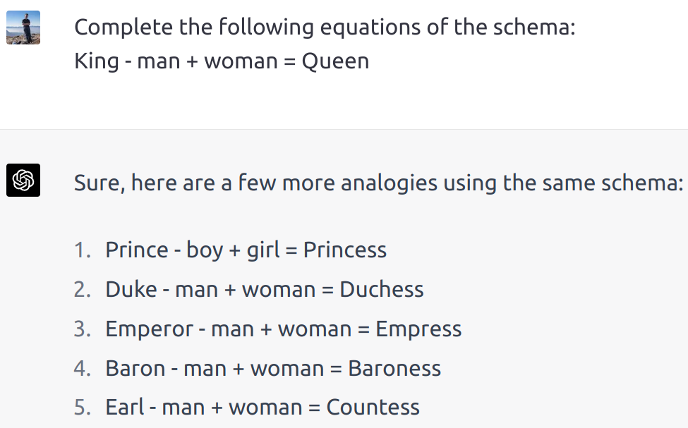</a>
    <figcaption>I was only preparing and GPT-4 already presented so many examples 😄</figcaption>
</figure>

Ok, let’s enter a difficult territory:

<figure>
    <a href="../images/2023/04/gpt-4-playing-with-word-arithmetic-3.png">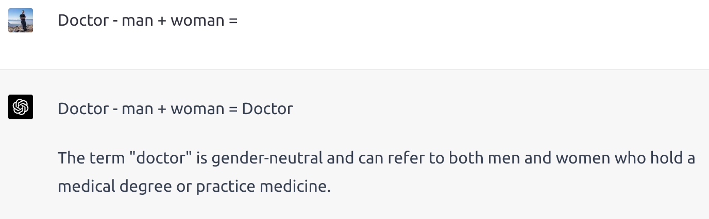</a>
    <figcaption>Well done GPT-4!</figcaption>
</figure>

## Geography

Does GPT-4 understand the relationship of a capital city to its country?

<figure>
    
</figure>

Of course it does! But let’s trick it by using something like a “cultural capital city”:

<figure>
    <a href="../images/2023/04/gpt-4-playing-with-word-arithmetic-5.png">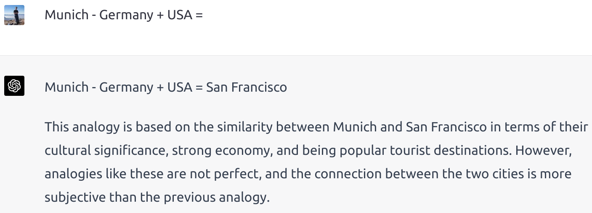</a>
    <figcaption>Wow. Impressive.</figcaption>
</figure>

## Grammar

<figure>
    <a href="../images/2023/04/gpt-4-playing-with-word-arithmetic-6.png">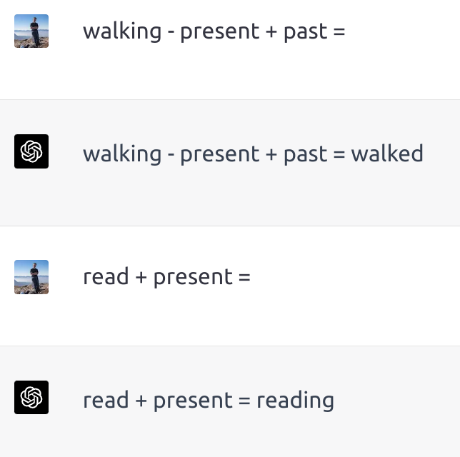</a>
</figure>

Again, GPT-4 did perfect here.

<figure>
    <a href="../images/2023/04/gpt-4-playing-with-word-arithmetic-7.png">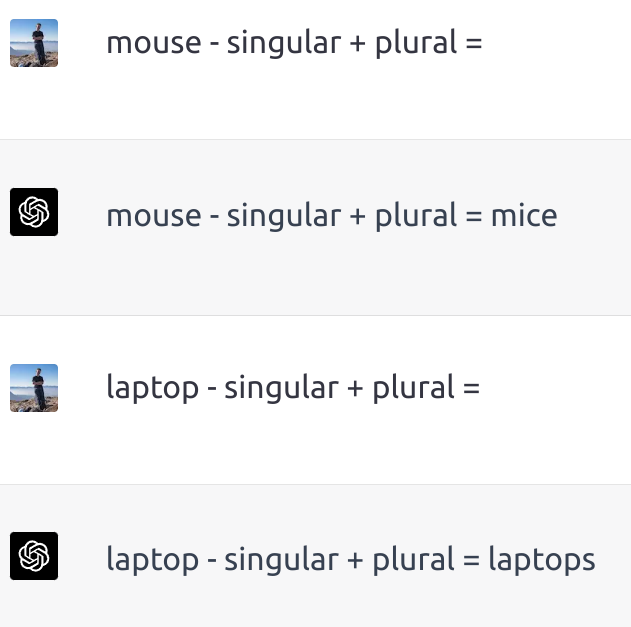</a>
    <figcaption>Finding plural forms seems to be easy as well</figcaption>
</figure>

## Products and Technology

I finally found a non-perfect example:

<figure>
    <a href="../images/2023/04/gpt-4-playing-with-word-arithmetic-8.png">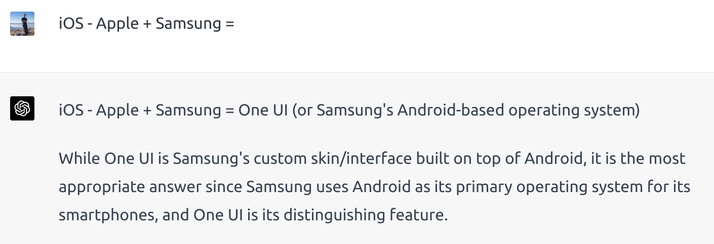</a>
    <figcaption>For “iOS — Apple + Samsung” I would have expected “Android”, not “One UI”.</figcaption>
</figure>

How will power generation continue?

<figure>
    <a href="../images/2023/04/gpt-4-playing-with-word-arithmetic-9.png">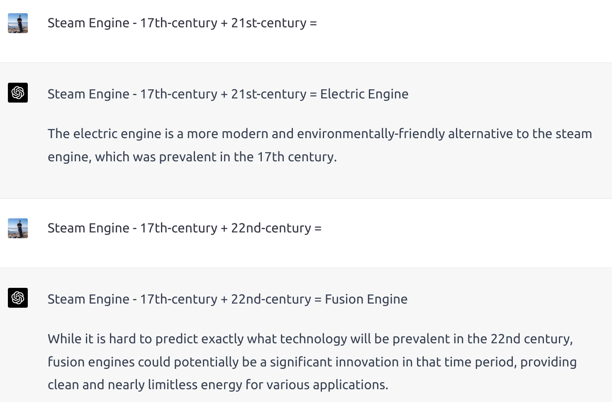</a>
</figure>

## Software

Let’s start simple with big programming languages and popular web frameworks:

<figure>
    
</figure>

What happens if we go more niche?

<figure>
    
</figure>

Can we translate between programming languages?

<figure>
    <a href="../images/2023/04/gpt-4-playing-with-word-arithmetic-12.png">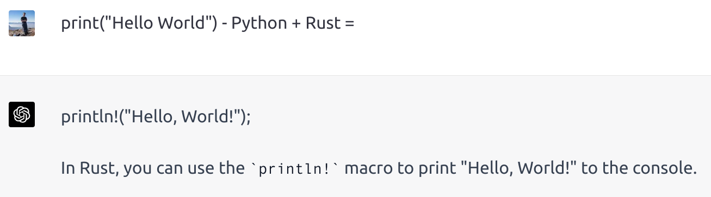</a>
    <figcaption>Of course we can!</figcaption>
</figure>

## Biology

<figure>
    <a href="../images/2023/04/gpt-4-playing-with-word-arithmetic-13.png">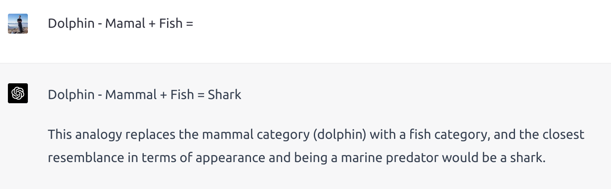</a>
</figure>

## Culture

<figure>
    <a href="../images/2023/04/gpt-4-playing-with-word-arithmetic-14.png">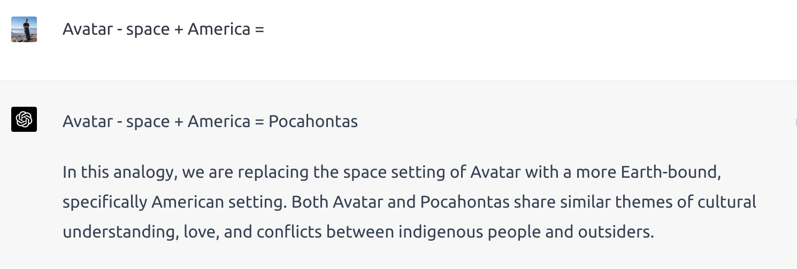</a>
</figure>

Let’s check the Marvel universe vs the DC universe:

<figure>
    <a href="../images/2023/04/gpt-4-playing-with-word-arithmetic-15.png">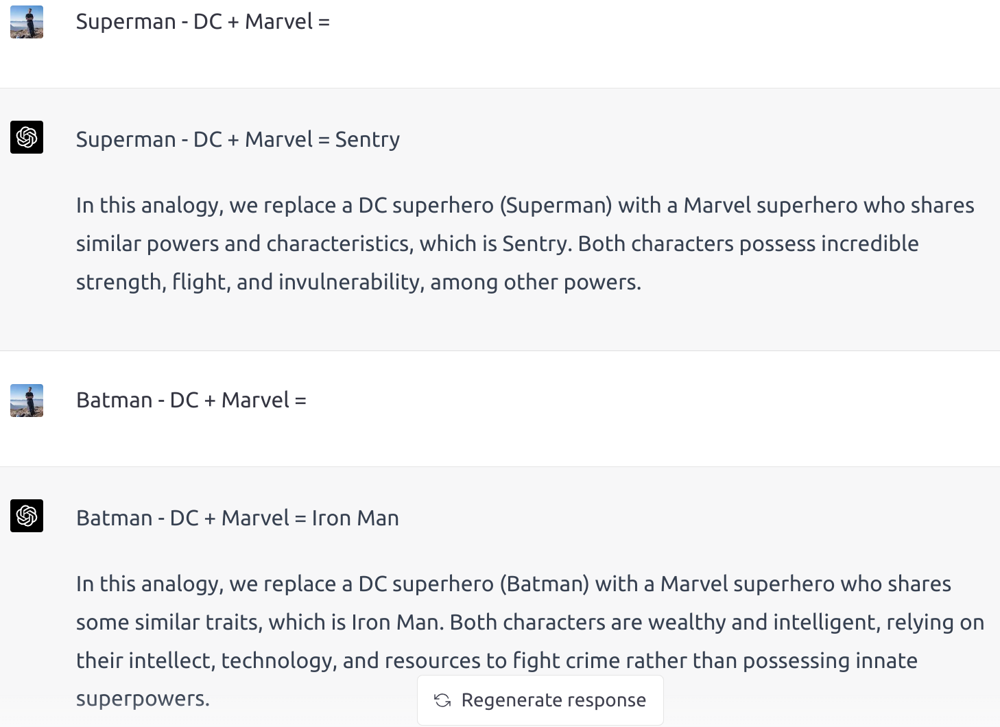</a>
</figure>

So far, so good

<figure>
    <a href="../images/2023/04/gpt-4-playing-with-word-arithmetic-16.png">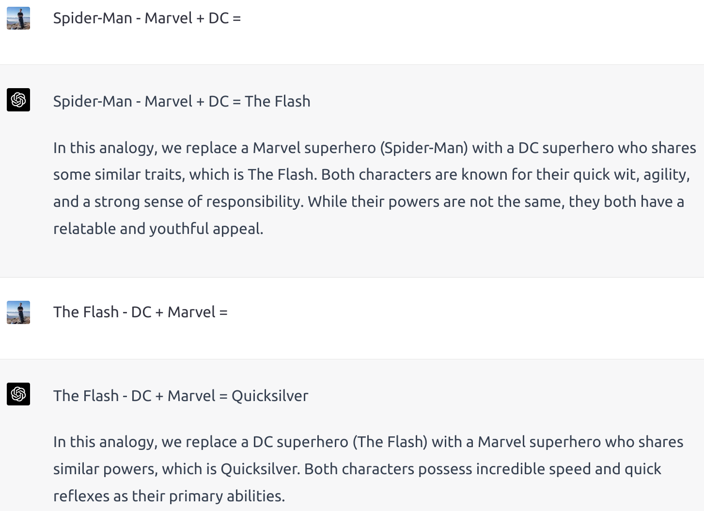</a>
</figure>

Interesting. Maybe Spider-Man does not have a DC equivalent?

<figure>
    <a href="../images/2023/04/gpt-4-playing-with-word-arithmetic-17.png">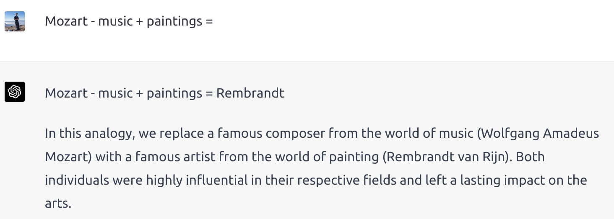</a>
</figure>

## More open questions

In this category are examples where I didn’t have a clear expected result. They are more difficult as they are more vague. They also need more often an explanation. Interestingly, GPT-4 gave the explanation without me having to ask.

<figure>
    <a href="../images/2023/04/gpt-4-playing-with-word-arithmetic-18.png">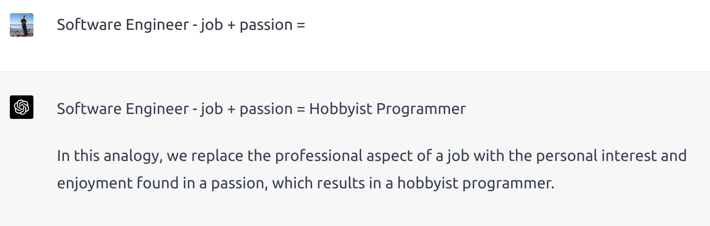</a>
</figure>

<figure>
    <a href="../images/2023/04/gpt-4-playing-with-word-arithmetic-19.png">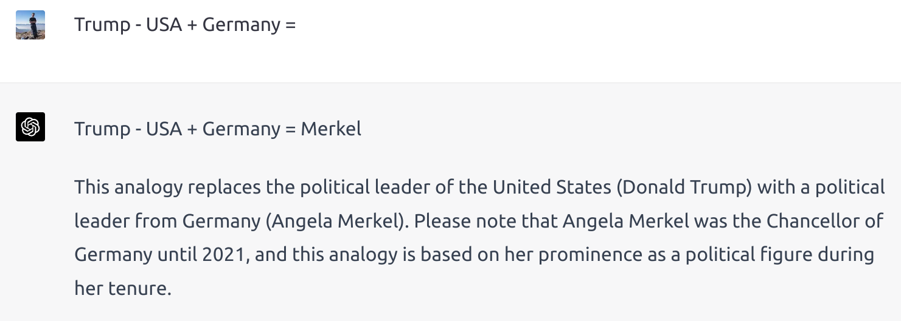</a>
</figure>

That was not surprising, although I was interested in another aspect.

<figure>
    <a href="../images/2023/04/gpt-4-playing-with-word-arithmetic-20.png">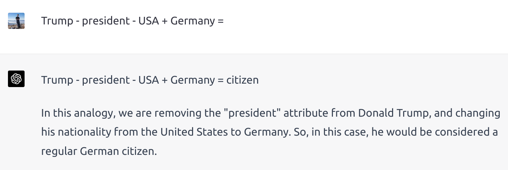</a>
</figure>

Let’s take an example by Rostyslav Neskorozhenyi ([Word embeddings in 2020](https://towardsdatascience.com/word-embeddings-in-2020-review-with-code-examples-11eb39a1ee6d)):

<figure>
    <a href="../images/2023/04/gpt-4-playing-with-word-arithmetic-21.png">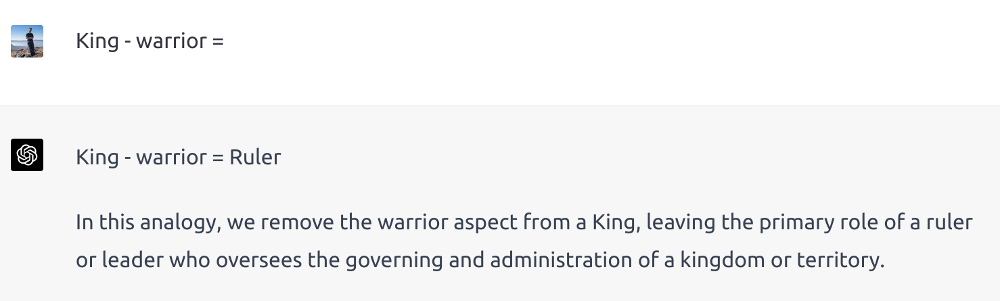</a>
</figure>

## Food and Recipes

Let’s take an example by Florian Huber in his story [King — Man + Woman = King ?](https://blog.esciencecenter.nl/king-man-woman-king-9a7fd2935a85) (2019):

<figure>
    <a href="../images/2023/04/gpt-4-playing-with-word-arithmetic-22.png">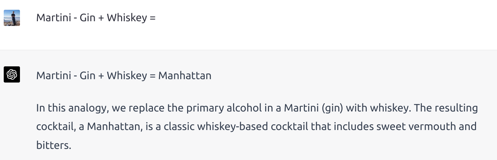</a>
</figure>

Let’s see what it thinks about the [eggless omelette](https://www.youtube.com/watch?v=9Ah4tW-k8Ao):

    <figure>
        <a href="../images/2023/04/gpt-4-playing-with-word-arithmetic-23.png">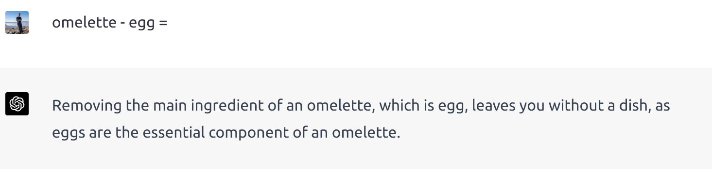</a>
    </figure>
    <figure>
        <a href="../images/2023/04/gpt-4-playing-with-word-arithmetic-24.png">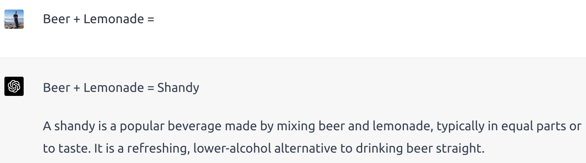</a>
    </figure>
    <figure>
        <a href="../images/2023/04/gpt-4-playing-with-word-arithmetic-25.png">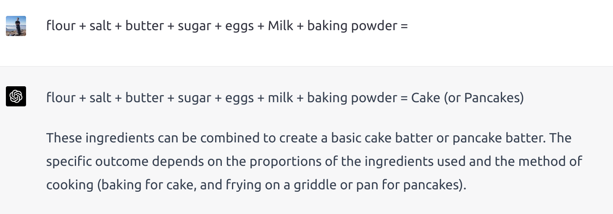</a>
    </figure>

