<figure>
    <a href="../images/2023/04/shiny-pytest-plugins-1.jpg">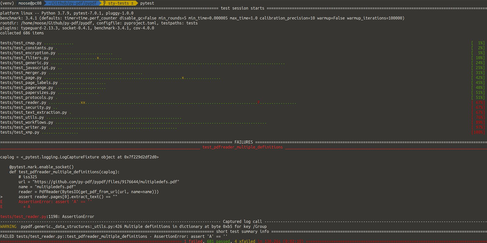</a>
    <figcaption>This is the default console output given by pytest for pypdf. I made one test fail on purpose for this article.</figcaption>
</figure>

Pytest allows a lot of customization for the look-and-feel. Output formats for the progress, the results, the diffs in error cases. While you can do it all yourself, there are [tons of plugins](https://docs.pytest.org/en/7.1.x/reference/plugin_list.html).

## Test setup

I used the pypdf test suite in most screenshots. To visualize the diff of a failure, I used this:

```python
import pytest


@pytest.mark.parametrize(
    ("left", "right"),
    [
        (
            {
                "age": 29,
                "name": "Molecule Woman",
                "powers": ["Turning tiny", "Radiation zap"],
                "secretIdentity": "Julia Jukes",
                "foo": [1, 2, 3],
                "not": "here",
            },
            {
                "age": 29,
                "name": "Molecule Man",
                "powers": ["Turning tiny", "Radiation blast"],
                "secretIdentity": "Dan Jukes",
                "bar": [1, 2, 3],
                "but": "there",
            },
        )
    ],
)
def test_equality(left, right):
    assert left == right
```

The default looks like this:

<figure>
    <a href="../images/2023/04/shiny-pytest-plugins-2.png">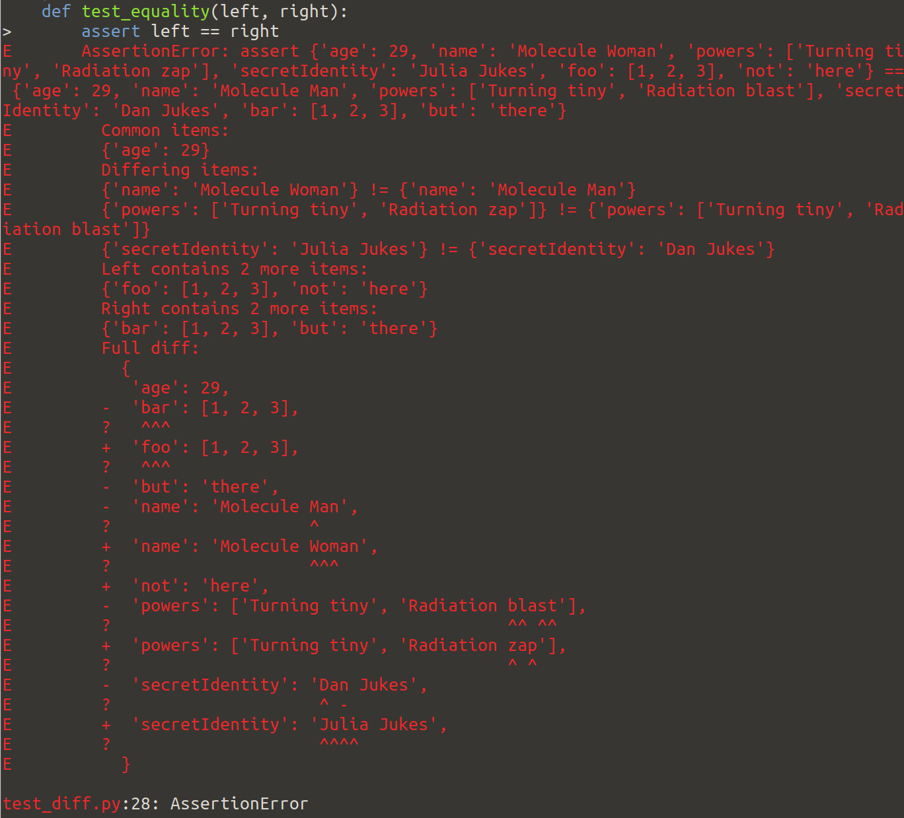</a>
    <figcaption>Default diff of pytest</figcaption>
</figure>

## pytest-sugar

[pytest-sugar](https://pypi.org/project/pytest-sugar/) (1034 stars [on Github](https://github.com/Teemu/pytest-sugar)) is a plugin for pytest that shows failures and errors instantly and shows a progress bar:

<figure>
    <a href="../images/2023/04/shiny-pytest-plugins-3.jpg">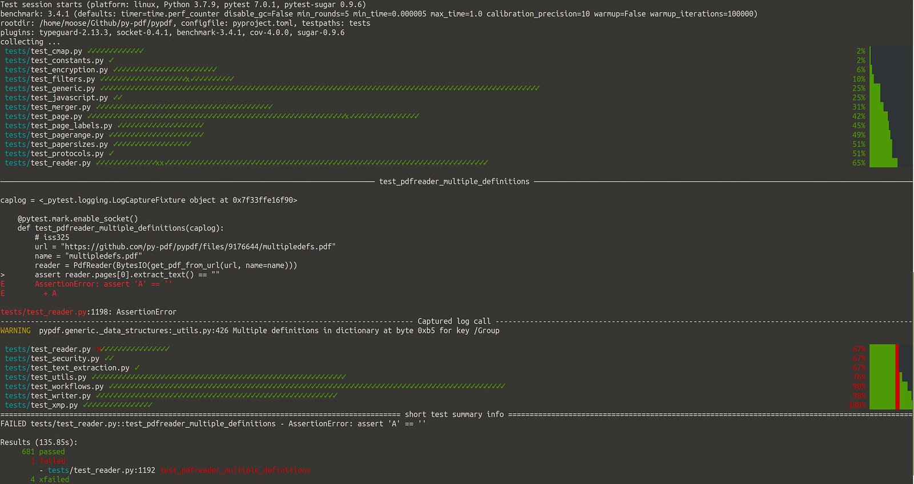</a>
</figure>

You can see the following differences to the default behavior:

* **Icons**: Passing checks have a green check ✓ instead of the green `.`, the failing test has a red ⨯ instead of a red `F`, the xfailing tests have a green `x` instead of a yellow `x`.
* **Instant error display**: You can see the error message instantly, while other tests are still running
* **Summary report**: The results output is easier to read
* **Progress bar**: On the right side you can see the progress bar instead of plain progress numbers

## pytest-clarity

[pytest-clarity](https://pypi.org/project/pytest-clarity/) (361 stars [on Github](https://github.com/darrenburns/pytest-clarity)) brings the coloured diff output from the [Ward test framework](https://github.com/darrenburns/ward) to pytest.

<figure>
    <a href="../images/2023/04/shiny-pytest-plugins-4.png">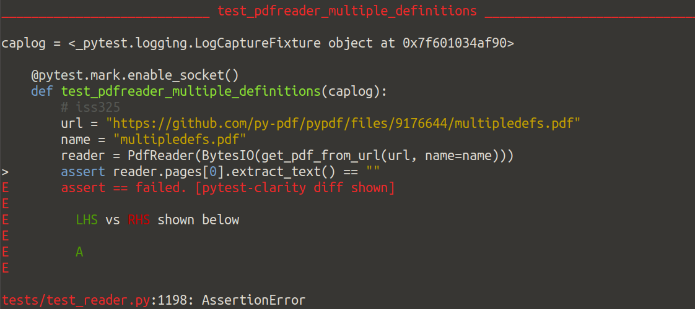</a>
    <figcaption>The lefthand side (LHS) has the string “A”, the righthand side (RHS) has the empty string “”</figcaption>
</figure>

In this specific case, I think the standard error output is way easier to read.

For dictionaries it looks like this:

<figure>
    <a href="../images/2023/04/shiny-pytest-plugins-5.png">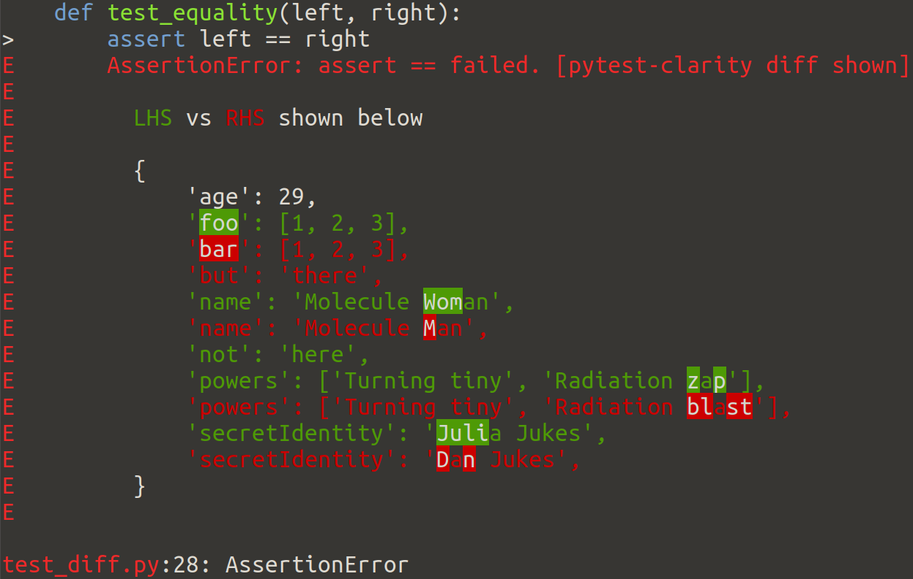</a>
</figure>

## pytest-pretty

[pytest-pretty](https://pypi.org/project/pytest-pretty/) (352 stars [on Github](https://github.com/samuelcolvin/pytest-pretty)) makes a summary of failures nicer:

<figure>
    <a href="../images/2023/04/shiny-pytest-plugins-6.png">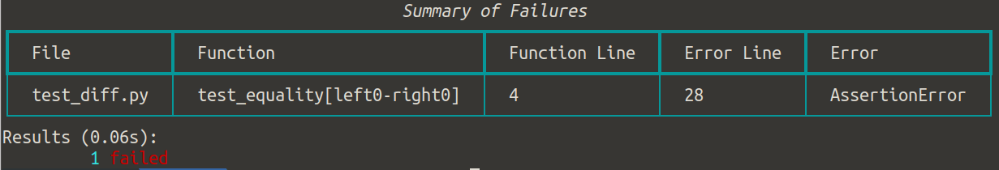</a>
</figure>

## pytest-icdiff

[pytest-icdiff](https://pypi.org/project/pytest-icdiff/) (202 stars [on Github](https://github.com/hjwp/pytest-icdiff)) improves the diff and error messages using [ICDiff](https://www.jefftk.com/icdiff).

<figure>
    <a href="../images/2023/04/shiny-pytest-plugins-7.png">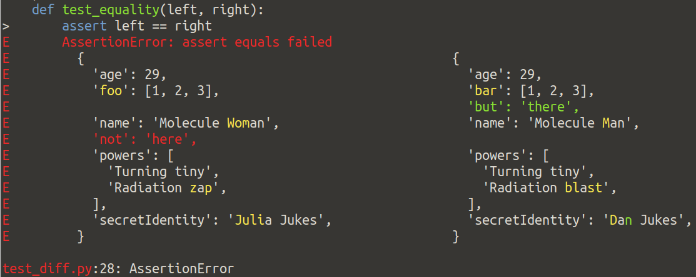</a>
</figure>

## pytest-rich

[pytest-rich](https://pypi.org/project/pytest-rich/) (186 stars [on Github](https://github.com/nicoddemus/pytest-rich)) is a plugin that replaces the failure boxes in a nice way.

<figure>
    <a href="../images/2023/04/shiny-pytest-plugins-8.png">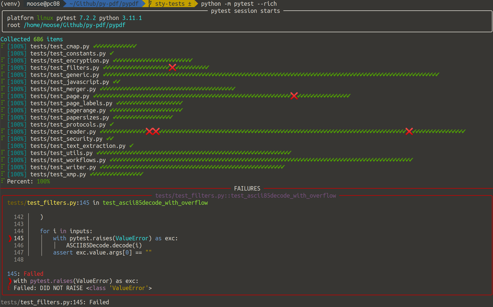</a>
</figure>

## Verbose test output

pytest-testdox, pytest-pspec, and pytest-mocha all seem to want to achieve the same verbose output, but only pytest-testdox handles multi-line docstrings and parametrized tests well.

### pytest-testdox

[pytest-testdox](https://pypi.org/project/pytest-testdox/) (41 stars [on Github](https://github.com/renanivo/pytest-testdox)) is a [TestDox format](https://en.wikipedia.org/wiki/TestDox) reporter for pytest. It looks very similar to pytest-pspec, but doesn’t have the mentioned issues.

<figure>
    <a href="../images/2023/04/shiny-pytest-plugins-9.jpg">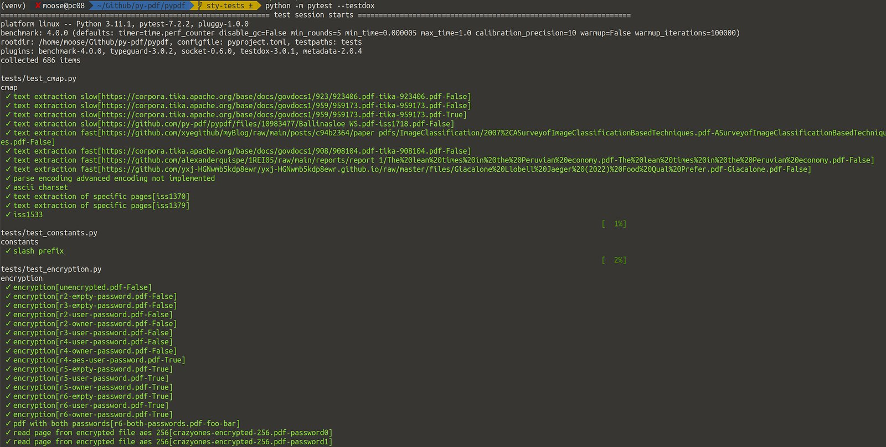</a>
</figure>

### pytest-pspec

[pytest-pspec](https://pypi.org/project/pytest-pspec/) (53 stars [on Github](https://github.com/gwthm-in/pytest-pspec)) is a pspec format reporter for pytest.

<figure>
    <a href="../images/2023/04/shiny-pytest-plugins-10.jpg">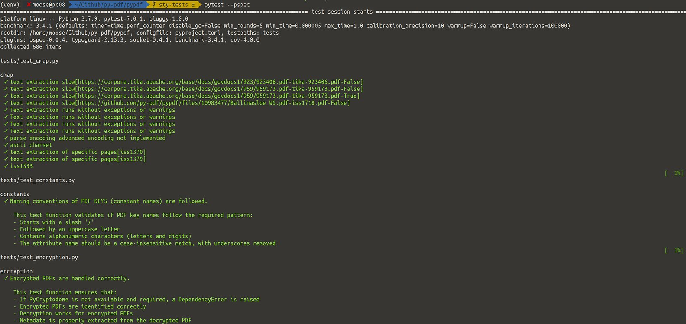</a>
</figure>

In comparison to the default output of pytest:

* **Verbosity**: While running the test, you can see the docstring of the test that was running. If you formulate the docstring in a nice way, you can read this as a specification that is checked. A big downside is that it [shows the complete docstring](https://github.com/gwthm-in/pytest-pspec/issues/10) all the time and that test [parametrization is not handled well](https://github.com/gwthm-in/pytest-pspec/issues/11).

On a side-note: I also tried [pytest-spec](https://pypi.org/project/pytest-spec/) (92 stars [on Github](https://github.com/pchomik/pytest-spec)), but I didn’t get any changes. I might have used it in the wrong way.

The [pytest-it](https://pypi.org/project/pytest-it/) plugin goes in a similar direction, but it works with annotations.

### pytest-mocha

[pytest-mocha](https://pypi.org/project/pytest-mocha/) (10 stars [on Github](https://github.com/rudineirk/pytest-mocha)) wants to get output in [MochaJS](http://mochajs.org/) format. It’s very similar to pytest-testdox, but fails with multi-line docstrings.

<figure>
    <a href="../images/2023/04/shiny-pytest-plugins-11.jpg">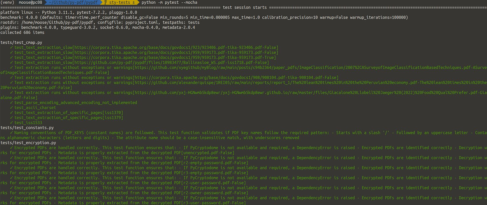</a>
</figure>

## pytest-tui

[pytest-tui](https://pypi.org/project/pytest-tui/) (20 stars [on Github](https://github.com/jeffwright13/pytest-tui)) is a plugin for viewing test run results, with console scripts to launch a Text User Interface (TUI) or an HTML page.

<figure>
    <a href="../images/2023/04/shiny-pytest-plugins-12.png">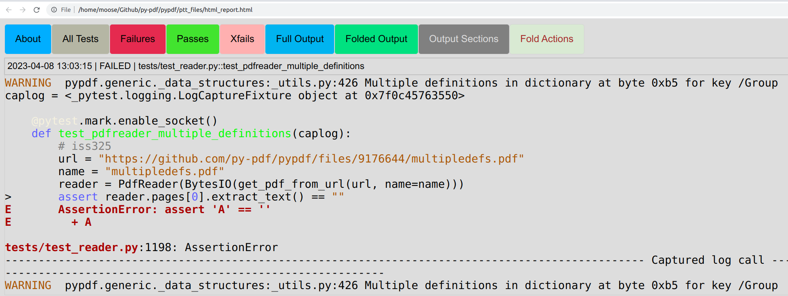</a>
</figure>

## Summary

I’d recommend using `pytest-icdiff`. All other plugins are very much personal preference. I’ve stumbled over [pytest-nice-parametrize](https://pypi.org/project/pytest-nice-parametrize/) which does not fit here, but looks nice.
