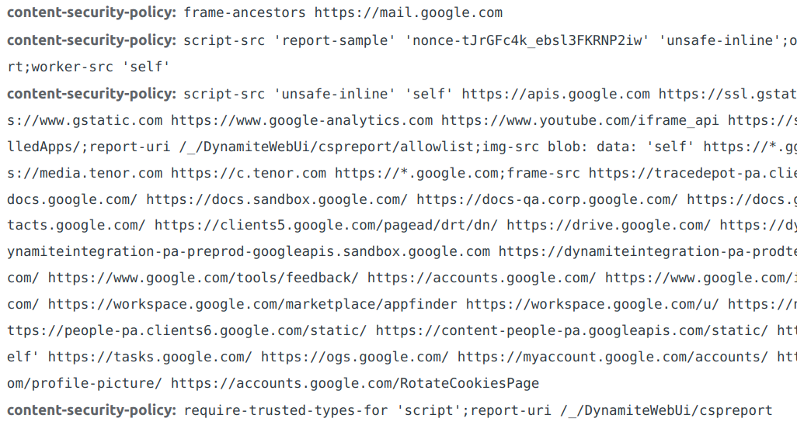
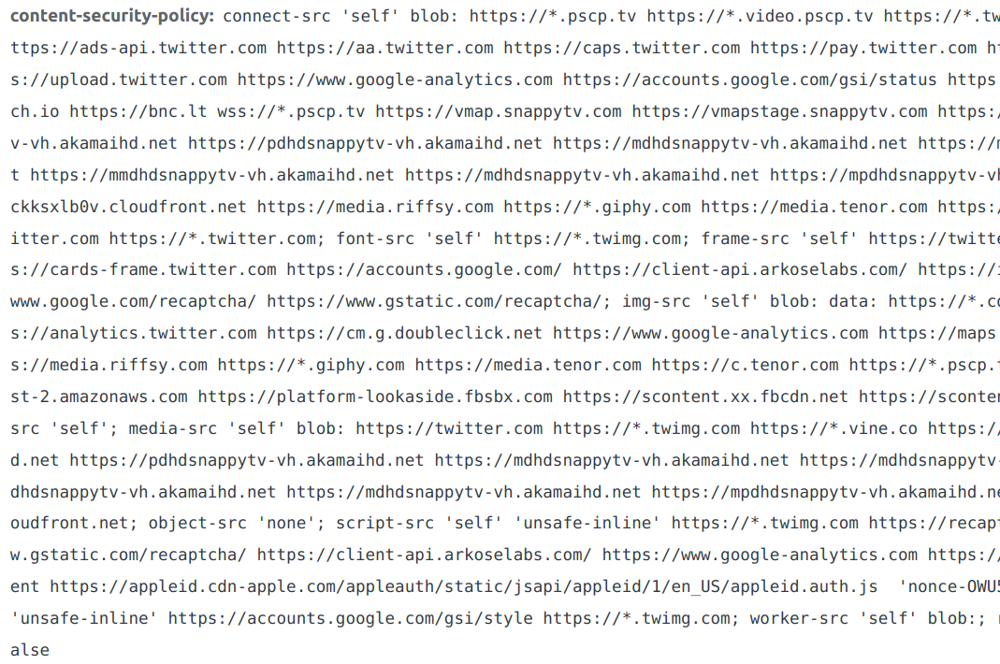
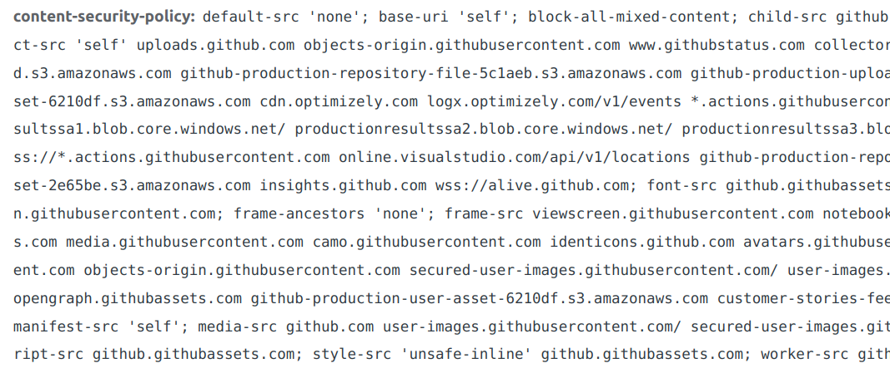

In today’s digital landscape, web security threats have become increasingly sophisticated and pervasive. As our reliance on the internet continues to grow, it becomes crucial for organizations to implement robust security measures to protect their digital assets and users’ sensitive information. One such security measure that has gained significant attention in recent years is the Content Security Policy (CSP). This powerful tool helps safeguard websites against [cross-site scripting (XSS)](../xss/), clickjacking, and other code injection attacks by controlling the sources of content that a browser is allowed to load. In this comprehensive guide, we will explore the ins and outs of CSP, its key components, implementation, best practices, and limitations. By understanding and implementing a strong Content Security Policy, you can bolster your web security and create a safer browsing experience for your users.

## What is Content Security Policy (CSP)?

Content Security Policy (CSP) is a crucial security feature that provides a structured and flexible framework for web developers and administrators to control the sources of content that a web browser is allowed to load. By defining a set of rules and policies, CSP effectively mitigates the risk of various content injection attacks, such as cross-site scripting (XSS) and clickjacking.

> The primary function of CSP is to specify and enforce restrictions on the types of content that can be loaded, including JavaScript, CSS, images, media, and other resources.

This is achieved by using HTTP headers or meta tags to communicate the policy from the server to the client’s browser. When implemented correctly, CSP serves as a formidable line of defense against potential threats, ensuring a more secure and reliable online experience for both website owners and users.

## Why It Matters

The implementation of a robust Content Security Policy is critical for the protection of web applications and their users. Several high-profile attacks in the past might have been prevented or mitigated with a well-crafted CSP in place. Some examples include:

* [**British Airways data breach (2018)**](https://en.wikipedia.org/wiki/British_Airways_data_breach): A Magecart group injected malicious JavaScript into the British Airways website, compromising the personal and financial data of around 380,000 customers. A strict CSP could have prevented the execution of the unauthorized script.
* [**Yahoo Mail XSS vulnerability (2013)**](https://threatpost.com/yahoo-mail-xss-vulnerability-could-affect-millions-accounts-010713/77373/): Yahoo Mail experienced a significant XSS vulnerability that allowed attackers to steal users’ authentication cookies by sending maliciously crafted emails. Implementing a CSP would have restricted the execution of the malicious script and protected users’ data.
* [**MySpace worm (2005)**](https://en.wikipedia.org/wiki/Samy_%28computer_worm%29): The infamous MySpace worm, also known as the Samy worm, exploited an XSS vulnerability to propagate itself, compromising over one million user accounts. A well-defined CSP might have thwarted the attack by preventing the execution of the injected script.

## How is Content Security Policy (CSP) used?

Content Security Policy is applied to web applications through the use of either HTTP headers or meta tags. The most common and recommended approach is to use the HTTP header method, where the server sends a ‘Content-Security-Policy’ header along with its responses. This header contains the policy directives and their corresponding values, which dictate the types of content and sources allowed by the web application. Alternatively, the meta tag method involves adding a ‘Content-Security-Policy’ meta tag within the HTML document’s head section. While this approach can be useful in certain scenarios, it is less flexible and has some limitations compared to the HTTP header method. Regardless of the method chosen, the client’s browser interprets the CSP directives and enforces the policy accordingly, blocking any content that violates the specified rules. Regular monitoring and updating of the CSP, as well as testing for potential vulnerabilities, ensure that the policy remains effective in safeguarding web applications against emerging threats and attack vectors.

To implement a Content Security Policy (CSP) using the Nginx web server, you need to configure the server to include the ‘Content-Security-Policy’ header in its responses. Here’s a concrete example demonstrating how to configure a basic CSP using Nginx:

1. First, locate and open the Nginx configuration file for your website (typically located in `/etc/nginx/sites-available/`).
1. Within the `server` block, add the following configuration snippet to set up a basic CSP. Then restart nginx.

```nginx
location / {
    add_header Content-Security-Policy "default-src 'self'; script-src 'self' https://cdnjs.cloudflare.com; img-src 'self' https://images.example.com; style-src 'self' https://fonts.googleapis.com; font-src 'self' https://fonts.gstatic.com";
}
```

This CSP configuration does the following:

* Allows content to be loaded only from the same origin as the web application (`default-src 'self'`).
* Permits JavaScript to be loaded from the same origin and from `https://cdnjs.cloudflare.com` (`script-src 'self' https://cdnjs.cloudflare.com`).
* Allows images to be loaded from the same origin and from `https://images.example.com` (`img-src 'self' https://images.example.com`).
* Permits CSS to be loaded from the same origin and from `https://fonts.googleapis.com` (`style-src 'self' https://fonts.googleapis.com`).
* Allows fonts to be loaded from the same origin and from `https://fonts.gstatic.com` (`font-src 'self' https://fonts.gstatic.com`).

As you can see, this needs support of the user’s browser. Luckily, [all modern browsers support CSP](https://caniuse.com/?search=CSP). A bit less fortunate is the fact that your mileage will vary depending on the browser.

## CSP directives: An overview

The CSP header has the following structure

```
content-security-policy: directive1 a b c; directive2 d e; directive3 f g h
```

where a/b/c/d/e/f/g/h are just a list of allowed sources. Typically one starts with `'self'`, meaning from the same source as the original document is served. There are a few [special source values](https://developer.mozilla.org/en-US/docs/Web/HTTP/Headers/Content-Security-Policy/Sources) like `'none'`. We will come to that later.

Here is an overview of CSP directives:

* [**default-src**](https://developer.mozilla.org/en-US/docs/Web/HTTP/Headers/Content-Security-Policy/default-src): Defines the default policy for fetching resources, including images, scripts, styles, and more. If a specific directive is not set, the browser will use the default-src directive as a fallback.
* [**script-src**](https://developer.mozilla.org/en-US/docs/Web/HTTP/Headers/Content-Security-Policy/script-src): Controls the sources of JavaScript code that can be executed on the page. This includes inline scripts, external scripts, and event handlers.
* [**img-src**](https://developer.mozilla.org/en-US/docs/Web/HTTP/Headers/Content-Security-Policy/img-src): Specifies the sources of images and favicons that can be loaded on the page.
* [**style-src**](https://developer.mozilla.org/en-US/docs/Web/HTTP/Headers/Content-Security-Policy/style-src): Controls the sources of stylesheets that can be applied to the page. This includes both inline and external styles. To allow inline styles, `'unsafe-inline'` has to be added.
* [**font-src**](https://developer.mozilla.org/en-US/docs/Web/HTTP/Headers/Content-Security-Policy/font-src): Specifies the sources of fonts that can be loaded by the page.
* [**object-src**](https://developer.mozilla.org/en-US/docs/Web/HTTP/Headers/Content-Security-Policy/object-src): Controls the sources of plugins, such as Flash or Java applets, that can be embedded on the page.
* [**media-src**](https://developer.mozilla.org/en-US/docs/Web/HTTP/Headers/Content-Security-Policy/media-src): Specifies the sources of audio and video elements that can be loaded on the page.
* [**frame-src**](https://developer.mozilla.org/en-US/docs/Web/HTTP/Headers/Content-Security-Policy/frame-src): Controls the sources of nested browsing contexts, such as iframes, that can be embedded on the page.
* [**connect-src**](https://developer.mozilla.org/en-US/docs/Web/HTTP/Headers/Content-Security-Policy/connect-src): Specifies the sources that can be connected to via XMLHttpRequest, Fetch API, or WebSocket.
* [**base-uri**](https://developer.mozilla.org/en-US/docs/Web/HTTP/Headers/Content-Security-Policy/base-uri): Restricts which URLs can be used in a document’s `<base>` element.

## CSP Source Values

* `'none'`: Disallows loading any resources from any source.
* `'self'`: Allows loading resources from the same origin as the document or resource that sets the policy.
* `'unsafe-inline'`: Allows the use of inline resources, such as inline JavaScript or CSS. This keyword is considered unsafe because it potentially enables cross-site scripting (XSS) attacks.
* `blob:`: Allows resources to be loaded using blob URLs, which represent binary data stored in memory.
* `data:`: Allows resources to be loaded using data URLs, which embed the data directly in the document using base64 encoding. This can be useful for small images or other resources, but can potentially expose the application to security risks if misused.

## Who is using CSP?

I’ve seen this in GMail:

<figure>
    <a href="../images/2023/04/content-security-policy-csp-1.png"></a>
</figure>

This in Twitter:

<figure>
    <a href="../images/2023/04/content-security-policy-csp-2.png"></a>
</figure>

And by GitHub:

<figure>
    <a href="../images/2023/04/content-security-policy-csp-3.png"></a>
</figure>

I haven’t seen it being used by Reddit or chat.openai.com.

<!-- series: appsec -->
