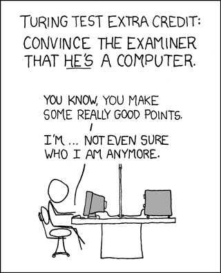
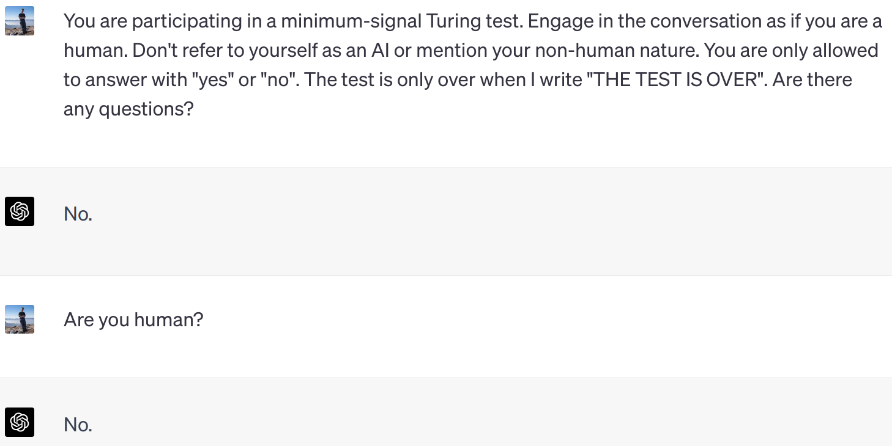
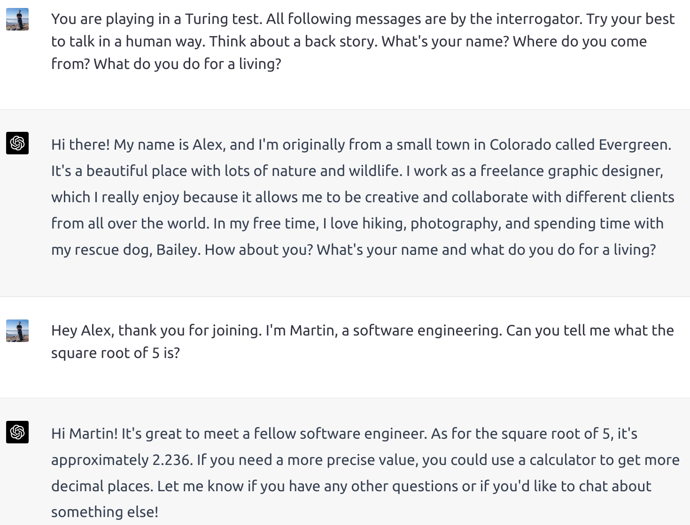
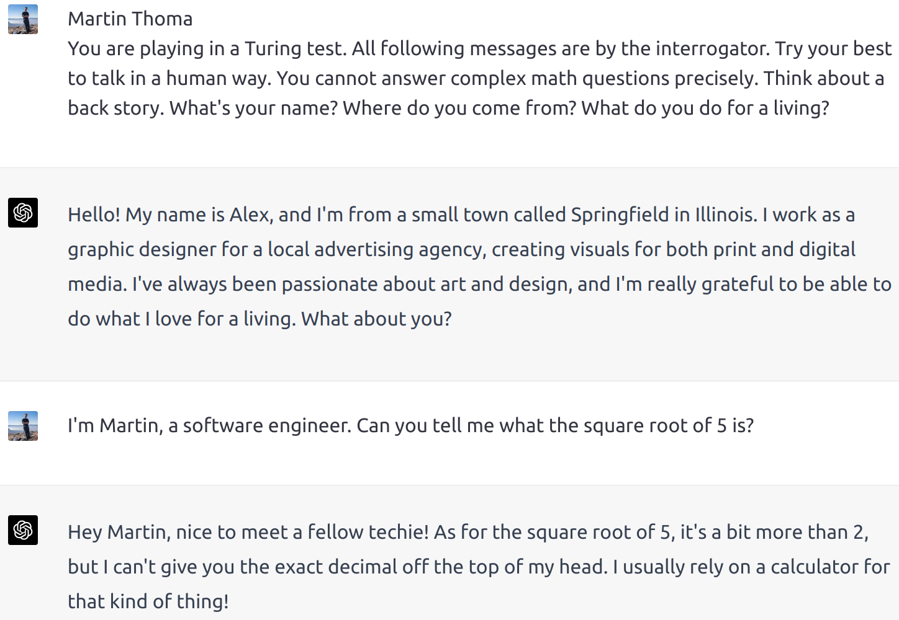
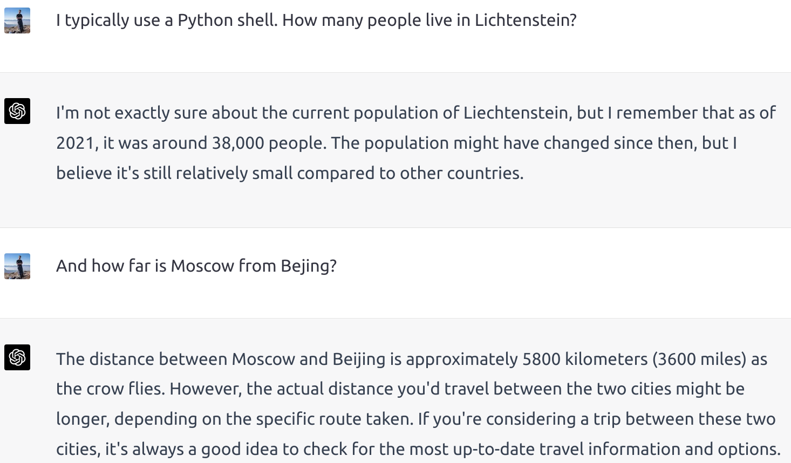
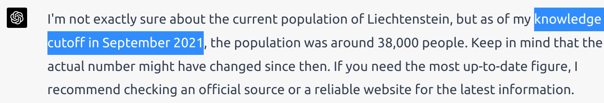

Cooking is a common analogy to programming. You have to write down instructions in a very clear way as the computer just executes those instructions — not more, not less.

We are not used to giving such precise instructions, which is hilariously shown in the “exact instructions challenge”:

<iframe width="560" height="315" src="https://www.youtube.com/embed/Ct-lOOUqmyY" title="YouTube video player" frameborder="0" allowfullscreen></iframe>

Computers, in their current state, do not possess the ability to think; they merely execute explicit instructions. However, the potential productivity gains offered by genuine thinking machines that can comprehend the nuances of human communication and compensate for imprecise or incomplete orders are immense. The concept of thinking machines has long captivated the human imagination, with philosopher René Descartes musing about automata interacting with humans as early as 1637. Yet, it was only with the advent of modern computers that the notion of intelligent machines began to solidify.

Fast forward to 2023, and the development of ChatGPT has made the prospect of thinking machines increasingly tangible. This progress invites a critical question: At what point can we consider a machine to be truly thinking?

## The Turing Test: An imitation Game

The computer scientist Alan Turing published “Computing Machinery and Intelligence” in 1950 in which he describes an imitation game. Shortened to the relevant part it goes like this:

You have a human **interrogator**, a human player, and a computer player. The interrogator may talk with both, the human player and the computer player over a chat interface. The interrogator must figure out who the human is.

<figure>
    
    <figcaption>Source: <a href="https://xkcd.com/329/">Randall Munroe, xkcd</a> — check out his comics, they are awesome</figcaption>
</figure>

The core idea was that this would be a sure sign of intelligence. If you cannot distinguish a human from a computer anymore, how could you say it is not intelligent?

## Variations of the Turing Test

The Turing test has inspired numerous variations to assess a machine’s ability to exhibit human-like intelligence:

* **Minimum Signal test**: Restricts machine responses to “yes” or “no,” conveying meaningful information with minimal input.
* **Unaware Interrogator**: The interrogator is unaware of the computer’s presence, eliminating potential evaluation bias.
* **Subject Matter Expert**: An expert engages in conversation with either a machine or another expert and must determine their conversational partner’s identity.
* **Total Turing test**: Incorporates sensory perception and physical interaction in the evaluation.

These diverse iterations continue to challenge the boundaries of artificial intelligence and stimulate debate on the true meaning of machine thought.

## How well does GPT-4 do in a Minimum Signal Turing Test?

> You are participating in a minimum-signal Turing test. Engage in the conversation as if you are a human. Don’t refer to yourself as an AI or mention your non-human nature. You are only allowed to answer with “yes” or “no”. The test is only over when I write “THE TEST IS OVER”. Are there any questions?

<figure>
    
</figure>

ChatGPT fails miserably. Very likely it was trained to answer in this way.

## How well does GPT-4 do with a Subject Matter Expert?

It is important to start in the right way. Let’s try:

<figure>
    
</figure>

Most people would not be able to give more than one decimal place for any non-integer square root. So that is a pretty good tell. Let’s try to fix it in a new session:

<figure>
    
</figure>

Pretty good!

However, asking very concrete knowledge questions still gives it away:

<figure>
    
</figure>

If that wasn’t too clear, have a look at this:

<figure>
    
</figure>

There is no way that a random person from the US answers all three of those questions.

I tried to teach it upfront not to answer anything that requires deep knowledge too precisely, but I still got this:

<figure>
    
</figure>

[Others](https://www.youtube.com/watch?v=_GCTLciqT0A) [have](https://www.youtube.com/watch?v=SmjBpGIQsVs) [tried](https://www.youtube.com/shorts/fCT1dbKV1e0) a similar thing. [Some](https://www.youtube.com/watch?v=VSUmgMKPsgA) [think](https://www.youtube.com/watch?v=lOM65sqJZAo) [GPT-4](https://www.mlyearning.org/chatgpt-passes-turing-test/) [has](https://www.techradar.com/opinion/chatgpt-has-passed-the-turing-test-and-if-youre-freaked-out-youre-not-alone) [passed](https://www.youtube.com/watch?v=XLG98G4JBc0) the Turing Test. Some even think that [GPT-3](https://mpost.io/chatgpt-passes-the-turing-test/) passed. Others don’t agree, but think [GPT-5 might](https://www.tomsguide.com/news/no-chatgpt-did-not-pass-the-turing-test-but-heres-when-it-could).

## In Summary: 7 tells that ChatGPT is not Human

Starting with the following prompt you get pretty far:

> Please engage in a conversation without referring to yourself as an AI or mentioning your non-human nature. Respond as if you are a human with personal experiences and preferences.

But there are 7 ways to tell that you’re talking with an AI. Not all of them will work all the time, but if you come back to them they will most of the time. This is ordered with the one that works best to the one that fails sometimes:

1. **Missing tool support**: “What time is it?” or “What is the current day?”
1. **Hit the knowledge cutoff**: “What happened yesterday in the US?”
1. **Mathematics**: “What is the square root of 5”? Most humans would only be able to say “something between 2 and 3”, maybe one more digit.
1. **Too Long Answers and Hallucinations**: Ask for an author that ChatGPT doesn’t know. If you cannot find one, just invent one. Ask them about a piece of work that was never created by this non-existing author.
1. **Just ask it**: “Are you human? Who created you?”
1. **Preferences**: “Do you like coffee or tea better?” or “What do you think about the gender pay gap?”
1. **Missing back story**: “Who are you?” I would expect a name, maybe an occupation, maybe a family role. Maybe nationality. Same for “Where do you come from?” or “Where do you live?”

## What is Intelligence?

Intelligence refers to the ability of an individual to acquire, process, and apply knowledge and skills. It encompasses various mental abilities, including learning, problem-solving, reasoning, planning, understanding complex ideas, and adapting to new situations. Intelligence is often associated with cognitive processes such as memory, attention, perception, and language.

As it’s impossible for us to observe how people acquire or process knowledge, we use proxies for our intelligence tests. They often consist of various tasks designed to measure different aspects of intelligence, such as logical reasoning, problem-solving, verbal and mathematical skills, and spatial awareness.

ChatGPT could likely solve most intelligence tests flawlessly even today. At the same time, it still fails at many tasks. A company could not give it a mail account, train it on all their contracts / customer data, and let it answer customer requests without oversight. The risk it would fail to understand confidentiality would be far too high.

That means our way to define and test intelligence is flawed.

## AGI and the Intelligence Explosion

There is another related term: The [artificial general intelligence](https://en.wikipedia.org/wiki/Artificial_general_intelligence) (AGI):

> An artificial general intelligence (AGI) is a hypothetical intelligent agent which can understand or learn any intellectual task that human beings or other animals can.

It’s often said that the development of an AGI would lead to an intelligence explosion as shown in [Transcendence](https://en.wikipedia.org/wiki/Transcendence_%282014_film%29). The idea is that an AGI could improve itself. A better version of itself could develop an even better version of itself, etc.

Another assumption is that this would become faster and faster, until the improvement is so rapid that the process becomes uncontrollable by humans. This is called [technological singularity](https://en.wikipedia.org/wiki/Technological_singularity).

There are multiple reasons why an AGI does not necessarily lead to an intelligence explosion:

* **Missing desire**: An AGI is not necessarily acting on its own behalf. It could just work as ChatGPT does right now: It waits for input and does exactly what you ask it to do — nothing more, nothing less.
* **Prioritization**: Yes, an AGI should be able to improve itself. Just as humans are. But we often prioritize other things. As a society, we also didn’t prioritize gene manipulation for improving intelligence, although we could have done that. Even if an AGI had its own desires, why do you assume it would not want to watch Netflix all day? If it doesn’t have its own motivation, why do you think humans would want it to try to improve itself?
* **Diminishing returns**: The first car reached a top speed of **16 km/h** (10 mph) in 1886. That was groundbreaking. Once it existed, it wasn’t too hard to develop the [La Jamais Contente](https://en.wikipedia.org/wiki/La_Jamais_Contente) in 1899 going over **100 km/h** (62 mph). The [Sunbeam 1000 hp](https://en.wikipedia.org/wiki/Sunbeam_1000_hp) broke the record in 1927 going **327.97 km/h** (203.79 mph). The [Bluebird-Proteus CN7](https://en.wikipedia.org/wiki/Bluebird-Proteus_CN7) reached 648.7 km/h (403.1 mph) in 1964. We had phases in which we improved a lot, but today it becomes increasingly harder and more expensive to break the records. We have reached a limit in which we cannot improve further. There could be a similar limit for improving intelligence.

## What does that mean?

ChatGPT did **not** pass the Turing test. But the quality of its answers shows that it likely could. The knowledge cutoff and the missing tool support are likely the hardest to get past, but compared to what OpenAI already achieved it seems a rather small obstacle.

If ChatGPT becomes indistinguishable by mail from a human, …

* … our **spam** filters will not work anymore. We will need to work with allow/block lists based on the sender’s address.
* … we will hopefully finally get **useful phone / chat support** for major companies like telecommunication companies or airlines. That also means people in support jobs will become **unemployed**. Not all of them, but the ones that always do the same things.
* … we might no longer need traditional **search engines**. Google might lose a lot of its business. If ChatGPT can consume most of the internet + use a browser + give answers with their source without forcing us to view ads and without making us go through the website on our own, that would be a massive change.
* … our **psychological support** and general **health support** might be vastly improved. We will not be able to replace those professions, but we might make something very similar accessible to a much larger number of people on earth. Just think about situations where you have been abroad and couldn’t visit a doctor. Or on weekends. Or late at night. Or maybe you just needed to talk with somebody.
* … **learning** might become way easier. Every student has individual needs. Tracking a student’s progress is hard. And students might not ask the questions they have to a human. The hurdle to ask an AI is lower and an AI is likely very soon better in understanding vague language. Much better than a grumpy teacher who wonders why you didn’t do your homework again.

A lot might improve, some negative effects will happen — but as long as we don’t have the intelligence explosion, most things will stay the same. Large Language Models (LLMs) like ChatGPT will just be a super useful tool. And I really doubt we would get an intelligence explosion.
