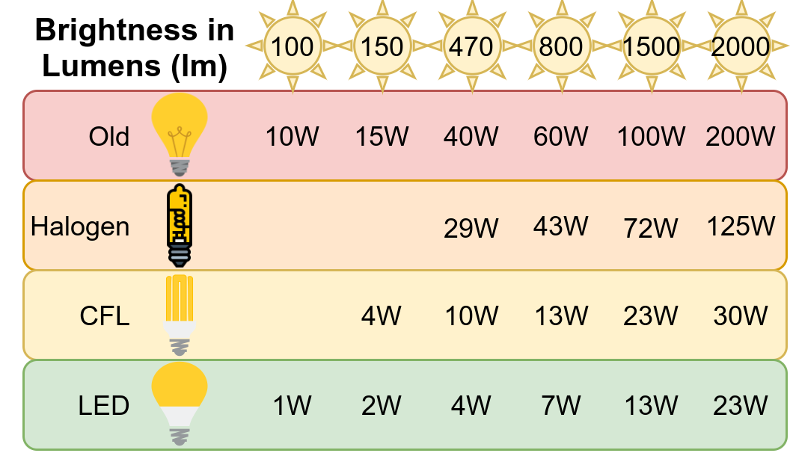
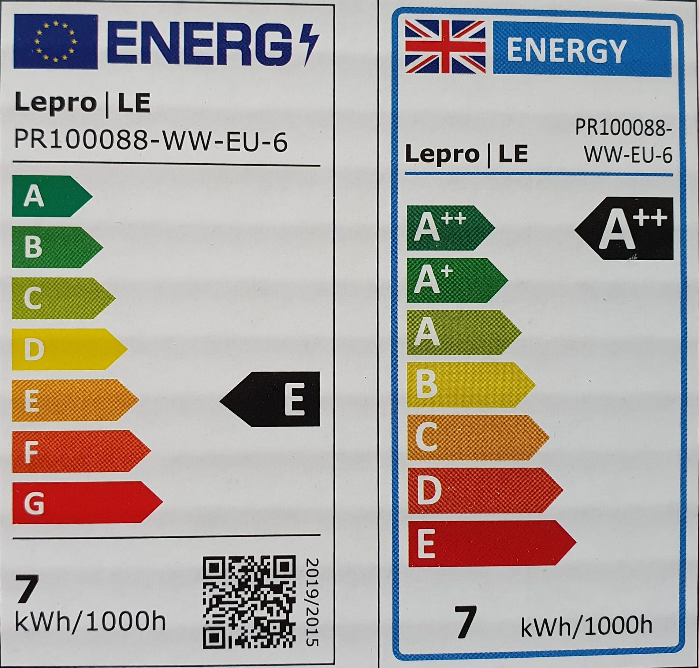

One of my favorite articles is “[Is it worth changing the lightbulb](../is-it-worth-changing-the-lightbulb/)”. The article contains the following table that shows rather clearly that it’s pretty much always worth replacing old incandescent light bulbs by LEDs:

<figure>
    
</figure>

However, even within the category of LEDs there are differences. The EU has given us efficiency labels that place all LEDs I could find in the “E” or “F” tier:

<figure>
    
</figure>

Hence I wondered, what the physical boundaries are.

Most LEDs I see are currently around **110 Lumen/Watt**.

## The current market

The 806 Lumen / E27 / 2700K / 15,000h lifetime lamps I recently bought need 7 Watt and cost 3.12€.

* [**Philips Ultra Efficient LED lamp**](https://www.lighting.philips.co.uk/consumer/ultra-efficient): **210 Lumen per Watt**. That is 840 Lumen for 4 Watt ([E27 / 3000K / 50,000 h lifetime, 10€](https://www.amazon.de/Philips-Classic-ultraeffiziente-Label-warmwei%C3%9F/dp/B09SWPYBCL/)). Hence you pay 6.88€ more, but you need only 57% of the energy. It also claims to have 3.3x the lifetime. That means you save roughly 150 kWh. Assuming a price of 0.33 €/kWh that would be 49.50€. However, the lifetime claim is crazy. Assuming it lasts 10 years instead of 50 and that you need it about 3 hours per day in average, that would be 11,000 hours. It would still be 10.89€ in savings for the electricity.
* [**Osram LEDVANCE**](https://www.ledvance.de/consumer/produkte/lampen/led-lampen/led-lamps-mit-energieeffizientklasse-a/led-lampen--klassische-kolbenform--energieeffizientklasse-a-c228466): It also has **210 Lumen per Watt** with the same specifications ([E27 / 3000K / 50,000h lifetime, 7 €](https://www.amazon.de/Ledvance-Stromsparlampe-herk%C3%B6mmliche-60W-Leuchtmittel-Energieeffizienz/dp/B0BL7SW7J1/)). People on Amazon complain about a green-ish color and some noise the lamp emits.
* [**Arcchio**](https://arcchio.co.uk/): They claim to get **212 Lumen per Watt**. The first one with warm light. The specs are ([E27 / 2700K / 50,000 h lifetime](https://www.amazon.de/Arcchio-besonders-effizient-Energieklasse-Filamentlampe/dp/B0BV8BM759/), 15.80€).
* **Samsung**: I’ve seen news that 230 Lumen per Watt are reached ([source](https://www.led-professional.com/products/featured/samsung-led-pushes-efficiency-of-mid-power-packages-to-higher-levels)). However, I couldn’t find typical light bulbs which are that efficient.

## Wave lengths — Physical limits

Light comes in different wave lengths. The longer the photon’s wavelength, the lower its energy.

Humans can perceive light in the range of wavelengths between 370 and 730 nanometers ([source](https://en.wikipedia.org/wiki/Visual_perception#cite_note-Margaret._2008-3)). If we had a light bulb which emitted only 555nm light, it would require 1/683 Watt per Lumen ([source](https://en.wikipedia.org/wiki/Lumen_%28unit%29)) or **683 Lumen per Watt**. That means, at least for green light, the physical limit would be 16% of the energy current 110 lm/W LEDs need. If it’s possible to engineer an LED anywhere close to that limit is a different story.

It’s hard to find good numbers for warm light (2700K) or white light (3000K). [One user claims](https://www.quora.com/Is-there-any-physical-limit-to-the-efficiency-of-light-emitting-diodes) its **320 Lumen per Watt**. Another website claims it’s at 327.6 Lumen per Watt ([source](https://www.dial.de/en-GB/projects/efficiency-of-leds-the-highest-luminous-efficacy-of-a-white-led)). That would still be only a third of the energy current 110 lm/W LEDs need. Hence there seems to be room for improvement 🎉
