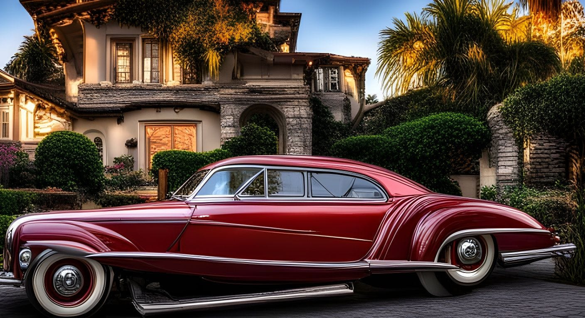

<figure class="ai-generated">
    
    <figcaption>Created with AI</figcaption>
</figure>

Modern electric cars have huge batteries and modern homes heat using heat pumps and thus electricity. Theoretically, you could heat a home using a Tesla. But how long would it last?

## Heat Energy Usage

German homes have an [average heated area of 135m²](https://www.musterhaus.net/ratgeber/haus-groesse). A modern home that fulfills the typical insulation requirements (KfW 55) needs 50 kWh/(m² ⋅a). The “a” stands for “annum”, so a year. Hence you get the yearly energy required for heating by 50 kWh/(m² ⋅a) ⋅ 135m² ⋅ 1 year = 6750 kWh.

Modern heat pumps have a SCOP value of at least 3. That means for every kWh of electric energy the pump uses, it generates 3 kWh of heat. Hence you only need 6750kWh/3 = **2250 kWh per year for an average new house.**

If you have **a really modern house** (KfW 40 standard) you will have a heat pump with a [SCOP of 5.6](https://lambda-wp.at/wp-content/uploads/2021/07/Technisches-Datenblatt_EU-L.pdf) and only need 25 kWh/(m² ⋅a) due to better insulation. That makes **602 kWh per year**.

Of course, if you live in a warmer climate or in a smaller house, the values will be lower. Or in colder climates and bigger houses, the values will be bigger.

## Transportation Energy Usage

People in Germany drive about [11387 km yearly](https://www.auto-motor-und-sport.de/verkehr/jahresfahrleistung-kilometer-jaehrlich-auto-deutschland/) (7075 miles per year). Now we need the energy usage of cars by distance.

[ADAC publish those numbers](https://www.adac.de/rund-ums-fahrzeug/elektromobilitaet/tests/stromverbrauch-elektroautos-adac-test/) ([another article by ADAC](https://www.adac.de/rund-ums-fahrzeug/auto-kaufen-verkaufen/autokosten/sparsamste-elektroautos/)):

* Elaris Dyo: 11.5 kWh / 100km
* Fiat 500e (23,8 kWh): 13.0 kWh / 100km
* Hyundai IONIQ 6: 13.9 kWh / 100km
* Hyundai Kona Elektro: 16.7 kWh / 100km
* Tesla Model 3: 16.8 kWh / 100km
* Polestar 2 Long Range Single Motor: 18.5 kWh / 100km
* Citroën ë-Spacetourer: 29.7 kWh / 100km

So a Tesla Model 3 would use 16.8 kWh / 100 km ⋅ 11387 km = **1913 kWh per year.**

The [battery ranges from 55 to 82 kWh](https://en.wikipedia.org/wiki/Tesla_Model_3). Assuming the 55 kWh battery and the new, but cheap house you could probably **heat the house for a week with a single charge**.

If you have an 82 kWh battery and a super modern home, you could **heat it for seven weeks** 🤯

That makes a lot of simplifying assumptions, so take it as an order of magnitude.

## Household Devices

**Freezer + Refrigerator units**:

* [Old](https://praxistipps.focus.de/stromverbrauch-ihrer-haushaltsgeraete-im-ueberblick-ein-vergleich_150421) refrigerator: 674 kWh / year
* Typical new refrigerators (CHIQ CBM159LEBD): 152 kWh/year

**Dishwasher**: Assuming a cycle a day gives 365 cycles/year

* Old Dishwasher: 2.7 kWh/cycle ➔ 986 kWh/year
* New Dishwasher (Bauknecht BBO 3O41 PLT): 0.746 kWh/cycle ➔ 272 kWh per year

**Washing machine**: Assuming 2 cycles per week gives 104 cycles/year

* [Old washing machine](https://www.badenova.de/blog/stromverbrauch-waschmaschine/): 2.0 kWh/cycle ➔ 208 kWh
* New Siemens WM14G400 iQ500: 0.616 kWh / cycle ➔ 64 kWh

Now to one of my favorite topics: **Light bulbs**. Assuming you light a room with two 800-lumen bulbs. That would be 60 W for an old light bulb and 4.9W for a modern LED. Assuming 8 hours per day it would be:

* Old bulbs: 350 kWh/year
* New LED: 29 kWh/year — that is 2 years and almost 10 months with a big Tesla battery!

[**Is it worth changing the Lightbulb?** *Switching for a more efficient lightbulb for economic reasons*](../is-it-worth-changing-the-lightbulb/)

To summarize the savings of upgrading:

* **Light**: New ones need 92% less energy. Saves 321 kWh/year. Costs about 2.70€/bulb. Amortization in 21 days 💥
* **Dishwasher**: New ones are 72% more efficient. Saves 714 kWh/year. Costs 499€. Amortization in 2 years and 4 months 🎉
* **Refrigerator**: New ones are 77% more efficient. Saves 522 kWh/year. Costs 350€. Amortization in 2 years and 3 months 🎉
* **Washing machine**: New ones are 69% more efficient. Saves 144 kWh/year. Costs 534€. Amortization in 12 years and 4 months 😕

I assume 0.30€/kWh for the amortization. Prices for the devices and electricity might differ in your region.

## TVs and Computers

Assuming 8 hours per day:

* 75" diagonal (Samsung QLED 4K Q70A): 115 W gives 336 kWh/year
* 65" diagonal (Samsung QLED 4K Q70): 101 W gives 295 kWh/year
* 65" diagonal (Samsung OLED 4K S90C): 95 W gives 277 kWh/year
* 32" diagonal [old CRT TV](https://praxistipps.chip.de/roehrenfernseher-so-hoch-ist-der-stromverbrauch_48672): 70 W gives 204 kWh/year
* 32" diagonal (Samsung Series 4 UE32T4302AK): 31 W gives 91 kWh/year
* 14" Thinkpad T460p: 31.5 W gives 92 kWh / year
* 14" Thinkpad T14s: 18.0 W gives 53 kWh / year

So OLED seems to be more efficient than QLED and bigger screens make obviously a difference. Newer laptops are more efficient, but due to the cost of a laptop and the high efficiency even of older models, an upgrade might not be worth it.

## Now what?

1. Make sure you use LEDs everywhere
1. If you have an old dishwasher, refrigerator: Upgrade it
1. In doubt, buy some smart energy outlets for about 16€/piece to track the energy consumption of your devices.
