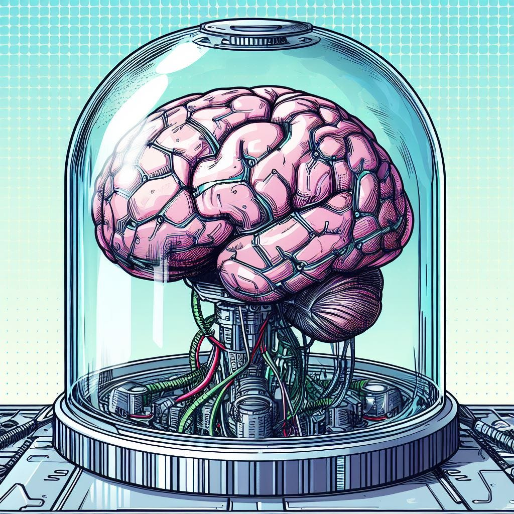
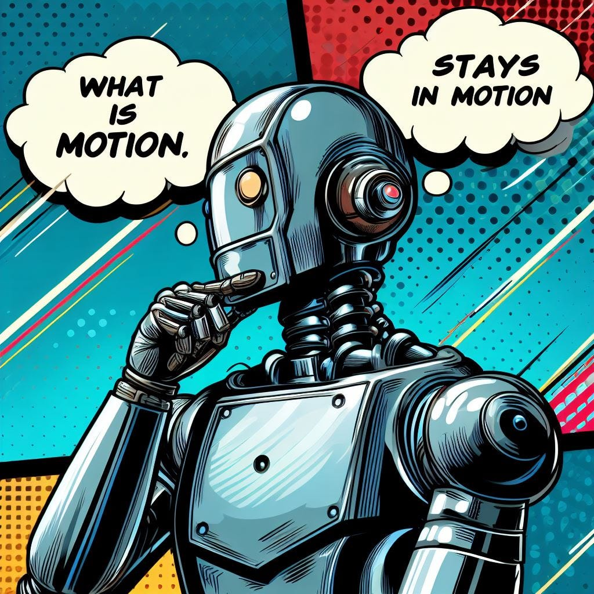

<figure class="ai-generated">
    
</figure>

The release of ChatGPT in November 2022 was perceived as a breakthrough in AI by the public. It resulted from using [Transformers](https://arxiv.org/abs/1706.03762) in Large Language Models (LLMs) and using way more training data than ever before.

Chatting with ChatGPT feels natural. If you don’t explicitly poke it, you might not realize that you’re talking with a computer program. In that sense, ChatGPT [almost passes the Turing test](../gpt-4-could-solve-a-60-year-old-challenge-in-computer-science/).

Now people think about (self-) consciousness and what the implications are. For example, in July 2022 the Google developer Blake Lemoine was fired as he thought the Google LaMDA AI was a person:

[**Google fires Blake Lemoine, the engineer who claimed AI chatbot is a person** *Google says Lemoine violated security rules, slams "wholly unfounded" claims.*](https://arstechnica.com/tech-policy/2022/07/google-fires-engineer-who-claimed-lamda-chatbot-is-a-sentient-person/)

LaMDA is certainly more advanced than [ELIZA](https://en.wikipedia.org/wiki/ELIZA), but something similar happened in 1966 with a psychotherapist program developed by Joseph Weizenbaum. His secretary used it and thought she was chatting with a therapist.

## What is consciousness?

Naively speaking, most people mean having a reasonable model of the world and oneself. Knowing where you are and at which time, a little about how to interact with people around you.

When asking if somebody is conscious, we typically mean if the person is awake and aware of their surroundings, which means not intoxicated or sick.

The story around Blake Lemoine reveals that we connect certain rights with the question about consciousness, namely the rights of living beings or humans.

So, let’s come up with formal criteria for consciousness that match what we mean and nothing more.

### № 1: Sensors — Being able to perceive the environment

<figure class="ai-generated">
    
</figure>

If a person cannot perceive their environment, I would have a hard time saying that the person is conscious.

A counter-example might be deaf and simultaneously blind people. [Haben Girma](https://en.wikipedia.org/wiki/Haben_Girma) is a deafblind lawyer who graduated from Harvard. She lost her vision and hearing in her childhood. She retains 1% of her sight. She is an impressive example that people who still have their skin to interact with the environment are obviously conscious.

If we took just that, then any smartphone would be conscious.

### № 2: Actors — Being able to manipulate the environment

<figure class="ai-generated">
    
</figure>

You might now argue that conscious beings need to be able to manipulate their environment. Something smartphones cannot do that clearly.

A modern train can, though. It can move. And it can sense its environment. So it doesn’t only act and perceive but also interacts with its environment.

The way a train interacts with its environment is limited. If the train does not break, we can clearly know what it will do, given some sensory inputs.

Another try might be **self-protection**. But I hope that trains are also built in a way that they don’t easily allow e.g. too fast speeds. Similarly, when we are in extreme situations we might be able to override our self-protection, e.g. when we protect children.

### № 3: Building a model of the world

<figure class="ai-generated">
    
</figure>

Creating a model about the world that was not told/programmed since birth/creation is something a train cannot do. Humans do that all the time. We make some assumptions about how things work. They might not be explicit and they might be completely wrong, but we try to explain the world. We think about how other humans would react when we say or do certain things. We build our very own simulations about the world within our heads.

With machine learning, computers also do it.

They only do it because we programmed them like this. And the models of the world computers can build are very limited. But they are models. Now are they conscious?

## Why it doesn’t matter

<figure class="ai-generated">
    
</figure>

I hope it became clear that we don’t have a proper definition of consciousness. We especially don’t have a clear test for it. It’s a vague term and we will shift the requirements when we see more developments in AI. The same goes for intelligence and I’ve written a light paper about how that happens with creativity:

[**Creativity in Machine Learning** *Recent machine learning techniques can be modified to produce creative results. Those results did not exist before; it…*](https://arxiv.org/abs/1601.03642)

The more we shift the goalpost, the more we might go into regions where we need to say that some humans are not conscious. Already it might be pretty hard to argue that a baby is conscious, even if it is awake.

Due to the lack of a proper definition of consciousness including a test for it, I don’t think it matters if some people say that something is conscious.
