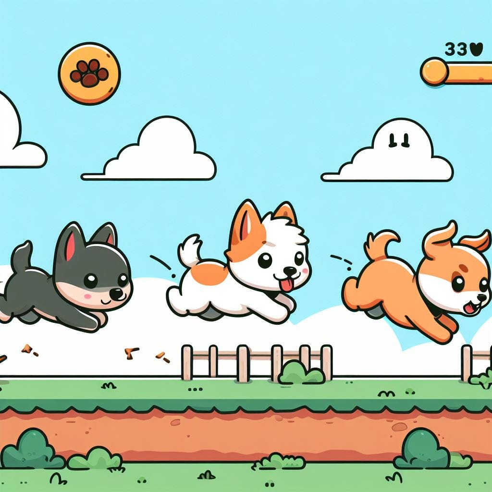

<figure class="ai-generated">
    <a href="../images/2023/11/developing-a-jump-and-run-part-1-1.jpg"></a>
</figure>

The quiet time of the year is coming, I’m thinking about presents for my loved ones and was reminded that I wanted to develop a jump-and-run for a while.

I’ll document how much time I spend on which tasks and will write about the different steps. You can follow the journey by reading those blog posts or the commits of [github.com/MartinThoma/jump\_and\_run\_game](https://github.com/MartinThoma/jump_and_run_game).

Let’s start!

## The Path to Awesomeness — in baby steps

Developing an enjoyable jump-and-run is a huge task. Games like [Donkey Kong](https://en.wikipedia.org/wiki/Donkey_Kong_%28arcade_game%29) (1981), [Super Mario](https://en.wikipedia.org/wiki/Super_Mario) (1985), or [Sonic](https://en.wikipedia.org/wiki/Sonic_the_Hedgehog) (1991) likely had hundreds if not thousands of people working on them over the years. And it’s not only developers, but also artists creating graphics and sounds, people writing a storyline, and lots of advertisement/merchandise. Even free software platformer examples like [Secret Maryo Chronicles](https://en.wikipedia.org/wiki/Secret_Maryo_Chronicles) (2003) and [SuperTux](https://en.wikipedia.org/wiki/SuperTux) (2004) have more than a hundred contributors.

It’s important to break such big tasks down:

1. **Project Setup (1.5 hours)**: We have a [git repository](https://github.com/MartinThoma/jump_and_run_game) containing a Python package (that is also [on PyPI](https://pypi.org/project/jump_and_run_game/)). It should have linting, at least one test, a README, and Continuous Integration (CI). The only functionality here is a simple shape that can jump and walk. No graphics, no opponents, no map, no sound. Really basic (this article).
1. **Objective and challenge**: Add an opponent that can kill us. Add lives and show how many are left. Also, add coins to collect and show the score. We need collision detection here.
1. **Sprites**: Add a static background image and a sprite for all game objects we have so far (player, opponent, coin) as well as a sprite for the platform. Structure it in a way that it can easily be exchanged. [OpenGameArt.org](https://opengameart.org/) looks promising as a source of free-to-use sprites.
1. **Maps**: A game map gives the layout of one level. We need to develop the map file format and have at least one map. The file format should be something that can be easily read with other software, e.g. YAML or JSON. It should contain a version of the format. Additionally, we need to have a new object: A platform on which we can walk.
1. **Background Music**: Find or create background music and play it.
1. **Sound effects**: Add sound effects for jumping, walking, and losing one life.
1. **Game menu**: Add an option to pause the game and a screen related to it. Add the option to change the volume of the background music and the sound effects (independently). Allow changing the window resolution. Add a “Game Over” screen.
1. [**Parallax scrolling**](https://en.wikipedia.org/wiki/Parallax_scrolling)
1. New game object: **Spikes**
1. New game object: **Moving Platforms**
1. New game object: **Ladder**
1. New game object: **Walking Enemies**
1. New game object: **Checkpoints**
1. New game object: **Crumbling platform**
1. New game object: **Shooting Enemies** — they are in a static position, but shoot in the line-of-sight to the player.
1. New game object: **Background decoration**
1. New game object: Exploding Enemies — when they are killed, they explode.
1. **Highscores per Level**: Minimum time required, maximum amount of points reached, bad guys killed
1. **Game engine AI interface**: Make it easy to interact with the game programmatically. Maybe somebody makes an awesome AI playing the game. That could show the best high scores possible.
1. New game object: **Invincibility Power-up**
1. New game object: **Shooting**
1. New game object: **Info box** to explain stuff, e.g. the key for shooting
1. New game object: **Secret areas**
1. **Boss fights**
1. **A game story**
1. **Mini-games**, e.g. collecting as many coins as possible in a limited time.
1. **Add a config file**: Allow customizing the movements as well as the sound settings.
1. **Coop mode**: Allow two players to play locally simultaneously. That affects how they can move.
1. **Level editor and plugin system**: Having the option to let the community build stuff
1. …. many more, especially: Make the game fun to play
1. **Bundling for Debian/Ubuntu**: Make a deb package. That should be rather straightforward.
1. **Bundling for Steam**: Let’s check what is required to get it on Steam. It [seems to be possible](https://stackoverflow.com/a/11586657/562769), but it looks like it’s not for free. Let’s see once I’m there 😄
1. **Bundling for Switch**: The [official docs mention Nintendo Switch](https://www.pygame.org/docs/ref/joystick.html#nintendo-switch-left-joy-con-pygame-2-x), so maybe we can play the game there? They have a [developer portal](https://developer.nintendo.com/). [/r/NintendoSwitch](https://www.reddit.com/r/NintendoSwitch/comments/jji6ti/how_difficult_is_it_to_get_a_nintendo_switch/) and [/r/gamedev](https://www.reddit.com/r/gamedev/) look promising. And there is [gamedev.stackexchange.com](https://gamedev.stackexchange.com/).

## Step 1: Python Project Setup

If you need an introduction to programming with Python, start with [the Python Tutorial](https://docs.python.org/3/tutorial/index.html). That takes several days if you’re not used to programming so far. If you come from another programming language, you will need about a day.

Once you know the basics of Python, there are two parts left to start software development:

* **Version Control**: When we develop software, we want to remember the different steps we made. We want to be able to jump back and we want to develop collaboratively. Hence we use version control systems. By far the most popular version control system is **git**. I’m using **GitHub** for hosting the git repository. If you don’t know git, I recommend reading the first two chapters of [the Pro Git Book](https://git-scm.com/book/en/v2).
Reading, understanding, and practicing that will take at least one more day.
* **Linting**: We want our code to look nice. And we don’t want to worry about it during development. For this reason, we use [the black python code formatter](https://pypi.org/project/black/), the [ruff autoformatter](https://pypi.org/project/ruff/), and [pre-commit](https://pypi.org/project/pre-commit/) to run everything automatically locally before a git commit is saved.
* **Testing**: I’m a big fan of “eating your own dog food” (using your own software) and thus finding issues, but I also want to have thorough automatic tests. I’m using [pytest](https://pypi.org/project/pytest/).
* **Continuous Integration (CI):** Running tests locally is nice and having pre-commit to automatically format as well, but when other people contribute code I don’t know if they have done that. Hence I want GitHub to automatically run the linter and the tests and tell me for Merge Requests (MRs, also called Pull Requests — PRs) if everything looks fine.

### Project Structure

Python packaging is its own big topic. You can read details about it in an older blog post:

[**Packaging in Python: Tools and Formats** *16 solutions to 9 problems — which ones do you know?*](../python-packaging-tools-and-formats/)

In short, you need a few files:

1. Create a valid `pyproject.toml`. Check the [flit README](https://pypi.org/project/flit/) for an example.
1. Add a `README.md`, a `LICENSE`, a `.gitignore` … contents don’t matter at this point

It should look similar to this:

```
(root of your git repository)
├── docs
├── jump_and_run_game (the name of your project)
│   ├── __init__.py
│   └── _version.py
├── LICENSE
├── Makefile
├── pyproject.toml
├── README.md
├── requirements
│   ├── ci.in
│   ├── ci.txt
│   ├── dev.in
│   └── dev.txt
└── tests
    └── test_main.py
```

### Create a README.md

People should know from the first day what this is about and also at which stage the project is.

[**9 Steps to Software Project Handovers** *Passing on the baton isn’t a cakewalk. Here’s how to do it*](../9-steps-to-software-project-handovers/)

### Lint your code before commits

I use [pre-commit](https://pypi.org/project/pre-commit/) with the following `.pre-commit-config.yaml`:

```yaml
# pre-commit run --all-files
repos:
-   repo: https://github.com/pre-commit/pre-commit-hooks
    rev: v4.5.0
    hooks:
    -   id: check-ast
    -   id: check-byte-order-marker
    -   id: check-case-conflict
    -   id: check-docstring-first
    -   id: check-yaml
    -   id: debug-statements
    -   id: end-of-file-fixer
        exclude: "resources/.*|docs/make.bat"
    -   id: trailing-whitespace
    -   id: mixed-line-ending
        args: ['--fix=lf']
        exclude: "docs/make.bat"
    -   id: check-added-large-files
        args: ['--maxkb=1000']
-   repo: https://github.com/psf/black
    rev: 23.11.0
    hooks:
    -   id: black
        args: [--target-version, py38]
-   repo: https://github.com/asottile/blacken-docs
    rev: 1.16.0
    hooks:
    -   id: blacken-docs
        additional_dependencies: [black==23.11.0]
        exclude: "docs/user/robustness.md"
-   repo: https://github.com/charliermarsh/ruff-pre-commit
    rev: v0.1.6
    hooks:
    -   id: ruff
        args: ['--fix']
-   repo: https://github.com/asottile/pyupgrade
    rev: v3.15.0
    hooks:
    -   id: pyupgrade
        args: [--py38-plus]
-   repo: https://github.com/pre-commit/mirrors-mypy
    rev: 'v1.7.1'
    hooks:
      - id: mypy
        additional_dependencies: [types-Pillow==10.0.0.2]
        files: ^jump_and_run_game/.*
```

### The Game Loop

It’s really not that exciting. Just a big while-True loop.

```python
import sys

import pygame

FPS = 60

pygame.init()

# Setup the window
screen = pygame.display.set_mode((800, 600))
pygame.display.set_caption("Jump and Run Game")

# Create core objects
clock = pygame.time.Clock()

while True:
    for event in pygame.event.get():
        if event.type == pygame.QUIT:
            pygame.quit()
            sys.exit()
    # Do what you need to do:
    # 1. Update game objects
    # 2. re-render screen
    pygame.display.flip()
    clock.tick(FPS)
```

### Creating a Package on PyPI

1. Create an account on [https://pypi.org/](https://pypi.org/)
1. Create an API token with all permissions for the account. Execute `export FLIT_USERNAME='__token__'`(yes, it should be exactly `__token__`; don’t replace that) and `export FLIT_PASSWORD='your-api-token'`.
1. `flit publish` to create the package on PyPI. Look in [https://pypi.org/manage/projects/](https://pypi.org/manage/projects/) for your project.
1. Now that the project is on PyPI, you can create a token just for that game
1. Store it in an `.envrc` file and make sure [direnv](https://direnv.net/) is working. Ensure you will NEVER put it under version control or within the package you build ⚠️ `.gitignore` is your friend.

## Summary

This step took 1.5 hours — it’s mainly the project setup, but also the game loop and uploading stuff to PyPI. I’m getting excited, but let’s see how long this lasts. I see the biggest hurdle in the artwork (both audio and images). I hope generative AI and free sprites can make this easier.
