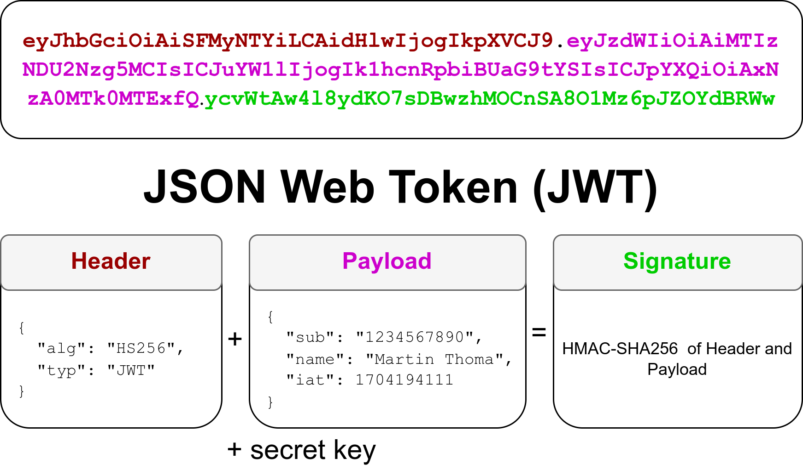
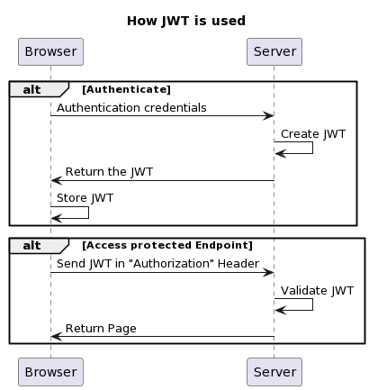

<figure>
    <a href="../images/2024/01/json-web-tokens-jwt-1.png"></a>
</figure>

JSON web tokens, or JWT in short, are a way of self-contained authentication standardized in [RFC 7519](https://tools.ietf.org/html/rfc7519). That means they contain all of the information necessary to tell that a user is authenticated. The server does not need to keep the session state. No session management. For that reason, it’s also called state-less authentication.

JWTs are used in the OpenID Connect standard which is built on top of OAuth 2.0.

## When do I use a JWT?

Think about a Web Mail service. The user goes to the login form and enters the username and the password to authenticate. But not only at this time, but with every follow-up request the users need to tell the server who they are.

<figure class="ai-generated">
    <a href="../images/2024/01/json-web-tokens-jwt-2.jpg"></a>
    <figcaption>The trivial solution: Show your credentials every single time.</figcaption>
</figure>

The trivial solution would be to send the username and password with every request. That approach has two massive disadvantages: (1) The secrets would need to be stored on the client's machine during the session and (2) Every single request could be used by a man in the middle (MITM) to get the secrets.

<figure class="ai-generated">
    <a href="../images/2024/01/json-web-tokens-jwt-3.jpg"></a>
    <figcaption>Imagine random tokens a bit like wristbands. They don’t contain the secrets (username and password), but are enough to decide if people may enter.</figcaption>
</figure>

Instead, the authentication server could send a **random session token** to the user after logging in. That token is stored by the users' browser and sent with every request. The server just looks up that session ID. As only the server can verify them, they are called opaque tokens.

Next, imagine we have one authentication service and multiple other services that don’t want to deal with identifying the user. They don’t want to deal with user sessions and look up user information.

In that case, we can give some basic information like the user-id and permissions directly to the user with a short-lived token. We need to ensure that this information cannot be tampered with. Hence the authentication server adds the information to the token, signs the token, and gives it to the user. It signs either with a private key (asymmetric algorithms like RS256), so that the other services only need the public key, or with a secret it shares with the other services (HS256, as in the example below). The user then just shows this token.

Another advantage is that you don’t need to make another DB lookup for the authentication for every single user request.

<figure>
    <a href="../images/2024/01/json-web-tokens-jwt-4.png"></a>
    <figcaption>Workflow how JWTs are used. Note that the validation does not need to be done by the same server as the initial authentication. JWT is more flexible here than session tokens.</figcaption>
</figure>

## The Structure of JWTs

<figure>
    <a href="../images/2024/01/json-web-tokens-jwt-5.png"></a>
</figure>

JWTs are strings that consist of a header, a payload, and a signature. The header typically just contains the algorithm `alg` used to create the signature. The `typ` is typically `JWT`. There are [less common header fields](https://en.wikipedia.org/wiki/JSON_Web_Token).

The payload typically contains:

* `iat`: Issued At Time as a Unix Timestamp.
* `exp`: Expiration Time as a Unix Timestamp. After this time, the JWT must not be accepted.
* Many more, but that depends on the service

## Examples: Which information is in there?

The one from ChatGPT looks like this:

```json
{
    "alg": "RS256",
    "typ": "JWT",
    "kid": "{{alphanum}}"
}
{
    "https://api.openai.com/profile": {
        "email": "my.email@gmail.com",
        "email_verified": true
    },
    "https://api.openai.com/auth": {
        "poid": "org-{{alphanum}}",
        "user_id": "user-{{alphanum}}"
    },
    "iss": "https://auth0.openai.com/",
    "sub": "google-oauth2|{{int}}",
    "aud": [
        "https://api.openai.com/v1",
        "https://openai.openai.auth0app.com/userinfo"
    ],
    "iat": 1702491406,
    "exp": 1703355406,
    "azp": "{{alphanum}}",
    "scope": "openid email profile model.read model.request organization.read organization.write offline_access"
}
```

## Generating and verifying a JWT

Creating and verifying a JWT is pretty simple. This is how you do it in Python just with the core libraries:

```python
import base64
import hmac
import hashlib
import json
import time


def enc(data):
    return base64.urlsafe_b64encode(data).rstrip(b"=").decode("utf-8")


def create_signature(unsigned_token, secret):
    return enc(
        hmac.new(
            secret.encode("utf-8"),
            unsigned_token.encode("utf-8"),
            hashlib.sha256,
        ).digest()
    )


def create_jwt(header, payload, secret):
    encoded_header = enc(json.dumps(header).encode("utf-8"))
    encoded_payload = enc(json.dumps(payload).encode("utf-8"))
    unsigned_token = f"{encoded_header}.{encoded_payload}"
    signature = create_signature(unsigned_token, secret)
    return f"{unsigned_token}.{signature}"


# Example usage:
header = {"alg": "HS256", "typ": "JWT"}
payload = {
    "sub": "1234567890",
    "name": "Martin Thoma",
    "iat": int(time.time()),
}
secret_key = "your_secret_key"

jwt_token = create_jwt(header, payload, secret_key)
print(jwt_token)
```

To verify the signature, you just decode and re-sign the contents. If it matches, the signature is right:

```python
import base64
import hmac
import hashlib
import json
import time


def dec(data):
    padded_data = data + "=" * (4 - len(data) % 4)
    return base64.urlsafe_b64decode(padded_data.encode("utf-8")).decode(
        "utf-8"
    )


def enc(data):
    return base64.urlsafe_b64encode(data).rstrip(b"=").decode("utf-8")


def create_signature(unsigned_token, secret):
    return enc(
        hmac.new(
            secret.encode("utf-8"),
            unsigned_token.encode("utf-8"),
            hashlib.sha256,
        ).digest()
    )


def verify_jwt(token, secret):
    encoded_header, encoded_payload, signature = token.split(".")
    unsigned_token = f"{encoded_header}.{encoded_payload}"

    # Re-create the signature
    expected_signature = create_signature(unsigned_token, secret)

    # Compare the expected signature with the actual signature
    # in constant time, so that the timing does not leak anything
    if not hmac.compare_digest(signature, expected_signature):
        raise ValueError("Signature mismatch.")

    # Check if the token is still valid (not expired)
    current_time = int(time.time())
    payload = json.loads(dec(encoded_payload))
    if "exp" in payload and payload["exp"] < current_time:
        raise ValueError("Token has expired.")


# Example usage:
jwt_token = "your.created.JWT"
secret_key = "your_secret_key"

try:
    verify_jwt(jwt_token, secret_key)
    print("JWT is valid.")
except ValueError:
    print("JWT is not valid.")
```

The user receives that token after authentication and stores it, e.g. in LocalStorage or a cookie.

For every authenticated request, the following header is then sent:

```http
Authorization: Bearer eyJhbGci...<snip>...W1UB8GQ
```

## Concerns and Alternatives to JWT

A core concern you might read about is that `alg` could be `none`, meaning no signature is created. Then any user can forge a token. Never create such tokens, and make sure that your verifier rejects them: it should only accept the algorithm it expects instead of trusting the `alg` field of the token. The code above does that, as it always computes an HS256 signature.

A real issue is that you cannot **logout**. You can let the user's browser delete the token, but the JWT remains valid. If anybody else has it, they can still use it. You could add a revocation list (blacklist), but then you can essentially directly use a session token.

Authentication (and authorization) **changes are delayed**. If the permissions are stored within the JWT they remain valid as long as the JWT is valid. You might reduce that issue with access/refresh tokens.

<!-- series: appsec -->
