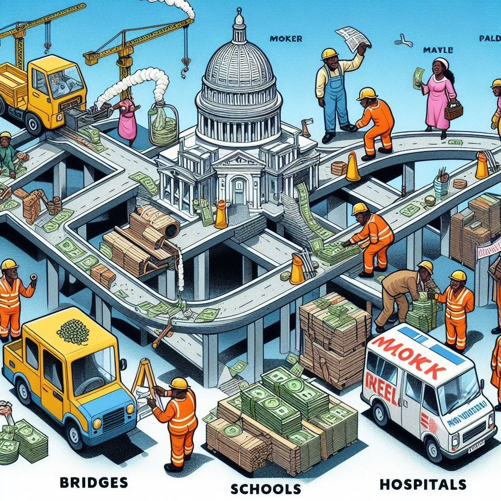
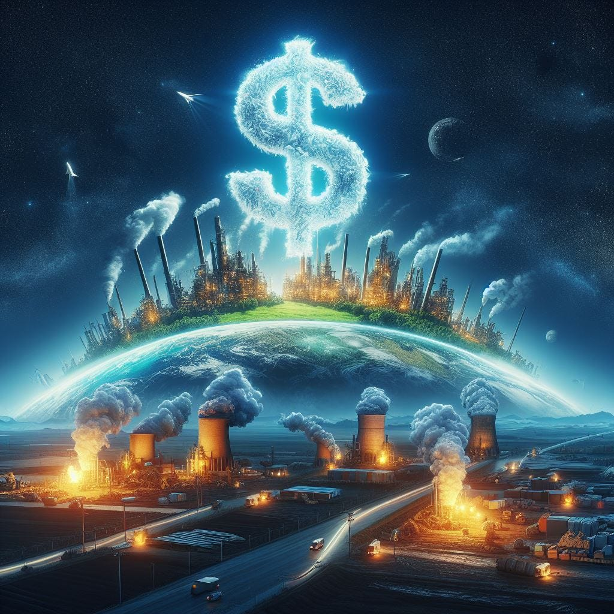
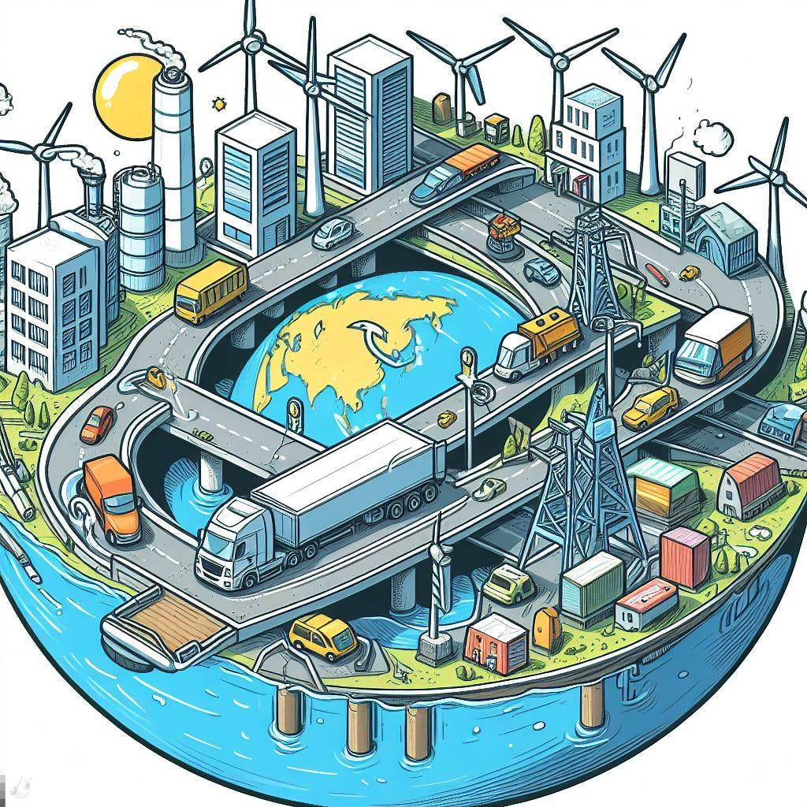
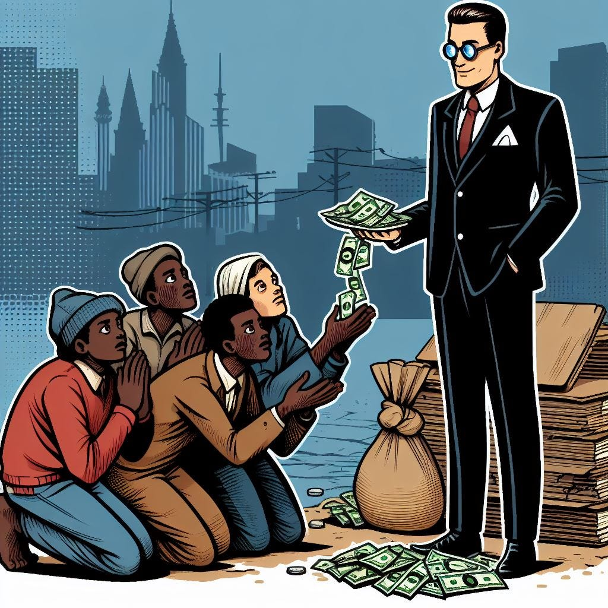
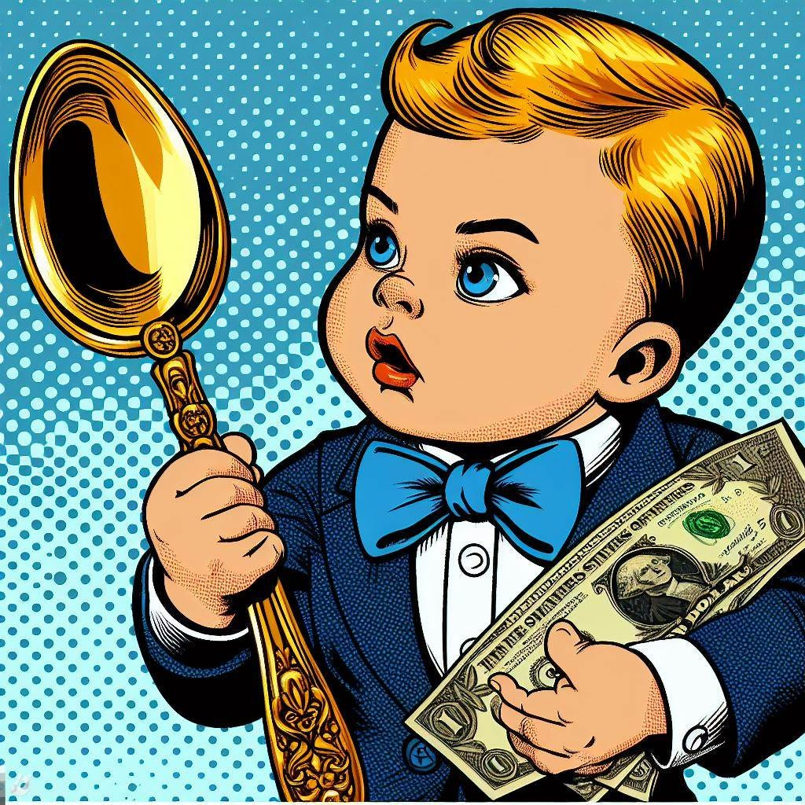

<figure class="ai-generated">
    
</figure>

I love to think about how to make our society better. Taxation is a crucial part of a working society. We want to have safe drinking water, roads, police, firefighters, free education to build a fair foundation to flourish even for people from poor families, and much more.

The question is how we get the money.

**Printing money** would be one way. The effect would be that every Euro would become equally less valuable. That means high net-worth individuals and companies would convert their Euros to other currencies like the Dollar, Pound, or Yen. I’m uncertain about the follow-up effects, but let’s assume it’s a bad idea. We can explore in another article what would happen with that approach.

Assuming that we have to get it through taxes, I was thinking about which taxes we have, if they are helpful, and how high they should be. Let’s have a look at the main taxes of 2022:

<figure>
    
    <figcaption>Taxes in Germany in Billion EUR (2022)</figcaption>
</figure>

The public pension fund, income tax, and public health insurance are directly deducted from the income. I’d call all of them “**income tax**”. I just wanted to avoid that you get confused when you look for the sources ([bpb.de](https://www.bpb.de/kurz-knapp/zahlen-und-fakten/soziale-situation-in-deutschland/61874/steuereinnahmen-nach-steuerarten/) and [destatis.de](https://www.destatis.de/DE/Themen/Staat/Steuern/Steuereinnahmen/steuereinnahmen.html) / [2](https://de.statista.com/statistik/daten/studie/39054/umfrage/einnahmen-der-gesetzlichen-rentenversicherung-seit-1990/#:~:text=Im%20Jahr%202022%20beliefen%20sich,rund%20362%2C98%20Milliarden%20Euro.)).

The other massive one is the **value-added tax** which is part of everything you pay for as a private person.

## Reducing Consumption and Internalizing Costs: Tobacco, Alcohol and CO2

<figure class="ai-generated">
    
    <figcaption>Created with AI</figcaption>
</figure>

Both are harmful to the health if they are consumed in too large quantities. Adding a tax on it makes consumption more expensive, hopefully reducing the extremes and giving the country the money to deal with the negative consequences.

The tax should be increased when issues are observed. Also, advertisements for those kinds of goods should not be allowed.

<figure class="ai-generated">
    
</figure>

The price should represent the cost of providing that good or service. Sadly, we do have externalized costs. For example, think about a public toilet. The cost of providing that toilet is certainly the cost of building it, the cost of water for flushing, maybe electricity. If the toilet pumps the waste into a public river, then the cost of cleaning it is externalized to the public. The provider of the toilet does not have to pay for it.

In this example, the cost can be internalized by providing a sewage system, making usage of it mandatory, and charging for it.

The same is the case of CO2: Emitting greenhouse gases was free for a long time. It causes climate change which costs money due to natural catastrophes. The cost is externalized. By putting a price tag on emitting CO2 the cost is internalized again.

Internalizing costs brings the price closer to the true cost of a good or service. That enables the market to switch to better solutions.

## Task-specific taxes: Motor vehicle tax, the Energy Tax, and Broadcasting fees

<figure class="ai-generated">
    
</figure>

Building bridges and roads is expensive. People who use them more should pay more for them.

The motor vehicle tax and the energy tax go both in the same direction. As just owning a vehicle doesn’t change anything I’d rather get rid of the motor vehicle tax and increase the energy tax by 28% to compensate for it.

The [Federal Ministry for Digital and Transport of Germany](https://en.wikipedia.org/wiki/Federal_Ministry_for_Digital_and_Transport) plans to spend 38 Billion EUR in 2024 ([source](https://www.bundeshaushalt.de/DE/Bundeshaushalt-digital/)), which is mostly spent on streets and train tracks, but also on waterways.

The energy and vehicle tax makes about 43 billion EUR, so it roughly works out.

Although I’m not happy with the broadcasting fee for other reasons, it is also such a type of task-specific tax.

## Social Redistribution: Income tax, inheritance tax, and corporate taxes

<figure class="ai-generated">
    
</figure>

Removing the income tax would mean that [working off the books](https://en.wikipedia.org/wiki/Unreported_employment) would no longer pay off. We would still want to have the same expenses, so we would need to increase other taxes.

The Value-added tax could be increased by a bit, but not too much otherwise the poorest would have less money.

Removing that tax would greatly benefit the highest-income people, but not change much for very low incomes. That makes any change very hard. Likely the real estate transfer tax as well as the inheritance tax could be increased. Maybe also the trade and corporate tax.

<figure class="ai-generated">
    
</figure>

Inheritance tax is another type of social redistribution tax. The idea here is to mainly reduce the super-wealthy. At the moment in Germany, however, I feel like this mainly affects families of medium wealth. Very low-wealth families are not affected and very high-wealth families have ways to avoid taxation.

## General government tasks: Value-added tax

<figure class="ai-generated">
    
</figure>

I tried to find more detailed information about where those come from. Buying food feels very different from going to the cinema. For basic necessities like food and water, I’d want no tax. For nice-to-have stuff, the tax could be higher instead.

## Local Government: Local Luxury Taxes

<figure class="ai-generated">
    
    <figcaption>Created with AI</figcaption>
</figure>

Germany is federally organized: 16 states have a wide range of competencies that are secured by the constitution. For example, building codes and how the education system works are none of the business of the federal government, but only of the states.

The third layer is the towns and municipalities. They have to enact all of the laws that the German government and their specific state government make. To do so, they receive money directly from the state, but they also have a few ways to get money by themselves:

* [Dogs](https://en.wikipedia.org/wiki/Dog_licence#Germany): A yearly fee you have to pay if you own a dog
* [Entertainment tax](https://de.wikipedia.org/wiki/Vergn%C3%BCgungsteuer_%28Deutschland%29): Slot machines, sexual services, entrance fees
* [Second home tax](https://de.wikipedia.org/wiki/Zweitwohnungsteuer): A yearly fee you must pay if you are registered in a second city.

## Summary

Taxes have important functions besides giving the government a way of enacting policies:

* **Social welfare**: Redistribution from the wealthy to the ones in need to give people a fair chance to become wealthy and to guarantee a minimum quality of life.
* **Reducing Consumption and Internalizing Costs**: Pushing people in the right direction so that the world becomes a better place.
* **Task-specific taxes**: In some cases, it’s possible and reasonable that people who profit from some government actions pay more or less directly for it.

While writing this mini-article I’ve also noticed several issues:

* **Responsibility**: The German government might make a bill that municipalities have to fulfill. The country gets most of the income, but the municipalities have to pay for a lot of the laws. This causes issues.
* **Tax competition**: Giving the municipalities and states ways to improve their finances sounds good at first, but it leads to tax competition with negative consequences for the general public.
* **Transparency**: Due to its federal structure, it’s astonishingly hard to figure out how much tax money Germany made and on which topics it was spent. This makes an analysis of changes extremely tedious.
