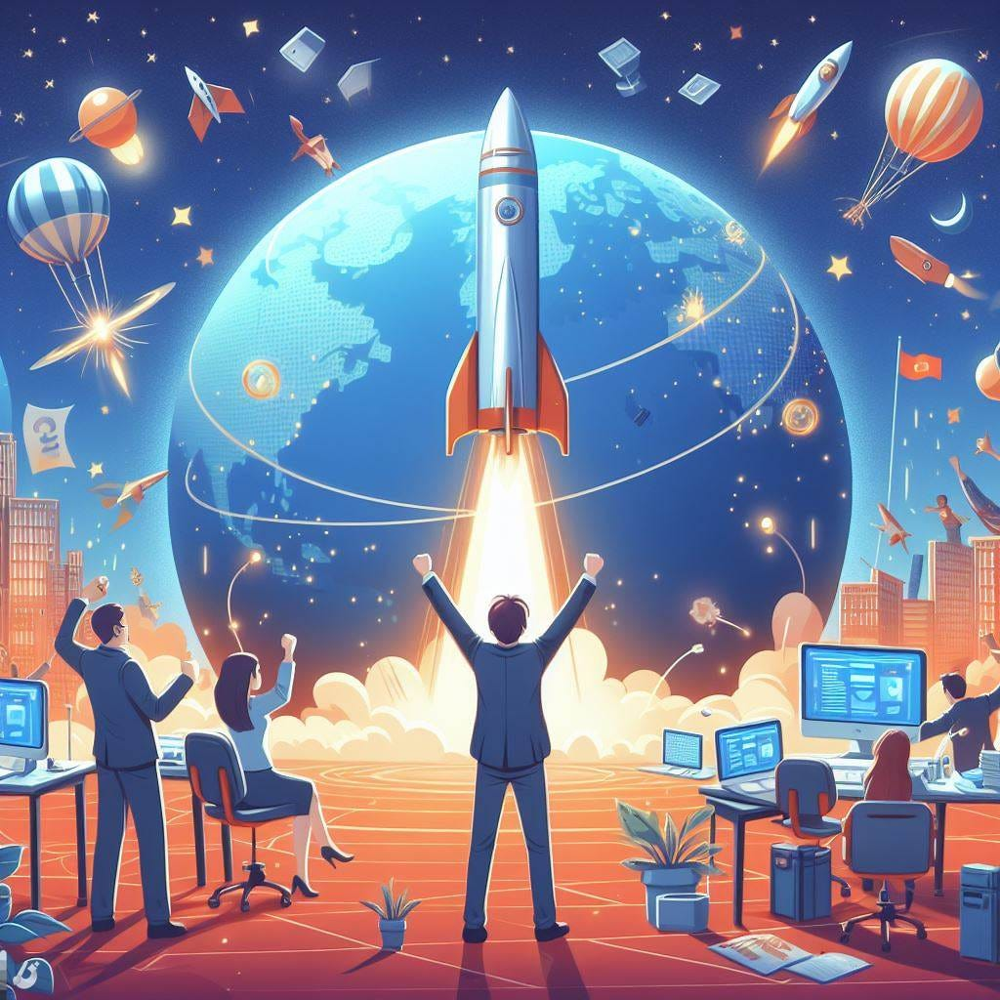
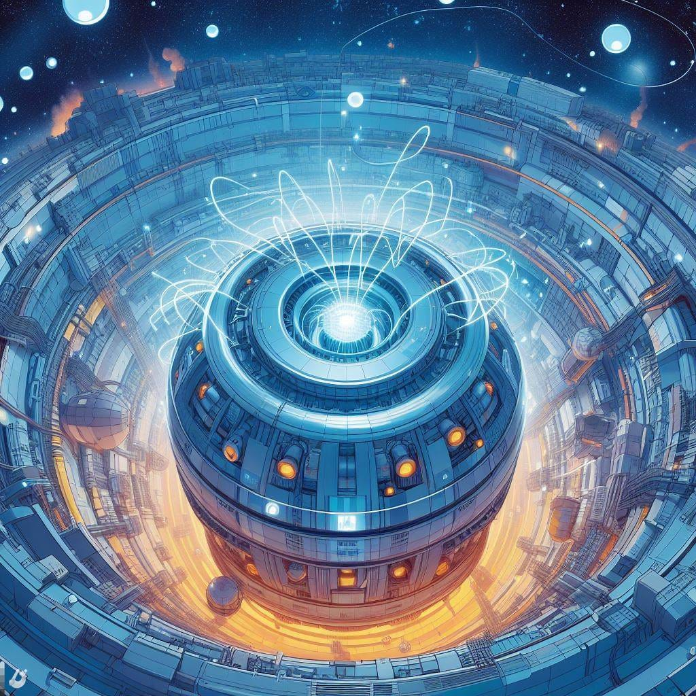
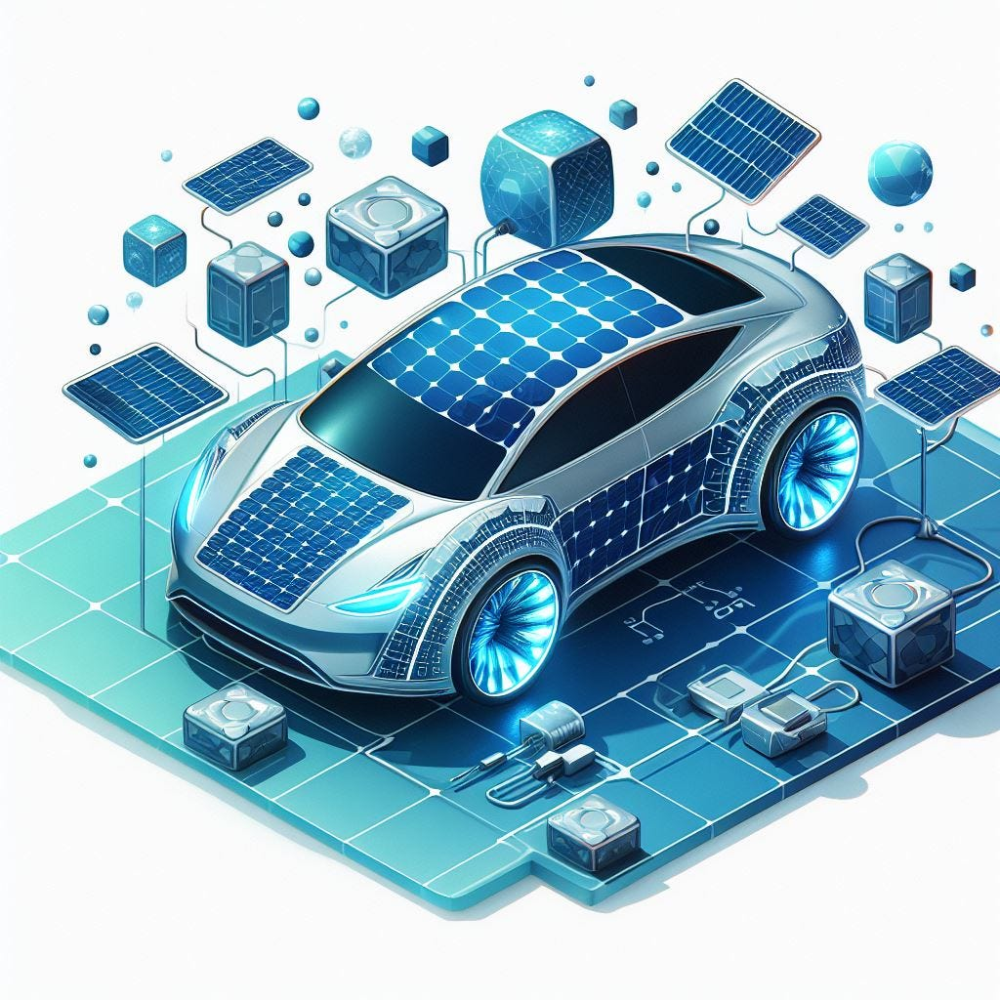
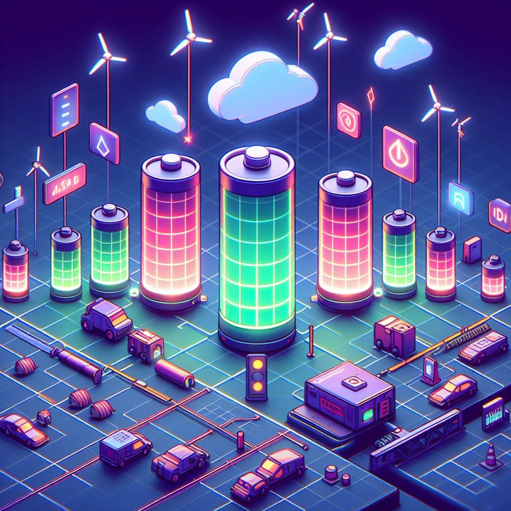
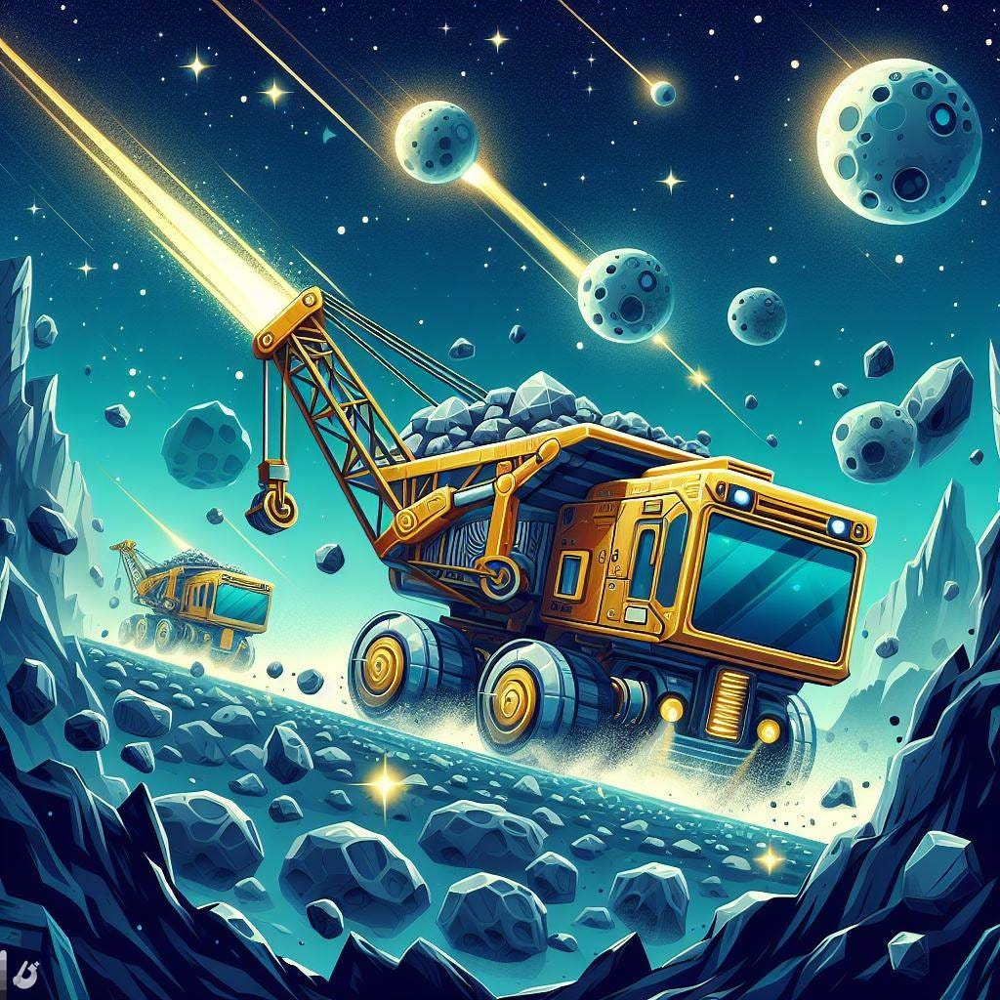
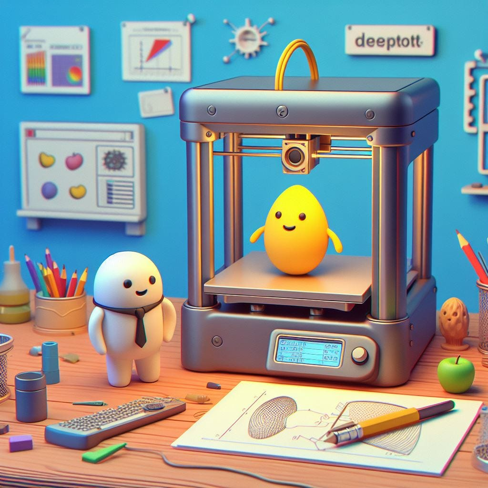
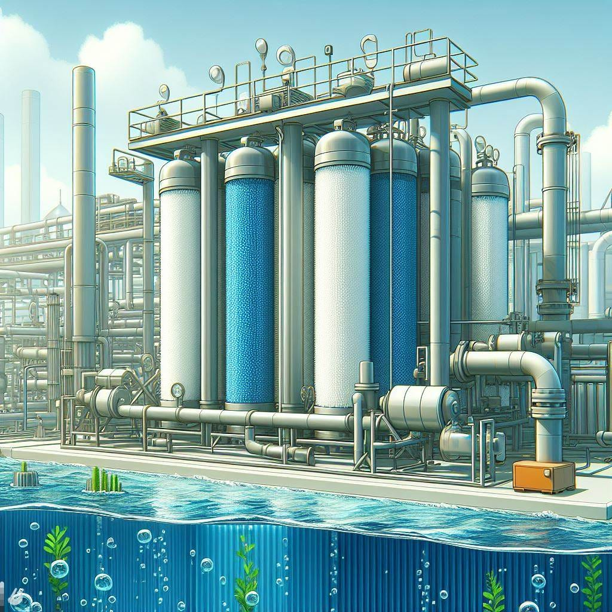

<figure class="ai-generated">
    
</figure>

Technological breakthroughs are fascinating. I love dreaming about a better world. A better world that we can achieve by expanding the capabilities of humanity. Join me in my excitement about a potentially bright future🚀

## №1 — Energy: Nuclear Fusion

<figure class="ai-generated">
    
</figure>

Nuclear fusion is the dream energy source: Clean and cheap. If we could make it work, a lot of our problems could be solved. Depending on how cheap it would be, it would catapult humanity into a new era.

## №2 — Energy: Efficient Solar Cells

<figure class="ai-generated">
    
</figure>

If we get more efficient solar cells, we can create energy more easily in a distributed way. No more need for big power plants. The decentralization would make us more resilient to catastrophes.

Current available modules have an efficiency of about 23 percent.

## №3 — Energy: Improved Grid-Scale Batteries

<figure class="ai-generated">
    
</figure>

If we could store huge amounts of energy for much longer, for example, several months, we could use the power we get in summer within the winter months. Even if it was just a few days, we could make renewable energy way more reliable.

The [Moss Landing Power Plant](https://en.wikipedia.org/wiki/Moss_Landing_Power_Plant) has a battery with 2,270 MWh. That is about the energy 1000 two-person households use in a year. Completely crazy.

## №4 — Resources: Asteroid mining

<figure class="ai-generated">
    
</figure>

Mining pollutes the environment, costs a lot of time, and is energy-intensive. Mining is difficult when the concentration of the desired metal is low in the ore. That could be drastically better on some asteroids — if we could get there and move the metals back to Earth.

## №5 — 3D printing

<figure class="ai-generated">
    
</figure>

Imagine a world in which you would no longer need to go to a store. You would also not need to wait for package delivery — or at least the package would not need to travel from China around the world. Instead, communities would have 3D printers. Cheap ones can make simple things like boxes or toys. More complex printers could print clothes and tools. And the most advanced 3D printers could **print organs**. No need to wait for a donor — you get your liver printed.

[We do already print organs](https://en.wikipedia.org/wiki/Organ_printing). But nothing complex.

[Metal printing](https://www.youtube.com/watch?v=NkMRzpobmQQ) and [3D food printing](https://en.wikipedia.org/wiki/3D_food_printing) are also already a reality. Sadly, nothing close to [the replicator of Star Trek](https://en.wikipedia.org/wiki/Replicator_%28Star_Trek%29).

## №6 — Water: Efficient Desalination

<figure class="ai-generated">
    
</figure>

Clean drinking water is crucial for humanity. Despite living on a planet with huge oceans, drinking water is scarce. The reason is salt. We cannot drink seawater as it contains too much salt. Removing the salt is technically easy — just boil it and get the condensed water. However, that is extremely energy-intensive. It’s just too expensive. Using membranes we can do better, but it’s still not good enough.

Efficient desalination of water would help millions of people.

Currently, we need 3 kWh/m³. Reverse osmosis gets to roughly 2 kWh/m³. One person needs roughly 200L of water per day. With a price of 0.30€/kWh that would cost 0.18€/day. Local freshwater costs around 0.2 kWh/m³. So it’s still 15x cheaper and it will likely always stay 5x cheaper.

## №7— Human Manual Labor: Humanoid Robots

<figure class="ai-generated">
    
</figure>

Humanoid robots like the Toyota T-HR3, the Tesla Bot, or the ones by Boston Dynamics might enable a completely new level of automation. Tesla even claims their Tesla Bot Optimus would 100x the world economic output ([source](https://www.theverge.com/2022/9/30/23374729/tesla-bot-ai-day-robot-elon-musk-prototype-optimus-humanoid)).

## №8 — Human Intellectual Labor: Artificial intelligence

<figure class="ai-generated">
    
</figure>

The current hype around [Large Language Models](https://en.wikipedia.org/wiki/Large_language_model) (LLMs), mostly around ChatGPT, shows the potential. Having access to such a tool boosts productivity and enables completely new features. It doesn’t replace humans so far — but it makes people more efficient. So we need fewer people to get the same amount of work done. Think only about the images I created for this article. I could not have done that by myself without AI tools.
