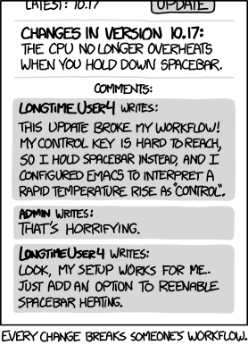
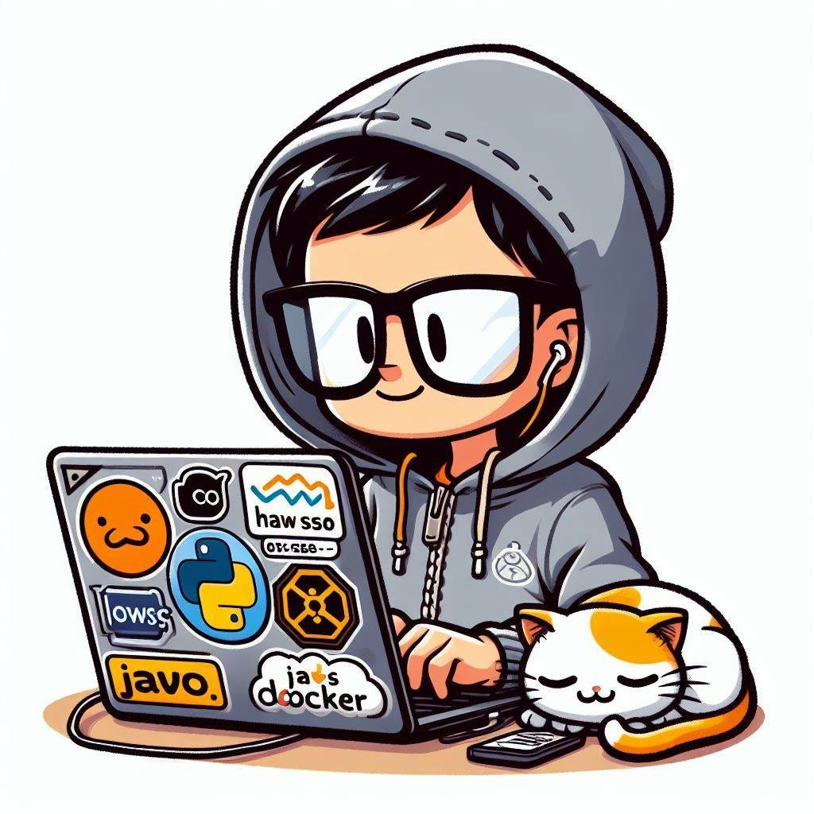
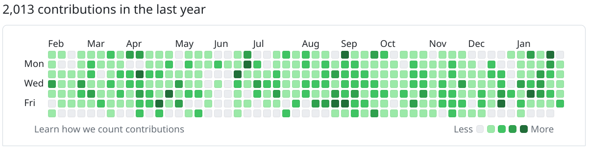

<figure class="ai-generated">
    
</figure>

Are you a maintainer of open-source software who wants to become better? In this article, I reflect on my work as the maintainer of pypdf/PyPDF2.

The first two sections give you some context. They can be skipped if you just want an answer to the question: *What is a good maintainer?*

## What is pypdf?

pypdf is a free and open-source pure-python PDF library capable of splitting, merging, cropping, and transforming the pages of PDF files. It can also add custom data, viewing options, and passwords to PDF files. pypdf can retrieve text and metadata from PDFs as well.

It was actively developed from 2011 to 2016. It works for a lot of use cases and thus the Python community still used the library a lot — although it didn’t receive any update until 2022. In April 2022, I became the maintainer of PyPDF2.

PyPDF2 is a fork of pyPdf — a way older project. The developers of PyPDF2 always wanted to keep backward compatibility. I didn’t feel that need. If I think the overall project benefits from breaking compatibility, I will do it.

## How I became the maintainer of PyPDF2

I became the maintainer of PyPDF2 in April 2022. It was a random event — I never intended to become the maintainer. I was writing a book about software development with Python. One section is about PDF — which meant that I needed to look up the current situation of libraries.

I wanted to make the situation for readers of my book as easy as possible and asked PyPDF2 maintainers to officially mark their project as dead. That was the point when I was asked if I was interested in becoming the maintainer.

Knowing my passion for software gardening, I hesitated to say “yes”. I tend to spend an insane amount of time when I get hooked on a topic. There was (and is) nothing in it for me: I am already employed at a great company, and I am recognized as a very senior developer. Maintaining PyPDF2 is not paid. I am not even the original author, meaning that I don’t get credits for that.

What should I say … I got hooked by the challenge. Software that is still used by hundreds or thousands of people and wasn’t maintained for 6 years is in a weird spot:

On the one hand, PyPDF2 was **super stable** for many years. People found workarounds for the known bugs.

<figure>
    
    <figcaption><a href="https://xkcd.com/1172/">xkcd-1172</a> by Randall Munroe</figcaption>
</figure>

On the other hand, there was no new development. No bugs were fixed. No new features were added. No syntax update since … I don’t know. Probably 2005, when the original version of pyPdf was released. Back then, Python 2.5 was hot and new. Yes, Python 2. And not 2.7. **Python 2.5**.

When I thought about the project, I realized that it’s confusing for beginners to see pyPdf and PyPDF2. The spelling and the fact that those are different packages — not only different versions. Hence I politely asked the maintainer of pyPdf if I could take over his project and merge the two again. That was astonishingly easy.

## Purpose: Why does the Software exist?

<figure class="ai-generated">
    
</figure>

Software changes all the time because the world around it changes. Having a clear purpose helps to state clearly which problems you want to tackle — and what is out of scope.

Once you have a purpose, you’re also not too far away from some example use-cases and workflows.

This should be part of the project's README: What is the software about and how can I use it? Where is the documentation? Where is an entry point for contributing?

## Personas in Open-Source Software

As a maintainer, you will interact with at least three kinds of people:

<figure class="ai-generated">
    
    <figcaption>Users, Contributors, and Maintainers.</figcaption>
</figure>

**Users** are people who just want to use your software. They might not be developers. Or maybe they are, but they don’t want to get too deep into your project.

**Contributors** are people who try to help to improve the project you’re maintaining. They might report bugs or other issues, they might do community work in answering questions about your software, or they create pull requests (PRs) with which they actively want to participate in developing the software. Some of them might use your software at work, others just contribute in their free time.

**Maintainers** are contributors with the privileges to apply changes to the software, close/edit/move issues on the issue tracker, upload new documentation, or create releases. Ideally, you’re not the only one.

## Understand people’s needs

Think about when the different personas are happy:

**Users** are happy when your software fulfills its purpose in an efficient way without bugs. They care about documentation and how to use the software — but they prefer not to read the docs at all.

**Contributors** are happy when they receive swift feedback. They want their contributions to be acknowledged and their knowledge to be appreciated. Once in a while, they need a little bit of help to get the work done.

**Maintainers** puzzle me. I think some love to help people. Others like to be in control and be able to decide. Ideally, they want to serve the whole community. For a maintainer, a high test coverage and working processes around issue reporting are key. The more is covered via automatic workflows in Continuous Integration (CI), the better.

## Technical Skills

<figure class="ai-generated">
    
</figure>

Maintainers need to understand the project they are maintaining. They need to understand the capabilities and the scope.

Astonishingly, the maintainers don’t need to understand everything in detail. It’s ok if there are contributors who know specific details better. However, be aware that people might ask questions about everything that goes into the code. If the original contributor is gone, you need to answer those questions or decide without understanding those parts. Hence it is in every maintainer’s interest to ask questions if they don’t understand parts of the contribution.

## Communication

<figure class="ai-generated">
    
    <figcaption>Created with AI</figcaption>
</figure>

A maintainer needs to be clear in the communication to help contributors understand where the project is going; just like a **product manager**. People want to add functions that are useful for their specific use cases. That is not always something useful for many people. In some cases, the cost of a new feature in maintenance and cluttering the public API is higher than the use of it.

Maintainers need to be **teachers and coaches**, as contributors have a wide range of skills: Some have better technical skills than the maintainer; others make their first steps into software engineering. A good maintainer can start the career of a contributor — for me, it was [Ralf Gommers](https://github.com/rgommers). I had little practical knowledge of using git in collaborative software development. He was kind, pointed me to the right resources, but also pointed out issues.

It’s a good idea to also have a look at users' needs once in a while. The **documentation** could not be good enough. There might be an **internal inconsistency** or a **missing feature**. In most cases, the users likely just didn’t search enough or want something that is not possible with your software. I regularly look for pypdf questions on StackOverflow.

The documentation helps a lot. It should not only cover the usage of the software, but also meta-topics like project governance, release cycles, and how contributions work.

## Examples of amazing maintainers

The open source community is big and there are tons of amazing people. People who could work in big tech companies for crazy salaries and relax in their free time, but choose to write free software for everybody.

Two concrete examples directly pop to my mind:

[Charlie Marsh](https://github.com/charliermarsh) is the developer who created the linter [ruff](https://pypi.org/project/ruff/). He has a clear vision, started his project, and made it big. Some people have not only the technical skills to do that but also the marketing capabilities to push the project and the project management skills necessary when many people start contributing and using it. Truly amazing.

My hero is [Ralf Gommers](https://github.com/rgommers) as he has motivated me to contribute to open-source software: He has been super active since 2012 without longer breaks. Every single interaction I’ve seen from him was kind and constructive.

Thank you to all the amazing people in the open source community ❤️

<figure>
    
    <figcaption>Contributions of Ralf Gommers</figcaption>
</figure>
