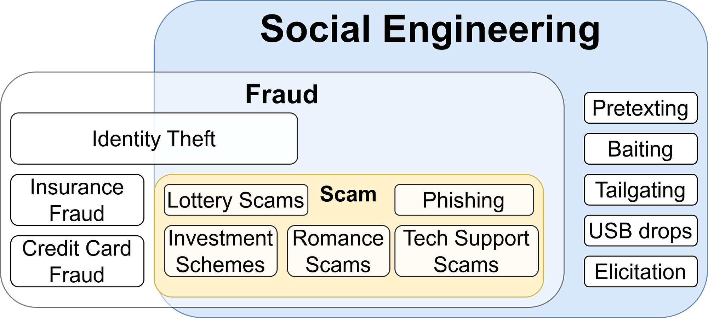
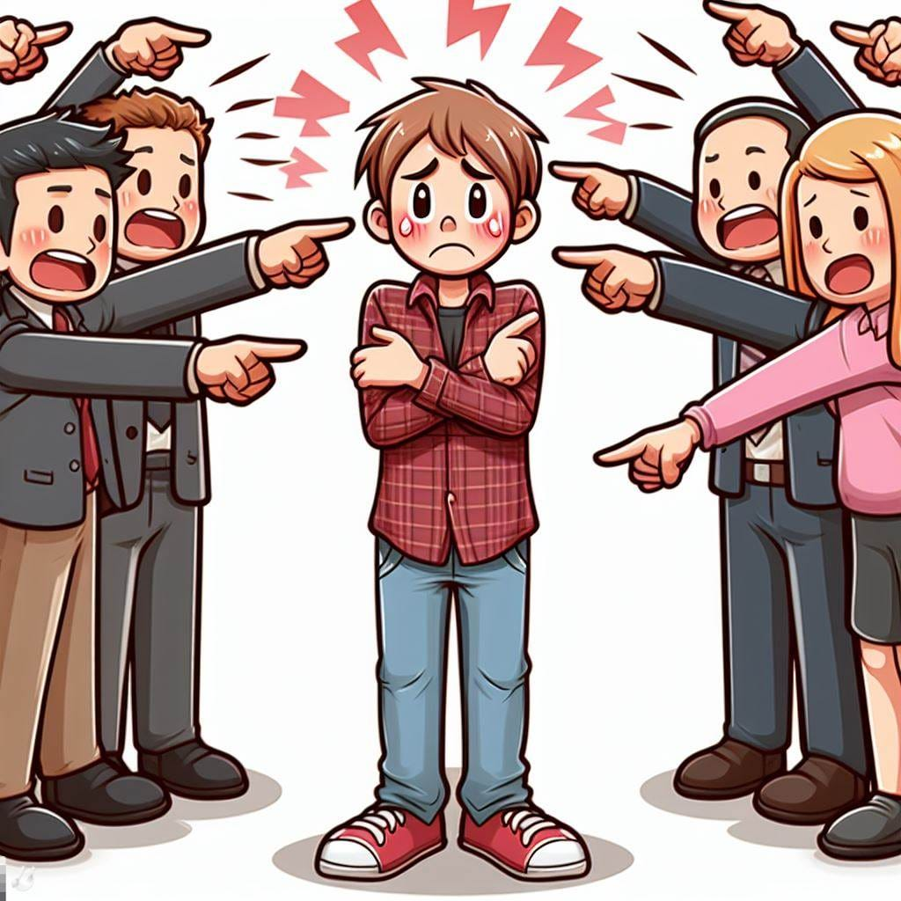

<figure>
    
</figure>

Social Engineering is the art of manipulating people. It’s not necessarily illegal, for example when children fake being sick so that they don’t have to go to school.

Social Engineers are also not doing anything illegal when they apply **elicitation:** A subtle form of getting information through normal conversations. Think about a friendly conversation at the airport. Maybe you think you’re flirting, but the other person wants to get more information about your employer. Just asking questions without any force.

**Pretexting** is giving some form of cover story or context for follow-up social engineering. It could be used for elicitation, e.g. in the movie [Taken](https://en.wikipedia.org/wiki/Taken_%28film%29) in which two tourists share a taxi with a stranger to cut costs. In that context, the stranger learns where they sleep and that they are alone.

<iframe width="560" height="315" src="https://www.youtube.com/embed/8DOEdC1t68U" title="YouTube video player" frameborder="0" allowfullscreen></iframe>

**Tailgating** is a very simple way to get access to a building — you just walk in after somebody else. You may even ask if they can hold it open. You could give some context by claiming you forgot your card or that it’s your first day.

**USB drops** are another straightforward technique. The attacker just leaves USB sticks with malware in a public place and hopes somebody plugs them in. **NEVER** plug an unknown device into your machine!

[**Scareware**](https://en.wikipedia.org/wiki/Scareware) is malware that claims to help — big popups on websites claiming “You have a virus!” and giving you the option to install anti-virus software. However, that supposedly anti-virus software **is** the virus.

## Fraud, Scams, and Phishing

The really interesting parts of social engineering are **fraud** cases. Fraud is intentional deception to secure unfair or unlawful gain or to deprive a victim of a legal right ([source](https://en.wikipedia.org/wiki/Fraud)). A big sub-category is scams.

A **scam**, or confidence trick, attempts to defraud a person or group after first gaining their trust. Confidence tricks exploit victims using a combination of the victim’s credulity, naïveté, compassion, vanity, confidence, irresponsibility, and greed ([source](https://en.wikipedia.org/wiki/Scam)). There are [tons of scams](https://en.wikipedia.org/wiki/List_of_confidence_tricks#Persuasion_tricks).

**Phishing** is a form of scam that refers to attempts to impersonate a trustworthy communication partner via fake websites, e-mails, or text messages. It is not targeted but aims at a large group of potential victims

**Spear-phishing**, in contrast, uses fake e-mails or websites to lure a small group or even a single victim into revealing secrets. If the target is an executive, it’s sometimes also called **whaling**. When the CEO is not the victim, but the attacker claims to be the CEO who gives orders e.g. to transfer money, it’s called **CEO fraud**.

[**trustedsec/social-engineer-toolkit** *Copyright 2020 The Social-Engineer Toolkit (SET) Written by: David Kennedy (ReL1K) @HackingDave Company: TrustedSec…*](https://github.com/trustedsec/social-engineer-toolkit)

## Greed

<figure class="ai-generated">
    
</figure>

Some scams lure their victims with the promise of quick wealth. The [**advance-fee scam**](https://en.wikipedia.org/wiki/Advance-fee_scam) is a well-known scam that uses people's greed. The Nigerian prince who is e.g. currently in prison. They need to pay bail to get out of prison. Once out, they give you a lot of money to show their gratitude.

A [**high-yield investment program**](https://en.wikipedia.org/wiki/High-yield_investment_program) is a type of Ponzi scheme that appeals directly to people's greed. The idea is to give them an investment opportunity. They will likely be suspicious in the beginning and only invest a little. The scammer pays out returns, either from their own money or from the money of other victims, so that the victims build trust. Once a lot of money is given, the scammer disappears — leaving the victim with a net loss.

A variant is called [**pig butchering**](https://en.wikipedia.org/wiki/Pig_butchering_scam): Essentially the same as the high-yield investment program, but done by a person whom the victim had a romantic relationship with:

[**The Pig Butcher - Darknet Diaries** *The #1 crime which results in the biggest financial loss is BEC fraud. The #2 crime is pig butchering. Ronnie…*](https://darknetdiaries.com/episode/141/)

## Shame Blackmailing

<figure class="ai-generated">
    
</figure>

Shame is a powerful feeling that is used in scams:

* [Sextortion](https://en.wikipedia.org/wiki/Sextortion) refers to a form of blackmail in which sexual information or images are used to extort money or sexual favors from the victim. Those might be completely out of the blue without any actual data, e.g. an e-mail claiming that the blackmailer has photos of the victim masturbating or having sex.
* A [romance scam](https://en.wikipedia.org/wiki/Romance_scam) is a confidence trick involving feigning romantic intentions towards a victim, gaining the victim’s affection, and then using that goodwill to get the victim to send money to the scammer under false pretenses or to commit fraud against the victim. The victim can feel embarrassed to fall for it and might not go to the police.

## Principles of Social Engineering

Robert Cialdini has identified six principles of influence in “Influence: The Psychology of Persuasion” (1984):

* **Reciprocity**: I give you, you give me.
* **Authority**: Academic titles help to persuade people.
* **Scarcity**: Perceived scarcity drives demand. Think about diamonds. Or toilet paper during COVID-19.
* **Commitment** & **Consistency**
* **Social Proof**: People do things they see other people do. There are quite a lot of hidden camera experiments.
* **Liking:** If people like you, they will believe you.

Those are covered in the 37C3 talk:

<iframe width="560" height="315" src="https://www.youtube.com/embed/r8bQeZe844g" title="YouTube video player" frameborder="0" allowfullscreen></iframe>

<!-- series: appsec -->
