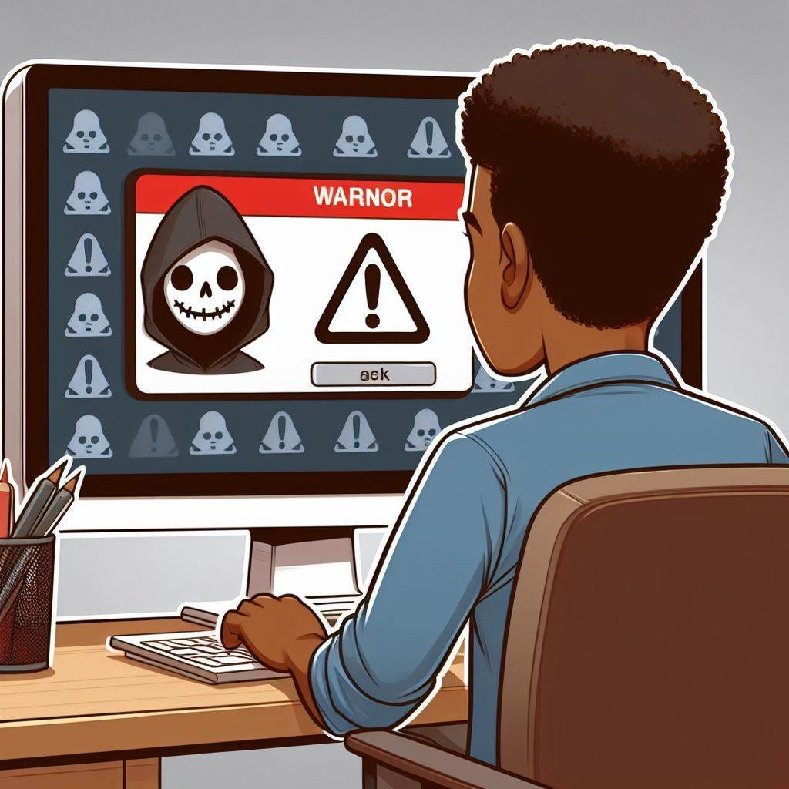
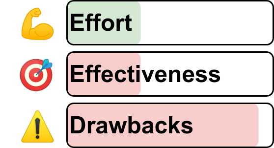
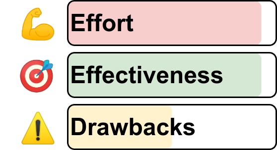
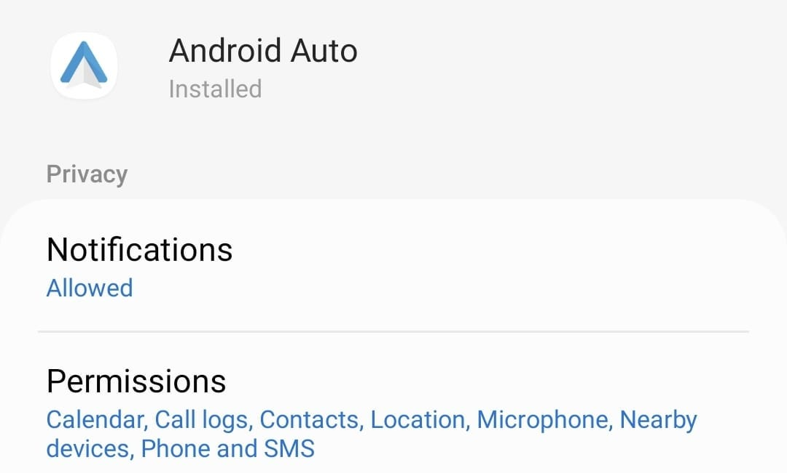

<figure class="ai-generated">
    <a href="../images/2024/03/click-at-your-own-risk-no-app-store-is-safe-1.jpg"></a>
</figure>

Why do software marketplaces such as the Android Play Store, the iOS App Store, Docker’s Docker Hub, Python’s PyPI, or JavaScript’s npm have so much malware? Can’t they do more against it? Is it just a money question?

Let me show you the reasons!

## Reality Check: Is it that bad?

Let me give you some of the titles of stories of malicious apps in software marketplaces:

* **Google Play Store** (Android, [2.4 million apps](https://www.statista.com/statistics/266210/number-of-available-applications-in-the-google-play-store/), 1+ billion monthly active users): [Google Play malware clocks up more than 600 million downloads in 2023](https://www.kaspersky.com/blog/malware-in-google-play-2023/49579/), [spyware installed 421 million times from Google Play](https://www.bleepingcomputer.com/news/security/android-apps-with-spyware-installed-421-million-times-from-google-play/)
* **Apple App Store** (iOS, [1.6 million apps](https://www.statista.com/statistics/779768/number-of-available-apps-in-the-apple-app-store-quarter/), 1+ billion monthly active users): [fraudulent Chinese apps on the Mac App Store](https://9to5mac.com/2022/08/04/fraudulent-chinese-apps-mac-app-store/), [Apple removed 18 harmful apps from the App Store](https://www.businessinsider.com/apple-removes-harmful-adware-iphone-apps-2019-10), [Pig-butchering scam apps sneak into Apple’s App Store](https://arstechnica.com/information-technology/2023/02/pig-butchering-scam-apps-sneak-into-apples-app-store-and-google-play/), [XcodeGhost Malware Infected 100+ Million iOS Users](https://www.intego.com/mac-security-blog/xcodeghost-malware-infected-100-million-ios-users-and-apple-said-nothing/)
* **Dockerhub** (Docker, [8.3 million repositories](https://www.docker.com/blog/docker-index-shows-continued-massive-developer-adoption-and-activity-to-build-and-share-apps-with-docker/), [13.4 million monthly active users](https://www.devopsdigest.com/red-hat-universal-base-image-available-on-docker-hub)): [Docker Hub repositories hide over 1,650 malicious containers](https://www.bleepingcomputer.com/news/security/docker-hub-repositories-hide-over-1-650-malicious-containers/), [Malicious Docker Hub Container Images Used for Cryptocurrency Mining](https://www.trendmicro.com/vinfo/it/security/news/virtualization-and-cloud/malicious-docker-hub-container-images-cryptocurrency-mining)
* **NPM** (JavaScript, [2.1 million packages](https://nodejs.org/en/learn/getting-started/an-introduction-to-the-npm-package-manager), [1+ million monthly active users](https://blog.npmjs.org/post/143451680695/how-many-npm-users-are-there.html)): [Malware found in npm package with millions of weekly downloads](https://therecord.media/malware-found-in-npm-package-with-millions-of-weekly-downloads)
* **PyPI** (Python, [0.5 million projects](https://pypi.org/), thousands of active users): [116 Malware Packages Found on PyPI Repository Infecting Windows and Linux Systems](https://thehackernews.com/2023/12/116-malware-packages-found-on-pypi.html)

To summarize: Malware is present in every software marketplace. The marketplaces with more users are targeted more often.

## What are the core problems?

Why is it so hard to create a secure software marketplace?

1. **Too many app versions**: Every day hundreds of software packages get uploaded to each marketplace. It’s just impossible to manually and thoroughly check all of them. Every new version could have malware. So it’s not enough to check the app once.
1. **Rinse and repeat**: Assume malware was detected and removed from the marketplace. Then the attacker can upload the same malware with minor modifications.
1. **Automatic detection is flawed**: It’s very hard to detect malicious software automatically.

## What could software marketplaces do to fight malware?

### №1: Clear Reporting Paths

Let users help you to identify malicious software. It sounds simple, but such a reporting path also means the marketplace needs a team dealing with the reports.

* The [Android Play Store](https://support.google.com/googleplay/answer/2853570?hl=en&co=GENIE.Platform%3DAndroid&sjid=9305752021454669852-EU) has a button.
* I guess the Apple App Store also has one, but I could not find it. Hence I’m rather certain that it’s not effective.
* PyPI: [Reporting a security issue](https://pypi.org/security/) and [a report button](https://blog.pypi.org/posts/2024-03-06-malware-reporting-evolved/)
* NPM: [Reporting malware in an npm package](https://docs.npmjs.com/reporting-malware-in-an-npm-package)

### №2: Pay-to-Publish

<figure>
    <a href="../images/2024/03/click-at-your-own-risk-no-app-store-is-safe-2.png"></a>
    <figcaption>Implementing a pay-to-publish option is rather easy for many software marketplaces if they already have a payment option. The effectiveness is low because malware can generate a high income. Additionally, this option has the severe drawback of closing the marketplace for some people.</figcaption>
</figure>

The more expensive an action becomes, the more people try to avoid it. That means if app developers needed to pay something for every single app update, they would do it less often. The same goes for malware developers.

Let’s see who employs this tactic:

* Apple App Store: 99 USD/year
* Google Play Store: 25 USD (once)
* PyPI (Python): Free
* NPM (JavaScript): [Free](https://www.npmjs.com/products)

### №3: Identify uploaders

<figure>
    <a href="../images/2024/03/click-at-your-own-risk-no-app-store-is-safe-3.png"></a>
    <figcaption>Requiring the identification of users to upload software means that the infrastructure to identify people needs to be created. That is very hard. If it should be effective, identifications need to be done in a similar way as banks do it. This means either <a href="https://en.wikipedia.org/wiki/Electronic_identification">eID</a> or <a href="https://www.binance.com/en/support/faq/%E2%80%8B%E2%80%8Bhow-to-verify-my-binance-account-with-video-identification-45ffb16556c540c6acc1766631efe985">Video Identification</a>. I assume this would be effective as it would be a lot harder to upload new versions. In the end, malware creators do not want to have the malware tied to their identities. The big drawback would be the identification: Some users will hate it, and the software store suddenly needs to deal with sensitive data (privacy).</figcaption>
</figure>

When people want to open a bank account in Europe, they have to be identified. The process is not perfect, but it does take some effort to fake this and it’s certainly nothing an attacker can do in bulk.

Similarly, if the software marketplaces would require identification to upload software, uploading malware would become much harder.

Identifying people makes it impossible for an attacker to re-upload the same malware again and again. They need to do it with other people, which is more time-consuming.

However, those other people might just be victims of hacks. For example, [Gentoo’s GitHub mirror was hacked in 2018](https://www.zdnet.com/article/gentoo-github-mirror-hacked-and-considered-compromised/) and [Canonical’s GitHub account was hacked in 2019](https://www.zdnet.com/article/canonical-github-account-hacked-ubuntu-source-code-safe/).

### №4: Sandboxing and Permissions

<figure>
    <a href="../images/2024/03/click-at-your-own-risk-no-app-store-is-safe-4.png"></a>
    <figcaption>Implementing effective sandboxing is extremely difficult. Android and iOS have done it, but I don’t know if there is any option for desktop operating systems (Windows, Mac, Linux). Once a working sandboxing system is implemented, it is extremely effective in limiting malware. The malware needs to be more sneaky. The only drawback is usability: It’s hard for users to decide if a given set of permissions is reasonable.</figcaption>
</figure>

Sandboxing means that the smartphone or server running the software (the *platform*) allows the software less stuff to do. For example, restricting access to the network is a crucial one or to the local file system.

The more fine-grained this system is, the easier it is for a user to judge if something fishy might go on. For example, why would a flashlight need network access?

<figure>
    <a href="../images/2024/03/click-at-your-own-risk-no-app-store-is-safe-5.jpg"></a>
    <figcaption>Android’s permission system has quite a lot of options. Many are related to sensors, but also access to some parts of the software like contacts or the calendar.</figcaption>
</figure>

By default, the platform could forbid everything. The user has to give explicit permission to enable that — outside of the software.

## How malware scanners work under the hood

<figure class="ai-generated">
    <a href="../images/2024/03/click-at-your-own-risk-no-app-store-is-safe-6.jpg"></a>
</figure>

Malware scanners take a software bundle and make a decision: Is it bad?

The tricky part is that software cannot decide for arbitrary other software what it does. It’s a consequence of [the halting problem](https://en.wikipedia.org/wiki/Halting_problem).

As a simple example, take Python code. We typically have the code in plain text which gives you way more options for analysis. And let’s assume that software is always malware when it accesses the internet. In Python, that is typically done with the `requests` library. Hence you could search for `import requests` to determine if you have malware.

This approach has two problems:

1. **False positives**: You would identify tons of software as malware which has a legitimate reason to access the internet. For example, an application giving you a weather forecast.
1. **False negatives**: Attackers can avoid this type of detection.

For example, attackers could create a new package `not_requests` that imports requests. Their software would then depend on `not_requests`. As a response, the automatic check could take the [transitive closure](https://en.wikipedia.org/wiki/Transitive_closure) of the package's dependencies (hence all dependencies, including their dependencies).

Then the attacker does a dynamic import which is also done by plugin systems:

```python
import importlib

requests = importlib.import_module("requests")
```

Oh, and before you think the malware scanner could search for the string `requests`: The attacker can encrypt that string. It doesn’t matter that the decryption key is within the shipped code as the goal is only to prevent static analysis from detecting it. In the simplest case, they just apply base64. Or a self-written simple cipher. Nothing hard for a cryptographer to break, but impossible for a machine to automatically decipher when it’s part of a large code base.

## Summary

Software marketplaces will never be perfectly safe. For that reason, users should be careful which software they install and use.
