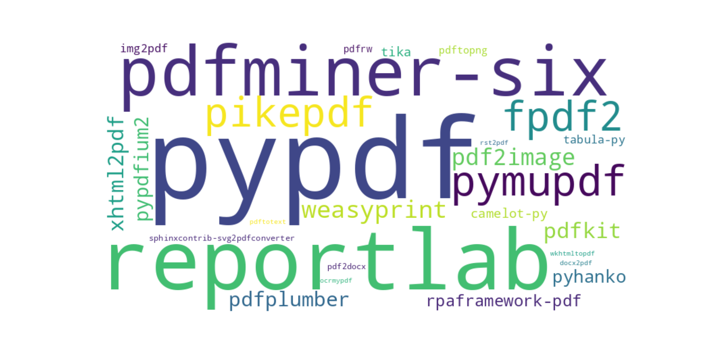

<figure>
    
</figure>

The Python PDF ecosystem is a mess. There are tons of packages on PyPI, but many of them are inactive. As I had the dubious fortune of having to work with PDF documents a couple of times in my career as a Python developer, let me guide you through this jungle.

Although people have [all kinds of Python/PDF-related issues](https://stackoverflow.com/questions/tagged/python+pdf+-pypdf+-pdfminer+-pandas+-python-imaging-library+-weasyprint+-flask+-django+-reportlab+-matplotlib+-pikepdf+-tabula+-selenium-webdriver+-wkhtmltopdf+-pdfrw+-ghostscript+-vba), most are around three topics: (1) Read text from PDF documents (2) Read tables from PDF documents (3) Generate PDF documents. I’ll focus on those.

Full disclosure: I am the maintainer of pypdf and PyPDF2. I’m also part of the py-pdf organization which aims to improve the Python ecosystem around PDF files. It contains pypdf, fpdf2, pdfly, and `pypdf_table_extraction`. I am biased when it comes to those libraries.

## The Top Libraries by PyPI Download Statistics 🏆

The PyPI download statistics from [March 2024](https://gist.github.com/MartinThoma/c95c955352bd30b4cee06c0e9eff9715) (30 days, ending in 2024–03–01 09:13:24). In brackets are the variants that were added to the download count.

Reference projects:

* 1\. **boto3**, downloaded 1,136,326,177×: A library to interact with AWS
* 2\. botocore, downloaded 522,672,231×: Used by boto3
* 3\. [**urllib3**](https://pypi.org/project/urllib3/), downloaded 464,629,985×: A library for making HTTP requests
* 4\. [**requests**](https://pypi.org/project/requests/), downloaded 385,781,127×: A library for making HTTP requests
* 5\. [**certifi**](https://pypi.org/project/certifi/), downloaded 354,125,620×: Mozilla’s root certificates
* 6\. [**wheel**](https://pypi.org/project/wheel/), downloaded 351,980,457×: Building Python packages
* 7\. [**pip**](https://pypi.org/project/pip/), downloaded 351,883,200×
* 8\. [**typing-extensions**](https://pypi.org/project/typing-extensions/), downloaded 344,505,419×
* 9\. [**charset-normalizer**](https://pypi.org/project/charset-normalizer/), downloaded 328,506,796×
* 10\. [**setuptools**](https://pypi.org/project/setuptools/), downloaded 327,273,028×
* 61\. [**pytest**](https://pypi.org/project/pytest/), downloaded 92,853,947×
* 227\. [**black**](https://pypi.org/project/black/), downloaded 26,976,103×
* 270\. [**flake8**](https://pypi.org/project/flake8/), downloaded 22,282,064×
* 518\. [**ruff**](https://pypi.org/project/ruff/), downloaded 8,455,716×

The PDF projects:

* 483\. [**pypdf**](https://pypi.org/project/pypdf/) (1498 questions on [SO](https://stackoverflow.com/questions/tagged/pypdf)), downloaded 9,386,480× (pypdf2, pypdf3, pypdf4)
* 795\. [**reportlab**](https://pypi.org/project/reportlab/) (1303 questions on [SO](https://stackoverflow.com/questions/tagged/reportlab)), downloaded 4,692,632×
* 981\. [**pdfminer-six**](https://pypi.org/project/pdfminer.six/) (490 questions on [SO](https://stackoverflow.com/questions/tagged/pdfminer)), downloaded 3,294,764× (pdfminer, pdfminer2)
* 1198\. [**pymupdf**](https://pypi.org/project/PyMuPDF/) (314 questions on [SO](https://stackoverflow.com/questions/tagged/pymupdf)), downloaded 2,167,085×
* 1240\. [**fpdf2**](https://pypi.org/project/fpdf2/) (94 questions on [SO](https://stackoverflow.com/questions/tagged/pyfpdf)), downloaded 2,005,313× (fpdf)
* 1243\. [**pikepdf**](https://pypi.org/project/pikepdf/) (31 questions on [SO](https://stackoverflow.com/questions/tagged/pikepdf)), downloaded 1,995,403×
* 1514\. [**weasyprint**](https://pypi.org/project/weasyprint/) (264 questions on [SO](https://stackoverflow.com/questions/tagged/weasyprint)), downloaded 1,346,313×
* 1597\. [**pdf2image**](https://pypi.org/project/pdf2image/) (71 questions on [SO](https://stackoverflow.com/questions/tagged/pdf2image)), downloaded 1,202,507×
* 1725\. [**pdfkit**](https://pypi.org/project/pdfkit/) (1099 questions on [SO](https://stackoverflow.com/questions/tagged/pdfkit)), downloaded 1,038,023×
* 1742\. [xhtml2pdf](https://pypi.org/project/xhtml2pdf/) (236 questions on [SO](https://stackoverflow.com/questions/tagged/xhtml2pdf)), downloaded 1,015,678×
* 1859\. pdfplumber, downloaded 896,970×
* 1909\. pypdfium2, downloaded 849,968×
* 2131\. [**pyhanko**](https://pypi.org/project/pyHanko/) (7 questions on [SO](https://stackoverflow.com/questions/tagged/pyhanko)), downloaded 691,196×
* 2329\. rpaframework-pdf, downloaded 562,711×
* 3002\. Apache [**tika**](https://pypi.org/project/tika/) (1295 questions on [SO](https://stackoverflow.com/questions/tagged/apache-tika)), downloaded 334,184×
* 3035\. [**camelot-py**](https://pypi.org/project/camelot-py/) (205 questions on [SO](https://stackoverflow.com/questions/tagged/python-camelot)), downloaded 329,521×
* 3350\. [**tabula-py**](https://pypi.org/project/tabula-py/) (143 questions on [SO](https://stackoverflow.com/questions/tagged/tabula-py)), downloaded 269,182×
* 3411\. [**img2pdf**](https://pypi.org/project/img2pdf/), downloaded 260,442×
* 3869\. pdftopng, downloaded 201,993×
* 4057\. pdfrw, downloaded 183,801× — inactive, use pypdf
* 5208\. [**sphinxcontrib-svg2pdfconverter**](https://pypi.org/project/sphinxcontrib-svg2pdfconverter/), downloaded 124,449×
* 5420\. pdf2docx, downloaded 115,100×
* 6620\. rst2pdf, downloaded 71,128×
* 6961\. ocrmypdf, downloaded 64,633×
* 6962\. wkhtmltopdf, downloaded 64,615×
* 7034\. pdftotext, downloaded 62,963×
* 7103\. docx2pdf, downloaded 61,637×

PyPI download statistics don’t represent popularity properly. People who have automatic Continuous Integration (CI) systems / build systems download their packages again and again. They easily make it appear as if the package is used all the time. That is an inherent skew towards libraries/frameworks used in web development.

Some projects have Anaconda packages and even Debian / Ubuntu packages. That reduces the number of PyPI downloads.

There are some libraries where the users should migrate:

* **Use pypdf**: There is no good reason to use PyPDF2, PyPDF3, PyPDF4 anymore
* **Use pdfminer-six**: Why do people still use pdfminer?
* **Use fpdf2**: fpdf was last updated in 2018 and doesn’t support Python 3.9.

## Comparison to 2023

Since last year boto3 got +126%, pytest +74%, and black +69%. I assume the boto3 numbers are massively inflated by CI systems, but the Python ecosystem could have gotten +70% more usage due to the AI hype.

Given this context, pypdf and its variants have +82%. The pypdf download numbers have exploded while PyPDF2 only increased a tiny bit. PyPDF3 and PyPDF4 are irrelevant.

**Hot and new** are pikepdf (+321%!), pdfplumber (+131%) and pypdfium2 wasn’t even in the stats.

pikepdf is an allrounder tool based on QPDF, but it has two severe limitations: [pikepdf cannot extract text](https://pikepdf.readthedocs.io/en/latest/topics/content_streams.html#extracting-text-from-pdfs) and [pikepdf is not a PDF generation library](https://pikepdf.readthedocs.io/en/latest/tutorial.html#creating-pdfs). It can [linearize/compress/normalize PDFs](https://pikepdf.readthedocs.io/en/latest/api/main.html#pikepdf.Pdf.save).

pdfplumber is based on pdfminer.six and can extract detailed information about the font/position of each character on every page. [pdfplumber can extract tables](https://github.com/jsvine/pdfplumber?tab=readme-ov-file#extracting-tables), but your mileage will vary.

reportlab got +114%, while fpdf2 (including fpdf) only got +62%. I wonder why that is.

## Text Extraction from PDF Documents 📖

If you simply want to get the complete text of a PDF page, but don’t care about its exact position, my [PDF text extraction benchmark](https://github.com/py-pdf/benchmarks) shows the best choices:

* **pypdfium2** (Apache-2.0 or BSD-3-Clause license): It’s fast and the text extraction is very good. The only downside might be that it might be hard to install as it relies on PDFium (Apache 2.0 license) which is a C++ project.
* **Apache Tika** (Apache-2.0 license) is a little bit slower and a little bit worse in text extraction quality, but still excellent. It is a Java project and the server has to be started, so the first run might be slow.
* **PyMuPDF** (GNU AFFERO GPL 3.0 / Commercial), also called “fitz”, is on-par with Tika. It relies on MuPDF by Artifex Software, Inc. under AGPLv3. It’s a C project and thus might come with the same installation issues as pypdfium2 / tika. The commercial license is something you need to check.
* **pypdf** (BSD license) is a pure Python project. I became the maintainer of it in April 2022 and since then we have improved its quality a lot. Its text extraction speed is roughly 10x — 20x slower than the one of pypdfium2/tika/PyMuPDF. The text extraction quality is roughly the same, but the other three projects deal better with whitespaces. PyPDF2, PyPDF3, PyPDF4 should no longer be used. They are forks of pypdf which are far behind in development and no longer maintained. **Use pypdf**. We have also added a [layout mode for text extraction](https://pypdf.readthedocs.io/en/latest/user/extract-text.html).

If you want some **extra information**, e.g. [which font was used for a specific word](https://stackoverflow.com/questions/34606382/pdfminer-extract-text-with-its-font-information) or [where exactly the character is](https://stackoverflow.com/questions/22898145/how-to-extract-text-and-text-coordinates-from-a-pdf-file/69151177#69151177) on the page, then use [pdfminer.six](https://pypi.org/project/pdfminer.six/) or [pdfplumber](https://pypi.org/project/pdfplumber/) (built on pdfminer.six). Their text extraction quality is worse than the one of the other four libraries, though.

**Extracting tables** is another special case of text extracting. camelot-py, tabula-py, and pdfplumber approach this.

A completely different topic is extracting text from images (or scanned PDF documents). That is OCR. Try tesseract for that task. Since ChatGPT arrived it might be worth using it to extract tables in a reasonable format.

## Generating PDF Documents 🔨

I see two reasonable choices to create PDF documents:

1. **Create the raw PDF from code**: [reportlab](https://pypi.org/project/reportlab/) is well known, but [fpdf2](https://pypi.org/project/fpdf2/) works in a very similar way. The project recently joined the py-pdf organization and is actively maintained free and open-source software (FOSS).
1. **Create an intermediate format and convert it to PDF**: There are several options, e.g. [pdfkit](https://pypi.org/project/pdfkit/) or [xhtml2pdf](https://pypi.org/project/xhtml2pdf/) (using HTML) or [pdflatex](https://tex.stackexchange.com/q/179772/5645) (using LaTeX). There are certainly way more, e.g. docx2pdf. I haven’t used those, though.
1. **Images**: You can convert SVG to PDF via [sphinxcontrib-svg2pdfconverter](https://pypi.org/project/sphinxcontrib-svg2pdfconverter/) and other images via [img2pdf](https://pypi.org/project/img2pdf/).

In all cases, you can add metadata with pypdf.

## Reading and Writing PDF Metadata 📝

Reading and writing PDF metadata with Python can be done with multiple libraries:

* pypdf, see the docs on how to [read/write PDF metadata](https://pypdf.readthedocs.io/en/latest/user/metadata.html)
* PyMuPDF ([docs](https://pymupdf.readthedocs.io/en/latest/document.html#Document.metadata))
* pikepdf ([docs](https://pikepdf.readthedocs.io/en/latest/topics/metadata.html))

## Signing a PDF Document

pyhanko is the only option here.

## Python PDF Applications 👩💻

* [**pdfly**](https://pypi.org/project/pdfly/): View metadata, create a 2-up booklet, compress a PDF, extract text, and concatenate PDFs.
* [**pdfalyzer**](https://github.com/michelcrypt4d4mus/pdfalyzer): In-depth analysis of PDF files

Are you curious about last year's overview?

[**The Python PDF Ecosystem in 2023** *Which libraries should you use for which use case?*](../the-python-pdf-ecosystem-in-2023/)
