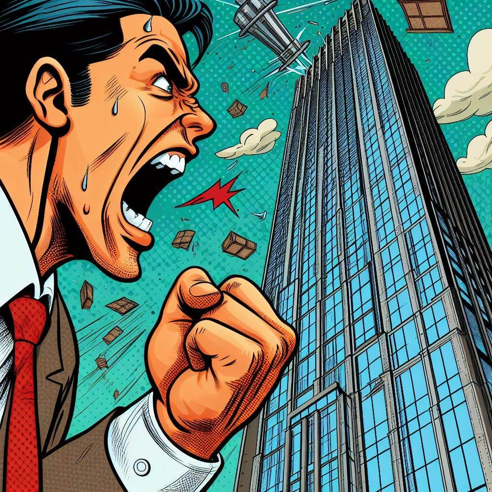
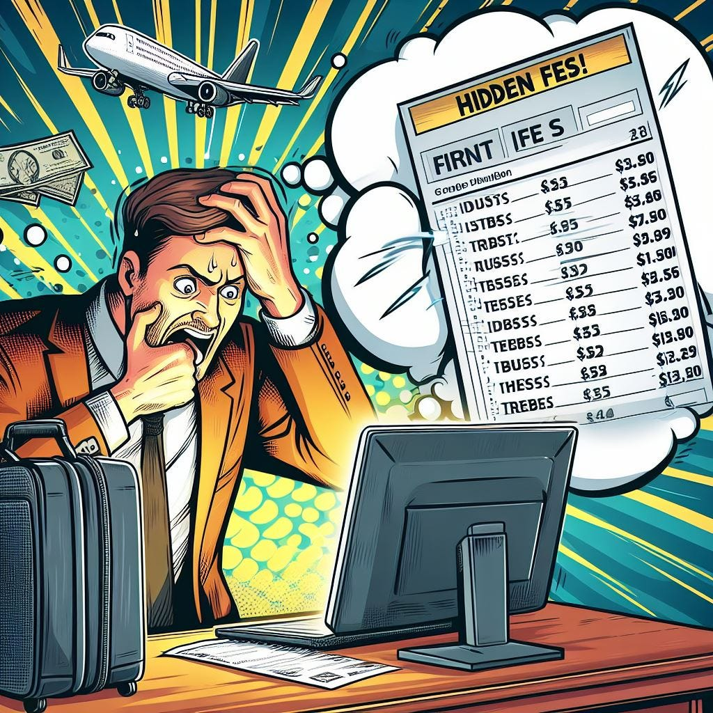
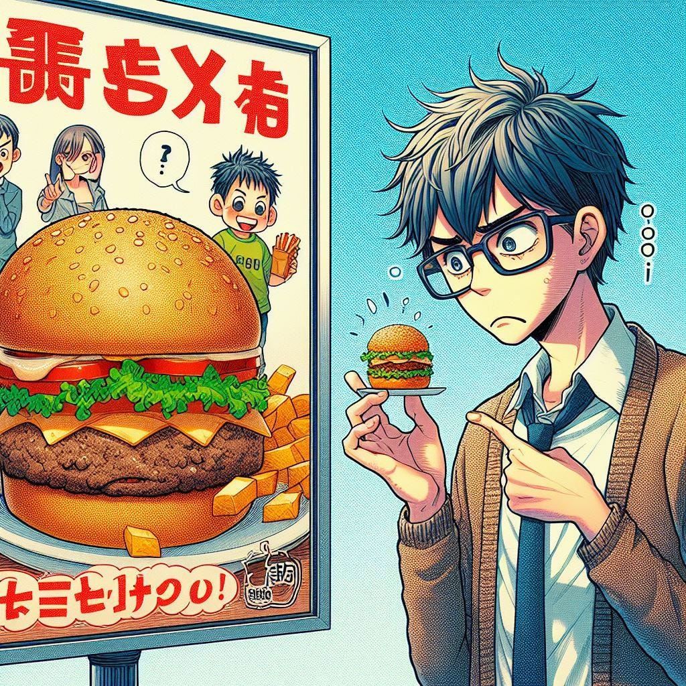
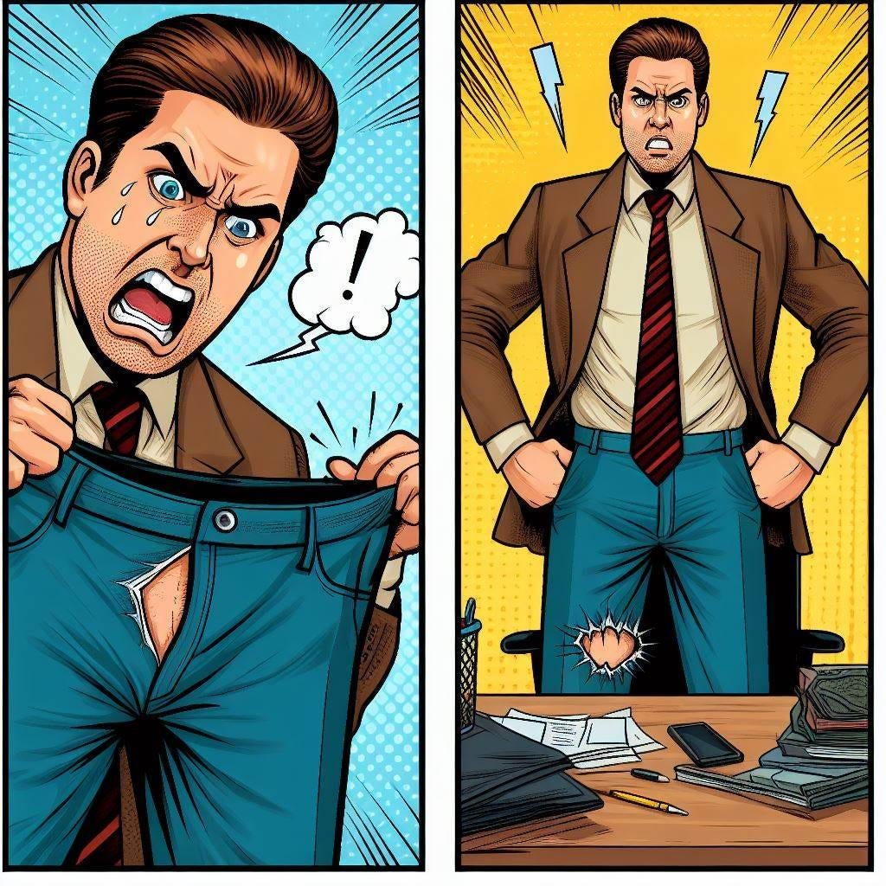
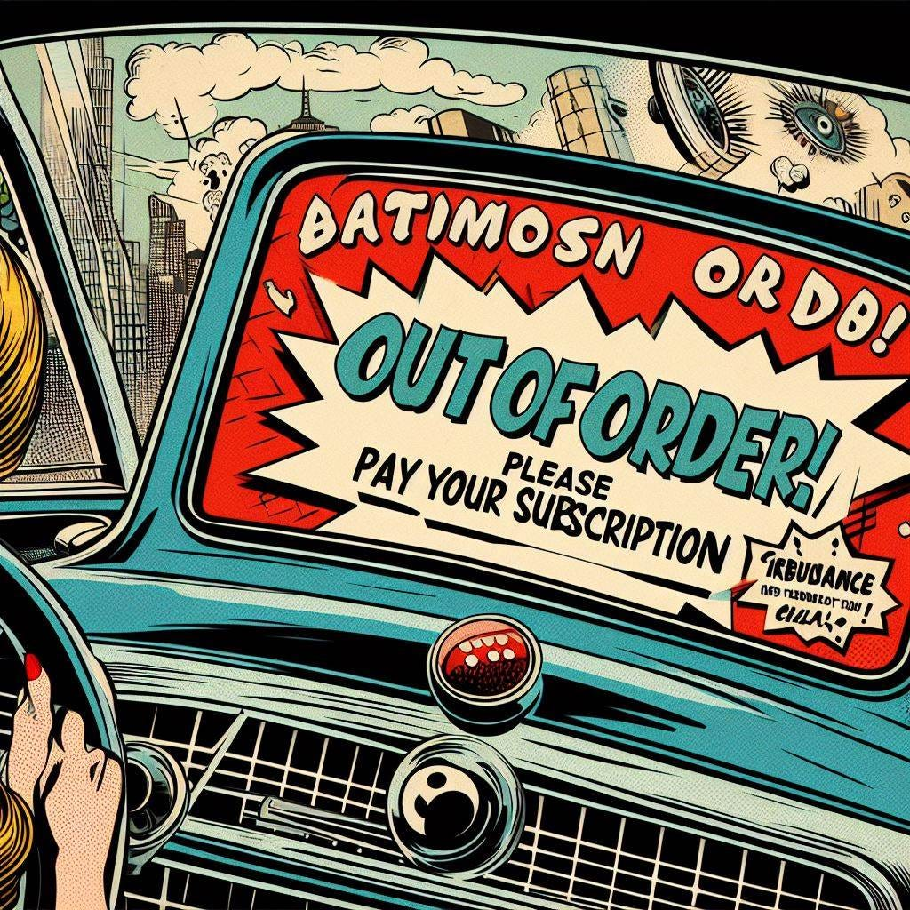
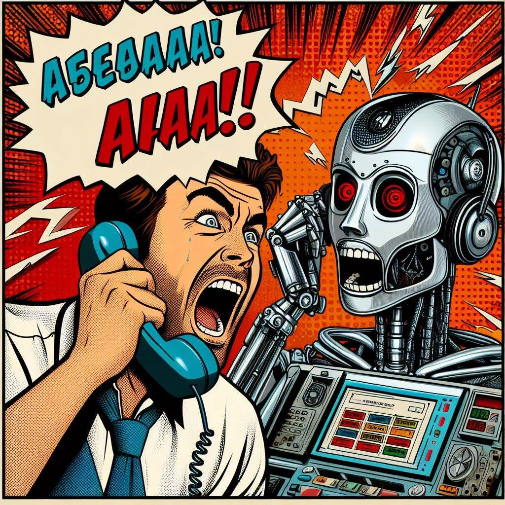

<figure class="ai-generated">
    
</figure>

As a consumer, I am getting more and more annoyed by a few effects of our (mostly) free market. This is mostly a rant, but could also be a collection of ideas where the law could limit the freedom to the benefit of all.

## № 1: Hidden Fees and Charges

<figure class="ai-generated">
    
</figure>

* Most prevalent in **airlines**, but the stories I’ve heard about **US-hospitals** are way more frightening.
* Companies use hidden fees to advertise lower prices and attract customers, knowing that consumers often overlook or misunderstand the additional costs. This makes a fair comparison practically impossible for the customer — hence it works against the image of a well-informed consumer in a free market.
* Regulators could enforce stricter transparency requirements, mandating that companies clearly **disclose all fees upfront**. For airlines, I could imagine that we define a typical “package”, e.g. the minimum baggage amount and paying via credit card. Only the price for that may be advertised. Consumers will likely be happy if they can opt-out of e.g. baggage they don’t need. Nobody complains if they have to pay less than expected.
As a side-note: The tax should always be included. Looking at you, US👀

## № 2: False Advertisement

<figure class="ai-generated">
    
</figure>

* Consumer goods, pharmaceuticals, and beauty products almost always **exaggerate** the benefits in advertisement. Photos of food — I’ve never gotten a hamburger from McDonald’s that looks like they advertise it. I’d also include **shrinkflation**.
* Companies exaggerate product benefits or make unsubstantiated claims to **increase sales**.
* Regulators should enforce [truth in advertising laws](https://www.ftc.gov/news-events/topics/truth-advertising) more rigorously, imposing fines for deceptive marketing practices. Standardized product information sheets help a lot, e.g. the ones we have in the EU on light bulbs and many electrical devices. Prices in supermarkets should also show what the same amount of food cost a month ago. The chain [dm](https://en.wikipedia.org/wiki/Dm-drogerie_markt) is doing that in Germany. It prevents that consumers get tricked by first offering false discounts.

## № 3: Poor Product Quality

<figure class="ai-generated">
    
</figure>

* Most prevalent in **fast fashion**, but also appliances such as washing machines, dishwashers, or fridges.
* Companies **prioritize cutting costs**, sacrificing product quality. **Planned obsolescence** is one aspect of it.
* We could enforce a minimum lifetime for certain product categories and help consumers understand how to use their rights. In Germany, we have a legally binding warranty for many products of two years. In the first year, the seller has to prove that you did misuse the product. In the second year, you have to prove that the product was faulty from the beginning. I used that for trousers once in the first year, but convincing the seller that I was in the right was pretty hard. I also think this warranty should be WAY longer for dishwashers, fridges, washing machines, ovens, microwaves, and similar expensive things. I’m thinking about 10 years.
We could also gradually increase it, helping the market to transition to products that have higher lifetimes.

## № 4: Subscriptions Everywhere

<figure class="ai-generated">
    
</figure>

* Most prevalent in Software, but also recently [in cars](https://www.theverge.com/2022/7/13/23206999/car-subscription-nightmare-heated-seats-remote-start). I’m not talking about car sharing but about the hardware features of a car for which you paid thousands of dollars. Then you have to pay [\$18/month for heated seats](https://www.theverge.com/2022/7/12/23204950/bmw-subscriptions-microtransactions-heated-seats-feature).
* Companies increasingly adopt subscription models as a source of **recurring revenue**, incentivized by the **predictability and stability** of subscription-based income streams. In cases like telecommunications or video streaming the model makes sense. In software applications which operate on your machine … less so. And not at all for hardware.
* Regulators could forbid subscription services in non-software areas where you already paid for the hardware. Leasing a car is fine, but buying the car + leasing the heating is just crappy. It’s also a security risk. The heater should not be connected to an outside network. I don’t want hackers to be able to fry me.

## № 5: Practically non-existing Support

<figure class="ai-generated">
    
</figure>

You only get an unusable chat bot and sometimes a postal address, but no email address to contact. The automatic phone queue is typically crappy.

The reason is simple: Support is expensive. When people are annoyed, they might not make a valid claim. Meaning cutting costs in support can reduce the costs in two ways.
