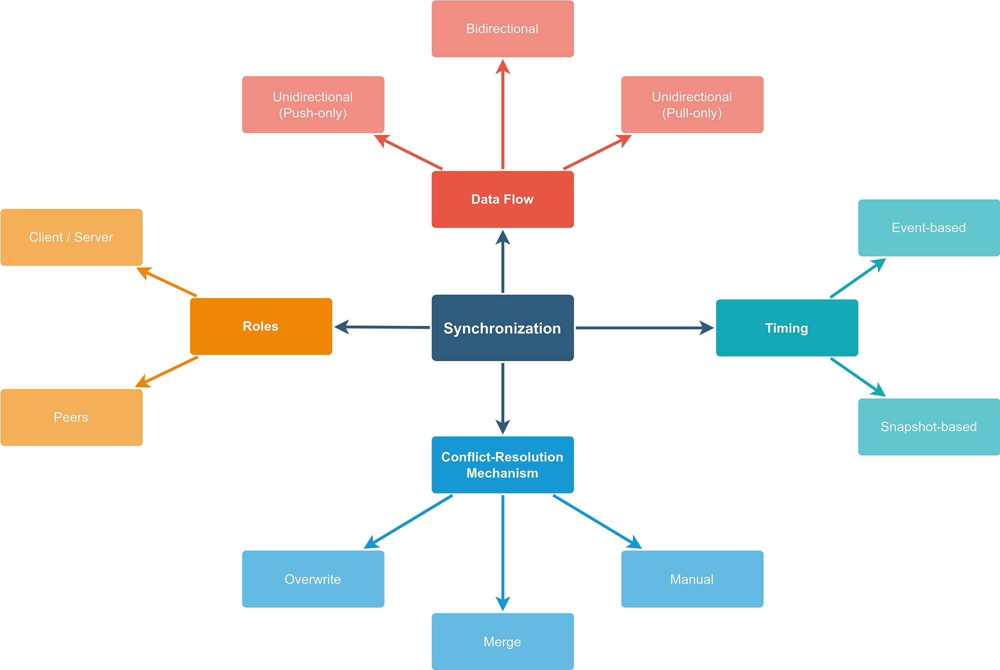
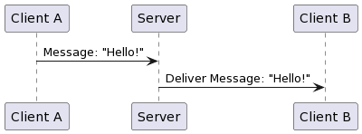
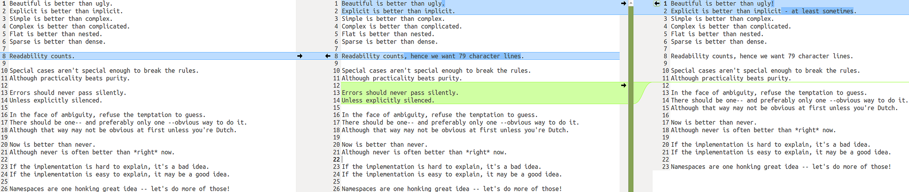

<figure>
    
</figure>

Synchronization is a common feature of many software products. Think about your e-book reader which gets the latest e-books and saves the reading progress. Or your Instant-Messaging app that ensures you have all your chats on all your devices. Or collaborative document writing apps like Google Docs or Word 365.

It’s a feature for which you need to answer the following four questions:

1. **Timing**: When does the synchronization happen and how fast does it need to be?
1. **Roles**: Which roles exist in the synchronization process?
1. **Data Flow**: Where/in which direction does the data flow?
1. **Conflict Resolution**: How do you deal with conflicts during the synchronization?

Let’s first go through a couple of example applications.

## Example 1: Instant message delivery

<figure>
    
</figure>

Instant messengers like WhatsApp, Slack, Threema, and Signal need to synchronize the messages between the chat participants. The maximum delay between sending a message and receiving it should typically be below a second.

The chat messages are sent once the user clicks the “send” button. They are sent to a central server by the client. The server sends it to all connected clients. If clients get connected later, they get all updates later.

Each message has a unique ID, a creator, a timestamp, and content. The timestamp is the one when the client has created/received the message. That means the same message can have different timestamps on the different clients and the server. That can lead to different message orders in the clients.

Messages are editable by the client who created it and nobody else. For this reason, there cannot be conflicts. The only conflict is the timestamp — and we chose to ignore that synchronization conflict by not synchronizing it.

## Example 2: Google Docs

You are working on a Word document via Google Docs on your computer. You don’t have internet, but the app stores it locally. Then you go on a weekend trip. You take your tablet — and notice that a lot of your past work is “gone”. You re-create what you remember and continue writing.

When you’re back home, your computer wants to sync. But the document is in a different state. What should happen?

You have again two **clients and a server.** The data flow is **bi-directional**. The synchronization happens as often as reasonably possible. It might even be every keystroke. In contrast to the instant messages, you can have conflicts. There is no way to resolve all possible conflicts automatically, hence you need to implement a manual conflict resolution mechanism. The simplest would be to show both documents side-by-side and let the user choose which one to take. Another option would be to have a three-way merge window:

<figure>
    
    <figcaption>A 3-way merge window shows the state of the document on the computer on the left, the state of the document on the tablet on the right, and lets you combine those in the middle. That is one way to let users manually resolve synchronization conflicts.</figcaption>
</figure>

## Example 3: Static Blog generators

Static site generators like [Pelican](https://getpelican.com/), [Hugo](https://gohugo.io/), [jekyll](https://jekyllrb.com/), [sphinx](https://www.sphinx-doc.org/en/master/), and many more use a one-way synchronization. You change the site, generate the static HTML pages, push them to a web server and you’re good.
