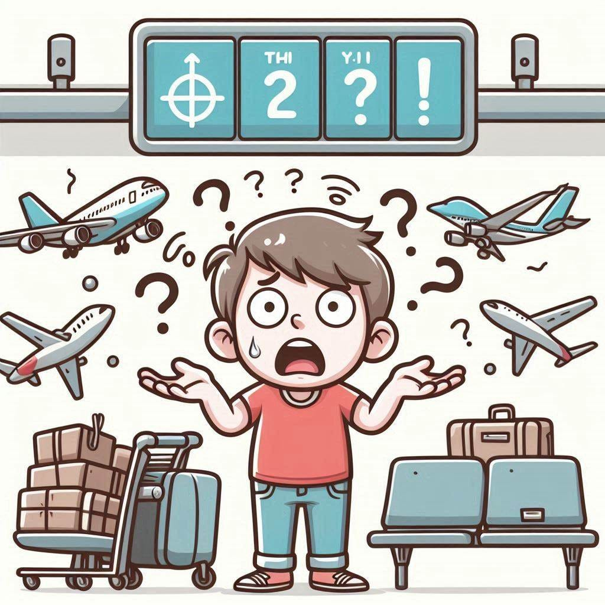
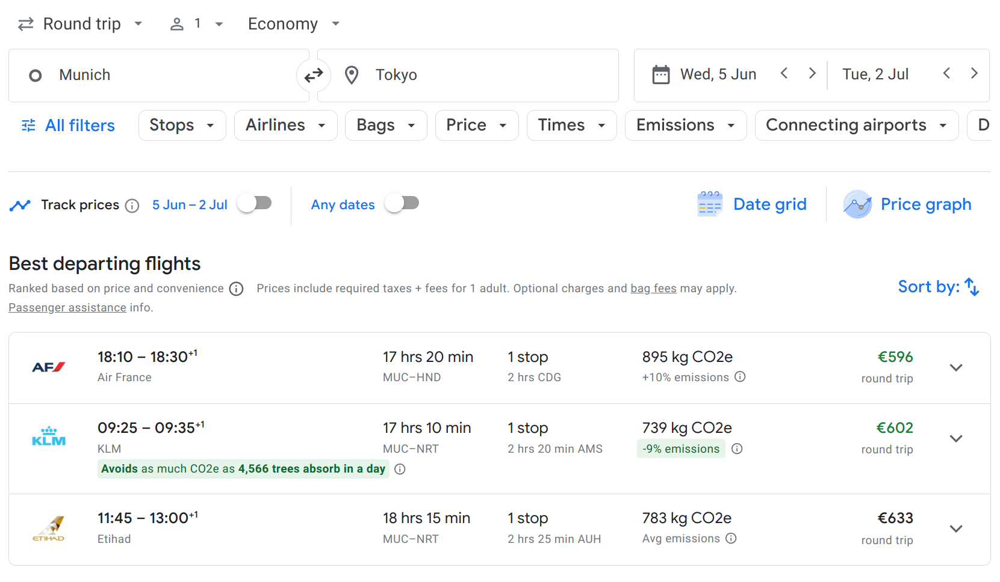
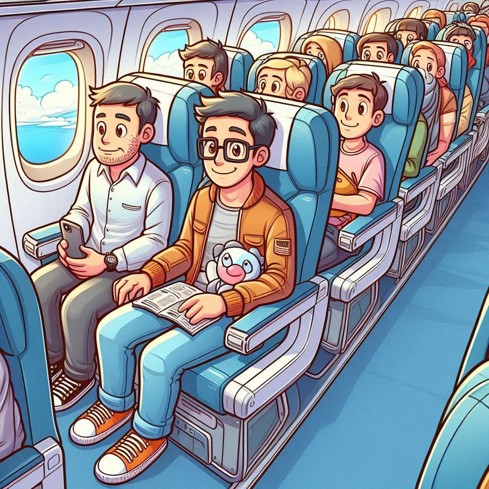
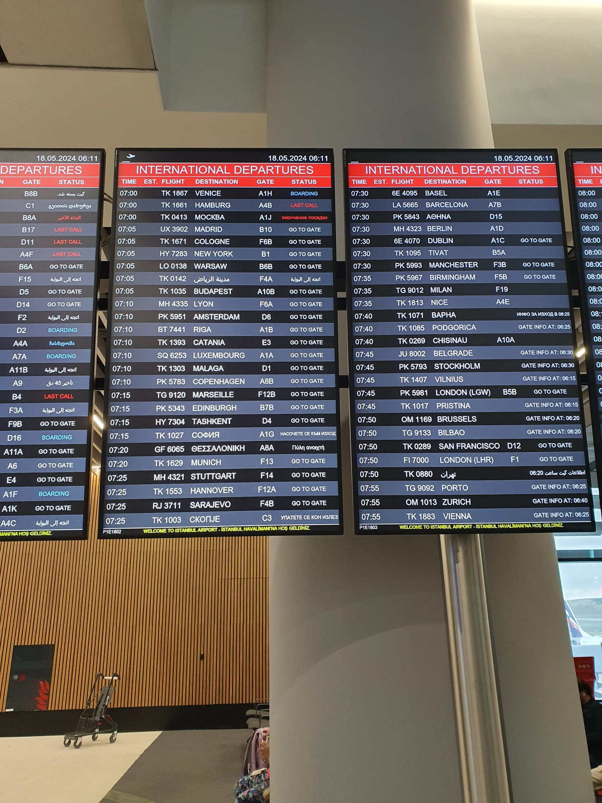

<figure class="ai-generated">
    
</figure>

International flights and airports can be incredibly confusing. If it’s in another country and the flight is expensive, you might be stressed quite a bit as well. Here is information for first-time flyers.

## The process

1. **Preparation**: Make sure you are allowed to enter the country you want to visit. That means you need a passport that is valid long enough, [potentially a visa](https://www.passportindex.org/byRank.php), sometimes vaccination, and proof of it.
1. **Booking**: Finding the proper flight is tedious. I’ll share some information about that later.
1. **Online Check-in**: 24 hours to about 6 hours before the departure of the first plane, you can tell the airline that you still want to use the flight that you already paid for. Then you can also choose your seat. Sometimes you only enter your passport number at this point.
1. **Baggage check-in**: For international flights, you need to be at the airport and give them your luggage quite a bit before the flight. I am typically 3 hours before the flight at the airport.
1. **Security check**: Airports have large areas that can only be visited by passengers. You need to say goodbye before going into the security check. This is where they check if you bring anything forbidden into the aircraft. You know, dangerous stuff like water 😄 Hence: Drink enough beforehand, but you likely should also buy a bottle of water before you go on the plane. Especially if you fly domestically and with a cheap airline. Buying water at the airport is expensive, but buying water on the plane is way more expensive.
1. **Boarding**: Getting many people on the plane takes quite a while. If you have no carry-on baggage or only something small, you should just wait and relax until the others go on the plane. If you bring more stuff, you should queue early: Sometimes there is not enough space for the carry-on baggage and they put it in your checked-in baggage.

## Booking a flight

<figure>
    
    <figcaption>Screenshot of Google Flights</figcaption>
</figure>

I hate airline websites. They are slow, hard to navigate, have surprise charges, are not reliable. If you make a mistake, it’s not you. The website is bad.

I typically search for the right flight via [flights.google.com](https://flights.google.com/), but I cross-check with [booking.com](https://www.booking.com/) and [skyscanner.net](https://skyscanner.net/) if the prices are reasonable.

First, you need to decide on a departure and arrival airport. Be careful: Some airports are far from the city. For example, London-Stansted is about 68 km away from the center of London, whereas Heathrow is only about 23 km away.

After that, you should check which number of stops and which total flight duration is acceptable.

Be careful with the departure time. You need to be at least two hours before departure at the airport. Especially if you don’t have a car it might mean that you need to sleep close to the airport the night before, which could make a cheaper connection way more expensive.

Despite what many people/websites claim, I could not see a difference in prices depending on the time of the day or if I was using a laptop / Android / iOS device.

## Baggage: Your stuff on planes

<figure class="ai-generated">
    
</figure>

Baggage and luggage are synonyms. It’s your stuff on planes, e.g. suitcases and bags.

There are three categories of baggage:

* **Checked-in baggage**: This is a heavy suitcase. Typically, every passenger may have one checked-in baggage. The maximum weight depends on the airline and the ticket, but 23 kg is a typical restriction in economy class. The size is typically described by the sum of length + width + height. Typically that should be below 158 cm. You give that suitcase to the airline when you check in. They will store it on the plane for you — but not in the cabin. You can only access it after you arrive. If you have a transfer, the airline will transfer this suitcase for you. I put the bulk of my clothes in there. Sometimes this is also not a suitcase, but maybe a big hiking backpack. You can also check in stuff that is bigger or heavier, but the process then is a bit different. I haven’t done that myself so far. I’ve seen people bringing a surfboard there. Sharp items like knives or scissors belong in the checked-in baggage, because they are forbidden in the cabin. Pack them so that they cannot damage your or other people’s baggage — keep in mind that it might be shaking a bit. Batteries and power banks are not allowed in the checked-in baggage; put those in your carry-on baggage or your personal items.
* **Carry-on baggage**: Another suitcase, but one that you bring in the cabin. You have to store it over your seat, hence it has to fit in there. The maximum weight is typically 7kg or 8kg. The maximum dimensions are 56 x 46 x 25 cm, including handles and wheels. This is for stuff that you want to take care of yourself or that you really need. I put sunglasses, a pair of underwear/clothes for sleeping in there. Just in case the checked-in luggage gets lost I still have my most important things.
* **Personal item**: A bag or a backpack. Just like the carry-on baggage, you take care of this. It has to be stored below your seat on the plane. A typical size restriction is 45 x 35 x 20 cm. This is for money, your passport, medicine, and hygiene products that you need during the flight.

## Orientation at the airport

<figure>
    
</figure>

Airports are huge. It’s really hard to find anything. To orient yourself at the airport, you need to answer these questions:

* **International vs Domestic**: Do you want to stay in the country (domestic) or fly outside of it (international)?
* **Arrival, Departure, Transfer, or Baggage Claim**: What do you want to do?

If you want to fly away (departure) you should know these:

* **Terminal**: Terminals are huge. They are enormous buildings. Going from Terminal 1 to Terminal 2 can mean that you need to go on a train! Make sure you get to the right terminal.
* **Gate**: Gates typically have a letter and a number, e.g. D13. The letter is the more important one. First make sure you are at the right letter. Only then look at the gate numbers.

When you search for check-in counters, be aware that the airlines don’t have fixed counters. At some time of the day a counter can be for Lufthansa, and later it can be for Qatar.

## What you should take on a plane

**Snacks** and **something warm**. Buying food on the aircraft is expensive. Make sure you have some stuff with you. I like to bring nuts and cereal bars.

I typically wear long trousers and a pullover on an international flight. Even if you come from a hot country and go to a hot country. At 10,000 meters altitude, it’s always cold.

You might also want to bring headphones with a cable so that you can watch movies from the in-flight entertainment system more comfortably. Maybe even noise-cancelling over-ear headphones.
