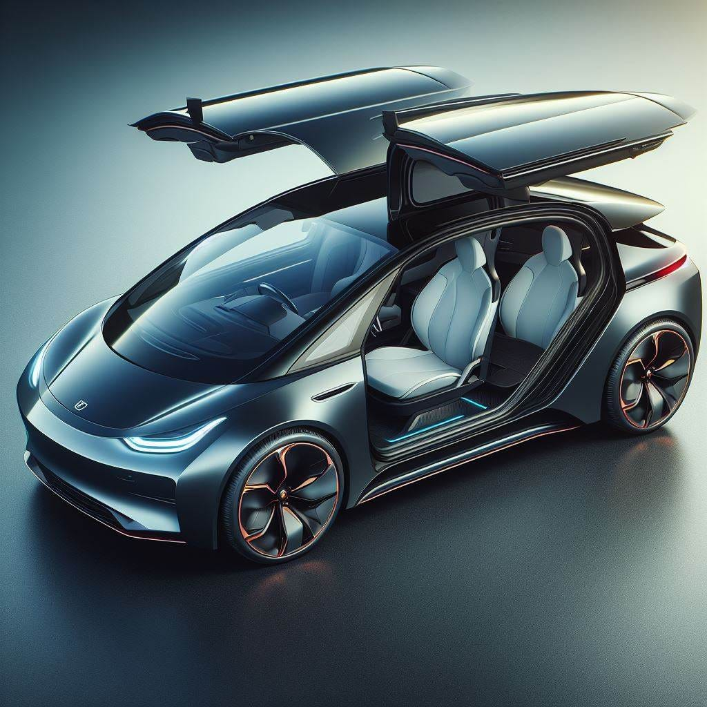
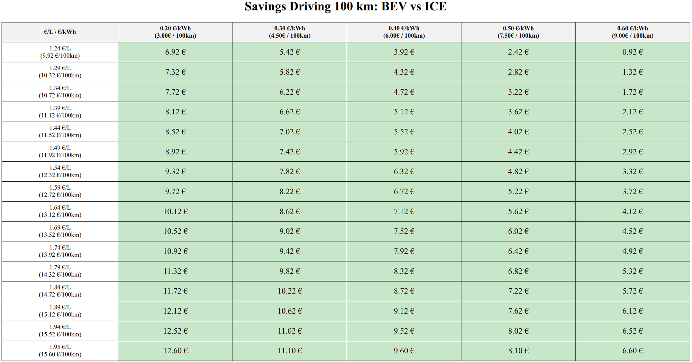
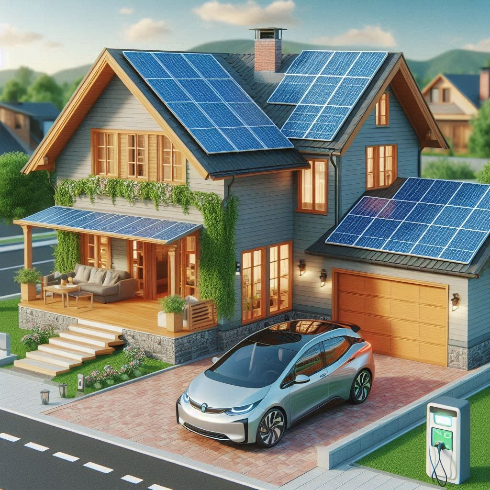
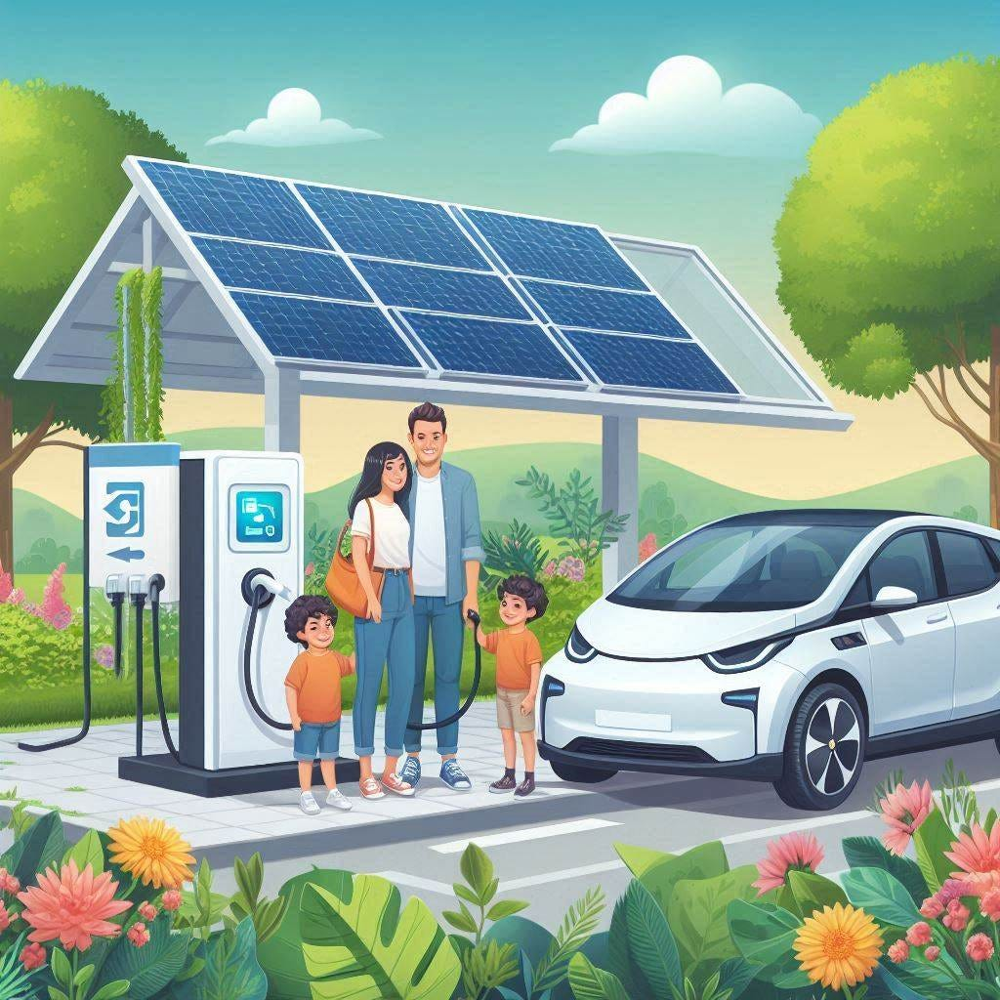
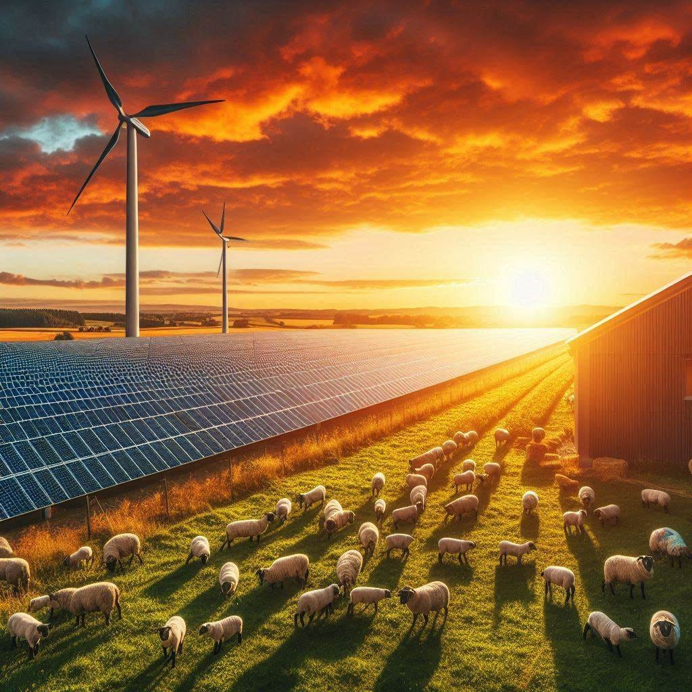

<figure class="ai-generated">
    
    <figcaption>Illustration of an electric car</figcaption>
</figure>

I keep reading and hearing rants by older people about electric cars or battery electric vehicles (BEVs) in general. They prefer their petrol / diesel cars which I’ll abbreviate with ICE — Internal Combustion Engine.

This article lists all of the reasons why I believe that we will see a gradual increase in the percentage of electric vehicles until they completely dominate the market by more than 90% of all cars on the streets in Germany by 2060.

Why 2060? Because legally no new ICE cars can be sold after 2035 in the EU and I would guess it takes about 25 years until the existing cars get replaced.

## Electric Cars are Cheaper 💸

The **cost of operation** is lower because the engines are way more efficient. A BEV needs 97–198 Wh/km ([source](https://ev-database.org/car/1555/Tesla-Model-3#:~:text=Real%20Energy%20Consumption%20Estimation%20between%2097%20%2D%20198%20Wh%2Fkm)) whereas the 2024 VW Arteon needs 4 gallons / 100 miles (9.4 L/100 km, [source](https://www.fueleconomy.gov/feg/bymodel/2024_Volkswagen_Arteon.shtml)). I currently pay 0.26 €/kWh or 1.63 €/L gas in Germany. Meaning, the Tesla 3 is 0.025–0.05 €/km and the VW Arteon is 0.15 €/km. In other words, a BEV can drive 300–600 miles for the price of 100 miles of an ICE.

Additionally, the taxes for owning a BEV are lower and insurance is about 25% cheaper, because there is less damage ([source](https://www.spiegel.de/auto/kfz-versicherung-elektroautos-lassen-sich-deutlich-billiger-versichern-als-verbrenner-a-011ead08-e76e-41d7-a5d4-c7df0d9e02d6)).

<figure>
    
</figure>

The **cost of maintenance** is lower because they have fewer parts that can break: The motor doesn’t need to sustain explosions, the user does not have to put the right fuel inside, there is [no gearbox](https://www.carbuyer.co.uk/tips-and-advice/169767/do-electric-cars-have-gearboxes) (transmission), no exhaust system, no radiator/cooling system for the engine. [No need for oil changes](https://www.kia.com/mu/discover-kia/ask/do-electric-cars-need-oil-changes.html). Brakes last longer due to [regenerative braking](https://en.wikipedia.org/wiki/Regenerative_braking). Only the tires wear down faster due to the higher weight.

The **purchase cost** is currently higher, but it will drop significantly once BEVs are produced in bigger numbers. We see that already. They can be cheaper than traditional internal combustion engine (ICE) cars because they are easier to build. It’s mainly the battery that needs to become more affordable. Due to the rise of solar and wind energy, we need better grid-scale batteries. Due to the popularity of smartphones, we need better small batteries. We already have a ton of people doing research on batteries just because of those two use cases. We will see massive improvements in battery tech driving the cost down (e.g. [sodium-ion batteries](https://www.youtube.com/watch?v=UmW2D_At1PY)).

## Electric Cars are better for the Climate 🌎

<figure class="ai-generated">
    
    <figcaption>Created with AI</figcaption>
</figure>

Humanity needs to get to net-zero carbon emissions. That is not possible with ICE cars, only with BEVs.

Many owners of ICE cars don’t care that much, but many governments have pledged to Net-Zero at some point. [The German government wants to achieve net zero by 2045](https://www.bundesregierung.de/breg-de/schwerpunkte/klimaschutz/climate-change-act-2021-1936846). That is only possible if many ICE cars are no longer operated.

## Electric Cars are better for the Environment 🌳

<figure class="ai-generated">
    
    <figcaption>Created with AI</figcaption>
</figure>

ICE cars need oil. Oil needs to be extracted, refined, and transported. [Oil spills](https://en.wikipedia.org/wiki/List_of_oil_spills) are sadly not that rare.

Nitrogen oxide is produced once the oil is burned in the cars ([source](https://www.umweltbundesamt.de/en/press/pressinformation/real-nitrogen-oxide-emissions-of-diesel-passenger)). “Elevated levels of nitrogen dioxide can cause damage to the human respiratory tract and increase a person’s vulnerability to, and the severity of, respiratory infections and asthma.” ([source](https://www.qld.gov.au/environment/management/monitoring/air/air-pollution/pollutants/nitrogen-oxides#:~:text=Environmental%20and%20health%20effects%20of,can%20cause%20chronic%20lung%20disease.)).

Battery production of BEVs can be improved. Rare earth minerals are mined in countries that do not follow the same environmental and labor protection laws as Germany. However, the magnitude of this is way lower than the magnitude of ICE cars. Additionally, we have started to develop batteries that can reduce or even eliminate the need for problematic rare earth minerals ([source](https://www.isi.fraunhofer.de/en/blog/themen/batterie-update/alternative-batterie-technologien-lithium-ionen-potenziale-herausforderungen.html)). ICE cars will always need a catalyst that also needs rare earth minerals ([source](https://eu.detroitnews.com/story/tech/2019/06/02/chinese-rare-earth-materials-used-widely/39533417/)).

[Atmospheric particulate matter](https://en.wikipedia.org/wiki/Particulates) is another issue that BEVs don’t eliminate. The tires/brakes wear down and thus the particulate is emitted. However, the OECD study “[Non-exhaust Particulate Emissions from Road Transport](https://www.oecd.org/env/highlights-non-exhaust-particulate-emissions-from-road-transport.pdf)” (2020) finds:

> While electric vehicles are estimated to emit slightly less PM10 from non-exhaust sources than conventional vehicles, heavier-weight EVs are estimated to emit more PM2.5 than conventional vehicles.

Meaning: If you compare heavy BEVs with small ICE cars, the PM2.5 emissions are worse. However, one has to say that BEVs are currently about 11% heavier than their gasoline variants.

* BMW 760i xDrive (2345 kg) vs BMW i7 eDrive50 (2595 kg): +250kg
* VW Golf 2.0 TDI (1449 kg) vs VW eGolf 2017 (1615 kg): +166kg

The reason is the difference in energy density:

* Gasohol E10: 12.1 kWh/kg
* Lithium-ion battery: 0.2 kWh/kg

At the same time, BEVs are about 5x as energy efficient. If you want to get the same range, you need 12.1/(0.2 × 5) = 12.1 times the weight. A typical fuel tank is about 50 L (13 gal) or 40kg of fuel. The BEV needs to carry 484 kg of batteries for the same range.

I was curious, so here are the numbers for a [Tesla Model S](https://ecomento.de/2014/06/23/so-viel-wiegen-die-teile-des-tesla-model-s/):

* Battery / Tank: 600kg vs 12 kg ([source](https://www.ws-autoteile.com/en/i108088/aic-kraftstofftanks-kraftstoffbehaelter-54245))
* Motor: 158 kg vs 194 kg ([BMW M50](https://de.wikipedia.org/wiki/BMW_M50))
* Gearbox: 0 kg vs 48 kg
* Oil pump, oil: 0kg vs 90 kg
* Exhaust system: 0kg vs 20 kg ([source](https://www.amazon.com/Flowmaster-717857-FlowFX-Cat-back-Exhaust/dp/B07R686CHY/))

## Battery electric cars are more fun to drive 😄

The cars are more modern — they have cameras and assistant systems. The multimedia system is on a different level. Their acceleration is way better. They are more silent.

Looking at the [Top-5 most loved car brands](https://www.consumerreports.org/cars/car-reliability-owner-satisfaction/most-and-least-liked-car-brands-a1291429338/) you see Tesla and Rivian in there. Two manufacturers who exclusively build BEVs.

## Charging battery electric cars at home 😎

<figure class="ai-generated">
    
    <figcaption>Created with AI</figcaption>
</figure>

Home owners can use their photovoltaic system to charge their own car. That is real independence. The freedom not to worry about spiking fuel prices.

Yes, I am aware that not everybody has their own house and even less people have a photovoltaic system installed. But for those who have, it’s amazing.

## We already see the trend 📈

50% of cars in Germany are up to 9 years old and almost all cars are less than 30 years old ([source](https://de.statista.com/statistik/daten/studie/3438/umfrage/pkw-bestand-nach-alter-der-fahrzeuge/)). That means any new ICE car bought might take 30 years to go again.

<figure>
    
    <figcaption>Data Source: <a href="https://www.umweltbundesamt.de/bild/entwicklung-der-pkw-neuzulassungen-nach">German Federal Environment Agency</a></figcaption>
</figure>

Looking at the [development of new car registrations by fuel type](https://www.umweltbundesamt.de/bild/entwicklung-der-pkw-neuzulassungen-nach) we can see that the relative and absolute numbers are growing. The more people buy BEVs…

* More manufacturers put new models on the market
* Manufacturers can produce in bigger numbers which reduces the price per unit
* A bigger market leads to research and development becoming more interesting

It’s a positive feedback loop. With 10–20 years of delay that also affects the used-car market.

## Car Manufacturers say it

Car manufacturers give deadlines when they will sell their last non-electric cars (by country):

* 2024: [VW](https://www.auto-motor-und-sport.de/tech-zukunft/alternative-antriebe/verbrenner-ausstieg-auto-hersteller-elektro-zukunft/) (Norway), [DS Automobiles](https://www.autobild.de/artikel/verbrennerausstieg-bei-grossen-marken-bis-2035-25721437.html) (Europe)
* 2025: [Jaguar](https://www.autobild.de/artikel/verbrennerausstieg-bei-grossen-marken-bis-2035-25721437.html) (Europe), [Lexus](https://www.autobild.de/artikel/verbrennerausstieg-bei-grossen-marken-bis-2035-25721437.html) (Europe)
* 2026: [Audi](https://www.autobild.de/artikel/verbrennerausstieg-bei-grossen-marken-bis-2035-25721437.html) (Europe), [Hyundai](https://www.adac.de/rund-ums-fahrzeug/autokatalog/marken-modelle/auto/ausstieg-verbrennungsmotor/#honda--der-spaetzuender) (Germany)
* 2027: [Alfa Romeo](https://www.autobild.de/artikel/verbrennerausstieg-bei-grossen-marken-bis-2035-25721437.html) (Europe, China, USA), [BMW](https://www.focus.de/auto/news/am-standort-muenchen-ab-ende-2027-bmw-streicht-verbrenner-aus-dem-programm-und-produziert-nur-noch-e-autos_id_259564766.html) (Munich, Germany)
* 2028: [Citroen, Opel](https://www.autobild.de/artikel/verbrennerausstieg-bei-grossen-marken-bis-2035-25721437.html) (Europe)
* 2030: [Fiat, Ford, Mercedes, Mini, Nissan, Rolls-Royce, Volvo, Peugeot](https://www.autobild.de/artikel/verbrennerausstieg-bei-grossen-marken-bis-2035-25721437.html) (Europe)
* 2034: [Lancia](https://www.autobild.de/artikel/verbrennerausstieg-bei-grossen-marken-bis-2035-25721437.html) (Europe)
* **2035**: [**European Union bans sales of new petrol and diesel cars**](https://www.europarl.europa.eu/pdfs/news/expert/2022/11/story/20221019STO44572/20221019STO44572_en.pdf), [**Japan bans sale of new gas vehicles**](https://www.sciencedaily.com/releases/2024/02/240207120352.htm), [**Hainan bans sales of new fuel-powered vehicles**](https://edition.cnn.com/2022/08/25/energy/hainan-fossil-fuel-vehicles-ban-intl-hnk/index.html), [VW](https://www.auto-motor-und-sport.de/tech-zukunft/alternative-antriebe/verbrenner-ausstieg-auto-hersteller-elektro-zukunft/) (Europe), [Kia, Dacia, Skoda](https://www.autobild.de/artikel/verbrennerausstieg-bei-grossen-marken-bis-2035-25721437.html)(Europe), [Toyota](https://www.autobild.de/artikel/verbrennerausstieg-bei-grossen-marken-bis-2035-25721437.html) (worldwide climate-neutral)
* 2040: [Honda](https://www.autobild.de/artikel/verbrennerausstieg-bei-grossen-marken-bis-2035-25721437.html) (Europe), [Hyundai](https://www.autobild.de/artikel/verbrennerausstieg-bei-grossen-marken-bis-2035-25721437.html) (worldwide)
* 2050: [**Indonesia bans sale of gasoline cars**](https://oto.detik.com/mobil/d-5763207/dadah-mobil-bensin-setop-dijual-di-indonesia-tahun-2050)

If you’re curious about other countries' fossil phase-out plans:

[**Phase-out of fossil fuel vehicles - Wikipedia** *Vehicles that are powered by fossil fuels, such as gasoline (petrol), diesel, kerosene, and fuel oil are set to be…*](https://en.wikipedia.org/wiki/Phase-out_of_fossil_fuel_vehicles)

## But ….

**Range anxiety** is the phenomenon, that people hesitate to buy electric cars because they worry that the range of a single charge isn’t good enough.

* Tesla Model 3: [300–610 km](https://ev-database.org/car/1991/Tesla-Model-3)
* Tesla Model Y: [250–510 km](https://ev-database.org/car/1743/Tesla-Model-Y)
* Tesla Model Y Long Range: [330–670 km](https://ev-database.org/car/2186/Tesla-Model-Y-Long-Range-RWD)
* VW ID.3: [250–520 km](https://ev-database.org/car/1831/Volkswagen-ID3-Pro)

It’s correct that a full tank of fuel gives between 600–1200 km of range. So about double the amount of a BEV. That is a disadvantage of BEVs.

How relevant is that shorter range? I’d argue not that much. Most people need the car to commute to work, which is hopefully way less than 100 km. We should build the infrastructure that people can typically charge their BEVs when they park them.

### Charging stations vs fuel stations

<figure class="ai-generated">
    
</figure>

Germany has about 14,452 fuel stations (2023, [numbers have been declining since 1965](https://www.adac.de/verkehr/tanken-kraftstoff-antrieb/deutschland/tankstellen-in-deutschland/)).

[Germany has 100,000 charging points](https://www.adac.de/news/ladesaeulen-ausbau-deutschland/) and the numbers are rapidly rising. The goal of the government is one million charging points by 2030.

The supermarket Lidl had 1800 charging points in 2022 ([source](https://www.autobild.de/artikel/ladestationen-vor-restaurants-und-supermaerkten-930292.html)), and Aldi has 1200 charging points ([source](https://www.aldi-sued.de/de/nachhaltigkeit/klimaschutz-umwelt/elektromobilitaet.html)).

### Electric Grid stability

<figure class="ai-generated">
    
    <figcaption>Created with AI</figcaption>
</figure>

BEVs need electricity and the electric grid's capacity is limited. That means somebody has to take care to ensure we don’t run into problems here.

However, that is nothing the end consumer should worry about:

* Germany has one of the most stable grids in the world ([source](https://www.cleanenergywire.org/factsheets/germanys-electricity-grid-stable-amid-energy-transition))
* Norway has a ton of BEVs ([source](https://www.theverge.com/2024/1/2/24022282/over-80-percent-of-new-cars-sold-in-norway-were-electric-in-2023)) and also a stable grid ([source](https://www.ceer.eu/documents/104400/-/-/e19caae8-95cf-f048-0664-0720228881bb))

I’m not saying that nobody should worry about this. I’m saying I trust in the people whose job it is to take care of it.

### Safety

People worry about burning BEVs because the fires are hard/impossible to extinguish.

They always seem to forget that ICE cars have the same issue:

* **Frequency**: ICE cars burn about 60x as often compared to BEVs ([source](https://www.meinauto.de/lp/ratgeber/unfall-mit-dem-stromer-brennen-e-autos-schneller), [source](https://www.tagesschau.de/faktenfinder/e-autos-mythen-100.html))
* **Magnitude**: [Liquid fuel can move quite far away from the car](https://www.youtube.com/watch?v=GKO75VpqxR8), [extinguishing gasoline in a lab](https://www.youtube.com/watch?v=ojbt_EnRhjs), [Gasoline transporter exploding](https://www.youtube.com/watch?v=JfK-7de5T4U), [gas station exploding](https://www.youtube.com/watch?v=zil36k5cPt8), [gas station in Ghana exploding](https://www.youtube.com/watch?v=sHAwtzIfD1w), [explosion at a gas station in Germany](https://www.youtube.com/watch?v=wa7YmbUHtbQ), …

### Plug-in hybrids

While trying to get the best of both worlds, you get the worst:

* They are more expensive to build than either ICE or BEV cars
* They are heavier or have a severely smaller tank/battery pack. The weight makes them less efficient
* They are more complex to maintain as you have two systems to take care of.

The only good reason I can see for them is if you don’t have an option to charge at the moment, but expect to get one within the next 10 years. But in that case, I’d rather buy an old ICE car.

## What about Hydrogen Cars?

[**Why Hydrogen Cars will die** *They are too expensive. The numbers speak a clear language.*](../why-hydrogen-cars-will-die/)

## … and e-fuels?

Don’t get me started:

* They are even more inefficient than gas / Diesel
* They are more expensive to operate than gas / Diesel
* We don’t have enough e-fuels for planes. Not even close. Cars need a lot more in total than all planes combined.

## TL;DR

Battery electric vehicles (BEVs) are cheaper, better for the environment, and safer than internal combustion engine (ICE) cars.

We already see politics moving strongly away from fossil fuels and BEVs are the only feasible alternative for cars.

The transition will take many years, but in my lifetime I will see roads dominated by electric cars. Petrol and diesel are the past, hydrogen for cars will never take off, e-fuels for cars are wishful thinking of old people. Battery electric cars are the future.
