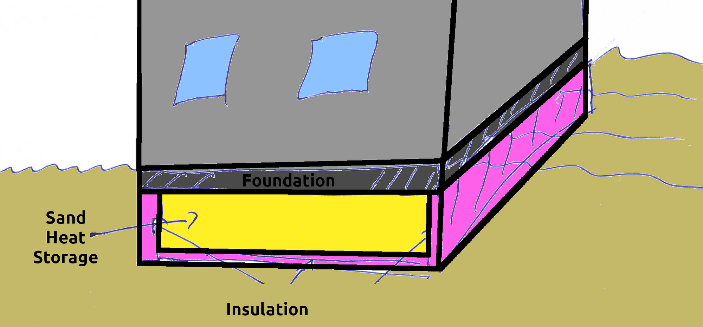
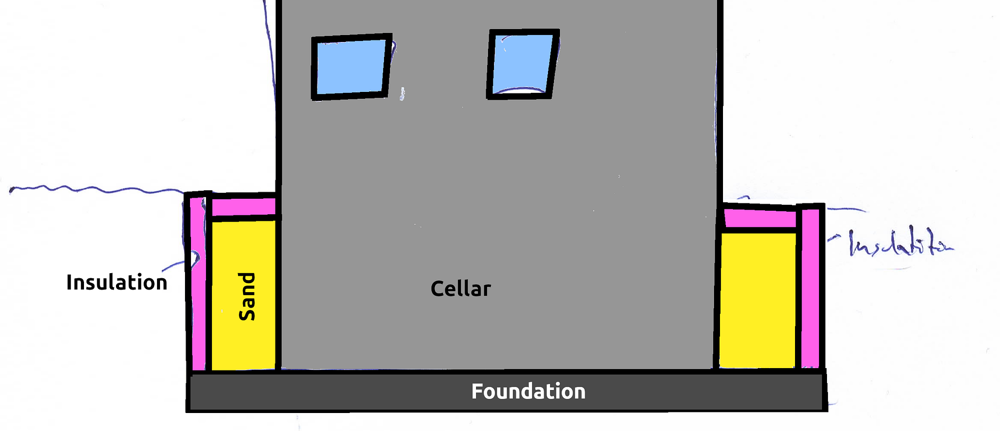

One of the biggest energy requirements in my house in Bavaria (Germany) is heat. My wife and I needed about **24,000 kWh** (2450 L of oil) per year. About 1,900 kWh (194L of oil) per year is for warm water.

Let’s say a sand battery becomes interesting if it can cover at least 10%, so 2,400 kWh.

I assume that we can extract heat until it’s about 15°C and we could heat it up to about 100°C. That is a temperature change of 85°C.

Energy = 840 J/(kg·°C) × 2.78×10⁻⁷ kWh/J × mass × temperature change

2400 kWh = 0.233 kWh/(ton·°C) × m × 85°C

m ≈ 121 tons

Dry sand has a density of 1602 kg/m³. So 76m³ of dry sand would be required, e.g. **5m x 6m x 2.5m**. That hole would need to be insulated and have pipes within it.

That is gigantic.

1m³ of sand is about 20€/m³. It’s astonishingly cheap, but it would still be **1520€** just for the sand. No digging, no insulation, no pipes.

## Including the sand storage into the buildings construction

Obviously, it does not work in my case of an old house with a comparatively small garden. But maybe it’s interesting for new homes? I wonder if the foundation of the house could rest on such a sand heat storage. I wonder if that would make the house more stable. What effects would it have if the bottom of the cellar was (very) warm? Probably the foundation would need to be insulated against the sand heat storage, but still the ground floor would likely be warm.

<figure>
    
</figure>

If the house has a cellar, the sand heat storage could surround it:

<figure>
    
</figure>

This way the whole cellar, excluding the foundation, would have warm walls. Again, likely it would make sense to have insulation between the heat storage and house. But mold in the cellar would have no chance 😄 Also, water getting into the building would have a much harder time.

I have no clue if it makes sense that the sand heat storage stays on the foundation or not.

If the house is 10m x 10m on the outside, the cellar is 2m below ground (a bit more due to the insulation), you would need about 1m thick “sand walls” around the cellar.

## Other materials

Another option could be to just use whatever is in the ground before (sand, stones, clay, organic parts, water). You dig it up, add the foundation and the insulated walls, put the pipes for heat transfer in, and put the ground back. That makes the heat storage capacity a lot harder to estimate:

* Dry sand: 840 J/kg°C
* moist clay: ~2000 J/kg°C
* Water: 4180 J/kg°C
