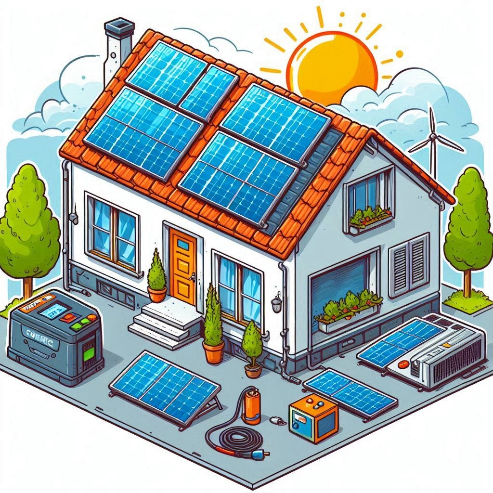
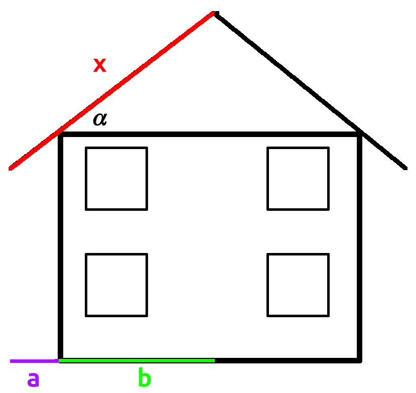

A photovoltaic system on your home is pretty neat: You produce a big chunk of the energy you need yourself. But it’s also expensive. Does it make economic sense?

The amount of variables to answer this question is overwhelming. Don’t worry, I’ll break it down for you!

## What is your energy usage? ⚡

Track your average daily electricity usage. I did that over a year and saw that my wife and I use about **7 kWh per day without heating** in our current home.

I currently have an oil heating system and need about 2500 L of oil per year. That is approximately 22,000 kWh of heat per year for heating and warm water. I will switch to a heat pump with a SCOP of 4 soon. That means I will need about **5500 kWh of electricity per year** additionally to the 7kWh/day. In **total:** **8055** **kWh/year**.

I pay **0.27€/kWh**, hence 2174€/year for electricity.

## What do you need for a rooftop photovoltaics system?

<figure class="ai-generated">
    <a href="../images/2024/06/how-to-calculate-if-a-solar-roof-makes-economic-sense-2.jpg"></a>
</figure>

The components of a photovoltaics system are:

1. **Solar modules**: Sometimes called solar panels. They convert sunlight into electricity. Typically, one module has about 440 Wp (Watt peak), meaning under optimal conditions it could give 440 W. If you had optimal conditions for one hour, you would get 440 Wh.
1. **Mounting system**: Holds the solar modules in place on your roof.
1. **Inverter**: A device that converts the direct current (DC) electricity generated by the solar modules into alternating current (AC) electricity that can be used in your home. The efficiency of the inverter matters. The ones in my offers were at 98.1% — 98.4%.
1. **Battery**: Optional, but it can store excess electricity generated by the solar modules for use when the sun isn’t shining. My offers were between 7.6 kWh and 10.2 kWh.
1. **Electric Meter**: Your electrical meter and the meter cabinet might need to get upgraded.

Additionally, you need to pay for:

1. **Module Installation**: Mounting everything safely on your roof.
1. **Inverter Installation**: Connecting the solar modules to the inverter.
1. **Electrical Installation**: Upgrading your meter and connecting the inverter to your home’s electrical system.
1. **Administration**: The system needs to be registered and you need to pay for the electricity meter.

## The cost of a photovoltaics system 💵

Prices always differ from region to region, but I got three different offers:

* Solarversum: 16,000€ for 10.4 kWp + 10kWh battery
* invanova.com: 23,000€ for 9.9 kWp + 10kWh battery (Leapton solar)
* invanova.com: 26,500€ for 10.0 kWp + 9.6kWh battery (DAH solar, Neoom)
* invanova.com: 29,500€ for 9.9 kWp + 7.6kWh battery (Meyer Burger, RCT Power).
* Wegatech: 26,200€ for 18 kWp + 9.6 kWh battery (sungrow, Trina). The battery is 5,500 €.

Assuming **5,500 € for a 9.8 kWh battery**, the prices range from 1000 €/kWp to 2450€/kWp. Let’s assume **1500€/kWp**. We put as many modules on the roof as possible and assume the 1500€/kWp already include the price of all related costs.

## Calculating the roof size for solar panels

<figure>
    <a href="../images/2024/06/how-to-calculate-if-a-solar-roof-makes-economic-sense-3.png"></a>
</figure>

* My roof has a pitch of 𝛼 = 30°.
* The roof overhang is about a = 1m
* The building is about 10m wide, so b = 5m

With a little trigonometry:

$$\begin{aligned}
\sec \alpha &= \frac{x}{a + b} \\
\Leftrightarrow x &= (a + b) \cdot \sec \alpha \\
\Rightarrow x &\approx 6\,\text{m} \cdot 1.155 = 6.93\,\text{m}
\end{aligned}$$

The house is about 10m wide, so the half of the roof that is oriented best is about 69.3m². Let’s say **60m²** as it should probably not go completely to the border.

One panel is about 440Wp and has 176cm x 113cm. I could fit at most:

* 8 in a row and 3 rows (24 modules) or
* 5 in a row and 6 rows (30 modules).

Assuming one module gives 440 Wp: **13.2 kWp** is the most that fits on my roof. Assuming 1500€/kWp that makes 19,800€ without a battery and 25300€ with a battery.

## The ETF Benchmark

ETFs are a popular choice for investments. The iShares Core S&P 500 ETF showed a performance of 600% within 14 years. If it was evenly distributed, that would be +13.6% per year. So assuming **6% yearly performance** is a conservative assumption. I have to pay 26.38% on those earnings each year (even without liquidating). That reduces the performance to **4.4175% per year**.

Let’s say I had the 25300€ right now and could choose to invest it in a photovoltaic rooftop system.

Let’s assume the photovoltaics system lasts for 30 years. That is the time over which I will make the comparison. After 30 years, my investment would have grown to 1.044175³⁰ ⋅ 25300 € = **92537 €**.

Without my own solar cells, I have to pay for electricity. In the first year it is 2174€/year, but I assume those prices increase by 3% per year. The total amount paid is **103,428€ in 30 years** as a little Python code shows:

```python
paid = 0  # in €
years = 30
base_year_electricity_price = 2174  # in €/year
yearly_price_increase = 1.03  # +3% per year
for year in range(years):
    paid += base_year_electricity_price * yearly_price_increase**year
print(paid)
```

I assume that I pay those running costs within the year. Hence, after 30 years, I would have **92,537€** in my bank account.

## Solar without battery

The sun is not always shining when you need it. That means you need energy from the grid. **Autarky** is the energy you used and produced yourself divided by the total energy you used.

The sun is sometimes shining (way) stronger than you need it. That means you have a surplus that you feed into the grid. In Germany, you get a **guaranteed tariff of 0.0743€/kWh** for what you feed in. You don’t have to pay taxes on those gains. **Self-consumption** is the energy you used divided by the energy you produced.

[This calculator](https://www.pv-berechnung.de/rechner) uses the information where my house is, the azimuth (direction of the roof), the pitch of the roof, the module efficiency, the inverters efficiency. It gives me:

* 14,535 kWh produced over a year
* 4,747 kWh are still used from the grid, but 3347 kWh are produced and used by the solar cells
* 11,188 kWh are fed back into the grid

Without a battery, the system would cost 19,800€ which leaves 5,500 € that can be invested right away. But the solar cells also help us to save money on the electric bill. That money can now be invested. It compounds and every year it becomes more as the electricity prices go up. So instead of paying more and more for the electric bill, I assume I will be able to invest more and more each year.

After 30 years, I would have **148,565**€ on my bank account:

* 20,116 € = 5500€ ⋅ 1.044175³⁰ from the initial investment and the compounding interest
* 42,993 € saved in electric bills
* 24,938 € from the feed-in tariff
* 60,518 € of interest and compounded interest of the money saved by the reduced electric bill and the money received by the feed-in tariff

## Solar with Battery

Adding a 9.8 kWh battery for 5,500€ means we start with 0€ invested in the beginning, but it changes the performance of the photovoltaics system:

* 14,535 kWh produced in total (same as before)
* 2086 kWh used from the grid, but 6165 kWh are produced and used by the photovoltaics system
* 8370 kWh are fed into the grid

That leaves me with **181,892€** on my bank account:

* **79,191 €** saved in electric bills
* **18,656 €** from feed-in tariff
* **84,045 €** from interest and compound interest on the money saved in electric bills and the feed-in tariff.

## Parameter influence: Investment performance

Let’s leave everything the same and see how numbers change for different expected yearly investment performances:

* Investment Performance: ETF-only vs Photovoltaics without battery vs PV with battery
* 3%: 48,726 € vs 102,697 € (2.1x) vs 131,533 € (2.7x)
* 5%: 74,838 € vs 130,895 € (1.7x) vs 162,771 € (2.2x)
* 9%: 173,398 € vs 221,440 € (1.3x) vs 258,123 € (1.5x)
* 12%: 320,758 € vs 338,368 € (1.1x) vs 374,630 € (1.2x)
* 15%: 586,062€ vs 527,215 € (0.9x) vs 553,943 € (0.9x)

So we can see that with increasing performance the PV systems become less interesting. +15% per year for 30 years is extremely optimistic, though.

## Parameter influence: Lifetime of PV

Let’s say the PV system doesn’t last 30 years. For this reason we also only invest for that long. We stay with the 6% investment performance:

* PV lifetime: ETF-only vs Photovoltaics without battery vs PV with battery
* 10 years: 38,981 € vs 31,198 € (0.8x) vs 30,726 € (0.8x)
* 15 years: 48,386€ vs 50,291€ (1.0x) vs 54,477€ (1.1x)
* 20 years: 60,060€ vs 75,110€ (1.3x) vs 86,019€ (1.4x)
* 25 years: 74,551€ vs 107,213€ (1.4x) vs 127,560€ (1.7x)
* 30 years: 92,538€ vs 148,565€ (1.6x) vs 181,893€ (2.0x)
* 35 years: 114,864€ vs 201,638€ (1.8x) vs 252,546€ (2.2x)

Not very surprisingly, the lifespan of the PV system is crucial. The longer it can last, the more profit it can make.

## Final Words

A photovoltaic system seems like a no-brainer if you have the money. However, you also need to be strict: Invest the money you saved. If you spend it on consumption, you will for sure be worse off with the PV system.

I haven’t considered maintenance… I’m uncertain how much that would be. This for sure makes the numbers worse for PV. Also, your insurance might become more expensive.

If you are curious about the script I used to calculate how much money would be made: [It’s on GitHub](https://github.com/MartinThoma/algorithms/blob/master/Python/solar_calculator.py) 😃

If you liked this article, you might also want to read:

[**How to evaluate new appliances as investments** *Focusing purely on the economic view*](../how-to-evaluate-new-appliances-as-investments/)
