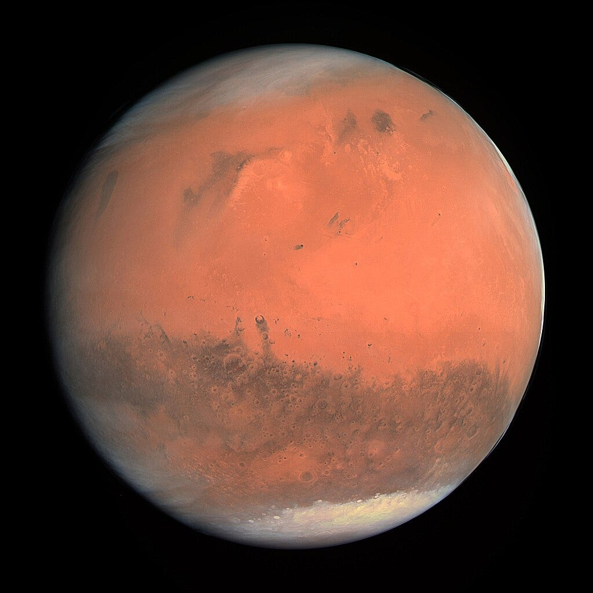
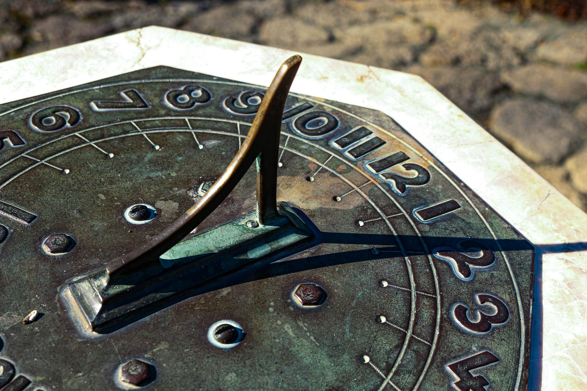
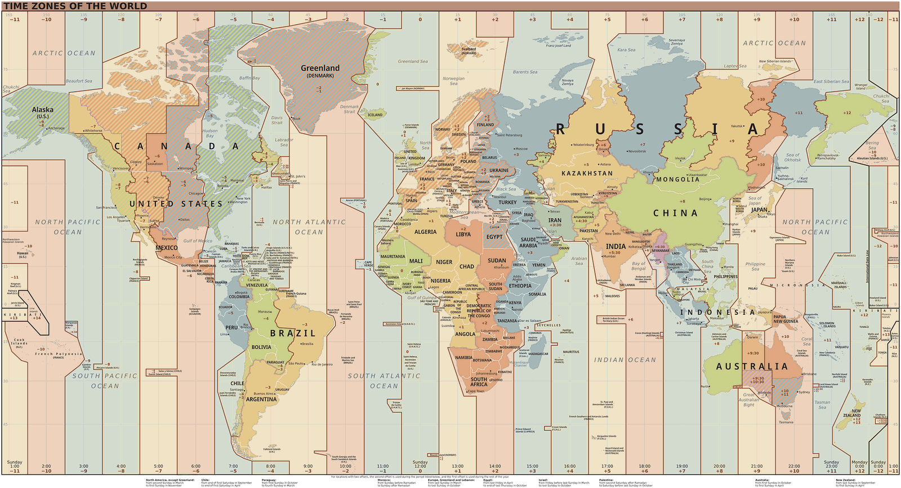
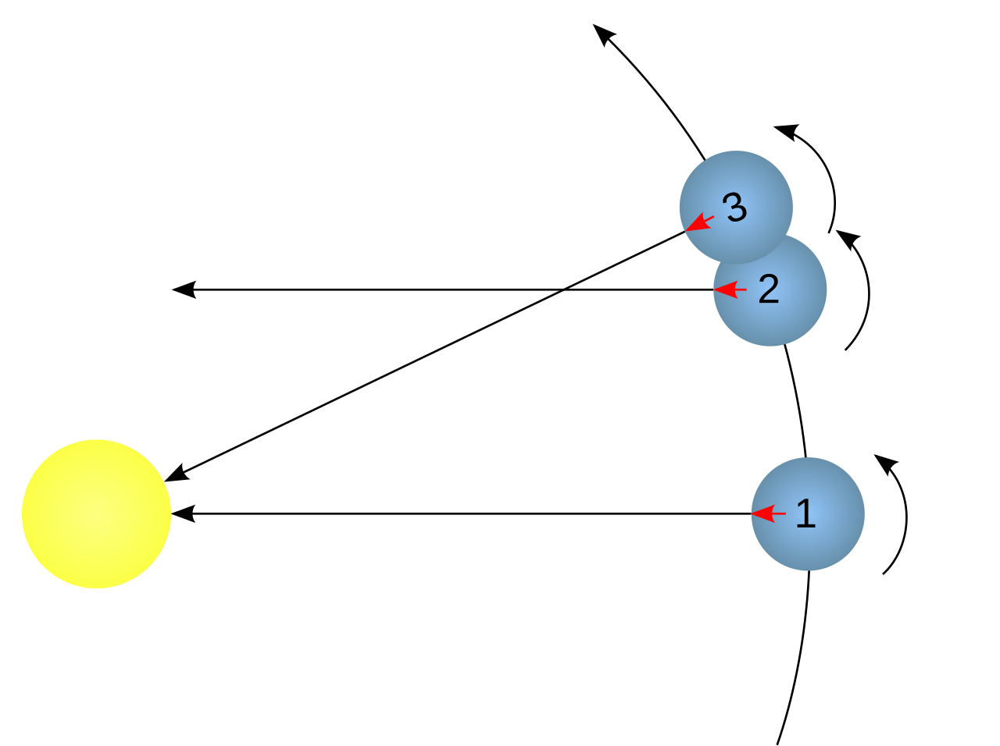

<figure>
    
    <figcaption>A photo of Mars by <em>ESA/Rosetta/NavCam</em>. Image source: <a href="https://commons.wikimedia.org/wiki/File:OSIRIS_Mars_true_color.jpg">Wikipedia Commons</a></figcaption>
</figure>

Localtime is what you see when you look at your watch. It’s what changes when you move far away in other countries.

The concept is pretty simple: A *day* is one full rotation of Earth. We split that into 24 segments called *hours*. For a given point on Earth we want the *noon* — the middle of the day — to be at the time when the sun is highest on the horizon.

<figure>
    
    <figcaption>A sundial works because we defined noon to be when the sun is highest on the horizon. It measures the “true solar time” — meaning it is completely dependent on your location. Photo by <a href="https://unsplash.com/@mlvihtelic">Mark Vihtelic</a> on <a href="https://unsplash.com">Unsplash</a></figcaption>
</figure>

If we would be very strict, then this local time would change with every difference in longitude, the definition of local time would change. Being so strict would render the time useless. Hence we introduced “buckets” of local time: The *timezones*.

<figure>
    
    <figcaption>Timezones. Image source: <a href="https://en.wikipedia.org/wiki/File:World_Time_Zones_Map.svg">Wikimedia Commons</a></figcaption>
</figure>

Those timezones are mainly different by an offset from each other. We simply defined Greenwich in London (England) as the basis.

Some software developers like to store everything in UTC without any offset in an attempt to standardize different systems. But local time is valuable:

* **Sunlight**: You know that it’s bright at noon and dark at midnight.
* **Biocycle**: Most people stand up between 5am and 8am and go to bed between 10pm and midnight.

The availability of public transportation, opening times of shops, wildlife activities, when it’s most likely safe outside, or when it’s typically quiet. All of that is related to the sun and our biocycle. So dropping local time means dropping important contextual information.

## Yeah, but what about Mars?

Local time on Mars is important for exactly the same reason: We want to know when to expect sunlight.

Mars has a different length of days:

* [**Mars sidereal day**](https://en.wikipedia.org/wiki/Sidereal_time): If we look at a full rotation compared to distant stars, Mars day has 24 hours, 37 minutes and 22 seconds. On Earth a sidereal day is 23 h 56 min 4.0905 s.
* [**Mars solar day**](https://en.wikipedia.org/wiki/Solar_time): We could also define a day as the time it takes until the sun is at the same position in the sky of Mars as observed from Mars. That would be 24 hours, 39 minutes and 35 seconds. The difference happens because Mars also circles around the sun while it is spinning around itself.

<figure>
    
    <figcaption>1 → 2 is a sidereal day, 1→3 is a solar day. Image Source: <a href="https://en.wikipedia.org/wiki/File:Sidereal_day_%28prograde%29.svg">Wikimedia Commons</a></figcaption>
</figure>

As we care about what happens on Mars, we would need to accept times such as 24:32:59.

> Since 1967, the second has been defined as exactly “the duration of 9,192,631,770 periods of the radiation corresponding to the transition between the two hyperfine levels of the ground state of the caesium-133 atom”.

Quote: “[Second — Atomic Definition](https://en.wikipedia.org/wiki/Second#Atomic_definition)” on Wikipedia.

Changing that definition would cause tons of issues. We also want to keep a minute being 60 seconds and an hour being 60 minutes.

As days on Mars have roughly the same duration as on Earth, it doesn’t matter too much how we define Noon. But if we generalize the concept, it makes sense to keep the “middle of the day” definition. Meaning we divide the solar day into two parts when the sun is highest on the horizon. Hence Mars Noon would be at 12:19:48 of local Mars time.

## Timezones on Mars

Timezones are used to align on one local time for people who are close in a spatial sense, but also politically. As we don’t have people on Mars, we don’t need timezones.

Once we have, we can define a prime meridian and use 24 offsets, so 15° slices of Mars. Once we have administrative regions on Mars, we need timezones.

## Calendars

One year is a full rotation around the sun. For Earth, it’s 365.2425 days. The fractional part is the reason why we have leap days.

A year on Mars is 686.98x 24 hours. Mars has 24.65972hours in a solar day, so **668.60 Mars solar days are in a Mars solar year**. The prime factors of 668 are 167 x 2 x 2 and of 669 are 3x 223.

Hence I would suggest 4 months with 167 days per month. The last month would be 168 days in 3 out of 5 years. Let’s say in every year that has a remainder of 0, 2, or 4 when divided by 5.

A more reasonable division could be done if there are seasons on Mars. Seasons are defined by the [climate on Mars](https://en.wikipedia.org/wiki/Astronomy_on_Mars#Seasons). Interesting, there are seasons!

<figure>
    
    <figcaption>Table from Wikipedia (<a href="https://en.wikipedia.org/wiki/Astronomy_on_Mars#Seasons">climate on Mars</a>)</figcaption>
</figure>

Now we want to find roughly equal-length months that fit well into the seasons. Let’s focus on the northern hemisphere to keep it short.

If we take 51 Mars-day months, we have 13 Mars-months for the 668.60 Mars solar days:

* Spring (193.3 days): Month 1–3, and 80% of Month 4
* Summer (178.64 days): 20% of Month 4, Month 5–7, and 30% of Month 8
* Autumn (142.70 days): 70% of Month 8, Month 9–10, 10% of Month 11
* Winter (153.95 days): 90% of Month 11, Month 12 and 13

If we take 28 Mars-day months, we have 23.88 Mars-months — meaning the last month would be quite a bit shorter. But we can have 7 days per week :-)

* Spring (193.3 days): Month 1–6 + 90% of Month 7
* Summer (178.64 days): 10% of Month 7, month 8–13, 28% of month 14
* Autumn (142.70 days): 72% of month 14, month 15–18, 38% of month 19.
* Winter (153.95 days): 62% of month 19, Month 20–24.

If we take **56 Mars-day months**, we have 12 months and the last one would be short:

* Spring (193.3 days): Month 1–3, 45% of month 4.
* Summer (178.64 days): 55% of month 4, month 5 and 6, 64% of month 7.
* Autumn (142.70 days): 36% of month 7, month 8 and 9, 19% of month 10.
* Winter (153.95 days): 81% of month 10, month 11 and month 12.

Note that the year then would diverge from the Earth’s calendar year. Hence it would make sense to start with the year 1. Which would mean that we need to get used to dates like 45.12.1 (Mars).
