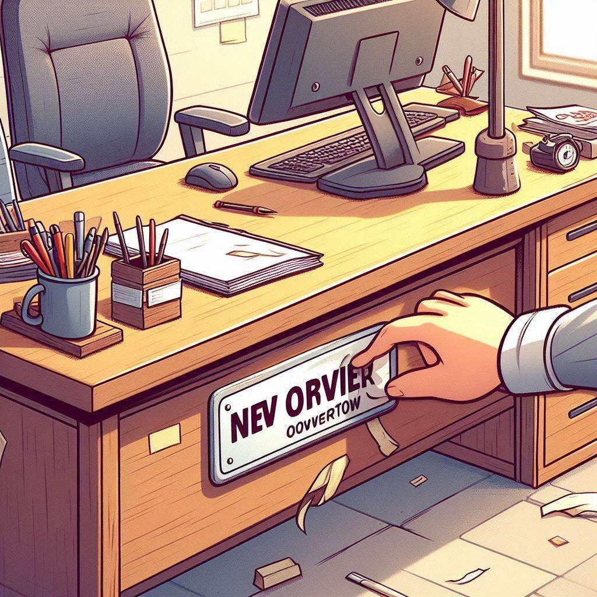

<figure class="ai-generated">
    
</figure>

Ever wondered what happens when a digital asset slips through the cracks? Picture this: you’ve been renting out a property, but when you stop paying, someone else moves in. This is exactly what can happen with domain and subdomain takeovers.

Domains are leased on an annual basis. Miss a renewal, and the registrar can put it up for sale. If someone else buys it, your company’s valuable asset could end up in their hands.

Subdomain takeovers work in a similar way but with a twist. Subdomains often point to resources that the original owner no longer controls. For instance, if Alice owns foobar.com and sets up a subdomain, code.foobar.com, pointing to github.com/foobar, and later her company closes its GitHub account, the subdomain still directs traffic to GitHub. An attacker like Bob could exploit this by creating a new GitHub organization with the same name and taking advantage of the abandoned subdomain.

## Why it matters

* **2015**: Google failed to renew Google.com. They were lucky and got the domain back for only 6006.13 USD ([source](https://money.cnn.com/2016/01/29/technology/google-domain-purchase/index.html)).
* **2019**: Windows Live Tiles were vulnerable as Microsoft had a CNAME entry left pointing to a free Azure subdomain ([source](https://www.golem.de/news/subdomain-takeover-microsoft-loses-control-over-windows-tiles-1904-140717.html)).
* **2020**: [Flaviu Popescu](https://www.linkedin.com/in/flaviu-popescu/) takes over a subdomain of the US military ([source](https://flaviu.io/us-army-subdomain-takeover/)).

## How are (sub)domain takeover attacks executed?

A domain takeover or subdomain takeover just describes the end result: A third party owns a domain or a subdomain of yours. I’m not calling the third party an attacker, because it can be done legally and without bad intentions, such as the 2015 domain takeover of google.com.

A domain takeover occurs when someone buys a domain that the original owner has failed to renew. Similarly, a subdomain takeover happens when someone registers a resource that the original owner has neglected.

## How can I prevent subdomain takeover attacks?

To protect against subdomain takeover, avoid neglecting your resources. Ensure you renew your domains promptly and maintain control over the resources your subdomains use.

Generally, it’s wise not to abandon resources; for instance, a GitHub account should be kept active as attackers could exploit a deleted account, and maintaining it incurs no cost.

## Which related resources should I care about?

The concept of domain takeovers can be applied to other resources as well:

* Amazon S3 Buckets
* Accounts on big Platforms: Github, Shopify, Heroku, Azure
* Social Media Accounts: Twitter, Facebook

<!-- series: appsec -->
