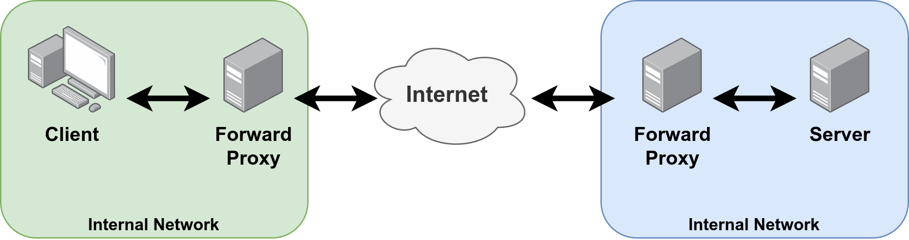

<figure>
    
    <figcaption>Image created by Martin Thoma.</figcaption>
</figure>

A **proxy** forwards requests. They can filter or change requests.

A **forward proxy** takes a request for the user and forwards it to a website. Examples are:

* [Privoxy](https://en.wikipedia.org/wiki/Privoxy): A forward proxy which helps to protect privacy ([German Talk](https://media.ccc.de/v/froscon2016-1808-das_privoxy-okosystem) from 2016). You can also block advertisement with it.
* [Charles Proxy](https://www.charlesproxy.com/): Allows you to monitor and manipulate traffic. [Charles Proxy can be used for testing](https://medium.com/@jagjeetjohal/mastering-api-testing-with-charles-proxy-how-to-monitor-and-manipulate-http-traffic-like-a-pro-4e48689a52e1).

A **reverse proxy** takes a request for a website and forwards it to a server. They can be used for caching and load balancing. Examples for reverse proxies are [nginx](https://nginx.org/en/) or the Apache HTTP Server with [mod\_proxy](https://httpd.apache.org/docs/current/mod/mod_proxy.html).
