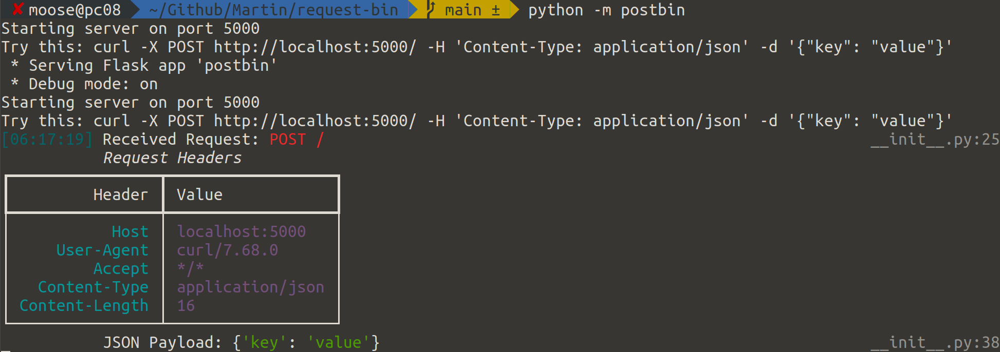

<figure>
    
</figure>

As a backend developer, I sometimes have the need to check which requests are sent, including the headers and the payload. It’s enormously useful to have a local tool which can check that.

I’ve just released [postbin](https://pypi.org/project/postbin/): A simple small webserver which receives requests and prints them, including the headers.

## Alternatives

I have used websites for that in the past, but in a professional context this might not be a good option in case you could leak private information. I also had issues with those websites, e.g. not all types of requests would be received/printed.

I’ve seen similar projects, but haven’t tried them:

* [httpbin](https://github.com/psf/httpbin): That looks pretty good. I have only found it once I started writing this blog post
* [rusqbin](https://github.com/lloydmeta/rusqbin)
