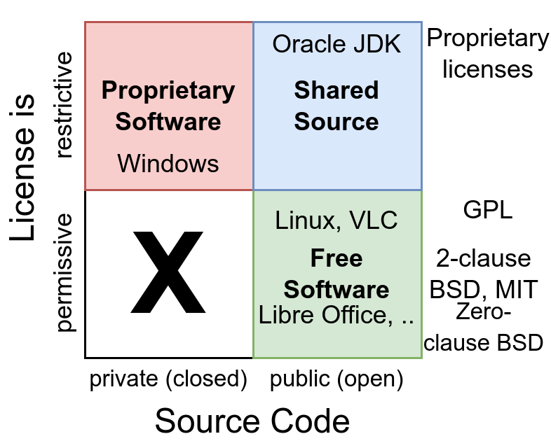

<figure>
    
</figure>

People use “open source” and “free software” as synonyms, but they are not. All Free Software is open source, but not all open-source software is free software.

Free software is free as in “free speech”, not as in “free beer”. That is the philosophy of Richard Stallman. I see it a bit differently.

To me, there is open source and closed source software:

* **Open Source**: I can read the source code. It’s available.
* **Closed Source**: I don’t have legal access to the source code.

## Free Software is more than just Open Source

Interestingly, even if the source code is legally available for me to read, I might not be allowed to do anything with it. Essential rights I want to have are:

1. **Copy**: If I want, I can make a backup of the software for myself.
1. **Modification**: If something is broken or doesn’t behave as I want, I am allowed to change the behavior.
1. **Derivative Distribution**: I am allowed to distribute the software with my changes.
1. **Choice of License**: I am allowed to distribute the software with my changes under any license I want. That means I can turn it into closed-source software.

Most proprietary software doesn’t allow any of those 4 freedoms. Even copyleft licenses like the GPL, which Stallman prefers for “free software”, only allow the first three. Selling the software is fine, though: the GPL only demands that the buyers get the same freedoms.

Not allowing (4) is self-protection similar to the [paradox of tolerance](https://en.wikipedia.org/wiki/Paradox_of_tolerance): To keep a tolerant society, one has to be intolerant towards intolerant people. To keep awesome free software, people who directly benefit from free software have to keep it free.

## What is Shared Source?

Some companies had the insight that there is value in their customers being able to validate parts of the code. This way they can check the quality and report bugs in way more detail. They could even fix bugs for free.

But they don’t give the user any of the essential rights you have in free software.
