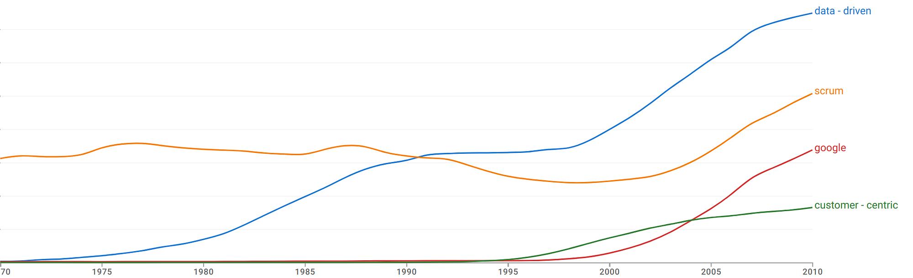
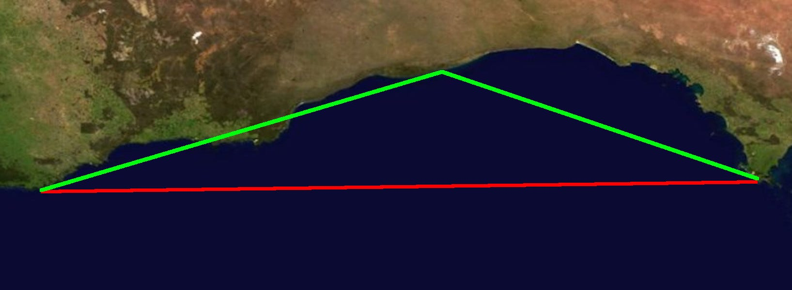

<figure class="ai-generated">
    
</figure>

People want to be good in their jobs and make decisions they can justify. For this reason, data-driven decisions are a wildly popular concept.

<figure>
    
    <figcaption>Since 2000 we want to be way more data driven according to Google Trends — even more than we want to be customer-centric 😉</figcaption>
</figure>

One of the most expensive parts of software development is the salary of software engineers. Hence it makes sense to make them as efficient as possible.

Writing software is hard as it is typically something new if you continue development of one product. That means there are few to none repetitive tasks. That makes **estimating the amount of work very hard** for anything non-trivial in software engineering. On the other hand: If you have done it before, it very quickly becomes trivial 😁

Tech companies bundle a minimal set of features that provides value to a user to so-called **user stories** (short: stories). Multiple stories that go into the same direction are bundled in one Epic, but for this article we stay at the short-term planning and thus with stories.

Short-term planning is anything below two months. Typically also below one month.

## Reasons for Short-Term Planning

1. **Client communication**: Companies want to tell their clients when a feature is ready. It might be relevant for sales when a new client wants a feature that is not ready yet. It might be relevant to align breaking change deployments for which partners / clients have to adapt.
1. **Prioritization**: Imagine that your sink is clogged and you need to buy groceries before the shops close at 8pm on Friday and not open until Monday. If you are confident that you can fix the sink and still have enough time to go shopping, you should do that first. Otherwise the kids might make a mess. Fixing the sink is more important. But if that means that there will be no food over the weekend, you will re-prioritize. Similar in software development. Some stuff is less important, but we should not break deadlines.
1. **Dependencies and developer utilization**: Despite what some agile coaches / scrum masters might advocate, developers are specialized. You cannot expect a backend developer to do frontend work or app development without losing efficiency and getting worse quality. That means for some tasks that cross specializations, you need certain people. Those dependencies on people can also mean that work on a task is blocked if a coworker is on vacation. And nothing kills developer productivity more than not having anything to work on. This means you want to have a large-enough backlog so that every single dev has something to do. This is mostly relevant for junior devs, because senior devs will always know something they can refactor 😅

## Issues with estimating

### #1 What do we estimate?

<figure class="ai-generated">
    
    <figcaption>Comparing apples with oranges.</figcaption>
</figure>

Many teams use story points. But what those story points represent varies wildly. Even within the team while doing an estimation, the different team members might have a different idea. Some estimate complexity, some estimate time, some estimate mental load. Those three are different:

* **Complexity**: If you do the same tasks twice, doing it once has a certain complexity. Doing it the second time might be at maximum as complex as the first one, but for sure not more complex. Complexity doesn’t add. Two tasks of complexity 5, if independent, are still of complexity 5 combined.
As an example, imagine you have to compute 123⁴⁵. Now compare that with 123⁴⁵ + 2. The task of computing those has the same complexity. Adding +2 is more work, but the complexity does not change.
If you seriously want to use complexity, you should use T-shirt sizes for the story estimations: Small, Medium, Large. Maybe even XS and XL / XXL. That prevents you from misusing the number.
* **Hours**: Hours add up. Two tasks that take 5 hours each will take 10 hours combined.
* **Mental load**: That is similar to complexity, but adds up a little bit like hours. If you have 100 trivial things the mental load is for sure higher than having just 10 trivial topics.

### #2 Arithmetics

<figure class="ai-generated">
    
</figure>

Different measures have different properties. For example, think of postal codes. If you have the postal code 9123 and 7456 you would hopefully not speak of a “total postal code” of 16579 or an “average postal code” of 8289.5.

Similarly, complexity cannot be averaged. One simple task + one complex task is not the same as 10 simple tasks.

But that is exactly what is often done: Teams estimate a story to be 1 Story Points of complexity and another one to be 8 Story Points. And then they say that they managed to finish 9 story points.

Yes, you can add numbers. But it is important what those numbers represent. If those are **ordinal features**, they can be ordered — but not added! And if you cannot add them, you cannot average them.

Other examples where averaging of numbers does not work:

* **Logarithmic Scales (e.g. Sound)**: 0dB + 0dB is not necessarily 0dB! ([source](https://sound.stackexchange.com/a/48880/7270)) Same goes for pH-levels.
* **Ratings** (Food, Restaurants, Goods): Having 100 ratings of 4 Stars is different than 80 ratings of 5 stars and 20 ratings of 0 stars.
* **Grades**: In Germany students get grades from 1 (the best) to 6 (the worst). If you have a student with a 1 in mathematics and a 5 in Spanish it’s very different from a student with a 3 in mathematics and a 3 in Spanish. One you would call an “average student” and the other one needs tutoring.
* **Circular data (e.g. angles)**: The average of 10° and 350° is not 180°, but 0°.
* **Codes and identifiers**: Phone numbers, ZIP codes
* **Probabilities**: The probability of me winning the lottery today is close to 0. The probability of me not winning the lottery today is close to 100%. The probability of either of both events happening is exactly 100%.

### #3 Who will do the work?

<figure class="ai-generated">
    
</figure>

Teams typically have an idea who will work on what when estimating. That is important as a team often has different roles. The complexity / hours / mental load a medium-difficult front-end task takes for a front-end developer is lower than for a back-end developer. But even within one role, different team members are familiar with different parts of the code base (assuming the code base is big enough that it’s impossible to know everything super well).

### #4 The Coastline Paradox: How to Game the System 😉

<figure class="ai-generated">
    
</figure>

Did you know that it’s not possible to give a single number for the length of an island’s coastline?

The reason is that it all depends on how fine-grained you measure. If you use a virtual ruler which is 1km long and then one that is 1m long, you will always have a longer coastline with the 1m ruler.

<figure>
    
    <figcaption>The red line is obviously shorter than the two green lines combined. Both approximate the coast line, but the green approximation is more fine-grained. This is always true: The more fine-grained you measure, the longer the result will be. And it’s not just a little bit. You can get to an infinite length if the measured object is irregular.</figcaption>
</figure>

The same is true for software development tasks. If you break them down more and more, at some point every single sub-task will be estimated with 1 Story Point. If you break it down, people will still estimate it with 1 Story Point. And depending on what your workflow around subtasks is, it might actually become more work: Documentation, reviews, testing can add work.

In my opinion the optimal size of a task is so that it represents half a workday up to two workdays. Then it can be used to explain a chunk of work easily to another person, but not be so small that the overhead is killing you.

## The hidden Reality: What stories don’t show

### #5 Changes in the Story

A simple story can be a ton of work if the desired outcome is not clear. Changes in the requirements are not always done in a new story, but the existing story is adapted. That means the estimation reflects the total amount of work — no matter what you estimated originally.

### #6 Interruptions

Interruptions while working mean you need some time to get back into the work. If you can work on 4 tasks sequentially it’s easier than switching between the tasks all the time. And still, it can be valuable if a team member does it to support others so that they don’t get blocked. Getting quick help if you’re blocked is awesome and a sign of an awesome workplace — but it also means somebody is switching tasks.

## So… how do we measure developer productivity?

I don’t have a good answer for that. I haven’t seen a single flawless system. The best might be feedback from coworkers, but that only works within a team.

Instead of measuring developer productivity, I would go back to the original intention: Making developers more efficient. Ask them regularly if they see ways how their work could be more efficient. Maybe that would be a good question for a retro?
