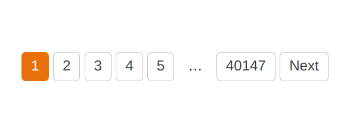

<figure>
    
    <figcaption>Pagination: We show the first 50 results on the first page, and continue like that. Until page 40147 is reached.</figcaption>
</figure>

In times of infinite scrolling, you might be tempted to think that pagination doesn’t matter. But even infinite scrolling sites use pagination under the hood for their backends. They automatically load the next “page” and append it to the bottom.

## The Basics: Offset, limit, and Order!

When you implement pagination, you need three elements:

* **Offset**: Which element is the first you want to see in the response? For the first call, the offset should be 0.
* **Limit**: This limits the maximum amount of elements shown. Even when the user requests something huge, you should have a maximum in the backend that you enforce.
* **Order**: It’s crucial to choose a consistent ordering. I like to order by creation time, with the oldest object first. This way the user will see the most recent ones at the end and not have skipped anything. However, it depends on your application what is most reasonable.

The [common terminology](https://www.postgresql.org/docs/current/queries-limit.html) is that given an ordered result set, the first `offset` elements are skipped. Then up to `limit` elements are shown.

## Filtering

While filtering is typically done in the same context, it’s very different. And it can be way more complicated. Filtering deserves its own article 😄

## Performance

We need pagination for performance:

* **Network transfer times**: The full dataset could be huge. It might take several seconds to transfer everything in one big result set. Even worse, the time is not predictable, so we would have to optimize those endpoints again and again. Instead, we can just paginate and know that the network time is always roughly the same.
* **DB speed**: Having a small (offset+limit) helps the DB to be fast. Most of the time the users are only interested in the first few results anyway. Just keep in mind that if the user actually goes to the end, the last pages essentially mean to the DB that it needs to compute the whole result set.

## UX

* **Total element count**: Showing a total element count is nice for users, and it might also be a good idea to return it in your API.
* **Show previous and next as buttons**: When I scroll through large datasets, I like it when the buttons exist and when they are always at the same location.
