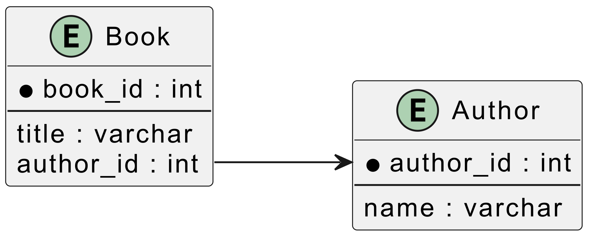

<figure>
    <a href="../images/2024/10/what-is-a-n-1-query-1.png"></a>
</figure>

An (n+1) query is a performance issue that happens in backend development. Instead of doing one query to show n objects, one does one query to get the objects and n additional queries to get detail information.

## Example

Imagine you have a website about books. The DB has two tables:

Book:

* book\_id
* title
* author\_id

Author:

* author\_id
* name

The book website has a page where all books are listed, so it executes:

```sql
SELECT * FROM book
```

Maybe you’re doing it in an ORM, so something like this:

```python
for book in Book.objects.all():
    print(f"{book.title} | {book.author.name}")
```

Looks fine, but the ORM executes a SELECT-query for every single book to get the author-dataset:

```sql
SELECT * FROM book
-- now for n=5 books:
SELECT * FROM author WHERE author_id = 4
SELECT * FROM author WHERE author_id = 1
SELECT * FROM author WHERE author_id = 3
SELECT * FROM author WHERE author_id = 2
SELECT * FROM author WHERE author_id = 5
```

## Why is it an issue?

Your database (DB) might not be on the same machine as your backend. That means every DB query has latency. The queries might not even be executed in parallel, meaning you have to wait n times for the network.

Even if the DB is on the same machine as the backend, you still have communication overhead that could be avoided.

## How do I avoid (n+1) queries?

Use a join:

```sql
SELECT
    book.book_id,
    book.title,
    author.name
FROM
    book
JOIN
    author
ON
    book.author_id = author.author_id;
```

Within your ORM, it might look like this:

```python
for book in Book.objects.select_related("author").all():
    print(f"{book.title} | {book.author.name}")
```

So you just tell the ORM in the first query that you need the data connected to it via foreign keys.
