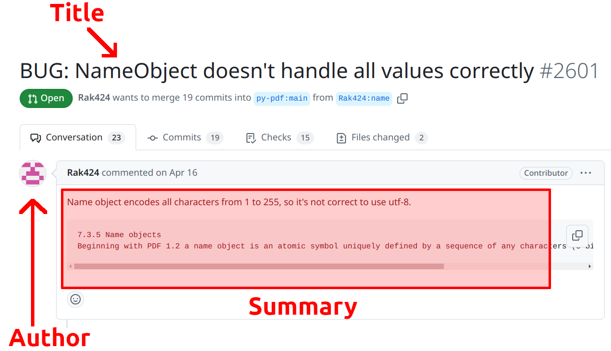
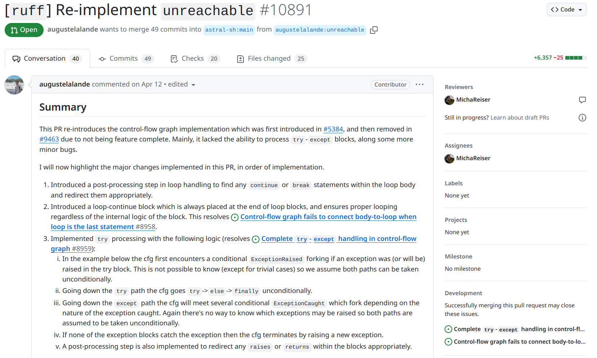
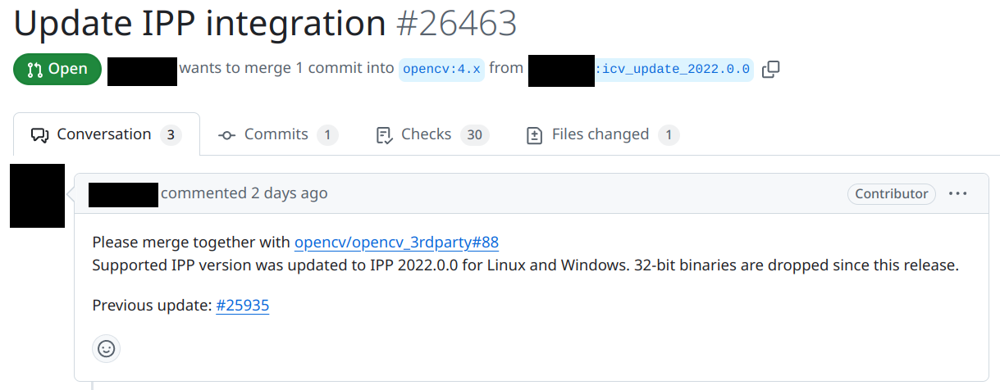

<figure>
    <a href="../images/2024/11/awesome-pr-processes-in-7-easy-steps-1.png"></a>
    <figcaption>The anatomy of a PR: It has an author, a title, and a summary.</figcaption>
</figure>

In this article I’ll describe some patterns I’ve noticed that help to make the pull request (PR) process smooth and productive.

## № 1: Keep changes minimal

It’s easier to review one file than ten. It’s easier to review 30 lines of code than 300.

But it’s not only that. If you make many unrelated changes, it’s hard for reviewers to wrap their head around those changes. Why did you do them? Why are they necessary?

Even worse: Every single change might be something to discuss.

For this reason, it’s helpful to only do stylistic changes in lines that you have to touch anyway. If you notice an issue on your way, rather open another PR to fix that issue.

One way to reduce PR sizes quite a lot is to **make a separate PR with tests** that should already succeed. Maybe the behavior was changed just slightly and one of your tests would look almost the same for an old version. Then you can make a first PR to add the test that should work and provide value on its own. In the second PR you make the adjustments to that test.

Another way to reduce PR sizes is to make **refactoring PRs**. When you add a complex new feature you might need to restructure the code. This restructuring does not change the behavior of the code, but makes it more flexible so that your actual changes can get added.

## № 2: Document Intention

A PR has a title and a summary. Use both to describe your intention. Not what you did or how you did it — both are documented in the code. But what did you try to achieve?

This is not only important for the reviewer, but also for you in the future. You might stumble over a line of code and go back in the commit history. When you wonder why you made this PR, you should give yourself enough context.

Let’s have a look at some random ones:

<figure>
    <a href="../images/2024/11/awesome-pr-processes-in-7-easy-steps-2.png"></a>
    <figcaption>You can see that the PR is massive — I’d typically try to get PRs &lt; 300 lines. The title is short and in the context of the project it might be pretty clear. In the summary the author gives the historic context with references, but I would lack the knowledge of what “unreachable” is good for in the first place. I like the summary of changes. Except for the size, I think this is an excellent PR.</figcaption>
</figure>

<figure>
    <a href="../images/2024/11/awesome-pr-processes-in-7-easy-steps-3.png"></a>
    <figcaption>This is a negative example of a PR: Using abbreviations might be fine if it’s clear to everybody what it means, but I would typically write that out in the summary to ensure people get the context. I would avoid using “update” as it’s one of the weakest descriptions. Why was it updated? Updated in which sense? Given the summary, I’d use the title “Support IPP 2022.0.0”.</figcaption>
</figure>

## № 3: Ask for specific Feedback

What should the reviewer do? Some examples might be:

* **Checking if Acceptance Criteria (ACs) are fulfilled**: You can list those explicitly
* **Correctness of a specific part**: Maybe you have doubts if you did an aspect of the PR correctly. Point that out!
* **Maintainability and Code Style**
* **Knowledge Sharing**: Maybe you don’t really need feedback, but rather want your reviewer to get familiar with a certain part of the code or a specific way to write code / tests.

This is done pretty well on [Code Review Stack Exchange](https://codereview.stackexchange.com/).

## № 4: Add Tests or Proof of Testing

A test can show very clearly how a feature is intended to be used. Additionally, it ensures that it keeps working in future.

In some cases you cannot write tests or the effort would be unreasonable. For example, when I write code for Django Admin I typically try to attach a screenshot that shows the change. This is typically easier and better than writing a unit test.

In both cases: When I’m reviewing code and I have doubts if something works, a test or proof of testing does wonders. It then means that I have to be rather certain that something does not work. So it tips the scales for approval of the PR.

## № 5: Use prefixes in titles

I first came across this in the [scipy development workflow](https://docs.scipy.org/doc/scipy/dev/contributor/development_workflow.html#writing-the-commit-message):

```text
API: an (incompatible) API change
BENCH: changes to the benchmark suite
BLD: change related to building SciPy
BUG: bug fix
DEP: deprecate something, or remove a deprecated object
DEV: development tool or utility
DOC: documentation
ENH: enhancement
MAINT: maintenance commit (refactoring, typos, etc.)
REV: revert an earlier commit
STY: style fix (whitespace, PEP8)
TST: addition or modification of tests
REL: related to releasing SciPy
```

Examples for PR titles in that project are:

```
ENH: differentiate: add array API support to jacobian and hessian
TST: optimize.linprog/milp: add tests for various bug reports
API: stats.{PermutationMethod,BootstrapMethod}: transition to rng (SPEC 7)
MAINT: linalg.interpolative: normalize rng argument with default_rng
MAINT: bump array-api-extra
BUG: guard distance_wrap directives
```

The prefix sets the expectation for the PR. In companies, you might have a tracking system and use the ticket number as the prefix.

## № 6: Establish a Commenting Culture in the Team

If a PR is long it happens regularly to me that 95% of the PR is obviously good and should be merged. There is just a small part where I’m uncertain about which means I will not approve the PR.

It’s good to add comments on that part in such situations. It shows the PR author that you have a look and might give them ideas how to improve the PR to make it easier to review.

The comments should be full sentences and be constructive. If you can make an explicit suggestion to fix an issue, do it!

[**3 rules of a good pull request comment** *Nowadays it seems all the development happens on Github. There is so called Github flow where you submit pull requests…*](https://medium.com/@yukas/how-to-write-good-pull-requests-comments-ce17ec3f5f36)

## № 7: PRs have top priority

An open and ready PR should almost always have priority. Before you start any new work, ensure that others can finish their stuff. It might be that you have doubts about the change — that’s why we have rule №6. Ask the PR author about that. Dangling PRs are frustrating and demotivating. Don’t do that to your team.
