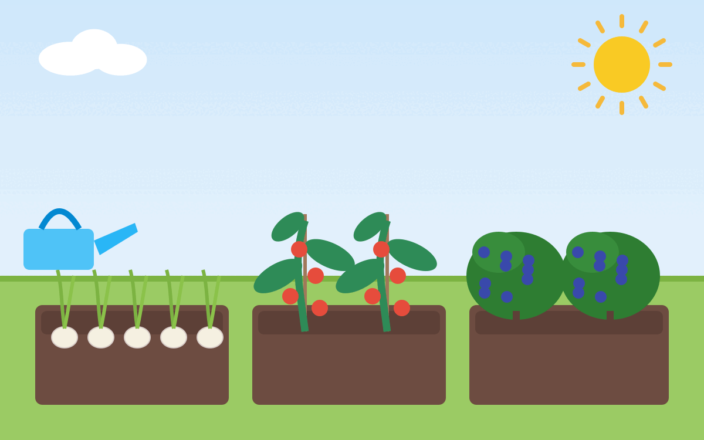

<figure class="ai-generated">
    
    <figcaption>Mit Claude AI generierte Illustration: Beete mit Knoblauch, Tomaten und Heidelbeeren</figcaption>
</figure>

## Karotten

* Boden: Sandig-lehmig, locker und steinfrei; bei schwerem, lehmigem Boden auf
  Dämmen anbauen
* Aussaat: Frühmöhren im März (Ernte ab Mai), Sorten für die Sommerernte im
  April, für Herbst und Winter nochmals im August
* Erntezeitpunkt: Je nach Sorte nach etwa 70 Tagen
* Saattiefe: 1-2,5 cm
* Abstand: 30-45 cm zwischen den Reihen, 2-5 cm in der Reihe
* Keimung: Kann bis zu drei Wochen dauern; bis dahin regelmäßig mit feinem
  Strahl gießen
* Gute Nachbarn: Zwiebeln und Lauch (ihr Geruch hält die Möhrenfliege fern)
* Fruchtfolge: Frühestens nach drei, besser nach fünf Jahren wieder auf dasselbe
  Beet

Quellen:

* [mein-schoener-garten.de](https://www.mein-schoener-garten.de/pflanzen/gemuese/moehren)

## Kartoffeln

* Standort: Sonnig
* Boden: Leicht bis mittelschwer, tiefgründig, keine Staunässe; nährstoffreich
  (reifer Mist und Kompost)
* Pflanzzeit: Wenn der Boden etwa 9 °C hat: in milden Regionen ab Anfang April,
  in kühleren erst Anfang Mai
* Erntezeitpunkt: Etwa drei Monate nach dem Pflanzen, wenn das Kraut gelb wird
  und verdorrt; frühe Sorten zwischen Juni und Anfang Juli
* Pflanztiefe: 10-20 cm tiefe Rille
* Pflanzabstand: 30-35 cm in der Reihe, mindestens 50 cm zwischen den Reihen
* Pflege: Die etwa 20 cm hohen Pflanzen zur Hälfte mit Erde anhäufeln, dann
  bilden sich mehr Knollen
* Gute Nachbarn: Möhren, Dicke Bohnen, Pastinaken
* Schlechte Nachbarn: Tomaten (Krautfäule)
* Fruchtfolge: Nur alle vier Jahre auf dasselbe Beet

Quellen:

* [mein-schoener-garten.de](https://www.mein-schoener-garten.de/pflanzen/gemuese/kartoffeln)

## Knoblauch

* Standort: Sonnig
* Boden: Locker, humusreich, nicht sandig, keine Staunässe
* Pflanzzeit: 15. September bis 10. Oktober (Winterknoblauch) oder Januar/Februar (Sommerknoblauch)
* Erntezeitpunkt: ab Juli (Winterknoblauch) bzw. August (Sommerknoblauch);
  sobald sich das Laub braun verfärbt
* Saattiefe: 5cm
* Pflanzabstand: 10x20cm

Quellen:

* [meine-ernte.de](https://www.meine-ernte.de/pflanzen-a-z/gemuese/knoblauch/)

## Zwiebeln

* Standort: Sonnig, guter Wind
* Boden: -
* Pflanzzeit: März bis April
* Erntezeitpunkt: ab August, wenn das Laub austrocknet und einknickt
* Saattiefe: Bei der Steckzwiebel sollte der obere Teil der Zwiebel aus dem Boden schauen
* Pflanzabstand: 5-10 cm

Quellen:

* [meine-ernte.de](https://www.meine-ernte.de/pflanzen-a-z/gemuese/zwiebel/)

## Tomaten

* Standort: Sonnig, warm, wind- und regengeschützt
* Boden: Humus- und nährstoffreich
* Pflanzzeit: Vorziehen ab März, Auspflanzen nach den Eisheiligen (Mitte Mai)
* Erntezeitpunkt: Juli bis Oktober
* Saattiefe: 0,5-1 cm
* Gute Nachbarn: Knoblauch, Kohl, Kohlrabi, Salat
* Schlechte Nachbarn: Fenchel, Gurke, Kartoffeln, Erbsen

Quellen:

* [meine-ernte.de](https://www.meine-ernte.de/pflanzen-a-z/gemuese/tomate/)

## Salat

Pflücksalat ist für den Anfang am einfachsten: Er bildet keinen Kopf, und man
erntet nach und nach die äußeren Blätter.

* Standort: Sonnig bis halbschattig
* Boden: Locker, humus- und nährstoffreich
* Aussaat: Direkt ins Beet ab Ende März/Anfang April; vorziehen ab Ende Februar
  unter Glas oder Folie
* Erntezeitpunkt: Sobald die äußeren Blätter 5-10 cm groß sind; nach 4-6 Wochen,
  und dann etwa genauso lange
* Pflanzabstand: 25-35 cm in der Reihe, mindestens 30 cm zwischen den Reihen
* Gießen: Regelmäßig, in Trockenperioden täglich
* Gute Nachbarn: Möhren, Bohnen, Kohlrabi, Radieschen, Dill, Rettich, Spinat,
  Rote Bete, Kohl

Kopfsalat braucht einen vollsonnigen Platz (sonst steigt der Nitratgehalt),
30 × 30 cm Abstand und ist 8-10 Wochen nach der Aussaat erntereif. Für eine
durchgehende Ernte von Juli bis Oktober alle zwei bis drei Wochen nachsäen.
Petersilie und Sellerie sind schlechte Nachbarn.

Quellen:

* [mein-schoener-garten.de: Pflücksalat](https://www.mein-schoener-garten.de/pflanzen/gemuese/pfluecksalat)
* [mein-schoener-garten.de: Kopfsalat](https://www.mein-schoener-garten.de/pflanzen/gemuese/kopfsalat)

## Heidelbeeren

* Boden:
    * sauer, pH=4-5,5 (Moorbeet-Erde oder Rhododendron-Erde).
    * Deshalb auch besser im Topf (min. 30L, eher flacher; mit Loch im Boden, um Staunässe zu vermeiden) als im Beet
    * Rhododendron-Langzeitdünger
    * Rindenmulch (ca. 5cm) abdecken
* Anpflanzen: Gut angießen
* Düngen: Vinasse (?) Flüssig-Dünger
* Pflanzzeit: Herbst oder Frühjahr
* Ernte:
    * Juli bis September, je nach Sorte
    * dauert 5-8 Jahre, bis der Strauch voll ertragreich ist
    * im YouTube-Video ist von bis zu 17kg pro Pflanze die Rede; üblich sind eher 2-5kg
* Schädlinge:
    * Vögel: Mit Netz schützen
* Mischkulturpartner: Preiselbeeren
* Gießen:
    * Heidelbeeren vertragen keinen Kalk. Das Gießwasser sollte daher weich sein (max. 8°dH)
    * Bei kalkhaltigem Leitungswasser besser Regenwasser verwenden
* Pflege: In den ersten Jahren muss man nicht schneiden; ältere Sträucher (ab ca. 5 Jahren) sollte man auslichten, indem man alte Triebe entfernt
* Winter: Frosthart; kann man im Winter einfach draußen lassen
* Preis: [10€](https://www.globus-baumarkt.de/p/obststrauch-heidelbeere-2-l-container-0684801513/)

Quellen:

* Marie Diederich: [Heidelbeere Anbau-Guide: So erntest du 17 kg pro Pflanze](https://www.youtube.com/watch?v=KetHJTLnrEk&t=6s) auf YouTube, 31.10.2023.

## Brombeeren

* Standort: Vollsonnig (mehr Blüten, und die Früchte reifen besser)
* Boden: Nicht zu leicht, humusreich, gut durchlässig, eher kalkarm (pH 5,5-6,5)
* Pflanzzeit: In kalten Regionen ab Mai, in milden auch im Herbst
* Pflanzabstand: Aufrecht wachsende Sorten 1 m, halb aufrechte 2 m, Sorten mit
  waagerechten Ruten bis 4 m
* Erziehung: An Spalier oder Spanndrähten
* Ernte: Nach und nach ab Mitte Juli bis in den Herbst
* Pflege: Die abgeernteten Ruten nach der Ernte oder im Spätwinter bodennah
  abschneiden; Früchte bilden sich an den vorjährigen Ruten
* Sorten: Stachellose Sorten wie 'Asterina', 'Oregon Thornless' oder 'Navaho'

Quellen:

* [mein-schoener-garten.de](https://www.mein-schoener-garten.de/pflanzen/obst/brombeeren)

## Johannisbeeren

* Standort: Sonne oder Halbschatten
* Boden: Tiefgründig, humus- und nährstoffreich
* Pflanzzeit: Am besten im Herbst oder im zeitigen Frühling; etwas tiefer
  pflanzen, als sie im Topf standen
* Pflanzabstand: Rote und Weiße 150-180 cm, Schwarze 200-250 cm; 2-3 m zwischen
  den Reihen
* Ernte: Je nach Sorte zwischen Juni und Juli
* Pflege: Jedes Jahr schneiden (nach der Ernte oder im zeitigen Frühjahr):
  Triebe, die älter als vier Jahre sind, bodennah entfernen; insgesamt 8-12
  kräftige Triebe stehen lassen

Quellen:

* [mein-schoener-garten.de](https://www.mein-schoener-garten.de/pflanzen/obst/johannisbeeren)

## Himbeeren

* Standort: Sonnig und windgeschützt
* Boden: Humusreich, locker, tiefgründig, leicht sauer (pH 5,5-6); keine
  Staunässe
* Pflanzzeit: Im Herbst ab Oktober, an einer Stelle, an der vorher keine
  Himbeeren oder Brombeeren standen
* Pflanzabstand: 40 cm, in Reihen mit Rankhilfe
* Ernte: Sommerhimbeeren ab Juni/Juli an den vorjährigen Ruten,
  Herbsthimbeeren von August bis Oktober an den diesjährigen
* Pflege: Jedes Jahr schneiden: Bei Sommerhimbeeren die abgetragenen Ruten
  entfernen und im Mai 10-12 mittelstarke neue Ruten pro Meter stehen lassen

Quellen:

* [mein-schoener-garten.de](https://www.mein-schoener-garten.de/pflanzen/obst/himbeeren)
