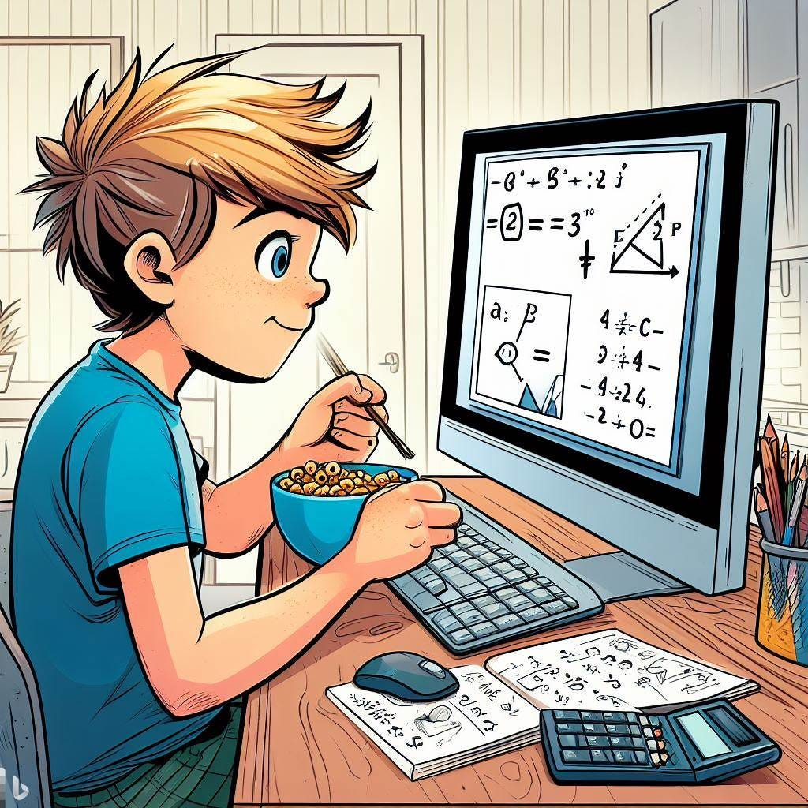
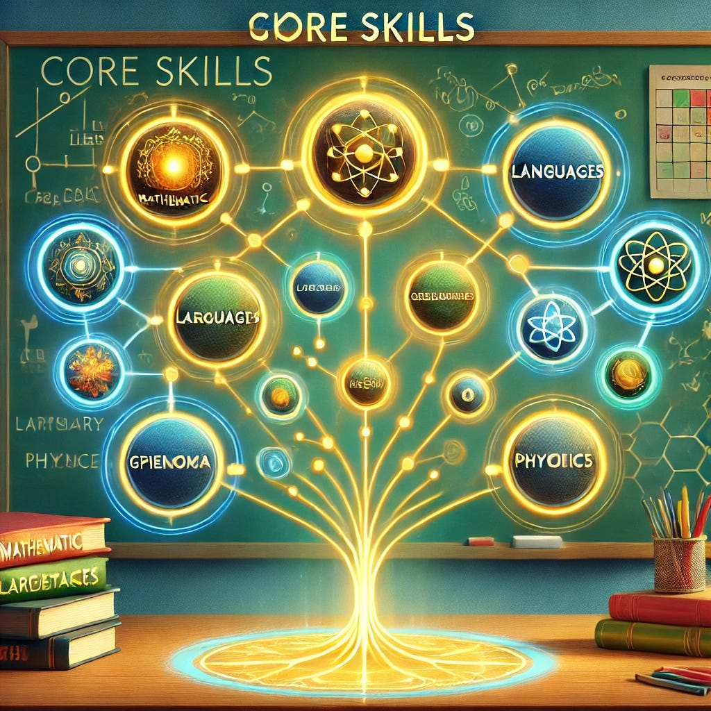

<figure class="ai-generated">
    
</figure>

In school you have 10–35 students in one room, being taught by one teacher. The teacher speaks, the students listen. While there are some variations, this is true for 70% of the time at school for many years.

This system has many problems:

1. **Inflexible curricula in a changing world**: Technology is shaping our world at a fast pace. We have jobs today that didn’t exist 20 years ago — and many aspects of jobs have drastically changed. Curricula have changed as well, but it’s unclear to me if they are actually good.
1. **You are all individuals**: But at school we are often treated as if we were all the same. Some people are bored in math lessons while it’s way too fast for others.
1. **Sick days**: When the teacher is sick, the students might miss important lessons in school. When a student is sick, they don’t know what happened — even if they could mentally participate (e.g. with a broken leg that prevents them from accessing the room). It’s stressful, and it excludes people. It stops people from getting educated.
1. **Refugees, migrants, and adults**: There are all kinds of people who wouldn’t fit in a normal classroom. Still, they might be interested in getting a similar kind of education. We should do our best to give them access to it. The more educated our population is, the better for all of us.
1. **Re-try exams**: An exam provides feedback to the student that they might not know something well enough. At the same time, it keeps a record of their achievement. And that record cannot be changed. It would be desirable if students could re-take exams after they noticed that they didn’t know a relevant part.

Instead of our current system, I would like to have a completely **customized learning experience.**

There should be an education web service, let’s call it EduServ, which keeps a record for the student. It provides access to all school books, a 24/7 help chat, an AI assistant, and a virtual classroom.

<figure class="ai-generated">
    
    <figcaption>A skill tree</figcaption>
</figure>

The record is accessible to the student. It should look like a skill tree to them: They know what they have mastered and what they need to learn for a future goal. They can track their progress in achieving a given skill.

The classroom would be more flexible and focused on collaboration. People could switch classes easily, get projects to work on together, and get way more general life advice by teachers.

One of the best experiences I had was when I wanted my class to participate in a competition. We had to make an interesting project around climate change. We built a website which provided valuable information. In our English and French classes (I’m German, so a foreign language), we translated the websites. Some students were translating it to Russian and Farsi. In Media Education, we designed the website. I think a part of the physics / mathematics classes was about calculating the heat loss of our school building. Something that the school had to do anyway. It was amazing. And we also won the competition.

Anyway, going back to my idea: The actual teaching of hard skills would likely mostly shift to the AI-assistant. In an optimal world this AI assistant would do way more than just answering simple questions. It would find tasks within the student’s environment that would bring the student closer to their goal. It would show them which skills they need as well as a path to acquire them with intermediate goals. And all of that while helping to make the world be better.
