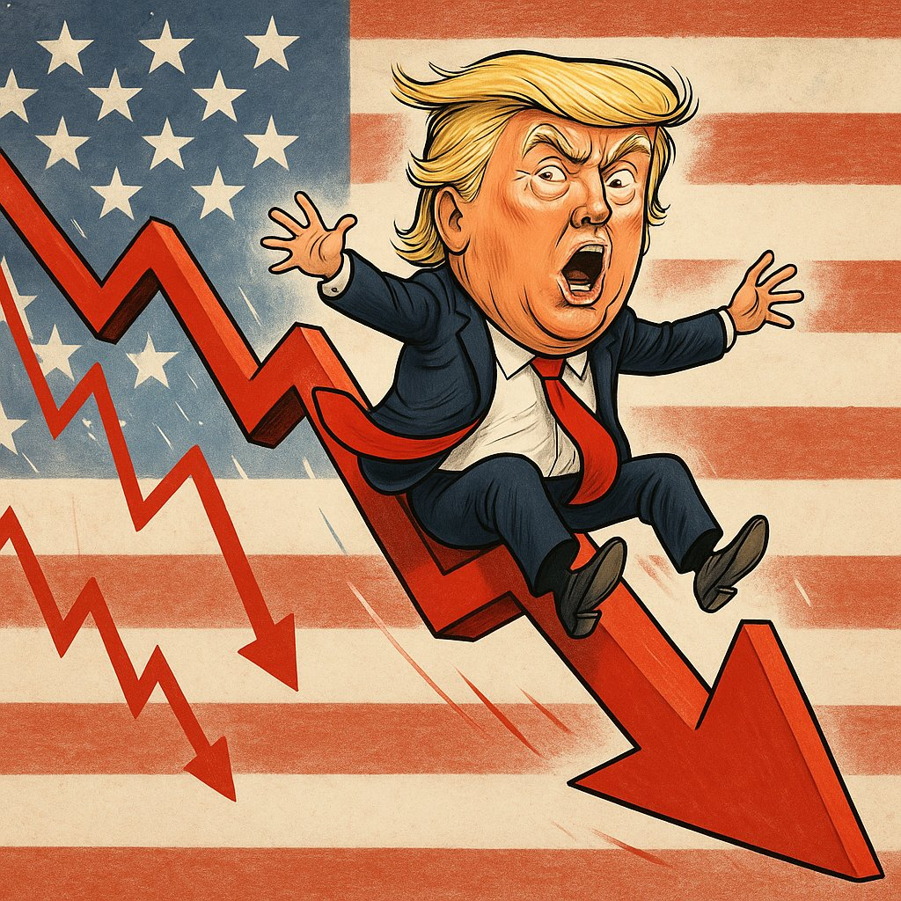
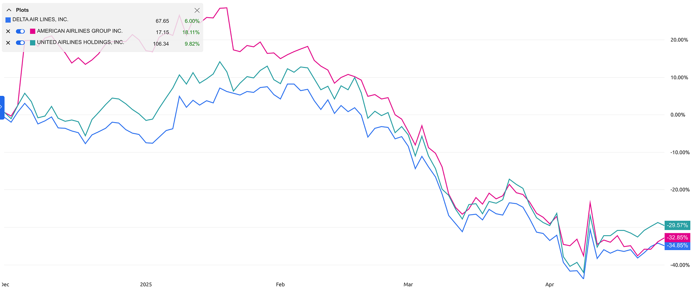
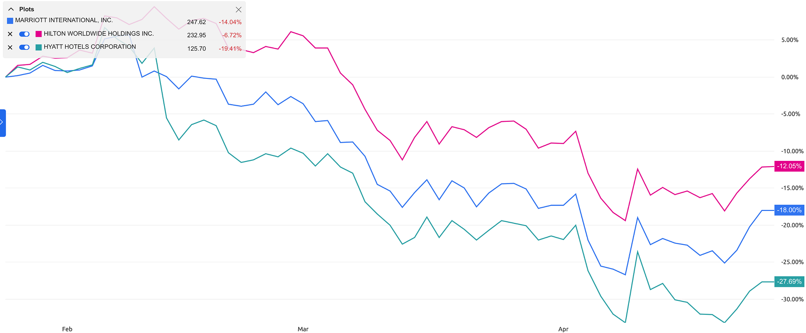
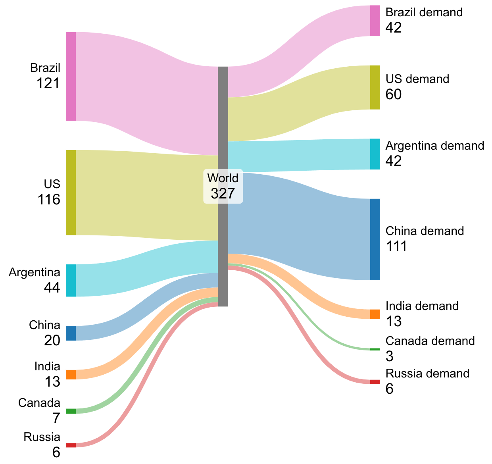
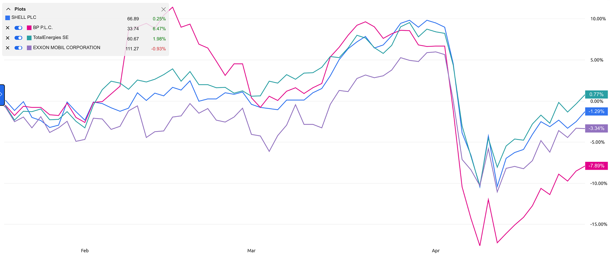

<figure class="ai-generated">
    
</figure>

The US isn’t the same since Trump took office. April 2025 was especially crazy from an economic perspective:

* **Tariffs**: In the beginning of [April 2025 Trump announced tariffs](https://en.wikipedia.org/wiki/Liberation_Day_tariffs) against almost all countries. He jumped back and forth with the height of the tariffs and exceptions. This made it impossible for companies to plan.
* **Xenophobia**: Under Trump ICE became way more aggressive. People didn’t get due process. This directly harms tourism. Who wants to visit a country that puts them into prison without good reason?
* **Short-sighted egoism**: Expensive goods such as the F-35 fighter jets or [Boeing aircraft](https://www.theguardian.com/us-news/2025/apr/21/china-returns-boeing-737-jet-us-too-expensive-tariffs) need long-term support. The actions of Elon Musk with Starlink and the rhetoric of the Trump administration to former allies like Canada have killed the confidence in the US. Trump keeps talking about Canada as the 51st state, about taking Greenland from Denmark, and Elon Musk and Trump talked in a patronizing way about/to Ukraine.

The US had a GDP of **29.7 trillion USD** in 2024. A 1% loss would mean almost 300 billion USD less! Keep that in mind as numbers are huge in this article. A billion USD is not that much for the whole of the US economy.

## Tourism and Higher Education: \$60 Billion USD

In 2022, the travel and tourism industry contributed \$2.4 trillion to the U.S. economy, representing 9.2% of the country’s GDP ([source](https://wttc.org/news/us-remains-the-worlds-most-powerful-travel-and-tourism-market), [source](https://www.statista.com/statistics/1099933/travel-and-tourism-share-of-gdp/)). That is about 18 million jobs in tourism in the US or about 11% of all employees ([source](https://www.statista.com/statistics/1419076/contribution-of-travel-and-tourism-to-employment-us/)).

The top-5 countries of non-immigrant admissions into the United States are in 2023 ([source](https://en.wikipedia.org/wiki/Tourism_in_the_United_States#Visitor_statistics)):

* 20.5 million: Canada
* 14.5 million: Mexico
* 3.9 million: United Kingdom
* 1.8 million: Germany
* 1.8 million: India

[**As international tourists pull back on U.S. travel and purchases, \$90 billion in lost revenue looms** *For international tourists, traveling to the United States is looking less inviting these days.*](https://www.nbcnews.com/business/consumer/travelers-going-to-united-states-less-due-to-trump-tariffs-rhetoric-rcna201640)

One can see this with US airlines plummeting on the stock market:

<figure>
    
    <figcaption>Delta, American Airlines, United Airlines went down by more than 30% since Trump took office.</figcaption>
</figure>

Hotel chains are active internationally so the impact is not as severe, but you can still see the steep drop in beginning of April:

<figure>
    
    <figcaption>More than -20% for hotel chains, as one can see for Hilton, Hyatt, and Marriott.</figcaption>
</figure>

Enrollment of exchange students likely will plummet as exchange students can neither feel safe nor do their research freely:

* 21st of February: Research is hindered as Trump banned words such as “climate” or “woman” from scientific publications ([source](https://www.theguardian.com/environment/2025/feb/21/trump-scientific-research-climate))
* 8th of March, [Mahmoud Khalil](https://en.wikipedia.org/wiki/Detention_of_Mahmoud_Khalil): [This](https://www.washingtonpost.com/education/2025/04/24/ice-arrest-mahmoud-khalil-no-warrant/) shows that foreigners don’t have free speech in the US anymore.
* 25th of March, [Rumeysa Ozturk](https://en.wikipedia.org/wiki/Detention_of_R%C3%BCmeysa_%C3%96zt%C3%BCrk): A PhD student was snatched by masked officers in broad daylight. Then she was flown 1,500 miles away ([source](https://edition.cnn.com/2025/03/29/us/rumeysa-ozturk-tufts-university-arrest-saturday/index.html)).
* 14th of April, [Mohsen Mahdawi](https://en.wikipedia.org/wiki/Detention_of_Mohsen_Mahdawi): Arrest of Columbia activist Mohsen Mahdawi sparks protest in NYC ([source](https://www.youtube.com/watch?v=TI0QRe8gGzE))
* 15th of April: Trump administration freezes \$2.2 billion in grants to Harvard over campus activism ([source](https://apnews.com/article/harvard-trump-administration-federal-cuts-antisemitism-0a1fb70a2c1055bda7c4c5a5c476e18d))
* 18th of April: More than 1,000 international students have had visas or legal status revoked ([source](https://apnews.com/article/f1-visa-international-college-student-trump-9d4d900d328a0c205503c1178e70f1d5))

International students contributed \$43.8 billion to the U.S. economy during the 2023–2024 academic year and supported more than 378,000 jobs ([source](https://www.aau.edu/newsroom/leading-research-universities-report/new-analysis-shows-international-students-contributed)).

## Agriculture: \$30 Billion USD

Seven countries produced more than 5 million tons (5 Mt) of soybeans in 2022 ([source](https://en.wikipedia.org/wiki/List_of_countries_by_soybean_production), [source](https://wits.worldbank.org/trade/comtrade/en/country/ALL/year/2022/tradeflow/Exports/partner/WLD/product/120100), [source](https://wits.worldbank.org/trade/comtrade/en/country/ALL/year/2022/tradeflow/Imports/partner/WLD/product/120100)):

<figure>
    
    <figcaption>A very rough idea of soybean producers in Million tons (left side) and consumers (right side). The two big net-producers in the world are the US and Brazil. The single biggest net-consumer is China. There are a lot of other countries involved, but the numbers are by far not that big.</figcaption>
</figure>

China will now shift its soybean imports from the US to Brazil.

In 2023, the US exported 6 Billion USD in pork ([source](https://www.worldstopexports.com/pork-exports-by-country/)). In 2024, the US exported about 1 Billion USD in pork to China ([source](https://www.idnfinancials.com/news/54070/us-farmers-on-edge-china-cancels-120-000-tonnes-of-pork-imports)). This will now shift to Spain ([source](https://www.idnfinancials.com/news/54070/us-farmers-on-edge-china-cancels-120-000-tonnes-of-pork-imports)).

Corn seems to face a similar fate ([source](https://www.world-grain.com/articles/21302-report-china-halts-us-corn-soybean-orders)).

## Military Equipment: \$8 billion USD

The [F-35 fighter jet](https://en.wikipedia.org/wiki/Lockheed_Martin_F-35_Lightning_II) costs about \$100 million USD. The fear of a [kill-switch](https://www.euronews.com/next/2025/03/13/can-the-us-turn-off-european-weapons-experts-weigh-in-on-kill-switch-fears) raises concerns about orders of F-35 jets:

* **Canada** paid for 16 of 88 ordered F-35 jets ([source](https://www.cbc.ca/news/politics/f35-blair-trump-1.7484477)). They are debating whether to cancel the remaining ones.
* **Portugal** wanted to get the F-35, but is thinking about the [JAS 39 Gripen](https://en.wikipedia.org/wiki/Saab_JAS_39_Gripen) now ([source](https://en.defence-ua.com/news/portugal_torn_between_f_35_and_gripen_to_replace_the__16_fighters-14321.html)).
* **Switzerland** signed a contract for 36 aircraft, but many want to cancel ([source](https://www.msn.com/en-ie/money/other/81-of-swiss-reject-the-f-35-switzerland-may-cancel-purchase-of-american-fighter-jets/ar-AA1D5fVQ)).

**Starlink** is also not trustworthy as Elon Musk [has shown](https://kyivindependent.com/ukrainian-front-line-would-collapse-if-starlink-is-turned-off-musk-claims/). The US has also used it as leverage ([source](https://www.reuters.com/business/us-could-cut-ukraines-access-starlink-internet-services-over-minerals-say-2025-02-22/)). [An alternative might be Eutelsat](https://www.advanced-television.com/2025/03/07/eutelsat-to-replace-starlink-in-ukraine/). Here are some news of countries turning away from Starlink:

* 23rd of March, 2025: Italy suspends Starlink purchase negotiations with SpaceX amid Musk controversy ([source](https://kyivindependent.com/italy-suspends-starlink-purchase-negotiations-with-spacex-amid-musk-controversy/))
* 27th of February, 2025: Mexican Billionaire Carlos Slim Cuts Ties with Elon Musk’s Starlink, Costing Musk \$7 Billion After Controversial Tweet ([source](https://www.msn.com/en-us/money/companies/mexican-billionaire-carlos-slim-cuts-ties-with-elon-musk-s-starlink-costing-musk-7-billion-after-controversial-tweet/ar-AA1zWshm))
* 3rd of February, 2025: Ontario ends contract with Musk’s Starlink over US tariffs ([source](https://www.bbc.com/news/articles/c5y7626l610o))

## Export Restrictions for Nvidia: \$5.5 billion USD

[**Nvidia, caught in the US-China trade war, takes a \$5.5 billion hit | CNN Business** *Nvidia is caught in the middle of an escalating trade war between the world’s two largest economies.*](https://edition.cnn.com/2025/04/16/tech/nvidia-plunge-h20-chip-china-export-intl-hnk/index.html)

## Indicators of a recession

### Consumer Confidence

Confident consumers spend more money. They make big investments, e.g. buying a house, a car, or a refrigerator.

Consumer confidence is a soft factor. You simply ask people questions to measure it. There are different ways to do this survey.

The [Consumer Confidence Index](https://en.wikipedia.org/wiki/Consumer_confidence_index) asks 5000 people about their perception of the economy with a survey in five categories. The record-high was at 144.7 in May 2000. The record-low was at 25.3 points in February 2009. In March 2025 it was at 92.9 — around the same as during COVID and a lot better than during the financial crisis from 2008–2014.

### Oil

When the tariffs were announced, the oil prices immediately fell. With them, the value of many companies including the big oil companies fell:

<figure>
    
    <figcaption>BP, TotalEnergies, ExxonMobil, and Shell all fell by at least 15% when the Trump tariffs were announced in April 2025.</figcaption>
</figure>

People expected reduced economic activity (maybe even a recession) and thus less need for oil.

Later, in April 2025, news spread that China pivots from US oil to Canadian oil ([source](https://news.bloombergtax.com/international-trade/china-pivots-from-us-to-canada-for-more-oil-as-trade-war-worsens)). China imported 11.1 million barrels of crude oil per day (b/d) in 2024 ([source](https://www.eia.gov/todayinenergy/detail.php?id=64544)), only a small share of it from the US. As China’s coal consumption will likely plateau in 2027 ([source](https://energynews.pro/en/china-and-the-future-of-coal-a-plateau-at-8-77-billion-tonnes-by-2027/)) and more and more cars are electric, I would expect the oil imports to drop as well. 7.6% of their cars were electric in 2023 already ([source](https://www.iea.org/data-and-statistics/data-tools/global-ev-data-explorer)).

### Scarcity due to missing cargo ships from China

At the moment I see several smaller TikToks by US-Americans saying that fewer ships from China arrive in US ports. It’s pretty hard to find that from credible sources:

* 22nd of April: [Chinese freight ship traffic to busiest U.S. ports, Los Angeles, Long Beach, sees steep drop](https://www.cnbc.com/2025/04/22/busiest-us-ports-see-big-drop-in-chinese-freight-vessel-traffic.html)
* 24th of April: [Traffic at the Port of Los Angeles set to plunge amid tariffs](https://www.latimes.com/business/story/2025-04-24/traffic-at-the-port-of-los-angeles-set-to-plunge-amid-tariffs-disruption)
* 25th of April: [Tariff tit-for-tat has Seattle waiting for the ships to come in](https://www.seattletimes.com/business/tariff-tit-for-tat-has-seattle-waiting-for-the-ships-to-come-in/)

The US has [several huge ports](https://en.wikipedia.org/wiki/List_of_ports_in_the_United_States). Here are some that publish monthly numbers:

* Port of Houston (Texas): [Port statistics](https://porthouston.com/about/our-port/statistics/)
* Port of Long Beach (California): [Port statistics](https://polb.com/business/port-statistics/#latest-statistics)
* Port of Savannah (Georgia): [Port statistics](https://gaports.com/wp-content/uploads/2025/04/Monthly-TEU-Throughput-March-2025.pdf?1745738916=)

A container ship needs between 13 days (Shenzhen to Long Beach) up to 30 days (Shanghai to New York via the Panama Canal).

As it takes up to a month to see the effect, I would expect the statistics of April to look mostly fine. The ones of May will also not see the full impact, but should already look worse. The statistics of June should see the full effect of Trumps tariffs.

Once it goes down, truck drivers should also notice. There are 8.5 million people employed throughout the economy in jobs that relate to trucking activity in 2023 ([source](https://www.trucking.org/economics-and-industry-data)). In March 2025, there were approximately 163.51 million employed persons in the United States, meaning over 5% of the workforce have jobs related to trucking.
