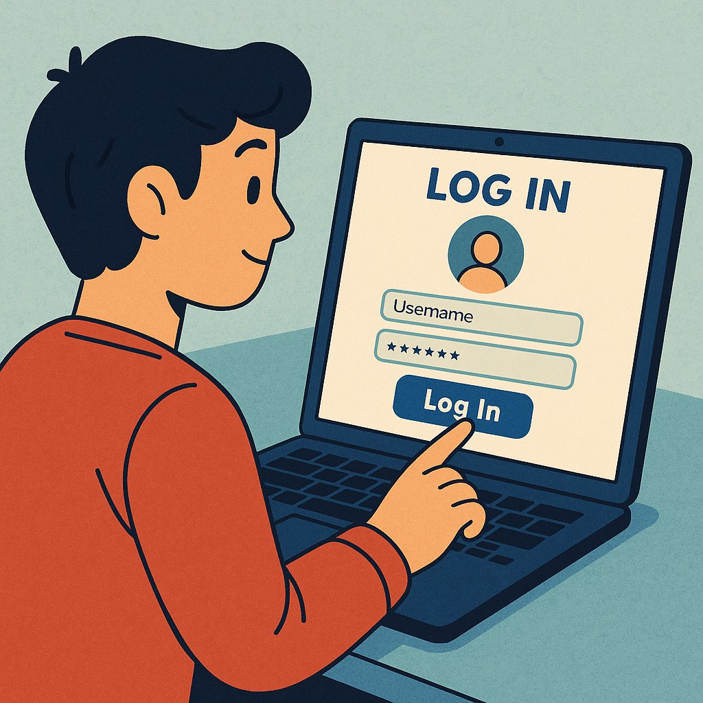
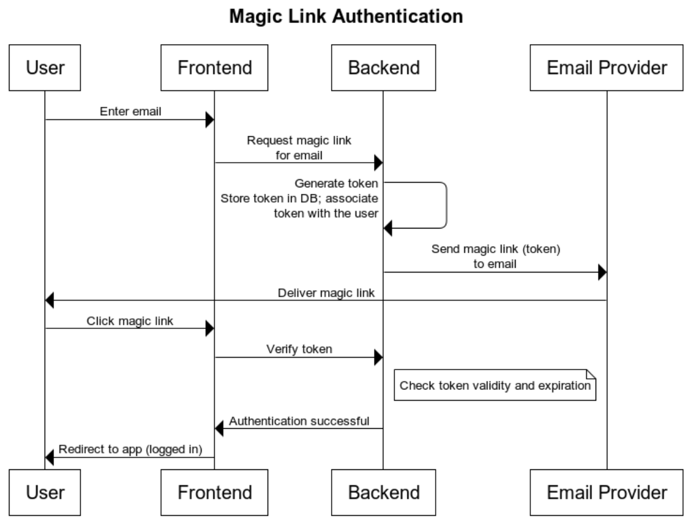
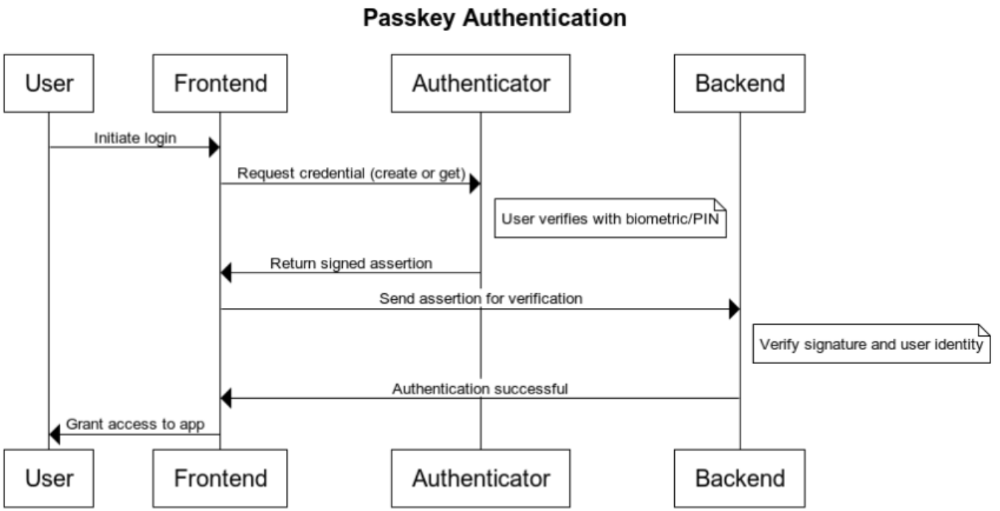
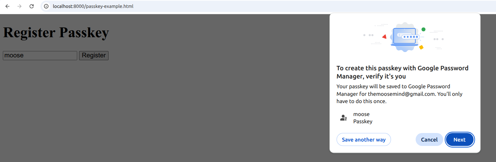
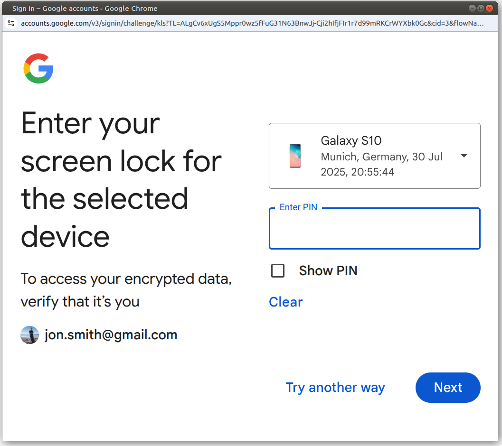
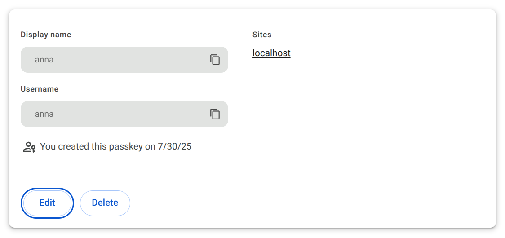
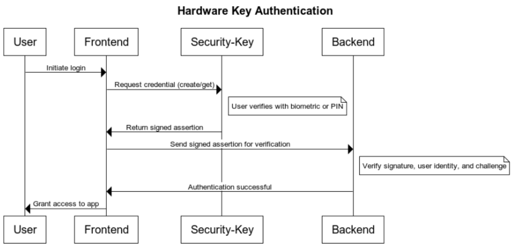
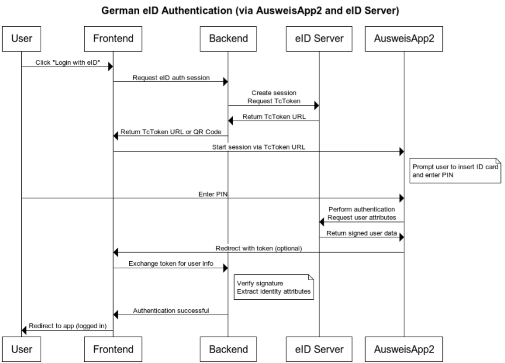

<figure class="ai-generated">
    <a href="../images/2025/08/6-authentication-systems-your-developers-are-not-thinking-about-1.jpg"></a>
</figure>

Every web service needs a way to authenticate their users. The most basic way to do it is to use the user’s e-mail address or a username with a password. Also social logins using Google / Microsoft / Amazon / Facebook are pretty wide-spread. But there are other options most developers don’t think about. At least one of them will be new to you 😉

I’ll first explain how they work and then make one of my infamous comparisons so that you have an easier time deciding what is good for your website. Let’s go 🚀

## № 1: Magic Links 🔗

Instead of logging in with a password, you just send a token to the user via e-mail. That token is just a bunch of random characters, e.g.

```python
import secrets, string

def generate_secure_token(length=32):
    alphabet = string.ascii_letters + string.digits  # A-Z, a-z, 0-9
    return ''.join(secrets.choice(alphabet) for _ in range(length))

>>> generate_secure_token()
'I32w5CAWuqNSrj1OVWniSEWwvVDAFuhp'
```

The magic link then is just a URL containing the token, e.g.

```python
def generate_magic_link(user):
    token = generate_secure_token()
    UserToken.objects.create(user, token)  # store it in DB
    return "https://my-website.com/login?token=" + token
```

When the user clicks on the link in their e-mail, it is stored e.g. as a HTTP-only cookie.

So the workflow is:

<figure>
    <a href="../images/2025/08/6-authentication-systems-your-developers-are-not-thinking-about-2.png"></a>
</figure>

Note that magic links are a tiny but important improvement over email/SMS one-time-passwords (OTP): The user just clicks on the link to login. The user does NOT copy the credential.

Ideally, the token is long enough that the user would never think about telling an attacker. It should also be short-lived, e.g. only be valid for 2 hours. The session of the user can be longer, just the link is not valid for longer.

## № 2: TOTP

Time-based One-Time Passwords (TOTPs) are commonly used as a second factor. You login via email+password and get asked for your TOTP code.

The core idea is pretty simple:

1. The server and the client both share a secret. They also have a clock that is in sync.
1. Both, client and server, count how many times 30 seconds have passed since 1970 (the Unix epoch).
1. A keyed hash function (HMAC) is applied to that number with the secret as key.

The hash function makes sure that nobody can get to know the secret from the result. So even if you get to know one password, it will be invalid in at most 30 seconds.

Here is some Python code that shows this:

```python
import time
import hmac
import hashlib
import base64
import struct


def get_totp_token(secret, time_step=30, digits=6):
    # Decode base32 secret (add padding if necessary)
    secret = secret.upper()
    missing_padding = len(secret) % 8
    if missing_padding != 0:
        secret += "=" * (8 - missing_padding)
    key = base64.b32decode(secret)

    # Get number of time steps since epoch
    counter = int(time.time() / time_step)
    counter_bytes = struct.pack(">Q", counter)

    # HMAC-SHA1
    hmac_hash = hmac.new(key, counter_bytes, hashlib.sha1).digest()

    # Dynamic Truncation
    offset = hmac_hash[-1] & 0x0F
    code = struct.unpack(">I", hmac_hash[offset : offset + 4])[0] & 0x7FFFFFFF
    otp = code % (10**digits)

    # Return zero-padded string
    return str(otp).zfill(digits)


# Example usage
if __name__ == "__main__":
    secret = "JBSWY3DPEHPK3PXP"  # base32 encoded string
    print("TOTP Code:", get_totp_token(secret))
```

While this is mostly used as a second factor, you could also login just with the email and a TOTP. One would need to make the TOTP code long enough to avoid attackers brute-forcing all TOTP codes within 30 seconds for one user to get a temporary login.

## № 3: Passkeys via Webauthn

Authentication using passkeys makes use of public-key-cryptography. The browser generates a public key and a private key. The private key never leaves the user’s devices (password managers may sync it between them), only the public key is shared with the website.

Before you continue, you might want to try it on a demo page:

[**Passkeys.io - A Real-World Passkey Demo & Info Page** *Try a Realistic Passkey Demo Login and User Profile. Browse the Passkey Directory and Find Websites With Passkey…*](https://www.passkeys.io/)

Here is the workflow:

<figure>
    <a href="../images/2025/08/6-authentication-systems-your-developers-are-not-thinking-about-3.png"></a>
</figure>

When the user first creates the passkeys, a popup will show up:

<figure>
    <a href="../images/2025/08/6-authentication-systems-your-developers-are-not-thinking-about-4.png"></a>
</figure>

Once they accept, something like this will happen:

<figure>
    <a href="../images/2025/08/6-authentication-systems-your-developers-are-not-thinking-about-5.png"></a>
</figure>

Now the user will see this key in the URL bar:

<figure>
    <a href="../images/2025/08/6-authentication-systems-your-developers-are-not-thinking-about-6.png"></a>
</figure>

Clicking on it, the user can get to the password manager:

<figure>
    <a href="../images/2025/08/6-authentication-systems-your-developers-are-not-thinking-about-7.png"></a>
</figure>

You can only change the display name / username, but neither view nor change the actual passkey.

In case you’re interested in what the actual code for that looks like:

[**algorithms/plant-uml/authentication/passkeys at master · MartinThoma/algorithms** *This repository is for learning and understanding how algorithms work. - algorithms/plant-uml/authentication/passkeys…*](https://github.com/MartinThoma/algorithms/tree/master/plant-uml/authentication/passkeys)

In the frontend, the key functions are:

```javascript
navigator.credentials.create()  // Register
navigator.credentials.get()     // Login
```

In the backend, the public key needs to be stored and signed assertions need to be verified using the [WebAuthn/FIDO2 protocol](https://www.w3.org/TR/webauthn/).

There is one big disadvantage, though: You need a fallback if the user wants to login with another device.

The usage of the credentials can be protected by a password. The verification would be done by the browser — the website doesn’t get to know that password.

## № 4: Hardware Tokens via Webauthn

I have a [Yubikey](https://www.yubico.com/products/yubikey-5-overview/) and a [Google Titan](https://store.google.com/us/product/titan_security_key?hl=en-us&pli=1) security key. Those security keys can also be called “hardware tokens”.

From a user’s perspective, they behave the same:

1. I do some action that needs authentication
1. The security key starts blinking
1. I press the button on the key

Note that the flow using the security key is the same as with the passkeys. You just protect the usage of the credentials with the security key.

<figure>
    <a href="../images/2025/08/6-authentication-systems-your-developers-are-not-thinking-about-8.png"></a>
</figure>

Both use the [FIDO2](https://en.wikipedia.org/wiki/FIDO_Alliance#FIDO2) protocol and the [WebAuthn API](https://developer.mozilla.org/en-US/docs/Web/API/Web_Authentication_API). In fact, you can use the same frontend and backend code for it.

## № 5: Biometrics via WebAuthn

Biometric login on smartphones is already common. Most people use methods like fingerprint or facial recognition to unlock their phones. These biometrics can also be used in conjunction with WebAuthn, a web standard for passwordless authentication. When using passkeys (a feature of WebAuthn), the private key is stored securely on your device, and biometric verification (e.g., Face ID, fingerprint) is used to authorize its use. So you’re not authenticating with your face directly to a website — you’re using your face to **unlock the credential** stored on your device.

You can see a demo of that via:

[**Passkeys Demo** *Experience Passwordless Logins with the Free Passkeys Demo. Use Face ID, Touch ID, Android Biometrics or Windows Hello…*passkeys.eu](https://passkeys.eu/)

## № 6: eID

The German electronic ID ([eID](https://en.wikipedia.org/wiki/German_identity_card)) makes use of the official identity card. It’s mostly meant for Government services, but can also be used to identify for hotels or bank accounts. It is [eIDAS](https://en.wikipedia.org/wiki/EIDAS) compliant.

Web services which want to use it first need to be authorized and receive a certificate ([Berechtigungszertifikat](https://www.bva.bund.de/DE/Services/Behoerden/Produkt/PA-VfB/pa-vfb_node.html)). The backend needs an eID Server (e.g. [Governikus](https://www.governikus.de/en/produkte/eid-service/) or [adesso](https://www.adesso.de/de/services/digitale-identitaeten/index.jsp)). The user needs to have the AusweisApp ([Android](https://play.google.com/store/apps/details?id=com.governikus.ausweisapp2), [iOS](https://apps.apple.com/de/app/ausweisapp-bund/id948660805)) installed.

<figure>
    <a href="../images/2025/08/6-authentication-systems-your-developers-are-not-thinking-about-9.png"></a>
</figure>

[SkIDentity](https://www.skidentity.de/) and [Verimi](https://verimi.de/en/verimi-integration/) seem to offer easier integration via OpenID Connect (OIDC). Verimi also has a [Keycloak integration](https://docs.verimi.de/#/plugins/plugin_keycloak).

## Comparison

There are tons of ways to compare authentication methods, but I am interested in the following:

* **Popularity**: How well-known is this method to normal users?
* **User Experience (UX)**: Assuming the user has seen it before, how easy is it?
* **Phishing resistance**: How well does the authentication method protect users from phishing?
* **Replay protection**: Can an attacker reuse a captured credential?
* **Implementation complexity**: How much work is it to implement? More stars mean more work.

| Authentication Method                | Popularity | UX    | Phishing Resistance | Replay Protection | Implementation Complexity |
|--------------------------------------|------------|-------|---------------------|-------------------|---------------------------|
| Username + Password                  | ★★★★★      | ★★    | ★                   | ★                 | ★                         |
| Magic Link (via Email)               | ★★         | ★★★★  | ★★                  | ★★                | ★★                        |
| Username + TOTP                      | ★★★★       | ★★    | ★★                  | ★★★               | ★★                        |
| Social Logins (Google, Apple, etc.)  | ★★★★       | ★★★★  | ★★★                 | ★★                | ★★★                       |
| Passkeys (WebAuthn)                  | ★          | ★★★★  | ★★★★★               | ★★★★★             | ★★★★                      |
| Hardware Tokens (WebAuthn, FIDO2)    | ★★         | ★★★   | ★★★★★               | ★★★★★             | ★★★★                      |
| Biometrics (WebAuthn)                | ★★         | ★★★★★ | ★★★★★               | ★★★★★             | ★★★★                      |
| eID (e.g., German AusweisApp2)       | ★          | ★★    | ★★★★                | ★★★★              | ★★★★★                     |

Passkeys are almost ideal, but their adoption isn’t high so far. That makes it harder to adopt it yourself.

eID has the big advantage of actually being able to give the identity, but it’s just too complex — for the user and for the developers. Pairing it with the low adoption makes me want to avoid it for the moment.

Another important factor is that all mentioned WebAuthn authentication methods are device-bound. You cannot go to your library and login using that. You could use e.g. your Google Account or a password manager to log in to Chrome and that would sync the passkeys, though.
