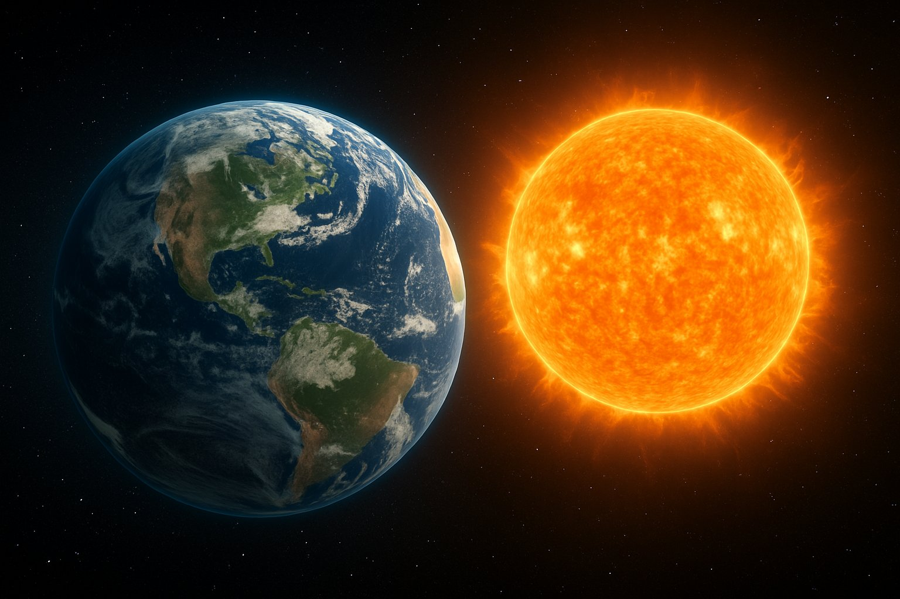
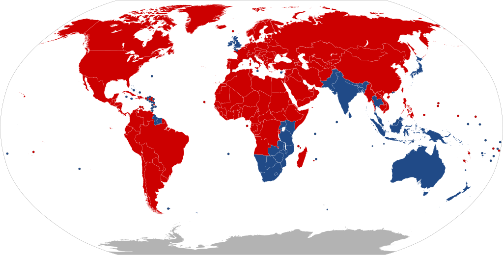
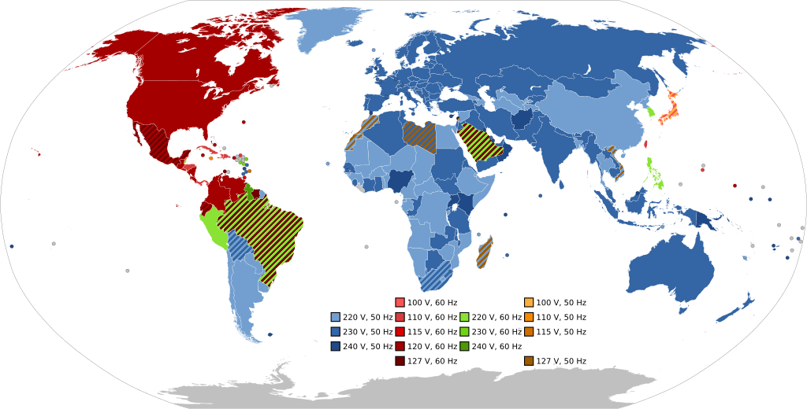
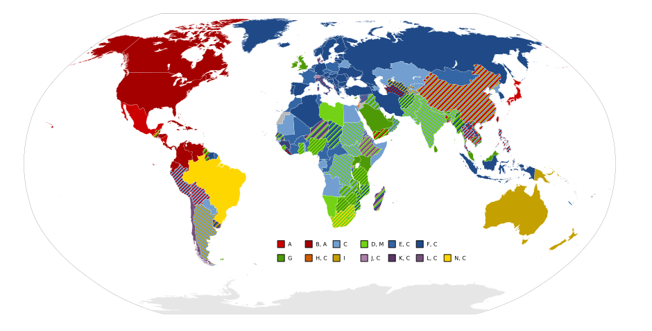
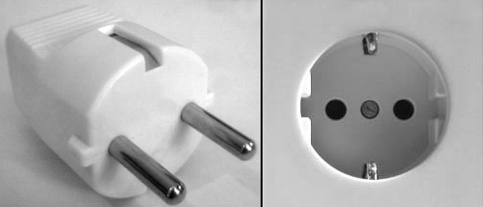
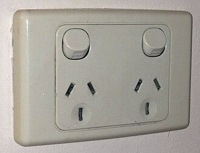
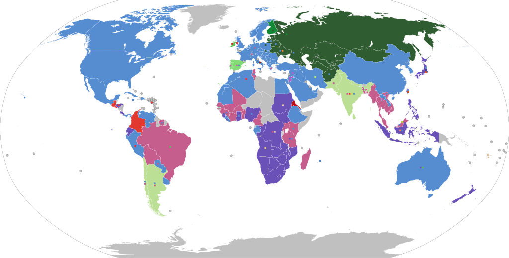
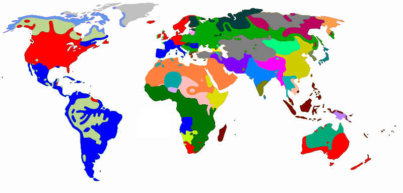
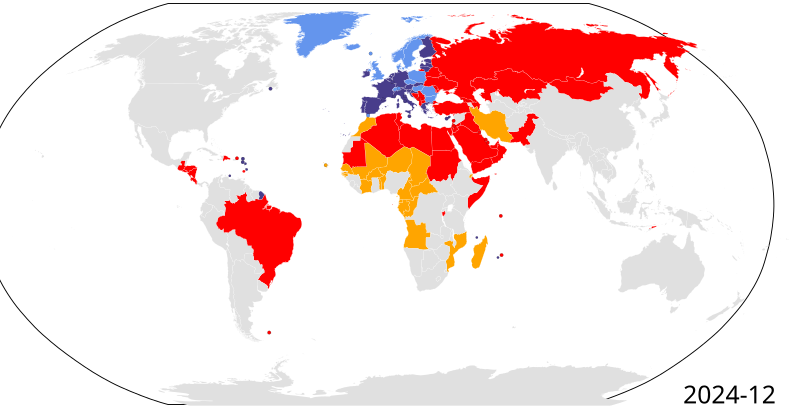

Our world is not ideal. Many small decisions which are kind of arbitrary and could have easily been done differently initially are simply too expensive to change years later.

## №1: Our Calendar

<figure class="ai-generated">
    <a href="../images/2025/10/improvements-that-we-will-never-see-1.jpg"></a>
    <figcaption>Created with AI</figcaption>
</figure>

Some months have 30 days, others 31, and February has 28 or 29 days.

Earth takes 365 solar days, 5 hours, 48 minutes, and 45 seconds to go around the sun. So we need 365 days in a year and every couple of years we need 366 to account for those 5 h 49 min.

**The better option would be the [International Fixed Calendar](https://en.wikipedia.org/wiki/International_Fixed_Calendar)**: 13 months with 28 days per month. That would be 364 days. The remaining 1 or 2 days are not part of any month.

**Why it’s better**:

* Every month has the same number of days. That makes statistics easier.
* Every month has exactly 4 weeks. That means every month can start with the same day. No need to wonder if 1st of November is a Sunday or not.
* The last day (or 2 days) of the year could be holidays and not be counted to any week. That would also mean that every calendar ever sold would be valid for every year. No need to always buy new calendars / throw perfectly fine unsold calendars of the last year away.

## №2: Left- and right-hand traffic

<figure>
    <a href="../images/2025/10/improvements-that-we-will-never-see-2.png"></a>
    <figcaption>Most countries drive right (red), but quite a few drive left (blue). Source: <a href="https://en.wikipedia.org/wiki/File:Countries_driving_on_the_left_or_right.svg">Wikimedia Commons</a>.</figcaption>
</figure>

If you drive on the right (red countries) or on the left (blue countries) mostly depends on if the country had a significant influence by the British Empire around 1900.

At that time, switching would have been easy.

Now, switching would be a pain:

* The steering wheel of all cars in that country would be on the wrong side
* Tons of drivers would not be used to the direction
* Driving signs and even streets (e.g. highway exits) would be on the wrong side.

## №3: Electric voltage and frequency

<figure>
    <a href="../images/2025/10/improvements-that-we-will-never-see-3.png"></a>
    <figcaption>Source: <a href="https://en.wikipedia.org/wiki/File:World_Map_of_Mains_Voltages_and_Frequencies,_Detailed.svg">Wikimedia Commons</a></figcaption>
</figure>

Europe, including Russia and Turkey, uses 230V with 50 Hz. Most of Asia, Africa, and Oceania use 50Hz and 220–240V, with notable exceptions being:

* Japan: 100V, 50Hz in the east and 60Hz in the west. In 1895, Tokyo bought generators from Germany (AEG, 50 Hz), and in 1896 Osaka bought generators from the US (General Electric, 60 Hz).
* Philippines / South Korea / Saudi Arabia: 220V, but 60Hz

Switching would mean to change all household electronics. No way that this will happen. Countries with 220V/240V might switch to 230V.

## №4: Electric power plugs

<figure>
    <a href="../images/2025/10/improvements-that-we-will-never-see-4.png"></a>
    <figcaption>Source: <a href="https://en.wikipedia.org/wiki/File:World_map_of_electrical_mains_power_plug_types_used.svg">Wikimedia Commons</a></figcaption>
</figure>

It’s good that countries with a different frequency (50Hz vs 60Hz) or different voltage (100V / 120V / 230V) have different power plugs. However, I don’t understand why Australia/China/India/the UK use different plugs.

<figure>
    <a href="../images/2025/10/improvements-that-we-will-never-see-5.png"></a>
</figure>

<figure>
    <a href="../images/2025/10/improvements-that-we-will-never-see-6.jpg"></a>
    <figcaption>European Type F plugs vs the Australian/Chinese Type I</figcaption>
</figure>

In any case: Switching would mean that a ton of household-appliances would require an adapter.

## №5: Railway track gauges

Again, it would be ideal if the world had one standard everywhere. That would mean we could use the same trains everywhere in the world. Instead, we have 1435 mm in most of Europe/US/China/Australia, 1668 mm in Spain/Portugal, 1520 mm in Russia, and various other track gauges.

<figure>
    <a href="../images/2025/10/improvements-that-we-will-never-see-7.png"></a>
    <figcaption>Source: <a href="https://en.wikipedia.org/wiki/File:Rail_gauge_world.svg">Wikimedia Commons</a></figcaption>
</figure>

So there will never be a single train going from Portugal to China 🥲

## №6: Languages

The fact that we have so many vastly different languages is not ideal. It would be nice if there were no language barriers.

<figure>
    <a href="../images/2025/10/improvements-that-we-will-never-see-8.png"></a>
    <figcaption>Language Families — there are a ton more languages, but those are very different. Source: <a href="https://en.wikipedia.org/wiki/Template:Distribution_of_languages_in_the_world">Wikimedia Commons</a></figcaption>
</figure>

The other big difference is writing systems:

* Alphabets: Latin/Roman script, Russian (Cyrillic), Arabic, Greek, Hebrew
* Syllabic systems: Japanese Hiragana & Katakana
* Logographic systems: Chinese Hanzi, Japanese Kanji

## №7: Borders

Exclaves (e.g. Kaliningrad belongs to Russia, but is between Poland and Lithuania) as well as being landlocked (e.g. Liechtenstein, Austria, Switzerland) is not ideal as it creates dependencies. Artificial borders which are not at a river are also not great when the countries are at war.

## №8: Banking Systems

<figure>
    <a href="../images/2025/10/improvements-that-we-will-never-see-9.png"></a>
    <figcaption>Countries that use IBAN — the International Bank Account Number. The different colors encode different types of support; see <a href="https://en.wikipedia.org/wiki/File:IBANMap-World6.svg">Wikimedia Commons</a> for details</figcaption>
</figure>

We don’t have a single consistent system for international bank accounts. As a consumer, I would like to have globally unique numbers for bank accounts. The IBAN system is pretty nice:

```text
IE64 IRCE 9205 0112 3456 78

┌─────────────────────────────────────┐
│ Country code:         IE            │  → Ireland
│ Check digits:         64            │  → Validates the IBAN structure
│ Bank identifier:      IRCE          │  → Bank code (Central Bank of Ireland)
│ Branch code (sort):   920501        │  → Branch / routing identifier
│ Account number:       12345678      │  → Customer’s local account number
└─────────────────────────────────────┘
```

With that number I could immediately and without cost transfer money to that account.

This system is firmly established in Europe, but I’m certain that the US, Japan, and China have their own systems. Switching to one common system is extremely hard. Especially when alternatives are established… and certainly there are some political considerations relevant as well.
