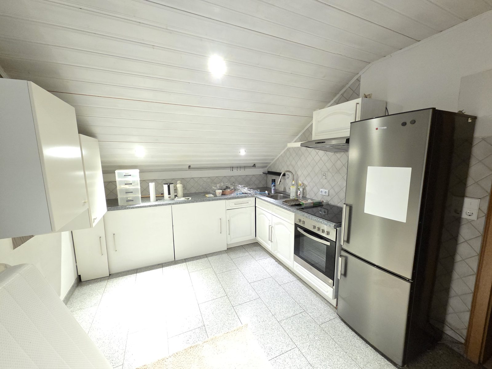
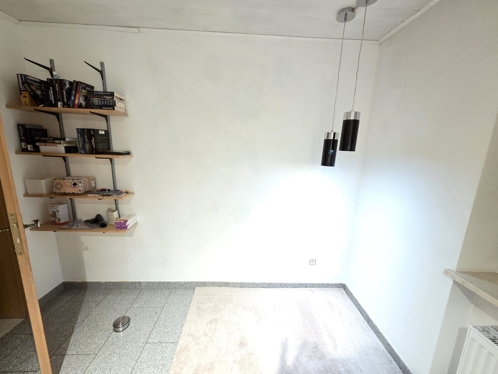
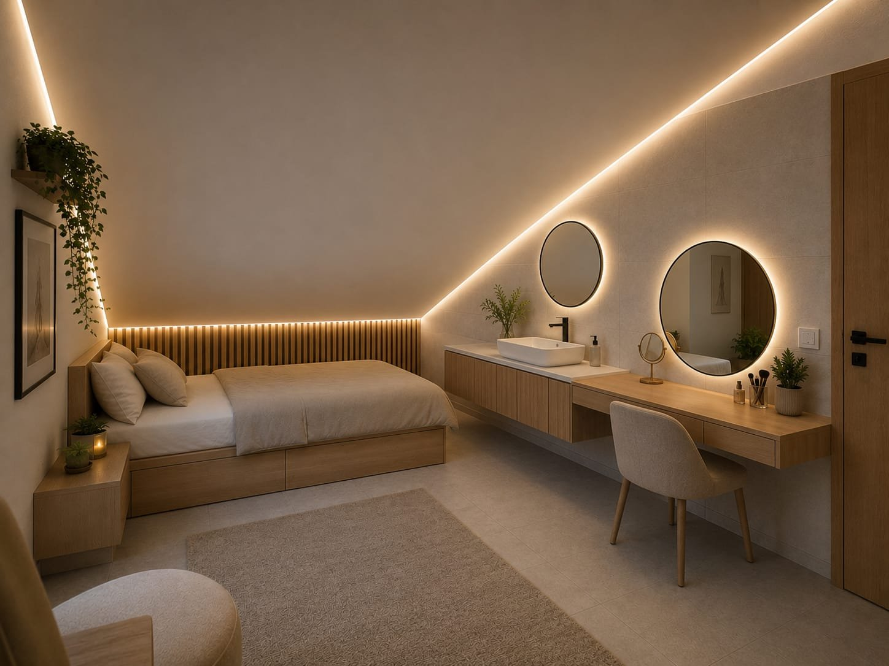
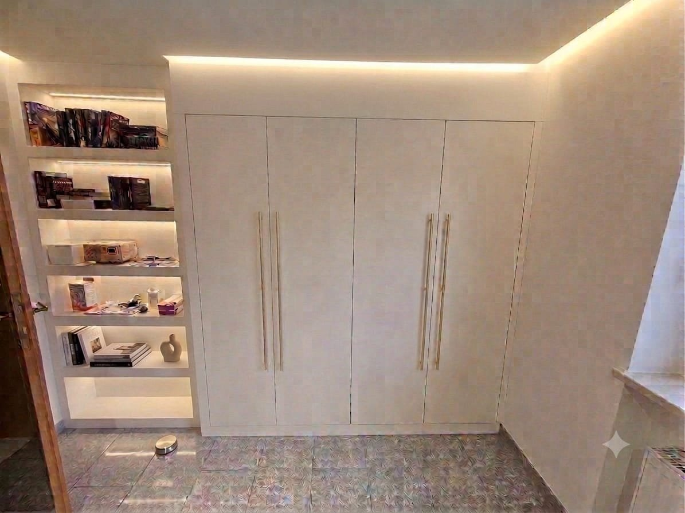
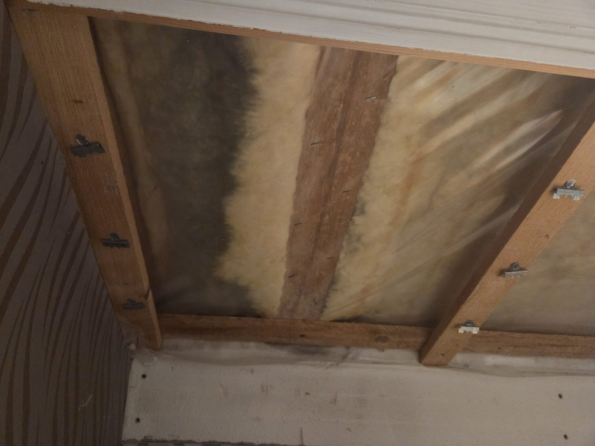
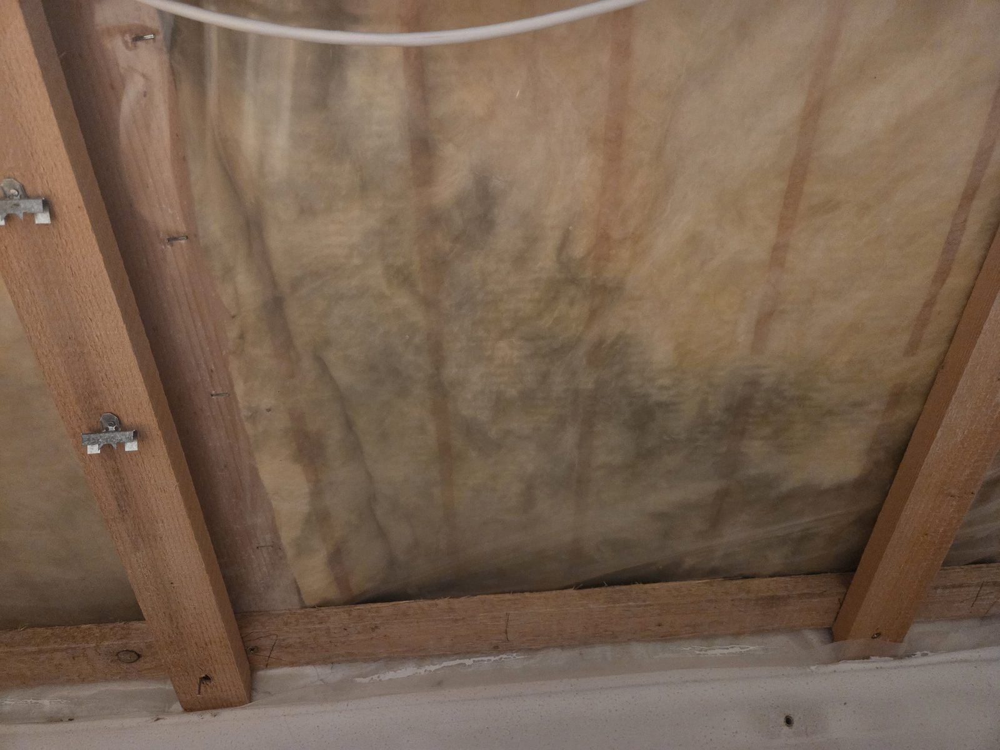
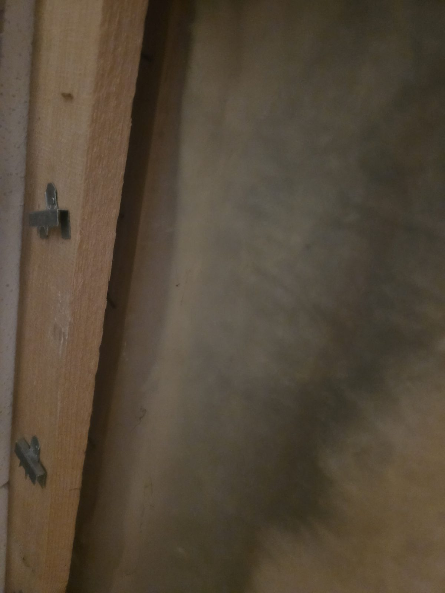

Aus der Küche im Obergeschoss soll ein Kinderzimmer werden. In diesem Artikel
halte ich fest, wie das Projekt verläuft: was ich plane, was ich kaufe, was
klappt und was nicht. Ich ergänze ihn, sobald es weitergeht.

    <figure>
        
        <figcaption>Vorher: die Küchenzeile unter der Dachschräge (Juli 2026)</figcaption>
    </figure>
    <figure>
        
        <figcaption>Vorher: die andere Seite des Raums mit Wandregal und Hängeleuchten (Juli 2026)</figcaption>
    </figure>

Der Raum ist rund 2,94 m × 4,20 m groß, also gut 12 m², und unter dem geraden
Teil der Decke rund 2,40 m hoch. Der Fliesenboden ist gut und bleibt. Seit den
Fotos oben sind der Kühlschrank, die Oberschränke und die Dunstabzugshaube schon
raus. Noch raus kommen:

* der Fliesenspiegel der Küche (siehe
  [Fliesenspiegel entfernen und verputzen](#fliesenspiegel-entfernen-und-verputzen)),
* die abgehängte Holzdecke, am geraden Teil und an der Schräge. An ihre Stelle
  kommt eine glatte, weiße Decke aus Gipskarton (siehe [Decke](#decke)),
* der Elektroherd mit Kochfeld, die Arbeitsplatte und das Spülbecken.

Danach bleiben der Herdanschluss und die Wasseranschlüsse der Spüle übrig. Den
Herdanschluss klärt der Elektriker, die Wasseranschlüsse könnte der Waschtisch
nutzen (siehe [Einrichtung](#einrichtung)).

Ungefähr so soll das Zimmer am Ende aussehen:

    <figure class="ai-generated">
        
        <figcaption>Ziel für die Seite mit der Dachschräge: Bett, Waschtisch und Schreibtisch, indirektes Licht an der Schräge. Mit KI erstellt</figcaption>
    </figure>
    <figure class="ai-modified">
        
        <figcaption>Ziel für die Seite mit der Tür: Trockenbau-Regal mit LED-Licht und Kleiderschrank. Mit KI erstellt</figcaption>
    </figure>

<strong>Stand: 11.10.2026 – Planungsphase</strong>
<ul>
  <li>🔄 Planung</li>
  <li>🔄 Material bestellen</li>
  <li>⏳ Rückbau und Vorbereitung</li>
  <li>⏳ Decke: Dämmung, Dampfbremse, Gipskarton, LED-Beleuchtung</li>
  <li>⏳ Dezentrale Lüftung</li>
  <li>⏳ Wände und Boden</li>
  <li>⏳ Zimmertür</li>
  <li>⏳ Trockenbau-Regal</li>
  <li>⏳ Einrichtung</li>
  <li>⏳ Fazit</li>
</ul>
✅ erledigt · 🔄 läuft · ⏳ offen

## Verlauf

### Oktober 2026: Planung

Die groben Bausteine stehen: eine neue, gedämmte Decke mit indirekter
LED-Beleuchtung, eventuell eine dezentrale Lüftung, vermutlich eine neue Zimmertür und ein
Trockenbauregal. Die Details stehen unten im Abschnitt
[Der Plan](#der-plan).

### 11. Oktober 2026: Blick in die Dachschräge

Unter der Profilholzverkleidung der Dachschräge liegt gelbe Mineralwolle zwischen
den Sparren. Raumseitig ist sie mit einer Folie abgedeckt, die an die Latten
getackert ist. Die Wolle hat großflächig dunkle, graue bis schwarze
Verfärbungen, vor allem zur Wand hin.

    <figure>
        
        <figcaption>Mineralwolle zwischen den Sparren, links dunkel verfärbt</figcaption>
    </figure>
    <figure>
        
        <figcaption>Fleckige Verfärbungen bis zum Wandanschluss</figcaption>
    </figure>
    <figure>
        
        <figcaption>Nahaufnahme neben einem Sparren</figcaption>
    </figure>

Für die Verfärbungen kommen vor allem zwei Ursachen in Frage:

* **Staub:** Strömt Raumluft durch Lücken in der Folie durch die Dämmung, filtert
  die Wolle den Staub heraus, und es entstehen dunkle Fahnen. Dann ist die
  Luftdichtheit mangelhaft.
* **Schimmel:** Gelangt warme, feuchte Raumluft an die kalte Seite der Dämmung,
  kondensiert dort Wasser. In einer Küche entsteht beim Kochen viel Feuchte.

Am Wandanschluss ist die Folie nicht verklebt, sie liegt nur an der Wand an.
Dort kann Raumluft hinter die Folie strömen, und mit ihr Staub und Feuchte. Das
passt dazu, dass die Verfärbungen zur Wand hin am stärksten sind.

Was daraus folgt:

* Die alte Dämmung und die Folie kommen raus (siehe [Decke](#decke)).
* TODO: Nach dem Ausbau Sparren und Unterspannbahn auf Feuchte, Schimmel und
  Verfärbungen prüfen. Ist das Holz feucht oder befallen, vor der neuen Dämmung
  einen Fachmann fragen.
* Die neue Dampfbremse muss an allen Stößen und Anschlüssen sorgfältig verklebt
  werden, vor allem an der Wand. Eher eine feuchtevariable Bahn nehmen (siehe die
  offenen Fragen unter [Decke](#decke)).

TODO: Neue Einträge hier chronologisch anfügen, jeweils mit Datum, was gemacht
wurde, Fotos, Problemen und Zeitaufwand.

## Der Plan

### Einkaufsliste: Sammelbestellung bei bausep.de

Ich bestelle alles, was ich für die nächsten Projekte brauche, in **einer**
Bestellung bei [bausep.de](https://www.bausep.de/), um Versandkosten nur einmal
zu zahlen. Die Versandkosten hängen laut Shop vom Warenwert und den gewählten
Produkten ab und sinken meist mit steigendem Warenwert; den genauen Betrag zeigt
erst der Warenkorb mit Postleitzahl.[^2] Ich lege daher alles in den Warenkorb,
bevor ich bestelle.

Preise: brutto, Stand Oktober 2026, jeweils von der Produktseite, ohne Versand.

#### Vorher messen (sonst bestelle ich falsch)

* Sparrenabstand (Achsmaß): 60 bis 70 cm, also teils mehr als 62,5 cm. Der
  Gipskarton kann daher nicht direkt auf die Sparren, es braucht eine
  Unterkonstruktion.
* TODO: Sparrenhöhe im Dach.
* TODO: Balkenabstand und Balkenhöhe der Holzbalkendecke auf dem Dachboden.
  Begehbar bleiben muss der Dachboden nicht (siehe
  [Mengen im Detail](#mengen-im-detail)).
* Öffnungsmaß der Dachluke: ca. 70 × 120 cm, lichte Raumhöhe darunter ca. 2,40 m.
  TODO: Öffnung genau nachmessen.
* TODO: Tiefe der Eingangstreppe und Fläche der Garagenwand zum Haus (siehe
  [Garage](../garage/)).
* TODO: Wo kommt die Lieferung hin, wo lagere ich sie trocken? Es sind rund
  1,5 t Gipskarton und etwa 18 m³ Dämmstoff.

#### Annahmen

* **Dach:** Satteldach, Grundfläche 10 m × 10 m, 30°, Kniestock 80 cm. Jede
  Dachseite überspannt waagerecht 5 m: Sparrenlänge
  5 m / cos 30° ≈ 5,77 m, Fläche je Seite 5,77 m × 10 m ≈ 57,7 m²,
  beide Seiten zusammen **rund 115 m²**. Das ist eine Obergrenze: Dachüberstand,
  Wandstärke und die Dämmung machen die Innenfläche kleiner, Fenster und Kamin
  zählen nicht mit.
* **Nicht mitgezählt:** Kniestockwände (2 × 10 m × 0,8 m = 16 m²) und die
  beiden Giebelwände (zusammen rund 29 m²). Sollen die auch verkleidet werden,
  kommen rund 14 beziehungsweise 29 Platten dazu.
* **Decke über dem Obergeschoss:** 10,56 m × 4,77 m = 50,37 m², gerundet 52 m².
  Das Kinderzimmer liegt unter der Dachschräge: Seine Schräge ist ein Teil der
  115 m², sein gerader Teil ein Teil dieser 52 m².

#### Die Bestellung

| Projekt | Material | Menge | Preis |
|---------|----------|-------|------:|
| Dachboden dämmen | [Steico Flex WLS 036, 140 mm](https://www.bausep.de/steico-flex-wls-036-holzfaserdaemmung.html?361=675952) (Paket 2,806 m², 16,30 €/m²) | 19 Pakete (53,3 m²) | 869,06 € |
| Dachboden dämmen | Steico Flex WLS 036, 200 mm, zweite Lage quer (22,10 €/m², Paketgröße im Shop prüfen) | 52 m² | 1.149,20 € |
| Luftdichtheit Decke | [Dampfbremsfolie 200 µm, 2 m × 50 m](https://www.bausep.de/dampfbremsfolie-200-my-weiss-2-m-x-50-m.html) | 1 Rolle (100 m²) | 120,85 € |
| Luftdichtheit Decke | [Superglass Supersan Durchdringungs-Klebeband](https://www.bausep.de/superglass-supersan-durchdringungs-klebeband.html) | 3 Rollen | 49,44 € |
| Luftdichtheit Decke | [Superglass Dichtkleber](https://www.bausep.de/superglass-dichtkleber.html), Kartusche 310 ml | 4 Kartuschen | 25,40 € |
| Gipskarton | [Gipskarton-Einmannplatte 12,5 mm, 2000 × 600 mm](https://www.bausep.de/gipskarton-einmannplatte-12-5-mm-2000-x-600-mm.html) (Staffelpreis ab 70 m²: 4,37 €/m², also 5,24 € je Platte) | 125 Platten (13 Kinderzimmer, 6 Regal, 106 Dachflächen) | 655,50 € |
| Unterkonstruktion | [CD-Profile 60 × 27 × 0,6 mm, 4000 mm](https://www.bausep.de/cd-profile-60-x-27-x-0-6-mm-mit-glatter-unterseite.html) (1,54 bis 2,09 €/m, je nach Seite) | 71 Stück (284 m) | 437 bis 594 € |
| Unterkonstruktion | [Direktabhänger für CD-Profile 60/27, 125 mm](https://www.bausep.de/direktabhaenger-fuer-cd-profile-60-27-125-mm.html) (100 Stück je Paket) | 3 Pakete | ca. 80 € |
| Unterkonstruktion | Schnellbauschrauben (Karton à 1000 Stück) | 2 Kartons | ca. 24 € |
| Spachteln | [Rigips VARIO Fugenspachtel 25 kg](https://www.bausep.de/rigips-vario-fugenspachtel.html?361=676918) für die Dachflächen (Pulver) | 2 Säcke | 72,10 € |
| Spachteln | [Rigips ProMix Plus](https://www.bausep.de/rigips-promix-plus-spachtelmasse.html), gebrauchsfertig, für die Fugen im Kinderzimmer | 1 Eimer | ab 29,06 € |
| Spachteln | [Knauf Multi-Finish 25 kg](https://www.bausep.de/knauf-multi-finish-gips-spachtelmasse-und-duennputz-25-kg.html) für die glatte Kinderzimmerdecke (Q4) | 1 Sack | 37,55 € |
| Spachteln | Papier-Fugendeckstreifen, 75 m (Preis im Shop prüfen, bei Globus 6,29 €) | 4 Rollen | ca. 25 € |
| Trockenbau-Regal | [CW-Profile 50 × 50 × 0,6 mm, 2600 mm](https://www.bausep.de/cw-profile-50-x-50-x-0-6-mm.html) (ab 1,91 €/m) | 6 Stück | 29,80 € |
| Trockenbau-Regal | [UW-Profile 50 × 40 × 0,6 mm, 4000 mm](https://www.bausep.de/uw-profile-50-x-40-x-0-6-mm.html) (ab 1,68 €/m) | 2 Stück | 13,44 € |
| Trockenbau-Regal | [Alu-Eckprofil für Gipskartonplatten 90°, 2,5 m](https://www.bausep.de/alu-eckprofil-fuer-gipskartonplatten-90.html?361=676828) | 8 Stück | ca. 24 € |
| Trockenbau-Regal, Decke | [Dichtungsband 50 mm, 30 m](https://bausep.de/dichtungsband-30-m-rolle-3-x-50-mm.html) | 1 Rolle | 11,30 € |
| Wand verputzen | [Knauf Rotband Haftputz 30 kg](https://www.bausep.de/knauf-rotband-haftputz.html?361=676919) | 4 Säcke | 67,64 € |
| Wand verputzen | [bausep Betonkontakt](https://www.bausep.de/bausep-betonkontakt.html) (Haftbrücke für glatte Untergründe, Gebindegröße im Shop prüfen) | 1 Eimer | ab 37,85 € |
| Wand verputzen, Decke streichen | [Knauf Grundol Tiefengrund 10 Liter](https://www.bausep.de/knauf-grundol-tiefengrund-10-liter.html) | 1 Kanister | ca. 52 € |
| Dachluke | [Dolle Bodentreppe click-fix](https://www.bausep.de/dolle-bodentreppe-click-fix.html) | 1 Stück | ab 439,90 € |
| Eingangstreppe | [Jackodur KF 300 SF 035 XPS, 100 mm](https://www.bausep.de/jackodur-kf-300-sf-035-xps-perimeterdaemmung.html?361=675938) (Paket 3 m², 20,21 €/m²) | 1 bis 2 Pakete | 60,63 bis 121,26 € |
| **Summe** | | | **rund 4.300 bis 4.550 €** |

Nicht enthalten: Garagenwand (siehe [Garage](../garage/)), UD-Profile und Verbinder,
Farbe (siehe [Decke abhängen](../decke-abhaengen/)), Paketbox,
Kleinteile für das Regal (siehe [Trockenbau-Regal](#trockenbau-regal)) und
Versand. Das LED-Material bestelle ich nicht bei bausep, sondern bei Amazon oder
einem Baumarkt-Shop (siehe [Beleuchtung](#beleuchtung-led-streifen-am-deckenrand)).

CW- und UW-Profile waren am 10.10.2026 auf bausep als „derzeit nicht lieferbar“
markiert. Vor der Bestellung prüfen; sonst kommen sie aus dem Baumarkt.

#### Mengen im Detail

**Holzfaser auf dem Dachboden.** 14 cm plus 20 cm sind 34 cm. Mit
λ = 0,038 W/(m·K) (Bemessungswert laut Zulassung[^3]) ergibt das für die
Dämmschicht allein U ≈ 0,038 / 0,34 ≈ 0,11 W/(m²·K). Die Holzbalken verschlechtern
den Wert etwas. Das liegt deutlich unter der Nachrüstpflicht für die oberste
Geschossdecke (0,24 W/(m²·K)) und unter dem, was Förderprogramme meist
verlangen (0,14 W/(m²·K));
beides vor einem Antrag nachprüfen. Die zweite Lage kommt quer zur ersten, damit
die Stöße nicht übereinander liegen. Begehbar bleiben muss der Dachboden nicht,
dafür ist der Spitzboden zu niedrig. Die Platten kommen daher direkt auf die
vorhandenen Dielen, ohne OSB-Lage.
Lagerplatz: 52 m² × 0,34 m ≈ 18 m³.

Im Kinderzimmer sitzt die Dampfbremse unter den Balken (siehe [Decke](#decke)).
Zwischen ihr und der Holzfaser liegen dann die Balkenfelder voll Luft und die
Dielen. Das ist kein Problem: Die Luft liegt auf der warmen Seite der Dämmung,
dort kondensiert nichts. Die Luft muss aber eingeschlossen sein. Ist ein
Balkenfeld zum Spitzboden oder zur Abseite hin offen, sinkt kalte Luft auch ohne
spürbaren Zug hinein, und warme steigt hinaus. Dann läuft kalte Luft unter der
Dämmung durch, die Decke kühlt aus, und an kalten Stellen kann Schimmel
entstehen.

* TODO: Balkenfelder an den Enden schließen, vor allem dort, wo die Balkenlage
  auf die Dachschräge trifft. Die Holzfaser muss dort lückenlos an die Dämmung
  der Schräge anschließen.
* Solange die Decke im Kinderzimmer offen ist, kann ich die Balkenfelder dort
  auch von unten mit Dämmung füllen; dann gibt es keine Luftschicht.
* TODO: Wo sitzt die Dampfbremse in den anderen Räumen im Obergeschoss? Bleiben
  dort die alten Decken, kommt sie oben auf die Dielen, unter die Holzfaser. Wie
  schließt sie dann an die Dampfbremse unter den Balken im Kinderzimmer an? Zwei
  Bahnen übereinander mit dem Holz dazwischen sollte es nicht geben, sonst kann
  Feuchte im Holz nicht austrocknen.

**Dampfbremse.** Die Decke (52 m²) plus Überlappung und Wandanschluss sind rund
58 m², also reicht eine Rolle. Die Folie hat einen sd-Wert über 100 m und ist
nicht feuchtevariabel. Für eine Decke zum kalten Dachboden ist eine
feuchtevariable Bahn fehlertoleranter; siehe die offene Frage unten.
Klebeband: Stöße (alle 2 m) und Wandanschluss ergeben grob 60 m, bei
25 m je Rolle sind das 3 Rollen. Auf der Produktseite stehen widersprüchliche
Maße (25 m × 60 mm und 50 m × 25 mm); vor der Bestellung nachfragen. Dichtkleber:
Umfang 2 × (10,56 m + 4,77 m) ≈ 31 m. Vom Isover Vario DoubleFit (10 m je
Kartusche) bräuchte ich 4 Kartuschen zu 7,44 €; ich nehme den günstigeren
Dichtkleber, es sei denn, die Folie gehört zum Isover-System.

**Gipskarton.** Eine Platte hat 1,2 m² und wiegt rund 12 kg (10 kg/m²).
125 Platten sind 150 m² und rund 1,5 t, das sind drei Paletten (60 Platten je
Palette, auf der dritten liegen nur 5 Platten). Da die Dachfläche eine
Obergrenze ist, lohnt es sich, nach dem Messen auf 120 Platten und damit zwei
volle Paletten zu kommen. Die Lieferung kommt per Spedition frei Bordsteinkante; es muss jemand
da sein, der zügig entlädt, und Gabelstapler habe ich nicht, also 2 bis 3 Helfer
einplanen. Auf die Paletten gibt es Pfand (7 € je Gipskartonpalette).[^2] Ob
die Platten Längskanten mit Abflachung haben, steht nicht auf der Produktseite;
beim Support nachfragen. Die Querkanten sind Schnittkanten und müssen angefast
werden.

**Unterkonstruktion.** Rechnung wie in [Decke abhängen](../decke-abhaengen/):
CD-Profile mit 50 cm Achsabstand ergeben rechnerisch 2 m Profil je m² (dort
steht 1 m/m², das stimmt bei diesem Abstand nicht). Das ergibt bei 128 m²
(Kinderzimmer plus Dachflächen) 256 m, mit 10 % Verschnitt 282 m, also 71
Profile à 4 m. Direktabhänger
setze ich konservativ mit 2 je m² an. Das ist der größte Posten der
Unterkonstruktion. Direkt auf die Sparren schrauben geht nicht: Ihr Achsabstand
schwankt zwischen 60 und 70 cm, ist also teils größer als 62,5 cm, und die
Plattenstöße lägen nicht regelmäßig auf einem Sparren.

**Spachteln.** Fugenlänge etwa 2,2 m je m² Platte (Längsfugen alle 0,6 m,
Querfugen alle 2 m). Der Materialverbrauch für Fugen liegt laut ProMix-Seite bei
etwa 350 g je m². Für 115 m² Dachflächen sind das rund 40 kg, also zwei
25-kg-Säcke Pulver; das ist deutlich günstiger als gebrauchsfertige Masse
(Pulver 36,05 € je 25 kg). Für die sichtbare Kinderzimmerdecke nehme ich die
gebrauchsfertige Masse für die Fugen und danach Multi-Finish für Q3/Q4; der
Verbrauch von Multi-Finish steht nicht im Shop (Herstellerangabe prüfen,
ich rechne mit 1 bis 1,5 kg/m²). Die Qualitätsstufen Q1 bis Q4 stehen in
[Decke abhängen](../decke-abhaengen/).

**Dachluke.** Die Dolle click-fix ist wärmegedämmt (U 0,49, Luftdichtheit
Klasse 4, belastbar bis 150 kg) und gibt es mit Öffnungen von 110 × 60 bis
140 × 70 cm bei lichter Raumhöhe bis 274 cm, also auch in 120 × 70 cm wie die
vorhandene Öffnung mit 2,40 m Raumhöhe darunter. Der Lukenkasten ist aber nur 24 cm
hoch, die Dämmung später 34 cm: Der Kasten muss also aufgedoppelt und der
Deckel zusätzlich gedämmt werden. Eine Alternative ist die
[Wellhöfer Passivhaus-Bodentreppe](https://www.bausep.de/wellhoefer-passivhaus-bodentreppe-gutholz-3-tlg.html?361=676686)
(120 × 70 cm, U 0,48). Behalte ich die vorhandene Luke, brauche ich nur
Dichtband und die Aufdopplung.

**XPS unter der Eingangstreppe.** Die Wandfläche ist 1,2 m × 2 m = 2,4 m²; ein
Paket (4 Platten à 1250 × 600 mm, zusammen 3 m²) reicht dafür knapp. Kommen die
abfallenden Seitenflächen dazu, sind es zwei Pakete. Alternativ gibt es die
[URSA XPS D N-III-L](https://www.bausep.de/ursa-xps-d-n-iii-l-perimeterdaemmung-mit-stufenfalz.html?361=675938)
für 61,80 € je Paket. XPS darf draußen nicht frei in der Sonne stehen; es
braucht eine Verkleidung (Putz oder Platten). Die Paketbox mit Vorhängeschloss
konstruiere ich danach.

TODO: Aufbau der Paketbox festlegen (Rahmen, wetterfeste Verkleidung, Einwurfklappe,
Boden gegen aufsteigende Feuchte).

#### Garage

Die Garagen-Projekte (Absturzsicherung am Dachboden, Wand zum Haus, Dach innen
verkleiden) stehen in einem eigenen Artikel: [Garage](../garage/). Was es davon
bei bausep gibt, kommt mit in diese Bestellung.

### Decke

Das Kinderzimmer liegt unter der Dachschräge. Seine Decke besteht aus der
Schräge und einem geraden Teil; beide werden mit Gipskarton neu beplankt.
Gedämmt werden sie unterschiedlich:

* **Gerader Teil:** Darüber liegt der Dachboden. Diesen Teil dämme ich von oben,
  zusammen mit der ganzen Decke über dem Obergeschoss (siehe
  [Einkaufsliste](#einkaufsliste-sammelbestellung-bei-bausepde)). Von unten kommt
  hier keine Dämmung dazu.
* **Schräge:** Die alte Mineralwolle und die Folie kommen raus; sie sind dunkel
  verfärbt (siehe
  [Blick in die Dachschräge](#11-oktober-2026-blick-in-die-dachschrage)).
  Zwischen die Sparren kommt von innen neue Dämmung.

Wie man eine Decke abhängt, beplankt und spachtelt, habe ich schon in
[Decke abhängen](../decke-abhaengen/) beschrieben. Hier geht es vor allem um das,
was dieses Mal anders ist: die Dämmung der Schräge, die Dampfbremse und die
LED-Beleuchtung.

**Fläche:** 2,22 m × 2,94 m und 2,35 m × 2,94 m, zusammen also rund 13,4 m².
Hintereinander sind die beiden Flächen 4,57 m lang, mehr als der Raum (4,20 m):
Die Schräge ist länger als der Boden darunter.

TODO: Welche der beiden Flächen ist die Schräge, welche der gerade Teil?

**Aufbau** (von außen nach innen):

| Schicht | Gerader Teil | Schräge |
|---------|--------------|---------|
| 1 | Holzfaser-Dämmung auf dem Dachboden, 14 + 20 cm, von oben verlegt | Dachdeckung und Unterspannbahn (bleiben) |
| 2 | Holzbalkendecke (bleibt) | neue Dämmung zwischen den Sparren |
| 3 | Dampfbremse | Dampfbremse |
| 4 | Unterkonstruktion | Unterkonstruktion |
| 5 | Gipskarton, 12,5 mm | Gipskarton, 12,5 mm |

Die Dampfbremse sitzt in beiden Teilen raumseitig, also im Kinderzimmer hinter
dem Gipskarton. Sie läuft ohne Unterbrechung von der Schräge über den Knick in
den geraden Teil und wird an allen Stößen, Durchdringungen und an den Wänden
luftdicht verklebt.

| Material | Menge | Preis |
|----------|-------|-------|
| Dämmung für die Schräge, z. B. [Holzfaser Flex WLS 036](https://www.bausep.de/guenstiger-holzfaser-flex-wls-036-daemmung.html?361=675946) | TODO (Dicke nach Sparrenhöhe) | TODO |
| [Dampfbremsfolie 200 µm, 2 m × 50 m](https://www.bausep.de/dampfbremsfolie-200-my-weiss-2-m-x-50-m.html) | 1 Rolle (100 m²) | 120,85 € |
| [Superglass Supersan Durchdringungs-Klebeband](https://www.bausep.de/superglass-supersan-durchdringungs-klebeband.html) | 3 Rollen | 49,44 € |
| [Superglass Dichtkleber](https://www.bausep.de/superglass-dichtkleber.html) | 4 Kartuschen | 25,40 € |
| [Isover Vario DoubleFit Plus, Kartusche 310 ml](https://www.bausep.de/isover-vario-doublefit-plus-dichtstoff-kartusche-310-ml.html) | optional, nur wenn die Folie zum Isover-System gehört | 7,44 € je Kartusche |
| Unterkonstruktion (Profile, Abhänger, Schrauben) | siehe Einkaufsliste | siehe Einkaufsliste |
| [Gipskarton-Einmannplatte 12,5 mm, 2000 × 600 mm](https://www.bausep.de/gipskarton-einmannplatte-12-5-mm-2000-x-600-mm.html) | 13 Stück | 68,12 € |

Eine Einmannplatte hat 1,2 m². Für 13,4 m² sind das 12 Platten, mit etwa 10 %
Verschnitt 13.

Offene Fragen:

* TODO: Wie dick wird die Dämmung der Schräge? Sparrenhöhe messen und die
  Dämmung in die Einkaufsliste aufnehmen; dort fehlt sie noch. Der
  Sparrenabstand schwankt zwischen 60 und 70 cm (Achsmaß); klemmende Matten
  schneidet man daher für jedes Feld einzeln etwas breiter zu als den lichten
  Abstand zwischen den Sparren.
* TODO: Wie ist das Dach außen aufgebaut (diffusionsoffene Unterspannbahn)?
  Davon hängt ab, ob eine normale Dampfbremsfolie reicht oder eine
  feuchtevariable Dampfbremse besser ist. Der Dichtstoff Isover Vario DoubleFit
  gehört eigentlich zum Vario-System; passt er zur gewählten Folie?
  Siehe auch [Dämmstoffe](../daemstoffe/).
* TODO: Welche Unterkonstruktion? Direkt auf die Sparren geht nicht (Achsabstand
  60 bis 70 cm). Mengen stehen in der Einkaufsliste; die Sparrenhöhe fehlt noch.

### Beleuchtung: LED-Streifen am Deckenrand

Statt einer Deckenlampe soll ein LED-Streifen am Rand der Decke indirektes Licht
geben. Das LED-Material kommt nicht von bausep: Dort gibt es nur das
[Schlüter-Liprotec-System](https://www.bausep.de/leuchtprofil/) für Fliesen, und
allein dessen Trägerprofil kostet 19,32 €/m, für 15 m also rund 290 €. Bei Amazon
oder im Baumarkt-Shop ist es deutlich günstiger.

Der Streifen ist laut Produkttitel 8 mm breit, 24 V, 3000 K (warmweiß), CRI über
90, 5 m je Set, mit 100-W-Netzteil.

| Material | Menge | Preis |
|----------|-------|-------|
| [24-V-LED-Streifen, warmweiß, mit Netzteil und Eckverbindern](https://www.amazon.de/KSIBNW-Selbstklebend-Flexibles-Fernseher-Dekoration/dp/B0DWRWRR85/), 5 m | 4 Sets (3 für 15 m Deckenrand, 1 für das Regal) | TODO |
| Variante A: fertige Lichtvoute aus Gipskarton mit Alu-Profil, [Alupona LEA, 2 m](https://www.amazon.de/Alupona-Stuckleiste-Beleuchtung-Profilschiene-LED-Streifen/dp/B0CKZ1YJG8), für Streifen bis 12 mm | 8 Stück (16 m) | ca. 502 € (62,80 € je 2 m) |
| Variante B: [Alu-Profil-Set LASLUX, 10 × 2 m](https://www.amazon.de/LASLUX-Aluminiumprofil-LED-Streifen-indirekte-Beleuchtung/dp/B0FS6RRG5C), mit Abdeckung, Endkappen und Klemmen, für Streifen bis 10 mm | 1 Set: 8 Profile für die Decke, 2 für das Regal | ca. 59 € |

Die Amazon-Preise stammen aus einer Suche am 10.10.2026; Preis und Versand im
Warenkorb prüfen. Beide Profile passen zum 8 mm breiten Streifen.

Variante A ist fertig: Die Voute wird laut Beschreibung an den Trockenbau geklebt
und verschraubt, danach wird die Abdeckung eingeclipst. Variante B spart rund
440 €, braucht aber eine selbst gebaute Blende: Das Profil sitzt einige
Zentimeter unter der Decke an der Wand und strahlt nach oben, davor verdeckt ein
Gipskartonstreifen auf einem UD-Profil die Lichtquelle. Die Streifen dafür fallen
beim Zuschnitt ohnehin ab.

Offene Fragen:

* TODO: Länge messen. 5 m sind zu kurz. Die Decke ist 2,94 m breit und über die
  Schräge gemessen 4,57 m lang; ihr Rand ist also rund
  2 × (2,94 m + 4,57 m) ≈ 15 m lang.
* TODO: Variante A oder B? Bei B die Blende skizzieren (Höhe, Abstand zur Decke).
* TODO: Leistung pro Meter laut Datenblatt prüfen. Jedes 5-m-Set hat sein eigenes
  Netzteil, damit wird das Licht am Ende nicht dunkler. Aufgeräumter wäre ein
  gemeinsames Netzteil (Summe der Leistungen plus etwa 20 % Reserve) mit
  Einspeisung an mehreren Stellen.
* TODO: Wo sitzen die Netzteile? Sie müssen zugänglich bleiben. Schalter oder
  Dimmer? Wer macht den Elektroanschluss?

### Dezentrale Lüftung

Ein [Marley Frischluft-Wärmetauscher Air 4.0 mit Fernsteuerung](https://www.globus-baumarkt.de/p/marley-frischluft-waermetauscher-marley-air-4-0-inkl-fernsteuerung-0782201313/)
für rund 350 € soll für frische Luft sorgen, ohne dass im Winter die Wärme zum
Fenster hinausgeht.

* TODO: Welche Außenwand? Durchmesser der Kernbohrung laut Anleitung? Bohrung
  selbst machen oder machen lassen?
* TODO: Stromanschluss planen.

### Wände und Boden

#### Fliesenspiegel entfernen und verputzen

An einer Wand hängen noch die Küchenfliesen: von etwa 80 cm Höhe bis zur Decke,
auf rund 4 m Länge. Bei 2,40 m Raumhöhe sind das höchstens 4 m × 1,60 m =
6,4 m²; unter der Schräge ist die Wand niedriger. Die
Fliesen kommen weg, die Wand wird verputzt und dann gestrichen (siehe
[Innenwände streichen](../innenwaende-streichen/)).

**Vorher:**

* TODO: Baujahr prüfen. Fliesenkleber enthielt bis 1993 teilweise Asbest, auch
  Spachtelmassen und Putze können betroffen sein, und Restbestände wurden noch
  danach verarbeitet.[^4] Man sieht es dem Material nicht an. Dann vor dem
  Abschlagen eine Probe des Klebers im Labor untersuchen lassen und bei einem
  positiven Befund nicht selbst abschlagen.
* TODO: Steckdosen und Leitungen der Küche im Fliesenbereich: Welche bleiben,
  welche werden stillgelegt (zum Beispiel ein Herdanschluss)? Das macht der
  Elektriker. Bleibende Dosen müssen nach dem Verputzen bündig mit der neuen
  Oberfläche abschließen; sonst Putzausgleichsringe einsetzen.
* TODO: Kommt der Waschtisch an diese Wand (siehe [Einrichtung](#einrichtung))?
  Dann Wasseranschlüsse vor dem Verputzen festlegen und dort einen
  Spritzschutz einplanen.

**Vorgehen:**

1. Raum abdecken, Fliesen mit Bohrhammer und Fliesenmeißel abschlagen.
   Schutzbrille, Gehörschutz, FFP2-Maske. Der Schutt ist Bauschutt und gehört
   nicht in den Hausmüll.
2. Lose Kleberreste und losen Putz entfernen, bis der Untergrund fest ist.
3. Untergrund beurteilen. Liegt darunter noch der alte Putz, reicht es, Löcher
   zu füllen und die Fläche zu glätten. Saßen die Fliesen direkt auf dem
   Mauerwerk, liegt die Fläche um Fliese plus Kleber tiefer als die Wand
   darunter; dann wird vollflächig verputzt. Ich plane den zweiten Fall.
4. Grundieren: glatte, nicht saugende Kleberreste mit Betonkontakt,
   saugendes Mauerwerk mit Tiefengrund.
5. Putzschienen setzen: Schnellputzleisten senkrecht in Batzen aus Rotband
   setzen und mit der Richtlatte auf die Ebene der angrenzenden Wand
   ausrichten. Abstand höchstens so groß, dass die Kartätsche auf zwei Leisten
   aufliegt (bei 1,5 m Kartätsche rund 1,3 m). Nach dem Anziehen der Batzen
   verputzen.
6. Rotband auftragen, mit der Kartätsche über die Putzschienen abziehen, nach
   dem Anziehen glätten. Den Übergang zum alten Putz an der Unterkante sauber
   beiziehen.
7. Trocknen lassen: bei 10 mm Putzdicke im Mittel etwa 14 Tage, bei dickerem
   Putz länger.[^5] Dann grundieren und streichen.

Weil das UD-Profil der neuen Decke auf die Wand geschraubt wird, kommt der Putz
vor der Decke.

**Material:**

Putzdicke: Fliese und Kleber sind grob 15 mm. Rotband braucht laut Knauf etwa
0,8 kg je m² und mm Putzdicke:[^5] 6,4 m² × 15 mm × 0,8 kg ≈ 77 kg.

| Material | Menge | Preis |
|----------|-------|-------|
| [Knauf Rotband Haftputz 30 kg](https://www.bausep.de/knauf-rotband-haftputz.html?361=676919) | 4 Säcke (3 rechnerisch, 1 Reserve für Ausbrüche) | 67,64 € |
| [bausep Betonkontakt](https://www.bausep.de/bausep-betonkontakt.html), 0,2 bis 0,35 kg/m² | 1 Eimer | ab 37,85 € |
| [Knauf Grundol Tiefengrund 10 Liter](https://www.bausep.de/knauf-grundol-tiefengrund-10-liter.html), 0,15 bis 0,25 l/m²; der Rest grundiert die Decke vor dem Streichen | 1 Kanister | ca. 52 € |
| Schnellputzleiste 10 mm, verzinkt, 2,5 m (z. B. [Knauf Schnellputzleiste 10/20](https://knauf.com/de-DE/p/produkt/schnellputzleiste-10-20-11141_0022)), Baumarkt | 4 Stück, auf höchstens 1,60 m gekürzt | TODO |
| Eckschutzschiene für Außenecken (nur falls die Fläche an einer Außenecke endet) | TODO | TODO |
| Bauschuttsäcke | TODO | TODO |

Rotband, Betonkontakt und Tiefengrund stehen in der
[Einkaufsliste](#einkaufsliste-sammelbestellung-bei-bausepde); bausep führt
keine Putzschienen, die kommen aus dem Baumarkt. Rotband lässt sich glätten und
streichen; Multi-Finish aus der Sammelbestellung nehme ich nur zum Nacharbeiten.

**Werkzeug:** Bohrhammer mit Fliesenmeißel, Fäustel und Flachmeißel,
Mörtelkübel, Rührquirl, Kelle, Traufel, Kartätsche (1,5 bis 2 m), Wasserwaage,
Glättkelle, Schwammbrett, Abdeckfolie.

#### Boden

Der Fliesenboden ist gut und bleibt.

TODO: Nach dem Ausbau der Küche prüfen, ob unter der Küchenzeile gefliest ist
und ob dort Sockelfliesen fehlen.

### Zimmertür

Die Tür soll Schall gut dämmen. Bei bausep gibt es keine Zimmertüren, nur
Kniestock- und Revisionstüren; die Tür kommt daher nicht in die Sammelbestellung.

Geplant ist das [Lebo Schallschutztür-Set in Weiß (RAL 9016), CPL, mit runder
Zarge](https://www.deinetuer.de/lebo-schallschutztuer-set-weiss-9016-cpl-mit-zarge.html)
von DeineTür.de (mein ursprünglicher Link:
[Lebo Schallschutztür Weiß 9016 CPL](https://www.deinetuer.de/lebo-schallschutztuer-weiss-9016-cpl.html)).
Laut Shop gehören Bänder, PZ-Schloss und eine absenkbare Bodendichtung dazu, ein
Drücker nicht. Die Schallschutzklasse 1, 2 oder 3 ist wählbar, das Türblatt ist
je nach Klasse 40 bis 50 mm dick. Preis laut Suche am 10.10.2026: 512,90 €; den
Preis für die gewählte Klasse und den Versand im Warenkorb prüfen (die
Versandkosten hängen dort vom Warenwert ab).

**Welche Schallschutzklasse?** Üblich ist diese Einteilung:[^6]

| Klasse | Rw,P (Prüfwert) | R'w (eingebaut, minus 5 dB Vorhaltemaß) |
|--------|----------------:|----------------------------------------:|
| 1 | 32 dB | 27 dB |
| 2 | 37 dB | 32 dB |
| 3 | 42 dB* | 37 dB* |

\* Klasse 3 steht nicht in der Quelle; die 42 dB nennt ein anderer Händler
(Mosel). Bei Lebo im Shop prüfen.

Ich nehme Klasse 2; Klasse 3 nur, wenn der Aufpreis klein ist. Der Wert gilt
für das komplette Element aus Türblatt, Zarge, Dichtungen und Bodendichtung,
und nur, wenn es dicht eingebaut ist:

* Die Bodendichtung braucht einen ebenen, fertigen Boden. Das ist hier der
  Fliesenboden, der bleibt; nach ihm richtet sich die Höhe der Tür.
* Die Fuge zwischen Zarge und Wand vollständig ausschäumen, sonst geht der
  Schall um die Zarge herum.
* Die Zargendichtung muss umlaufend am Türblatt anliegen.

Offene Punkte:

* TODO: Türöffnung und Wandstärke messen, Anschlagrichtung (DIN links oder
  rechts) festlegen. Das [Trockenbau-Regal](#trockenbau-regal) steht hinter der
  Tür, die Bänder sitzen also auf der Regalseite.
* TODO: Preis und Lieferzeit für Klasse 2 und 3 im Warenkorb vergleichen.
  Passt die Zarge zur Wandstärke?
* TODO: Drücker auswählen.

### Trockenbau-Regal

Ein eingebautes, raumhohes Regal aus Trockenbauprofilen, beplankt mit
Gipskarton und mit LED-Beleuchtung: 1,0 m breit, raumhoch (rund 2,40 m, genau
nach dem Einbau der Decke messen), 20 cm tief, mit 4 Regalböden. Es steht hinter der Tür, neben dem IKEA-Kleiderschrank (siehe
[Einrichtung](#einrichtung)).

* TODO: Skizze mit Türaufschlag, Regal und Kleiderschrank einfügen.
* TODO: Türstopper so setzen, dass Türblatt und Klinke nicht gegen die
  Regalkanten schlagen. Steht das Regal an der Wand, an die die geöffnete Tür
  klappt, geht die Tür um die Regaltiefe plus Klinke weniger weit auf.
* TODO: Zwischen Regal und Türzarge Platz für die Zargenbekleidung lassen.

**Aufbau:**

* **Seitenwangen:** zwei kleine Ständerwände. Je zwei CW 50 senkrecht (vorne und
  an der Wand), unten und oben ein Stück UW 50, beidseitig 12,5 mm Gipskarton.
  Eine Wange ist damit 7,5 cm dick, innen bleiben 85 cm Breite.
* **Böden:** liegende Rahmen. Vorne und hinten UW 50 (85 cm), dazwischen drei
  CW 50 als Querstreben (an beiden Enden und in der Mitte). Der Gipskarton
  spannt nur rund 20 cm von vorne nach hinten; eine Lage oben und eine unten
  reicht. Ein Boden ist 7,5 cm dick.
* **Fachhöhe:** (2,40 m − 4 × 7,5 cm) / 5 = 42 cm lichte Höhe je Fach.
* **Verbindung:** In jeder Wange sitzt auf Höhe jedes Bodens ein Riegel aus
  CW 50, daran wird der Boden verschraubt. Das hintere UW jedes Bodens wird
  zusätzlich an die Wand gedübelt, ebenso das hintere CW jeder Wange (alle 50 cm).
* **Plattenstoß:** Die Platten sind 2 m lang. Der oberste Boden liegt bei
  1,91 bis 1,98 m; ich kürze die Platten der Wangen auf 1,95 m, damit der Stoß
  auf seinem Riegel liegt.
* **Vorderkante:** Optional eine Dachlatte (30 × 50 mm) in das vordere UW jedes
  Bodens einlegen und verschrauben; das macht die 85 cm lange Kante steifer.
* **Kanten:** Alle sichtbaren Außenkanten bekommen ein Alu-Eckprofil, das mit
  eingespachtelt wird. Die Innenecken werden mit Fugendeckstreifen gespachtelt.
* **Oben:** Die oberen UW-Stücke werden in die CD-Profile der neuen Decke
  geschraubt, nicht durch die Dampfbremse gedübelt. Beim Bau der Decke ein
  CD-Profil über jede Wange legen. Das Regal kommt also nach der Decke.
* **Unten:** Der Fliesenboden bleibt; die unteren UW-Stücke kommen mit
  Dichtungsband direkt auf die Fliesen und werden durch sie hindurch gedübelt
  (die Fliese ohne Schlag vorbohren).
* **Licht:** Unter der Vorderkante jedes Bodens ein LED-Profil (siehe
  [Beleuchtung](#beleuchtung-led-streifen-am-deckenrand)).

| Material | Menge | Preis |
|----------|-------|-------|
| [CW-Profile 50 × 50 × 0,6 mm, 2600 mm](https://www.bausep.de/cw-profile-50-x-50-x-0-6-mm.html) | 6 Stück: 4 senkrecht, 2 für 12 Querstreben und 8 Riegel à 20 cm (13 je Stange) | 29,80 € |
| [UW-Profile 50 × 40 × 0,6 mm, 4000 mm](https://www.bausep.de/uw-profile-50-x-40-x-0-6-mm.html) | 2 Stück: 8 × 85 cm, aus den Resten 4 × 20 cm | 13,44 € |
| [Gipskarton-Einmannplatte 12,5 mm](https://www.bausep.de/gipskarton-einmannplatte-12-5-mm-2000-x-600-mm.html) | 6 Platten (2 für die Wangen, 2 für die Böden, 1 für Kleinteile und Stirnseiten, 1 Reserve) | 31,46 € |
| [Alu-Eckprofil 90°, 2,5 m](https://www.bausep.de/alu-eckprofil-fuer-gipskartonplatten-90.html?361=676828) | 8 Stück (4 × 2,40 m Wangenkanten, 8 × 85 cm Bodenkanten) | ca. 24 € |
| [Dichtungsband 50 mm, 30 m](https://bausep.de/dichtungsband-30-m-rolle-3-x-50-mm.html) | 1 Rolle (rund 9 m für das Regal) | 11,30 € |
| Nageldübel 6 × 40 mm (Baumarkt) | ca. 30 Stück | TODO |
| [Blechschrauben 3,5 × 9,5 mm](https://www.globus-baumarkt.de/p/knauf-blechschrauben-3-5-x-9-mm-100-stk-0763020154/) für CW in UW und die Riegel | 100 Stück | 8,20 € |
| Schnellbauschrauben 3,5 × 25 mm (aus der Sammelbestellung) | ca. 200 Stück | – |
| Dachlatte 30 × 50 mm (optional) | 4 m | TODO |
| **Summe** | | **ca. 120 € plus Kleinteile** |

Die Teile von bausep stehen auch in der [Einkaufsliste](#einkaufsliste-sammelbestellung-bei-bausepde).
Spachtelmasse und Fugendeckstreifen reichen aus der Sammelbestellung.

### Einrichtung

1. IKEA-Kleiderschrank neben dem Trockenbau-Regal, zum Beispiel PAX. 4 Korpusse mit je 50cm Breite und einer Tiefe von 58cm sollen es sein. Die Raumhöhe ist aktuell 2,40m, daher will ich erst nach dem Einbau der Decke entscheiden wie hoch die Korpusse sein sollen.[^7] Diese müssen dann an der Wand befestigt werden. Sie sollen weiße Türen haben, aber ob es Hochglanz oder matt wird, ob es Kassetten
hat oder nicht steht noch nicht fest. Es sollen lange goldene Griffe werden.
2. Bett oder Schlafsofa
3. Waschtisch (TODO: Können die Wasseranschlüsse der Küche genutzt werden?)

### Sicherheit im Kinderzimmer

* In Bayern braucht jedes Kinderzimmer mindestens einen Rauchwarnmelder.[^8]
* TODO: Steckdosen mit Kinderschutz, hohe Möbel an der Wand befestigen,
  emissionsarme Farbe und Materialien.

## Kosten

| Posten | geplant | tatsächlich |
|--------|--------:|------------:|
| Decke (Dämmung, Dampfbremse, Gipskarton) | TODO | TODO |
| LED-Beleuchtung | ca. 59 € (B) oder 502 € (A), plus Streifen | TODO |
| Dezentrale Lüftung | ca. 350 € | TODO |
| Wände und Boden | ca. 160 € für den Putz; der Boden bleibt | TODO |
| Zimmertür | ca. 510 € plus Drücker und Versand | TODO |
| Trockenbau-Regal | ca. 120 € plus Kleinteile | TODO |
| Einrichtung | TODO | TODO |
| **Summe** | TODO | TODO |

## Fazit

TODO: Nach Abschluss: Was hat wie lange gedauert, was hat es gekostet, was würde
ich beim nächsten Mal anders machen? Nachher-Fotos.

## Einzelnachweise

[^2]: [Anlieferung und Versand](https://www.bausep.de/services/anlieferung-und-versand/) und [Fragen & Antworten](https://www.bausep.de/services/haeufige-fragen/) via bausep.de, abgerufen am 10.10.2026.
[^3]: [Steico flex WLS 036](https://www.bausep.de/steico-flex-wls-036-holzfaserdaemmung.html?361=675952) via bausep.de (Bemessungswert λ = 0,038 W/(m·K), Zulassung Z-23.15-1452), abgerufen am 10.10.2026.
[^4]: Axel Mörer-Funk: [Asbest: Auch Fasern in Fliesenklebern und Spachtelmassen sind gefährlich](https://www.ingenieur.de/technik/fachbereiche/bau/asbest-auch-fasern-in-fliesenklebern-spachtelmassen-gefaehrlich/) via ingenieur.de, 19.06.2015.
[^5]: Knauf: [Rotband Haftputzgips](https://knauf.com/de-AT/p/produkt/rotband-haftputzgips-7-50-mm-10001_0070) via knauf.com, abgerufen am 11.10.2026.
[^6]: Garant: [Türenhandbuch, Schallschutz](https://tuerenhandbuch.garant.de/typo3conf/ext/cdt_cmos2/Resources/Public/cmos2/php/get.php?id=5724) via garant.de, abgerufen am 10.10.2026.
[^7]: [Kaufhilfe PAX/KOMPLEMENT](https://www.ikea.com/de/de/files/pdf/38/5a/385a9205/bf_kaufhilfe_paxkomplement_07-2026_online.pdf) via IKEA, abgerufen am 10.10.2026.
[^8]: [Art. 46 BayBO – Wohnungen](https://www.gesetze-bayern.de/Content/Document/BayBO-46) via Bayern.Recht, abgerufen am 03.10.2026.
