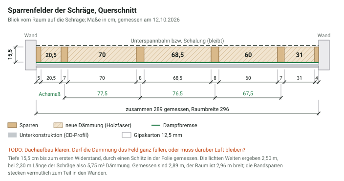

Aus der Küche im Obergeschoss soll ein Kinderzimmer werden. In diesem Artikel
halte ich fest, wie das Projekt verläuft: was ich plane, was ich kaufe, was
klappt und was nicht. Ich ergänze ihn, sobald es weitergeht.

    <figure>
        
        <figcaption>Vorher: die Küchenzeile unter der Dachschräge (Juli 2026)</figcaption>
    </figure>
    <figure>
        
        <figcaption>Vorher: die andere Seite des Raums mit Wandregal und Hängeleuchten (Juli 2026)</figcaption>
    </figure>

Der Raum ist 4,21 bis 4,22 m lang und 2,96 m breit, also rund 12,5 m². Unter
dem geraden Teil der Decke ist er 2,39 bis 2,41 m hoch, gemessen bis zur alten
Holzdecke. Die Schräge beginnt 2,21 m vor der Wand gegenüber dem Kniestock und
fällt mit knapp 30° bis zum Kniestock ab, der rund 1,26 m hoch ist. In der
Längswand gegenüber der Tür beginnt 0,99 m von der Schrankwand entfernt eine
1,09 m breite Fensternische mit Heizkörper. Der Heizkörper steht etwa 3 cm aus
der Nische vor; auch das Fensterbrett steht vor und ist etwas breiter als die
Nische. Der Fliesenboden ist gut und bleibt. Seit den Fotos oben sind der
Kühlschrank, die Oberschränke und die Dunstabzugshaube schon raus. Noch raus
kommen:

* der Fliesenspiegel der Küche (siehe
  [Fliesenspiegel entfernen und verputzen](#fliesenspiegel-entfernen-und-verputzen)),
* die abgehängte Holzdecke, am geraden Teil und an der Schräge. An ihre Stelle
  kommt eine glatte, weiße Decke aus Gipskarton (siehe [Decke](#decke)),
* der Elektroherd mit Kochfeld, die Arbeitsplatte, das Spülbecken und die
  Unterschränke.

Danach bleiben der Herdanschluss und die Wasseranschlüsse der Spüle übrig. Den
Herdanschluss klärt der Elektriker, die Wasseranschlüsse könnte der Waschtisch
nutzen (siehe [Einrichtung](#einrichtung)).

<figure>
    
    <figcaption>Grundriss und Längsschnitt. Die mit * markierten Werte sind aus einem Messpunkt unter der Schräge berechnet</figcaption>
</figure>

Ungefähr so soll das Zimmer am Ende aussehen:

    <figure class="ai-generated">
        
        <figcaption>Ziel für die Seite mit der Dachschräge: Bett, Waschtisch und Schreibtisch, indirektes Licht an der Schräge. Mit KI erstellt</figcaption>
    </figure>
    <figure class="ai-modified">
        
        <figcaption>Ziel für die Seite mit der Tür: Trockenbau-Regal mit LED-Licht und Kleiderschrank. Mit KI erstellt</figcaption>
    </figure>

<strong>Stand: 11.10.2026 – Planungsphase</strong>
<ul>
  <li>🔄 Planung</li>
  <li>🔄 Material bestellen</li>
  <li>⏳ Rückbau und Vorbereitung</li>
  <li>⏳ Decke: Dämmung, Dampfbremse, Gipskarton, LED-Beleuchtung</li>
  <li>⏳ Dezentrale Lüftung</li>
  <li>⏳ Wände und Boden</li>
  <li>⏳ Zimmertür</li>
  <li>⏳ Trockenbau-Regal</li>
  <li>⏳ Einrichtung</li>
  <li>⏳ Fazit</li>
</ul>
✅ erledigt · 🔄 läuft · ⏳ offen

## Verlauf

### Oktober 2026: Planung

Die groben Bausteine stehen: eine neue, gedämmte Decke mit indirekter
LED-Beleuchtung, eventuell eine dezentrale Lüftung, vermutlich eine neue Zimmertür und ein
Trockenbauregal. Die Details stehen unten im Abschnitt
[Der Plan](#der-plan).

### 11. Oktober 2026: Blick in die Dachschräge

Unter der Profilholzverkleidung der Dachschräge liegt gelbe Mineralwolle zwischen
den Sparren. Raumseitig ist sie mit einer Folie abgedeckt, die an die Latten
getackert ist. Die Wolle hat großflächig dunkle, graue bis schwarze
Verfärbungen, vor allem zur Wand hin.

    <figure>
        
        <figcaption>Mineralwolle zwischen den Sparren, links dunkel verfärbt</figcaption>
    </figure>
    <figure>
        
        <figcaption>Fleckige Verfärbungen bis zum Wandanschluss</figcaption>
    </figure>
    <figure>
        
        <figcaption>Nahaufnahme neben einem Sparren</figcaption>
    </figure>

Für die Verfärbungen kommen vor allem zwei Ursachen in Frage:

* **Staub:** Strömt Raumluft durch Lücken in der Folie durch die Dämmung, filtert
  die Wolle den Staub heraus, und es entstehen dunkle Fahnen. Dann ist die
  Luftdichtheit mangelhaft.
* **Schimmel:** Gelangt warme, feuchte Raumluft an die kalte Seite der Dämmung,
  kondensiert dort Wasser. In einer Küche entsteht beim Kochen viel Feuchte.

Am Wandanschluss ist die Folie nicht verklebt, sie liegt nur an der Wand an.
Dort kann Raumluft hinter die Folie strömen, und mit ihr Staub und Feuchte. Das
passt dazu, dass die Verfärbungen zur Wand hin am stärksten sind. Auch die
Nahaufnahme spricht eher für Staub: Die dunklen Stellen folgen dem Stoß zwischen
zwei Dämmstücken und der Kante am Sparren, also den Wegen, auf denen Luft
durchzieht. Das Holz ist hell und ohne Flecken.

Was daraus folgt:

* Die alte Dämmung und die Folie kommen raus (siehe [Decke](#decke)).
* Das Haus ist von 1990, die Wolle also alte Mineralwolle: Was vor 1996 eingebaut
  wurde, gilt als krebserzeugend und darf nach dem Ausbau nicht wieder eingebaut
  werden.[^10] Beim Ausbau trage ich FFP2-Maske, Schutzbrille, Handschuhe und
  einen Einwegoverall. Die Wolle nicht zerreißen, leicht anfeuchten und gleich in
  reißfeste Säcke packen; die Tür bleibt zu. Danach mit einem Industriesauger der
  Staubklasse H oder feucht reinigen, nicht fegen.
* TODO: Klären, wo der Landkreis alte Mineralwolle annimmt; sie gehört nicht in
  den Bauschutt.
* TODO: Nach dem Ausbau Sparren und Unterspannbahn auf Feuchte, Schimmel und
  Verfärbungen prüfen. Ist das Holz feucht oder befallen, vor der neuen Dämmung
  einen Fachmann fragen.
* Die neue Dampfbremse muss an allen Stößen und Anschlüssen sorgfältig verklebt
  werden, vor allem an der Wand. Eher eine feuchtevariable Bahn nehmen (siehe die
  offenen Fragen unter [Decke](#decke)).

TODO: Neue Einträge hier chronologisch anfügen, jeweils mit Datum, was gemacht
wurde, Fotos, Problemen und Zeitaufwand.

## Der Plan

### Einkaufsliste

Das meiste Material bestelle ich zusammen mit anderen Projekten im Haus in einer
Sammelbestellung bei [bausep.de](https://www.bausep.de/), um Versandkosten nur
einmal zu zahlen. Für das Kinderzimmer sind das:

| Bereich | Material | Menge | Preis |
|---------|----------|-------|------:|
| Decke | Dämmung für die Schräge, z. B. [Holzfaser Flex WLS 036](https://www.bausep.de/guenstiger-holzfaser-flex-wls-036-daemmung.html?361=675946) | rund 6,3 m², bis 15,5 cm dick, je nach Dachaufbau (TODO) | TODO |
| Decke | [Dampfbremsfolie 200 µm, 2 m × 50 m](https://www.bausep.de/dampfbremsfolie-200-my-weiss-2-m-x-50-m.html) | 1 Rolle (100 m², reicht auch für die übrige Decke im Obergeschoss) | 120,85 € |
| Decke | [Superglass Supersan Durchdringungs-Klebeband](https://www.bausep.de/superglass-supersan-durchdringungs-klebeband.html) | 1 Rolle | 16,48 € |
| Decke | [Superglass Dichtkleber](https://www.bausep.de/superglass-dichtkleber.html), Kartusche 310 ml | 2 Kartuschen | 12,70 € |
| Decke, Regal | [Gipskarton-Einmannplatte 12,5 mm, 2000 × 600 mm](https://www.bausep.de/gipskarton-einmannplatte-12-5-mm-2000-x-600-mm.html) (4,66 €/m², also 5,59 € je Platte) | 19 Platten (13 Decke, 6 Regal) | 106,21 € |
| Decke | [CD-Profile 60 × 27 × 0,6 mm, 4000 mm](https://www.bausep.de/cd-profile-60-x-27-x-0-6-mm-mit-glatter-unterseite.html) (1,54 bis 2,09 €/m, je nach Seite) | 8 Stück (32 m) | 49 bis 67 € |
| Decke | [Direktabhänger für CD-Profile 60/27, 125 mm](https://www.bausep.de/direktabhaenger-fuer-cd-profile-60-27-125-mm.html) (100 Stück je Paket) | 1 Paket | ca. 27 € |
| Decke, Regal | Schnellbauschrauben (Karton à 1000 Stück) | 1 Karton | ca. 12 € |
| Decke | [Rigips ProMix Plus](https://www.bausep.de/rigips-promix-plus-spachtelmasse.html), gebrauchsfertig, für die Fugen | 1 Eimer | ab 29,06 € |
| Decke | [Knauf Multi-Finish 25 kg](https://www.bausep.de/knauf-multi-finish-gips-spachtelmasse-und-duennputz-25-kg.html) für die glatte Decke (Q4) | 1 Sack | 37,55 € |
| Decke, Regal | Papier-Fugendeckstreifen, 75 m (Preis im Shop prüfen, bei Globus 6,29 €) | 1 Rolle | ca. 6 € |
| Regal | [CW-Profile 50 × 50 × 0,6 mm, 2600 mm](https://www.bausep.de/cw-profile-50-x-50-x-0-6-mm.html) (ab 1,91 €/m) | 6 Stück | 29,80 € |
| Regal | [UW-Profile 50 × 40 × 0,6 mm, 4000 mm](https://www.bausep.de/uw-profile-50-x-40-x-0-6-mm.html) (ab 1,68 €/m) | 2 Stück | 13,44 € |
| Regal | [Alu-Eckprofil für Gipskartonplatten 90°, 2,5 m](https://www.bausep.de/alu-eckprofil-fuer-gipskartonplatten-90.html?361=676828) | 7 Stück | ca. 21 € |
| Regal, Decke | [Dichtungsband 50 mm, 30 m](https://bausep.de/dichtungsband-30-m-rolle-3-x-50-mm.html) | 1 Rolle | 11,30 € |
| Wand | [Knauf Rotband Haftputz 30 kg](https://www.bausep.de/knauf-rotband-haftputz.html?361=676919) | 3 Säcke | 50,73 € |
| Wand | [bausep Betonkontakt](https://www.bausep.de/bausep-betonkontakt.html) (Haftbrücke für glatte Untergründe, Gebindegröße im Shop prüfen) | 1 Eimer | ab 37,85 € |
| Wand, Decke | [Knauf Grundol Tiefengrund 10 Liter](https://www.bausep.de/knauf-grundol-tiefengrund-10-liter.html) | 1 Kanister | ca. 52 € |
| **Summe** | | | **rund 635 bis 650 € plus Dämmung der Schräge** |

Preise: brutto, Stand Oktober 2026, jeweils von der Produktseite, ohne Versand.
Die Mengen stehen in den Abschnitten zu [Decke](#decke),
[Fliesenspiegel](#fliesenspiegel-entfernen-und-verputzen) und
[Trockenbau-Regal](#trockenbau-regal).

Nicht enthalten: UD-Profile und Verbinder, Farbe (siehe
[Decke abhängen](../decke-abhaengen/)), Putzschienen und Kleinteile für das Regal
(aus dem Baumarkt), das LED-Material (siehe
[Beleuchtung](#beleuchtung-led-streifen-am-deckenrand)) und Versand. CW- und
UW-Profile waren am 10.10.2026 auf bausep als „derzeit nicht lieferbar“
markiert. Vor der Bestellung prüfen; sonst kommen sie aus dem Baumarkt.

### Decke

Das Kinderzimmer liegt unter der Dachschräge. Seine Decke besteht aus der
Schräge und einem geraden Teil; beide werden mit Gipskarton neu beplankt.
Gedämmt werden sie unterschiedlich:

* **Gerader Teil:** Darüber liegt der Dachboden. Diesen Teil dämme ich von oben,
  zusammen mit der ganzen Decke über dem Obergeschoss. Von unten kommt hier
  keine Dämmung dazu.
* **Schräge:** Die alte Mineralwolle und die Folie kommen raus; sie sind dunkel
  verfärbt (siehe
  [Blick in die Dachschräge](#11-oktober-2026-blick-in-die-dachschrage)).
  Zwischen die Sparren kommt von innen neue Dämmung.

Wie man eine Decke abhängt, beplankt und spachtelt, habe ich schon in
[Decke abhängen](../decke-abhaengen/) beschrieben. Hier geht es vor allem um das,
was dieses Mal anders ist: die Dämmung der Schräge, die Dampfbremse und die
LED-Beleuchtung.

**Fläche:** Der gerade Teil reicht von der Schrankwand 2,21 m weit bis zum Knick
(mit dem Kreuzlinienlaser gemessen). An den Kniestock komme ich wegen der
Küchenzeile nicht gut heran; die Schräge habe ich daher aus einem zweiten Punkt
berechnet: 3,30 m von der Schrankwand ist sie 1,78 m hoch. Zwischen Knick
(2,39 m hoch) und diesem Punkt fällt sie um 0,61 m auf 1,08 m, das sind knapp
30°. Bis zum Kniestock (waagerecht 2,00 m) ist sie damit rund 2,30 m lang, und
der Kniestock ist rund 1,26 m hoch. Bei 2,96 m Breite sind das
2,21 m × 2,96 m und 2,30 m × 2,96 m, zusammen also rund 13,4 m².
Hintereinander sind die beiden Flächen 4,51 m lang, mehr als der Raum (4,21 m):
Die Schräge ist länger als der Boden darunter.

**Aufbau** (von außen nach innen):

| Schicht | Gerader Teil | Schräge |
|---------|--------------|---------|
| 1 | Holzfaser-Dämmung auf dem Dachboden, 14 + 20 cm, von oben verlegt | Dachdeckung und Unterspannbahn (bleiben) |
| 2 | Holzbalkendecke (bleibt) | neue Dämmung zwischen den Sparren |
| 3 | Dampfbremse | Dampfbremse |
| 4 | Unterkonstruktion | Unterkonstruktion |
| 5 | Gipskarton, 12,5 mm | Gipskarton, 12,5 mm |

<figure>
    
    <figcaption>Sparrenfelder der Schräge mit dem geplanten Aufbau</figcaption>
</figure>

Die Dampfbremse sitzt in beiden Teilen raumseitig, also im Kinderzimmer hinter
dem Gipskarton. Sie läuft ohne Unterbrechung von der Schräge über den Knick in
den geraden Teil und wird an allen Stößen, Durchdringungen und an den Wänden
luftdicht verklebt.

Die Holzfaser für den geraden Teil liegt oben auf den Dielen des Dachbodens.
Zwischen ihr und der Dampfbremse unter den Balken liegen dann die Dielen und
die Balkenfelder. In denen liegt schon etwas Dämmung: An der Dachluke im
Wohnhaus ist die Decke samt Holzdecke, Balken, Dämmung und Dielen rund 20,5 cm
dick. Bleibt dort Luft, ist das kein Problem: Sie liegt auf der warmen Seite der
neuen Dämmung, dort kondensiert nichts. Die Luft muss aber eingeschlossen sein. Ist ein
Balkenfeld zum Spitzboden oder zur Abseite hin offen, sinkt kalte Luft auch ohne
spürbaren Zug hinein, und warme steigt hinaus. Dann läuft kalte Luft unter der
Dämmung durch, die Decke kühlt aus, und an kalten Stellen kann Schimmel
entstehen.

* TODO: Balkenfelder an den Enden schließen, vor allem dort, wo die Balkenlage
  auf die Dachschräge trifft. Die Holzfaser muss dort lückenlos an die Dämmung
  der Schräge anschließen.
* TODO: Beim Abnehmen der Holzdecke prüfen, was in den Balkenfeldern liegt.
* Solange die Decke im Kinderzimmer offen ist, kann ich die Balkenfelder dort
  auch von unten mit Dämmung füllen; dann gibt es keine Luftschicht.

| Material | Menge | Preis |
|----------|-------|-------|
| Dämmung für die Schräge, z. B. [Holzfaser Flex WLS 036](https://www.bausep.de/guenstiger-holzfaser-flex-wls-036-daemmung.html?361=675946) | rund 6,3 m², bis 15,5 cm dick, je nach Dachaufbau (TODO) | TODO |
| [Dampfbremsfolie 200 µm, 2 m × 50 m](https://www.bausep.de/dampfbremsfolie-200-my-weiss-2-m-x-50-m.html) | 1 Rolle (100 m²) | 120,85 € |
| [Superglass Supersan Durchdringungs-Klebeband](https://www.bausep.de/superglass-supersan-durchdringungs-klebeband.html) | 1 Rolle (25 m) für die Stöße | 16,48 € |
| [Superglass Dichtkleber](https://www.bausep.de/superglass-dichtkleber.html) | 2 Kartuschen für den Wandanschluss (rund 15 m) | 12,70 € |
| [Isover Vario DoubleFit Plus, Kartusche 310 ml](https://www.bausep.de/isover-vario-doublefit-plus-dichtstoff-kartusche-310-ml.html) | optional, nur wenn die Folie zum Isover-System gehört | 7,44 € je Kartusche |
| Unterkonstruktion: CD-Profile 60 × 27 mm à 4 m, Direktabhänger, Schnellbauschrauben | 8 Profile, ca. 35 bis 45 Direktabhänger | TODO |
| [Gipskarton-Einmannplatte 12,5 mm, 2000 × 600 mm](https://www.bausep.de/gipskarton-einmannplatte-12-5-mm-2000-x-600-mm.html) | 13 Stück | 72,67 € |

Eine Einmannplatte hat 1,2 m². Für 13,4 m² sind das 12 Platten, mit etwa 10 %
Verschnitt 13. CD-Profile mit 50 cm Achsabstand ergeben 2 m Profil je m²:
13,4 m² × 2 m/m² ≈ 27 m, mit 10 % Verschnitt rund 30 m, also 8 Profile à 4 m.
Ein Direktabhänger sitzt an jeder Stelle, an der ein CD-Profil einen Balken oder
Sparren kreuzt. Die Balken des geraden Teils liegen wie die Sparren 60 bis
80 cm auseinander; das sind 2,5 bis 3,3 Abhänger je m², also rund 35 bis 45
Stück.

Offene Fragen:

* Die Schräge hat über die Raumbreite fünf Sparrenfelder mit 20,5, 70, 68,5,
  60 und 31 cm lichter Weite, zusammen 2,50 m. Die Sparren sind 7 bis 8 cm
  breit, die Achsmaße liegen bei 67,5 bis 77,5 cm. Bei 2,30 m Länge der Schräge
  sind das 5,75 m² Dämmung, mit 10 % Verschnitt rund 6,3 m². Klemmende Matten
  schneidet man für jedes Feld einzeln etwas breiter zu als die lichte Weite.
* Die Sparrenfelder sind rund 15,5 cm tief, gemessen durch einen Schlitz in der
  Folie bis zum ersten Widerstand (Unterspannbahn oder Schalung). TODO: Wie
  dick wird die Dämmung? Das hängt vom Dachaufbau ab (nächster Punkt): Darf sie
  das Feld ganz füllen, passen zum Beispiel 140 mm, und es bleiben 1,5 cm Luft;
  muss über der Dämmung eine Hinterlüftung frei bleiben, wird sie dünner. Die
  Dämmung fehlt noch in der Sammelbestellung.
* TODO: Wie ist das Dach außen aufgebaut (diffusionsoffene Unterspannbahn)?
  Davon hängt ab, ob eine normale Dampfbremsfolie reicht oder eine
  feuchtevariable Dampfbremse besser ist. Der Dichtstoff Isover Vario DoubleFit
  gehört eigentlich zum Vario-System; passt er zur gewählten Folie?
  Siehe auch [Dämmstoffe](../daemstoffe/).
* TODO: Wie ist der Kniestock aufgebaut? Aus seinen Steckdosen zieht es kalt
  (siehe [Strom und Wasser](#strom-und-wasser)); dahinter liegt vermutlich eine
  kalte Abseite. Dann muss die Dämmung der Schräge lückenlos an eine gedämmte
  Kniestockwand anschließen, und die Dampfbremse muss auch dort luftdicht sein.
* TODO: Welche Unterkonstruktion? Direkt auf die Sparren geht nicht (Achsabstand
  bis 77,5 cm). Die Mengen oben gelten für CD-Profile auf Direktabhängern; die
  Sparrenhöhe fehlt noch.

### Beleuchtung: LED-Streifen am Deckenrand

Statt einer Deckenlampe soll ein LED-Streifen am Rand der Decke indirektes Licht
geben. Das LED-Material kommt nicht von bausep: Dort gibt es nur das
[Schlüter-Liprotec-System](https://www.bausep.de/leuchtprofil/) für Fliesen, und
allein dessen Trägerprofil kostet 19,32 €/m, für 15 m also rund 290 €. Bei Amazon
oder im Baumarkt-Shop ist es deutlich günstiger.

Der Streifen ist laut Produkttitel 8 mm breit, 24 V, 3000 K (warmweiß), CRI über
90, 5 m je Set, mit 100-W-Netzteil.

| Material | Menge | Preis |
|----------|-------|-------|
| [24-V-LED-Streifen, warmweiß, mit Netzteil und Eckverbindern](https://www.amazon.de/KSIBNW-Selbstklebend-Flexibles-Fernseher-Dekoration/dp/B0DWRWRR85/), 5 m | 4 Sets (3 für 15 m Deckenrand, 1 für das Regal) | TODO |
| Variante A: fertige Lichtvoute aus Gipskarton mit Alu-Profil, [Alupona LEA, 2 m](https://www.amazon.de/Alupona-Stuckleiste-Beleuchtung-Profilschiene-LED-Streifen/dp/B0CKZ1YJG8), für Streifen bis 12 mm | 8 Stück (16 m) | ca. 502 € (62,80 € je 2 m) |
| Variante B: [Alu-Profil-Set LASLUX, 10 × 2 m](https://www.amazon.de/LASLUX-Aluminiumprofil-LED-Streifen-indirekte-Beleuchtung/dp/B0FS6RRG5C), mit Abdeckung, Endkappen und Klemmen, für Streifen bis 10 mm | 1 Set: 8 Profile für die Decke, 2 für das Regal | ca. 59 € |

Die Amazon-Preise stammen aus einer Suche am 10.10.2026; Preis und Versand im
Warenkorb prüfen. Beide Profile passen zum 8 mm breiten Streifen.

Variante A ist fertig: Die Voute wird laut Beschreibung an den Trockenbau geklebt
und verschraubt, danach wird die Abdeckung eingeclipst. Variante B spart rund
440 €, braucht aber eine selbst gebaute Blende: Das Profil sitzt einige
Zentimeter unter der Decke an der Wand und strahlt nach oben, davor verdeckt ein
Gipskartonstreifen auf einem UD-Profil die Lichtquelle. Die Streifen dafür fallen
beim Zuschnitt ohnehin ab.

Offene Fragen:

* TODO: Länge messen. 5 m sind zu kurz. Die Decke ist 2,96 m breit und über die
  Schräge gemessen 4,51 m lang; ihr Rand ist also rund
  2 × (2,96 m + 4,51 m) ≈ 15 m lang.
* TODO: Variante A oder B? Bei B die Blende skizzieren (Höhe, Abstand zur Decke).
* TODO: Leistung pro Meter laut Datenblatt prüfen. Jedes 5-m-Set hat sein eigenes
  Netzteil, damit wird das Licht am Ende nicht dunkler. Aufgeräumter wäre ein
  gemeinsames Netzteil (Summe der Leistungen plus etwa 20 % Reserve) mit
  Einspeisung an mehreren Stellen.
* TODO: Wo sitzen die Netzteile? Sie müssen zugänglich bleiben. Schalter oder
  Dimmer? Wer macht den Elektroanschluss?

### Dezentrale Lüftung

Ein [Marley Frischluft-Wärmetauscher Air 4.0 mit Fernsteuerung](https://www.globus-baumarkt.de/p/marley-frischluft-waermetauscher-marley-air-4-0-inkl-fernsteuerung-0782201313/)
für rund 350 € soll für frische Luft sorgen, ohne dass im Winter die Wärme zum
Fenster hinausgeht.

* TODO: Welche Außenwand? Durchmesser der Kernbohrung laut Anleitung? Bohrung
  selbst machen oder machen lassen?
* TODO: Stromanschluss planen.

### Strom und Wasser

Die Küche hat einige Anschlüsse hinterlassen. Die Maße sind ungefähr, weil die
Küchenzeile noch im Weg ist; „von der Tür“ heißt von der Zarge aus.

**Wasser:** An der Türwand liegen nebeneinander Kaltwasser, Abfluss und
Warmwasser, in dieser Reihenfolge vom Kniestock aus, auf rund 50 cm Höhe. Der
erste Anschluss sitzt rund 75 cm vor dem Kniestock, alle drei zusammen nehmen
rund 35 cm ein.

**Steckdosen:**

| Wand | Lage | Höhe |
|------|------|------|
| Türwand | direkt neben der Tür | unter dem Lichtschalter |
| Türwand | rund 88 cm von der Tür | über 2 m |
| Türwand | 2 Stück, rund 135 cm von der Tür, über der Arbeitsplatte | rund 90 cm |
| Türwand | 2 Stück, rund 135 cm von der Tür, unter der Arbeitsplatte | 30 bis 40 cm |
| Kniestock | 2 Stück, rund 107 cm von der Fensterwand, über der Arbeitsplatte | rund 90 cm |
| Fensterwand | rund 160 cm vom Kniestock | rund 2,10 m |
| Fensterwand | Blinddose | rund 30 cm |
| Schrankwand | rund 35 cm von der Fensterwand | rund 30 cm |

* Aus den Steckdosen am Kniestock zieht es leicht kalt. Dahinter liegt
  vermutlich eine kalte Abseite, und die Wand ist dort nicht luftdicht (siehe
  [Decke](#decke)). TODO: Diese Dosen luftdicht machen, zum Beispiel mit
  luftdichten Unterputzdosen.
* Die Steckdose an der Schrankwand liegt hinter dem Kleiderschrank. TODO:
  Verlegen oder für Licht im Schrank nutzen.
* Den Herdanschluss vermute ich an der Türwand, rund 100 cm von der Tür, hinter
  dem Herd. TODO: Beim Ausbau prüfen. Welche Dosen bleiben, welche legt der
  Elektriker still? Dazu kommen neue Anschlüsse für die LED-Netzteile, die
  Lüftung und Steckdosen an Bett und Schreibtisch.

### Wände und Boden

#### Fliesenspiegel entfernen und verputzen

An zwei Wänden hängen noch die Küchenfliesen, jeweils ab 87 cm Höhe:

* **Türwand:** von der Tür bis zum Kniestock, rund 2,96 m lang, bis zur Decke.
  Unter dem geraden Teil sind das 1,53 m Höhe, unter der Schräge nimmt sie bis
  auf 0,39 m ab. Zusammen rund 3,4 m².
* **Kniestock:** über die ganze Breite von 2,96 m bis zum Beginn der Schräge,
  also 0,39 m hoch. Das sind rund 1,2 m².

Zusammen sind das rund 4,5 m². Die Fliesen kommen weg, die Wand wird verputzt
und dann gestrichen (siehe [Innenwände streichen](../innenwaende-streichen/)).

An der Fensterwand sitzt unter der Schräge eine Verkleidung, die wie Fliesen
aussieht, vielleicht bedrucktes Styropor: ebenfalls ab 87 cm Höhe bis zur
Decke, auf den letzten 1,63 m vor dem Kniestock, rund 1,4 m². TODO: Material
prüfen. Ist es eine dünne Platte, kommt sie ab; dann Kleberreste abschleifen
und die Wand spachteln statt verputzen.

**Vorher:**

* TODO: Baujahr prüfen. Fliesenkleber enthielt bis 1993 teilweise Asbest, auch
  Spachtelmassen und Putze können betroffen sein, und Restbestände wurden noch
  danach verarbeitet.[^4] Man sieht es dem Material nicht an. Dann vor dem
  Abschlagen eine Probe des Klebers im Labor untersuchen lassen und bei einem
  positiven Befund nicht selbst abschlagen.
* TODO: Steckdosen und Leitungen der Küche im Fliesenbereich (siehe
  [Strom und Wasser](#strom-und-wasser)): Welche bleiben, welche werden
  stillgelegt (zum Beispiel ein Herdanschluss)? Das macht der Elektriker. Bleibende Dosen müssen nach dem Verputzen bündig mit der neuen
  Oberfläche abschließen; sonst Putzausgleichsringe einsetzen.
* TODO: Kommt der Waschtisch an die Türwand, wo die Spüle war (siehe
  [Einrichtung](#einrichtung))?
  Dann Wasseranschlüsse vor dem Verputzen festlegen und dort einen
  Spritzschutz einplanen.

**Vorgehen:**

1. Raum abdecken, Fliesen mit Bohrhammer und Fliesenmeißel abschlagen.
   Schutzbrille, Gehörschutz, FFP2-Maske. Der Schutt ist Bauschutt und gehört
   nicht in den Hausmüll.
2. Lose Kleberreste und losen Putz entfernen, bis der Untergrund fest ist.
3. Untergrund beurteilen. Liegt darunter noch der alte Putz, reicht es, Löcher
   zu füllen und die Fläche zu glätten. Saßen die Fliesen direkt auf dem
   Mauerwerk, liegt die Fläche um Fliese plus Kleber tiefer als die Wand
   darunter; dann wird vollflächig verputzt. Ich plane den zweiten Fall.
4. Grundieren: glatte, nicht saugende Kleberreste mit Betonkontakt,
   saugendes Mauerwerk mit Tiefengrund.
5. Putzschienen setzen: Schnellputzleisten senkrecht in Batzen aus Rotband
   setzen und mit der Richtlatte auf die Ebene der angrenzenden Wand
   ausrichten. Abstand höchstens so groß, dass die Kartätsche auf zwei Leisten
   aufliegt (bei 1,5 m Kartätsche rund 1,3 m). Nach dem Anziehen der Batzen
   verputzen.
6. Rotband auftragen, mit der Kartätsche über die Putzschienen abziehen, nach
   dem Anziehen glätten. Den Übergang zum alten Putz an der Unterkante sauber
   beiziehen.
7. Trocknen lassen: bei 10 mm Putzdicke im Mittel etwa 14 Tage, bei dickerem
   Putz länger.[^5] Dann grundieren und streichen.

Weil das UD-Profil der neuen Decke auf die Wand geschraubt wird, kommt der Putz
vor der Decke.

**Material:**

Putzdicke: Fliese und Kleber sind grob 15 mm. Rotband braucht laut Knauf etwa
0,8 kg je m² und mm Putzdicke:[^5] 4,5 m² × 15 mm × 0,8 kg ≈ 54 kg.

| Material | Menge | Preis |
|----------|-------|-------|
| [Knauf Rotband Haftputz 30 kg](https://www.bausep.de/knauf-rotband-haftputz.html?361=676919) | 3 Säcke (2 rechnerisch, 1 Reserve für Ausbrüche und die Fensterwand) | 50,73 € |
| [bausep Betonkontakt](https://www.bausep.de/bausep-betonkontakt.html), 0,2 bis 0,35 kg/m² | 1 Eimer | ab 37,85 € |
| [Knauf Grundol Tiefengrund 10 Liter](https://www.bausep.de/knauf-grundol-tiefengrund-10-liter.html), 0,15 bis 0,25 l/m²; der Rest grundiert die Decke vor dem Streichen | 1 Kanister | ca. 52 € |
| Schnellputzleiste 10 mm, verzinkt, 2,5 m (z. B. [Knauf Schnellputzleiste 10/20](https://knauf.com/de-DE/p/produkt/schnellputzleiste-10-20-11141_0022)), Baumarkt | 4 Stück für die Türwand, auf höchstens 1,53 m gekürzt; aus den Resten kurze Stücke für den Kniestock | TODO |
| Eckschutzschiene für Außenecken (nur falls die Fläche an einer Außenecke endet) | TODO | TODO |
| Bauschuttsäcke | TODO | TODO |

Rotband, Betonkontakt und Tiefengrund kommen mit in die Sammelbestellung bei
bausep; bausep führt keine Putzschienen, die kommen aus dem Baumarkt. Rotband lässt sich glätten und
streichen; Multi-Finish aus der Sammelbestellung nehme ich nur zum Nacharbeiten.

**Werkzeug:** Bohrhammer mit Fliesenmeißel, Fäustel und Flachmeißel,
Mörtelkübel, Rührquirl, Kelle, Traufel, Kartätsche (1,5 bis 2 m), Wasserwaage,
Glättkelle, Schwammbrett, Abdeckfolie.

#### Boden

Der Fliesenboden ist gut und bleibt.

TODO: Nach dem Ausbau der Küche prüfen, ob unter der Küchenzeile gefliest ist
und ob dort Sockelfliesen fehlen.

### Zimmertür

Die Tür soll Schall gut dämmen. Bei bausep gibt es keine Zimmertüren, nur
Kniestock- und Revisionstüren; die Tür kommt daher nicht in die Sammelbestellung.

Geplant ist das [Lebo Schallschutztür-Set in Weiß (RAL 9016), CPL, mit runder
Zarge](https://www.deinetuer.de/lebo-schallschutztuer-set-weiss-9016-cpl-mit-zarge.html)
von DeineTür.de (mein ursprünglicher Link:
[Lebo Schallschutztür Weiß 9016 CPL](https://www.deinetuer.de/lebo-schallschutztuer-weiss-9016-cpl.html)).
Laut Shop gehören Bänder, PZ-Schloss und eine absenkbare Bodendichtung dazu, ein
Drücker nicht. Die Schallschutzklasse 1, 2 oder 3 ist wählbar, das Türblatt ist
je nach Klasse 40 bis 50 mm dick. Preis laut Suche am 10.10.2026: 512,90 €; den
Preis für die gewählte Klasse und den Versand im Warenkorb prüfen (die
Versandkosten hängen dort vom Warenwert ab).

**Welche Schallschutzklasse?** Üblich ist diese Einteilung:[^6]

| Klasse | Rw,P (Prüfwert) | R'w (eingebaut, minus 5 dB Vorhaltemaß) |
|--------|----------------:|----------------------------------------:|
| 1 | 32 dB | 27 dB |
| 2 | 37 dB | 32 dB |
| 3 | 42 dB* | 37 dB* |

\* Klasse 3 steht nicht in der Quelle; die 42 dB nennt ein anderer Händler
(Mosel). Bei Lebo im Shop prüfen.

Ich nehme Klasse 2; Klasse 3 nur, wenn der Aufpreis klein ist. Der Wert gilt
für das komplette Element aus Türblatt, Zarge, Dichtungen und Bodendichtung,
und nur, wenn es dicht eingebaut ist:

* Die Bodendichtung braucht einen ebenen, fertigen Boden. Das ist hier der
  Fliesenboden, der bleibt; nach ihm richtet sich die Höhe der Tür.
* Die Fuge zwischen Zarge und Wand vollständig ausschäumen, sonst geht der
  Schall um die Zarge herum.
* Die Zargendichtung muss umlaufend am Türblatt anliegen.

Offene Punkte:

* Die vorhandene Zarge hat einen lichten Durchgang von 819 × 1965 mm. Das ist die
  Standardgröße: Zu einem Durchgang von 813 × 1966 mm gehören ein Türblatt von
  860 × 1985 mm und eine Wandöffnung von 885 × 2005 mm.[^9] Die Wand ist rund
  28 cm dick; die alte Zarge ist 31 cm breit und steht auf beiden Seiten etwa
  15 mm über. TODO: Nach dem Ausbau der alten Zarge die Wandöffnung messen und
  die Zargenbreite danach wählen.
* Die Zargenbekleidung beginnt 286 mm vor der Schrankwand. Das
  [Trockenbau-Regal](#trockenbau-regal) steht hinter der Tür, die Bänder sitzen
  also auf der Regalseite. TODO: Anschlagrichtung (DIN links oder rechts) danach
  festlegen.
* TODO: Preis und Lieferzeit für Klasse 2 und 3 im Warenkorb vergleichen.
* TODO: Drücker auswählen.

### Trockenbau-Regal

Ein eingebautes, raumhohes Regal aus Trockenbauprofilen, beplankt mit
Gipskarton und mit LED-Beleuchtung: 90 cm breit, raumhoch (rund 2,40 m, genau
nach dem Einbau der Decke messen), 20 cm tief, mit 4 Regalböden. Es steht hinter der Tür, neben dem IKEA-Kleiderschrank (siehe
[Einrichtung](#einrichtung)).

* Regal und Kleiderschrank teilen sich die Wand. Der Raum ist dort unten (über
  der Sockelfliese) 2966 mm breit, auf 1,20 m Höhe 2964 mm und oben, unter der
  alten Holzdecke, 2956 mm. Der Schrank braucht 2,00 m; an der engsten Stelle
  bleiben für das Regal also 95 cm. Mit 90 cm Regalbreite bleiben 5 cm Luft.
* Türaufschlag, Regal und Kleiderschrank zeigt der Grundriss oben.
* TODO: Türstopper so setzen, dass Türblatt und Klinke nicht gegen die
  Regalkanten schlagen. Steht das Regal an der Wand, an die die geöffnete Tür
  klappt, geht die Tür um die Regaltiefe plus Klinke weniger weit auf.
* Die Zargenbekleidung der Tür beginnt 286 mm vor der Schrankwand. Das Regal ist
  20 cm tief, bis zur Bekleidung bleiben also 8,6 cm.

**Aufbau:**

* **Seitenwangen:** zwei kleine Ständerwände. Je zwei CW 50 senkrecht (vorne und
  an der Wand), unten und oben ein Stück UW 50, beidseitig 12,5 mm Gipskarton.
  Eine Wange ist damit 7,5 cm dick, innen bleiben 75 cm Breite.
* **Böden:** liegende Rahmen. Vorne und hinten UW 50 (75 cm), dazwischen drei
  CW 50 als Querstreben (an beiden Enden und in der Mitte). Der Gipskarton
  spannt nur rund 20 cm von vorne nach hinten; eine Lage oben und eine unten
  reicht. Ein Boden ist 7,5 cm dick.
* **Fachhöhe:** (2,40 m − 4 × 7,5 cm) / 5 = 42 cm lichte Höhe je Fach.
* **Verbindung:** In jeder Wange sitzt auf Höhe jedes Bodens ein Riegel aus
  CW 50, daran wird der Boden verschraubt. Das hintere UW jedes Bodens wird
  zusätzlich an die Wand gedübelt, ebenso das hintere CW jeder Wange (alle 50 cm).
* **Plattenstoß:** Die Platten sind 2 m lang. Der oberste Boden liegt bei
  1,91 bis 1,98 m; ich kürze die Platten der Wangen auf 1,95 m, damit der Stoß
  auf seinem Riegel liegt.
* **Vorderkante:** Optional eine Dachlatte (30 × 50 mm) in das vordere UW jedes
  Bodens einlegen und verschrauben; das macht die 75 cm lange Kante steifer.
* **Kanten:** Alle sichtbaren Außenkanten bekommen ein Alu-Eckprofil, das mit
  eingespachtelt wird. Die Innenecken werden mit Fugendeckstreifen gespachtelt.
* **Oben:** Die oberen UW-Stücke werden in die CD-Profile der neuen Decke
  geschraubt, nicht durch die Dampfbremse gedübelt. Beim Bau der Decke ein
  CD-Profil über jede Wange legen. Das Regal kommt also nach der Decke.
* **Unten:** Der Fliesenboden bleibt; die unteren UW-Stücke kommen mit
  Dichtungsband direkt auf die Fliesen und werden durch sie hindurch gedübelt
  (die Fliese ohne Schlag vorbohren).
* **Licht:** Unter der Vorderkante jedes Bodens ein LED-Profil (siehe
  [Beleuchtung](#beleuchtung-led-streifen-am-deckenrand)).

| Material | Menge | Preis |
|----------|-------|-------|
| [CW-Profile 50 × 50 × 0,6 mm, 2600 mm](https://www.bausep.de/cw-profile-50-x-50-x-0-6-mm.html) | 6 Stück: 4 senkrecht, 2 für 12 Querstreben und 8 Riegel à 20 cm (13 je Stange) | 29,80 € |
| [UW-Profile 50 × 40 × 0,6 mm, 4000 mm](https://www.bausep.de/uw-profile-50-x-40-x-0-6-mm.html) | 2 Stück: 8 × 75 cm, aus den Resten 4 × 20 cm | 13,44 € |
| [Gipskarton-Einmannplatte 12,5 mm](https://www.bausep.de/gipskarton-einmannplatte-12-5-mm-2000-x-600-mm.html) | 6 Platten (2 für die Wangen, 2 für die Böden, 1 für Kleinteile und Stirnseiten, 1 Reserve) | 33,54 € |
| [Alu-Eckprofil 90°, 2,5 m](https://www.bausep.de/alu-eckprofil-fuer-gipskartonplatten-90.html?361=676828) | 7 Stück: 4 für die Wangenkanten (4 × 2,40 m), 3 für die Bodenkanten (8 × 75 cm, 3 je Profil) | ca. 21 € |
| [Dichtungsband 50 mm, 30 m](https://bausep.de/dichtungsband-30-m-rolle-3-x-50-mm.html) | 1 Rolle (rund 9 m für das Regal) | 11,30 € |
| Nageldübel 6 × 40 mm (Baumarkt) | ca. 30 Stück | TODO |
| [Blechschrauben 3,5 × 9,5 mm](https://www.globus-baumarkt.de/p/knauf-blechschrauben-3-5-x-9-mm-100-stk-0763020154/) für CW in UW und die Riegel | 100 Stück | 8,20 € |
| Schnellbauschrauben 3,5 × 25 mm (aus der Sammelbestellung) | ca. 200 Stück | – |
| Dachlatte 30 × 50 mm (optional) | 4 m | TODO |
| **Summe** | | **ca. 117 € plus Kleinteile** |

Die Teile von bausep kommen mit in die Sammelbestellung.
Spachtelmasse und Fugendeckstreifen reichen aus der Sammelbestellung.

### Einrichtung

1. IKEA-Kleiderschrank neben dem Trockenbau-Regal, zum Beispiel PAX. 4 Korpusse mit je 50cm Breite und einer Tiefe von 58cm sollen es sein. Die Raumhöhe ist aktuell 2,40m, daher will ich erst nach dem Einbau der Decke entscheiden wie hoch die Korpusse sein sollen.[^7] Diese müssen dann an der Wand befestigt werden. Sie sollen weiße Türen haben, aber ob es Hochglanz oder matt wird, ob es Kassetten
hat oder nicht steht noch nicht fest. Es sollen lange goldene Griffe werden.

    Rechts bleiben zwischen Schrank und Fensterwand rund 6 cm. Dort beginnt
    0,96 m vor der Schrankwand das Fensterbrett: Es steht 35 mm vor die Wand, ist
    3 cm dick, und seine Unterkante liegt 853 mm über dem Boden. Darunter steht
    der Heizkörper 3 cm vor. Die rechte Schranktür reicht geöffnet bis 1,08 m von
    der Schrankwand, also über das Fensterbrett. Hat sie ihre Bänder auf der
    Wandseite, steht ihre Außenseite bei 90° etwa 6 cm vor der Wand, ein Griff mit
    3 bis 4 cm Überstand also nur noch 2 bis 3 cm. Das Türblatt selbst kommt
    vorbei, der Griff schlägt aber am Fensterbrett an, wenn er bis auf
    0,85 bis 0,88 m herunterreicht. TODO: Griffe mit der Unterkante über 0,9 m
    setzen oder die rechte Tür mit den Bändern links anschlagen.

2. Bett oder Schlafsofa
3. Waschtisch (TODO: Können die Wasseranschlüsse der Küche genutzt werden?) Sie
   liegen an der Türwand rund 75 bis 110 cm vor dem Kniestock (siehe
   [Strom und Wasser](#strom-und-wasser)). Dort ist die Schräge nur noch rund
   1,7 bis 1,9 m hoch; für ein Kind reicht das, ein Erwachsener steht dort
   gebückt.

### Sicherheit im Kinderzimmer

* In Bayern braucht jedes Kinderzimmer mindestens einen Rauchwarnmelder.[^8]
* TODO: Steckdosen mit Kinderschutz, hohe Möbel an der Wand befestigen,
  emissionsarme Farbe und Materialien.

## Kosten

| Posten | geplant | tatsächlich |
|--------|--------:|------------:|
| Decke (Dämmung, Dampfbremse, Gipskarton) | TODO | TODO |
| LED-Beleuchtung | ca. 59 € (B) oder 502 € (A), plus Streifen | TODO |
| Dezentrale Lüftung | ca. 350 € | TODO |
| Wände und Boden | ca. 140 € für den Putz; der Boden bleibt | TODO |
| Zimmertür | ca. 510 € plus Drücker und Versand | TODO |
| Trockenbau-Regal | ca. 117 € plus Kleinteile | TODO |
| Einrichtung | TODO | TODO |
| **Summe** | TODO | TODO |

## Fazit

TODO: Nach Abschluss: Was hat wie lange gedauert, was hat es gekostet, was würde
ich beim nächsten Mal anders machen? Nachher-Fotos.

## Einzelnachweise

[^4]: Axel Mörer-Funk: [Asbest: Auch Fasern in Fliesenklebern und Spachtelmassen sind gefährlich](https://www.ingenieur.de/technik/fachbereiche/bau/asbest-auch-fasern-in-fliesenklebern-spachtelmassen-gefaehrlich/) via ingenieur.de, 19.06.2015.
[^5]: Knauf: [Rotband Haftputzgips](https://knauf.com/de-AT/p/produkt/rotband-haftputzgips-7-50-mm-10001_0070) via knauf.com, abgerufen am 11.10.2026.
[^6]: Garant: [Türenhandbuch, Schallschutz](https://tuerenhandbuch.garant.de/typo3conf/ext/cdt_cmos2/Resources/Public/cmos2/php/get.php?id=5724) via garant.de, abgerufen am 10.10.2026.
[^7]: [Kaufhilfe PAX/KOMPLEMENT](https://www.ikea.com/de/de/files/pdf/38/5a/385a9205/bf_kaufhilfe_paxkomplement_07-2026_online.pdf) via IKEA, abgerufen am 10.10.2026.
[^8]: [Art. 46 BayBO – Wohnungen](https://www.gesetze-bayern.de/Content/Document/BayBO-46) via Bayern.Recht, abgerufen am 03.10.2026.
[^9]: [Türen richtig planen – Normen und Maße](https://www.sanier.de/innentueren/tueren-richtig-planen-normen-und-maasse) via sanier.de, abgerufen am 12.10.2026.
[^10]: [TRGS 521: Abbruch-, Sanierungs- und Instandhaltungsarbeiten mit alter Mineralwolle](https://www.bgbau.de/fileadmin/Gisbau/trgs521.pdf) via bgbau.de, abgerufen am 13.10.2026.
