<figure class="ai-generated">
    <a href="../images/2024/01/rustikales-eichenparkett-schiffsbodenmuster.jpg">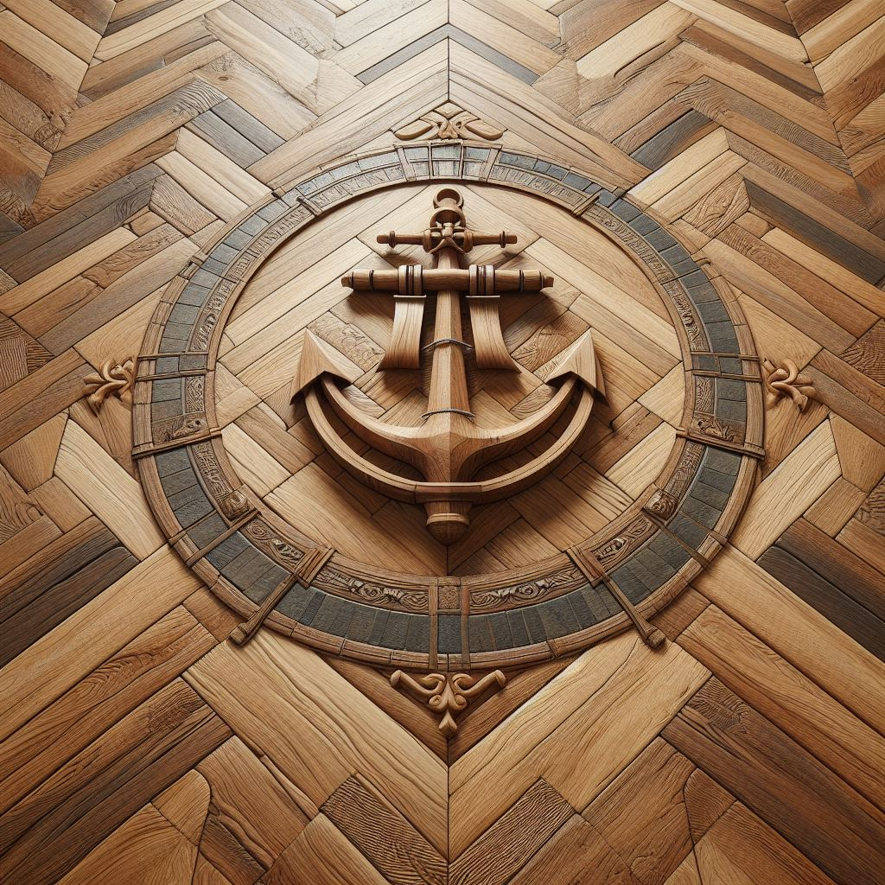</a>
    <figcaption>Eichenparkett im Fischgrätmuster mit Anker-Medaillon. Mit KI erstellt</figcaption>
</figure>

Parkett kann man in sehr unterschiedlichen Mustern verlegen. Das Muster und
seine Richtung verändern, wie ein Raum wirkt: Liegen die Stäbe in einem
schmalen Raum parallel zur langen Wand, wirkt er noch schmaler
(„kegelbahnartig“). Parallel zur kurzen Wand verlegt, wirkt er breiter[^1].

## Stäbe in Reihen

Beim Parallelverband liegen gleich breite Stäbe in parallelen Reihen. Die
Varianten unterscheiden sich darin, wie die Stöße (die Kopfenden der Stäbe)
versetzt sind[^1]:

* **Schiffsboden** oder **Wilder Verband**: Unterschiedlich lange Stäbe mit
  unregelmäßig versetzten Stößen, wie die Planken auf einem Schiffsdeck.
* **Englischer Verband** (englisch *brick bond*): Gleich lange Stäbe, jede Reihe
  um eine halbe Stablänge versetzt. Die Stöße jeder zweiten Reihe liegen
  dadurch auf einer Linie, wie bei einer Ziegelmauer.
* **Oxford-Verband**: Gleich lange Stäbe, jede Reihe um ein Drittel versetzt.
* **Ohne Versatz** (englisch *stack bond*): Die Stöße aller Reihen liegen auf
  einer Linie. Das wirkt sehr streng und betont jede Fuge.

    <figure>
        <a href="../images/2026/11/parkett-schiffsboden.svg">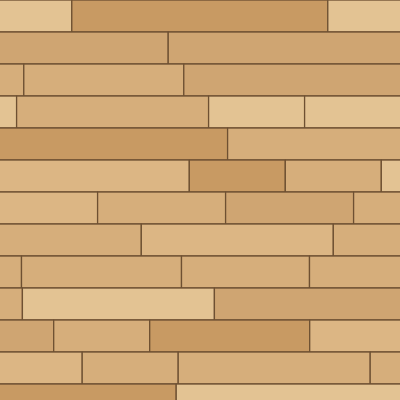</a>
        <figcaption>Schiffsboden</figcaption>
    </figure>
    <figure>
        <a href="../images/2026/11/parkett-englischer-verband.svg">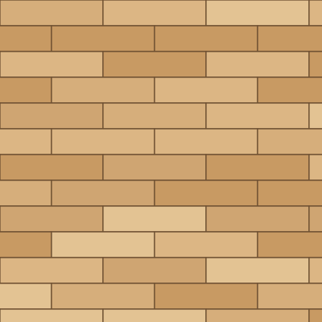</a>
        <figcaption>Englischer Verband</figcaption>
    </figure>
    <figure>
        <a href="../images/2026/11/parkett-oxford-verband.svg">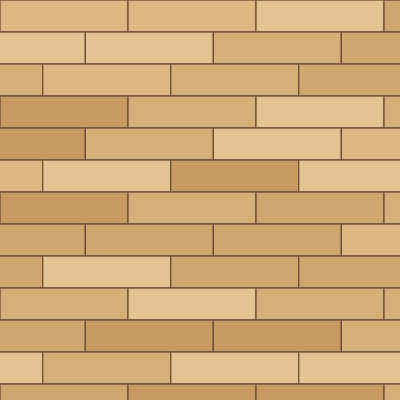</a>
        <figcaption>Oxford-Verband</figcaption>
    </figure>
    <figure>
        <a href="../images/2026/11/parkett-ohne-versatz.svg">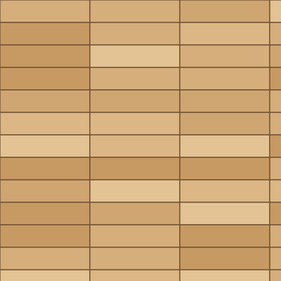</a>
        <figcaption>Ohne Versatz</figcaption>
    </figure>

## Fischgrät

Beim **Fischgrätmuster** (englisch *herringbone*) liegen rechteckige Stäbe im
90°-Winkel zueinander: Die Kopfseite eines Stabes stößt an die Längsseite des
nächsten. So entsteht ein Zickzack mit gezahnten Rändern. Durch die
wechselnde Richtung fällt das Licht auf jeden zweiten Stab anders, und das
Muster eignet sich gut für große Räume[^1].

* **Einfaches Fischgrät**: Je ein Stab pro Zacke.
* **Doppeltes Fischgrät**: Zwei (oder mehr) Stäbe liegen nebeneinander und
  bilden zusammen eine Zacke.
* **Französisches Fischgrät** (englisch *chevron*): Die Stäbe sind an den
  Kopfseiten um meist 30° oder 45° abgeschrägt und treffen sich auf einer
  Mittellinie. So entsteht eine durchgehende Zickzacklinie ohne Versatz[^1].

Beim **Leiterboden** wechselt sich eine Reihe parallel liegender Stäbe mit
einer quer dazu liegenden Einzelreihe ab. Liegt zwischen den Zickzackreihen
eines französischen Fischgrätmusters eine Reihe längs verlegter Stäbe, entsteht
ebenfalls ein Leiterboden[^1].

    <figure>
        <a href="../images/2026/11/parkett-fischgraet.svg">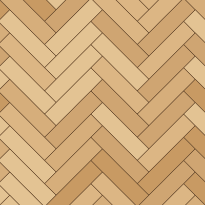</a>
        <figcaption>Einfaches Fischgrät</figcaption>
    </figure>
    <figure>
        <a href="../images/2026/11/parkett-doppeltes-fischgraet.svg">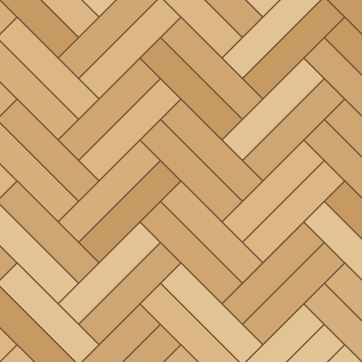</a>
        <figcaption>Doppeltes Fischgrät</figcaption>
    </figure>
    <figure>
        <a href="../images/2026/11/parkett-franzoesisches-fischgraet.svg">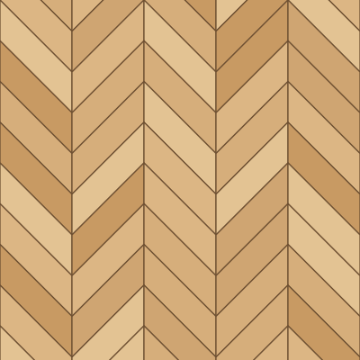</a>
        <figcaption>Französisches Fischgrät</figcaption>
    </figure>
    <figure>
        <a href="../images/2026/11/parkett-leiterboden.svg">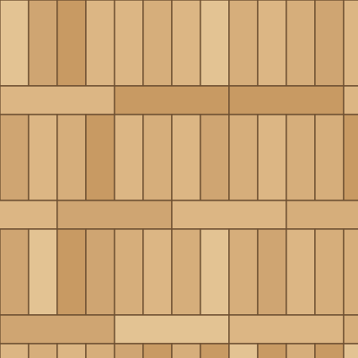</a>
        <figcaption>Leiterboden</figcaption>
    </figure>

## Würfel- und Flechtmuster

* **Würfelverband** (Schachbrett, englisch *checkerboard*): Mehrere Stäbe werden
  zu Quadraten zusammengefügt, die abwechselnd um 90° gedreht sind. Die
  Stablänge muss dafür ein ganzzahliges Vielfaches der Breite sein, zum
  Beispiel 49 × 7 cm[^1].
* **Flechtboden** (englisch *basket weave*): Pakete aus mehreren gleich langen
  Stäben, jedes um 90° zu seinen Nachbarn gedreht. Das sieht aus wie ein
  Korbgeflecht.
* **Flechtboden mit Würfel**: Die Stabpakete sind länger als breit, und die
  quadratischen Lücken dazwischen werden mit einem kleinen Parkettstück
  gefüllt[^1].
* **Altdeutscher Verband**: Je zwei gleich lange Stäbe liegen nebeneinander,
  zwischen den Stabpaaren liegt ein kurzer Stab quer. Die Doppelreihen sind um
  die Hälfte versetzt[^1].

    <figure>
        <a href="../images/2026/11/parkett-wuerfelverband.svg">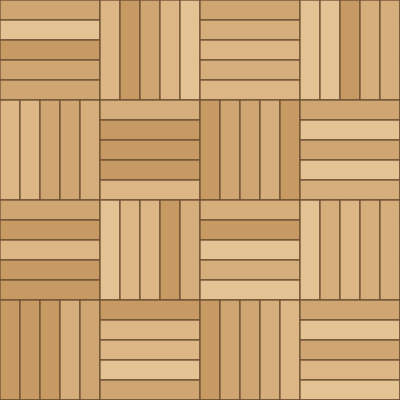</a>
        <figcaption>Würfelverband</figcaption>
    </figure>
    <figure>
        <a href="../images/2026/11/parkett-flechtboden.svg">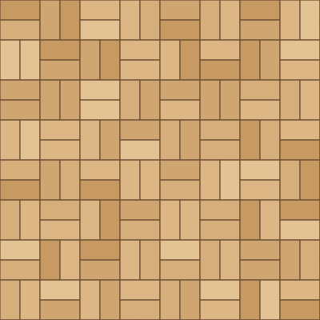</a>
        <figcaption>Flechtboden</figcaption>
    </figure>
    <figure>
        <a href="../images/2026/11/parkett-flechtboden-mit-wuerfel.svg">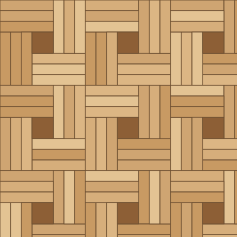</a>
        <figcaption>Flechtboden mit Würfel</figcaption>
    </figure>
    <figure>
        <a href="../images/2026/11/parkett-altdeutscher-verband.svg">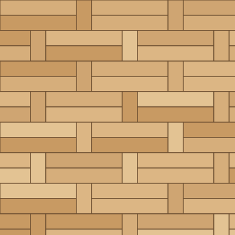</a>
        <figcaption>Altdeutscher Verband</figcaption>
    </figure>

## Mosaikparkett

Mosaikparkett besteht aus kleinen, nur 8 bis 10 mm dicken Lamellen, die meist
auf ein Netz geklebt zu Quadraten mit 12 oder 16 cm Kantenlänge geliefert
werden. Die häufigsten Muster sind Würfelverband, Parallelverband und
englischer Verband. Weil es so dünn ist, eignet es sich, wenn ein anderer
Bodenbelag ersetzt werden soll und die Fußbodenhöhe sich kaum ändern darf[^1].

Vorsicht bei alten Böden: Bis in die frühen 1960er-Jahre wurde Mosaikparkett
teilweise mit PAK-haltigen Klebern verlegt. Schwarzer Kleber unter altem
Parkett sollte man prüfen lassen, bevor man schleift oder herausreißt[^1].

## Tafelparkett: Versailles und Chantilly

<figure class="figure-right">
    <a href="../images/2026/11/parkett-versailles.svg">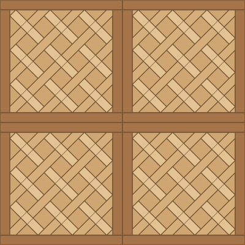</a>
    <figcaption>Versailles-Tafeln (vereinfacht)</figcaption>
</figure>

Beim **Tafelparkett** (auch *französisches Parkett*) werden geometrische Muster
zu quadratischen Tafeln verleimt, oft aus verschiedenfarbigen Hölzern. Die
Tafeln ergeben zusammen weitere Muster wie Rauten und Sterne[^1]. Bekannte
Tafelmuster sind **Versailles** und **Chantilly**, benannt nach den
französischen Schlössern.

Das Versailles-Muster besteht aus großen Tafeln mit diagonal verflochtenen
Stäben. Es wurde 1684 im Schloss Versailles als *parquet de menuiserie*
eingeführt und ersetzte dort Marmorböden, deren ständiges Wischen die
Deckenbalken darunter faulen ließ[^2].

## Einzelnachweise

[^1]: [Parkett](https://de.wikipedia.org/wiki/Parkett) via Wikipedia, abgerufen am 11.10.2026.
[^2]: [Parquet](https://en.wikipedia.org/wiki/Parquet) via Wikipedia, abgerufen am 11.10.2026.
