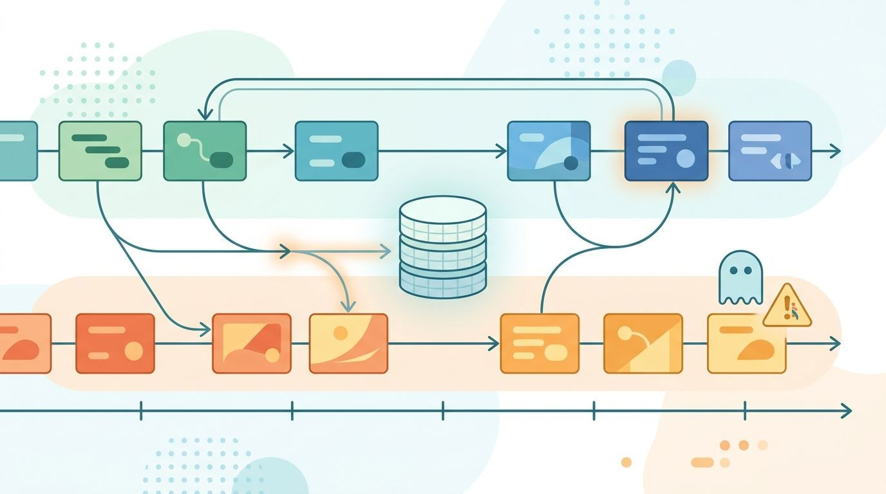
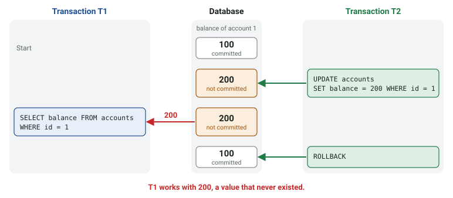
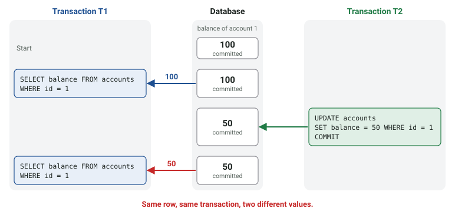
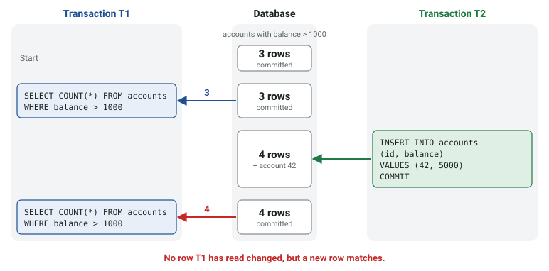

A web service rarely answers one call at a time. While one user transfers money,
another one looks at their balance, and a nightly job sums up all accounts. These
calls run concurrently, and they all work on the same central database. This comes
with its own set of problems: one call can see the half-finished work of another one.

The database protects against this with transaction isolation. In this article, you
will learn what the 3 best-known read phenomena are and which transaction isolation
levels fix them. Let's start!

<figure class="ai-generated">
    <a href="../images/2021/10/database-read-phenomena.jpg"></a>
    <figcaption>Concurrent transactions can read each other's changes.</figcaption>
</figure>

## The Basics

Databases organize multiple operations in transactions. You can imagine a database as a sequence of transactions. If a transaction is part of the database, we say it is committed. If a transaction fails, a rollback is executed. The transaction is undone.

The guarantees we want are summarized as ACID:

* **Atomicity:** a transaction happens completely or not at all. If the money is
  taken from one account, it also arrives on the other one.
* **Consistency:** a transaction takes the database from one valid state to
  another one; constraints like foreign keys and `CHECK`s hold.
* **Isolation:** concurrent executions of transactions don't lead to different
  results than serial executions. It should not matter if transactions are
  executed one after each other or in parallel.
* **Durability:** once a transaction is committed, it survives a crash.

The problems we will investigate in this article are called read phenomena and they occur when the isolation property is broken. Having a stronger isolation comes at a cost. The tradeoff is speed versus guarantees that certain problems don't occur. These guarantees are called transaction isolation levels.

In the following examples, two transactions T1 and T2 run at the same time on a
table `accounts` with a column `balance`. Time goes from top to bottom.


## Dirty Read

T1 reads data that T2 has written but not committed yet:

```sql
-- T2
UPDATE accounts SET balance = 200 WHERE id = 1;  -- was 100

-- T1
SELECT balance FROM accounts WHERE id = 1;       -- sees 200

-- T2
ROLLBACK;                                        -- 200 never existed
```

<figure>
    <a href="../images/2026/11/db-dirty-read.svg"></a>
    <figcaption>Dirty read: T1 reads a value that T2 never commits</figcaption>
</figure>

T1 now works with a value that was never part of the database. If it uses it
for a decision ("the customer can afford this"), the decision is wrong.


## Non-repeatable Read

T1 reads the same row twice and gets different values, because T2 changed and
committed it in between:

```sql
-- T1
SELECT balance FROM accounts WHERE id = 1;  -- 100

-- T2
UPDATE accounts SET balance = 50 WHERE id = 1;
COMMIT;

-- T1
SELECT balance FROM accounts WHERE id = 1;  -- 50
```

<figure>
    <a href="../images/2026/11/db-non-repeatable-read.svg"></a>
    <figcaption>Non-repeatable read: the same row has two values within one transaction</figcaption>
</figure>

Each read on its own is correct, but T1 doesn't see a single, consistent state.
A report that sums up values in several queries can end up with numbers that
never existed at the same time.


## Phantom Read

T1 runs the same query twice and gets a different *set* of rows, because T2
inserted or deleted rows that match the condition:

```sql
-- T1
SELECT COUNT(*) FROM accounts WHERE balance > 1000;  -- 3

-- T2
INSERT INTO accounts (id, balance) VALUES (42, 5000);
COMMIT;

-- T1
SELECT COUNT(*) FROM accounts WHERE balance > 1000;  -- 4
```

<figure>
    <a href="../images/2026/11/db-phantom-read.svg"></a>
    <figcaption>Phantom read: a new row matches T1's query</figcaption>
</figure>

The difference to the non-repeatable read: no row that T1 has seen was changed.
Locking the rows T1 has read doesn't help, because the new row didn't exist when
T1 read.


## Isolation Levels

The SQL standard defines four isolation levels by the phenomena they prevent:

<table>
    <tr>
        <th>Isolation Level</th>
        <th>Dirty Read</th>
        <th>Non-repeatable Read</th>
        <th>Phantom Read</th>
    </tr>
    <tr>
        <td>READ UNCOMMITTED</td>
        <td style="text-align: center;">💩</td>
        <td style="text-align: center;">💩</td>
        <td style="text-align: center;">💩</td>
    </tr>
    <tr>
        <td>READ COMMITTED</td>
        <td style="text-align: center;">✅</td>
        <td style="text-align: center;">💩</td>
        <td style="text-align: center;">💩</td>
    </tr>
    <tr>
        <td>REPEATABLE READ</td>
        <td style="text-align: center;">✅</td>
        <td style="text-align: center;">✅</td>
        <td style="text-align: center;">💩</td>
    </tr>
    <tr>
        <td>SERIALIZABLE</td>
        <td style="text-align: center;">✅</td>
        <td style="text-align: center;">✅</td>
        <td style="text-align: center;">✅</td>
    </tr>
</table>

✅ means the level prevents the phenomenon, 💩 means it can happen.

You set it per transaction:

```sql
SET TRANSACTION ISOLATION LEVEL REPEATABLE READ;
```

The real databases differ from the table in the details:

* **PostgreSQL** uses READ COMMITTED by default. READ UNCOMMITTED behaves like
  READ COMMITTED, so dirty reads never happen, and its REPEATABLE READ also
  prevents phantom reads ([docs](https://www.postgresql.org/docs/current/transaction-iso.html)).
* **MySQL** with InnoDB uses REPEATABLE READ by default
  ([docs](https://dev.mysql.com/doc/refman/8.0/en/innodb-transaction-isolation-levels.html)).
* **Microsoft SQL Server** and **Oracle** use READ COMMITTED by default.

Note the defaults: in most databases you get non-repeatable reads and phantoms
unless you ask for more.


## Beyond the three phenomena

The table suggests that REPEATABLE READ plus "no phantoms" is serializable. It
isn't. [A Critique of ANSI SQL Isolation Levels](https://arxiv.org/abs/cs/0701157)
(Berenson et al., 1995) showed more anomalies, for example:

* **Lost update:** T1 and T2 both read a counter (10), both add one and write
  11. One increment is lost. `UPDATE counters SET value = value + 1` avoids it,
  reading the value into the application and writing it back doesn't.
* **Write skew:** two doctors are on call, the rule is that at least one must
  stay. Both check "is someone else on call?", both see "yes", both sign off in
  separate transactions. Each transaction alone is fine, together they break the
  rule. Snapshot isolation, which many databases use for REPEATABLE READ, allows
  this; only SERIALIZABLE prevents it.


## Concurrency Control

Controlling the issues is also called concurrency control. There is optimistic
and pessimistic concurrency control:

* **Pessimistic** concurrency control locks data before using it. `SELECT … FOR
  UPDATE` locks the rows, and other transactions that want to change them wait.
  Safe, but waiting transactions slow everything down, and deadlocks are
  possible.
* **Optimistic** concurrency control uses no locks. It assumes conflicts are
  rare and checks at the end whether one happened, for example with a version
  column:

```sql
UPDATE accounts
SET balance = 150, version = version + 1
WHERE id = 1 AND version = 7;
-- 0 rows updated: someone else changed the row, retry
```

Most databases use multi-version concurrency control (MVCC) internally: readers
see a snapshot and don't block writers. At SERIALIZABLE, PostgreSQL aborts one of
two conflicting transactions with a serialization error, and the application has
to retry it.

Practical takeaways:

* Know the default isolation level of your database.
* Let the database do arithmetic (`value = value + 1`) instead of
  read-modify-write in the application.
* Use `SELECT … FOR UPDATE` or a version column when you read something in order
  to change it.
* If you use SERIALIZABLE, build retries into the application.


## See also

* Wikipedia: [Isolation (database systems)](https://en.wikipedia.org/wiki/Isolation_(database_systems))
